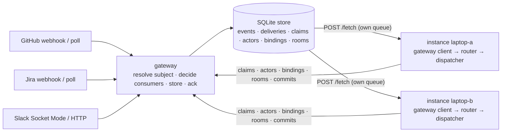

<!-- Written per the `the-loop:writing` skill. -->

# Capability: gateway

> One ingress process for many instances ([issue-496](https://github.com/MadaraUchiha-314/the-loop/issues/496)):
> the gateway owns every inbound transport — the GitHub and Jira webhooks, one Slack
> Socket Mode connection per app, the pollers — stores each event on its work item's
> subject **before** acknowledging the provider, and fans it out on write to the queue
> of every instance that consumes that subject. Instances poll their own queue and run
> no ingress of their own. **The instance-to-gateway boundary carries no authentication
> in this release** ([decision-146](../decisions/decision-146.md)): the gateway binds
> loopback unless `listen.exposed: true`, and an exposed gateway is readable, claimable
> and committable by any peer on that network — front it with the auth-terminating
> gateway of [decision-059](../decisions/decision-059.md) or keep it on a private
> network. Everything that judges a human (the authorized-actor guard, the control
> grammar, the Slack allow-list and grants, the GitHub and Jira posting tokens) stays on the
> instance. Since [issue-519](https://github.com/MadaraUchiha-314/the-loop/issues/519) the gateway also
> makes the **Slack Web API calls** its instances ask for, with the bot token it already
> holds for Socket Mode ([decision-151](../decisions/decision-151.md)): an instance behind
> a posting gateway needs no Slack token of its own.

## What it is

Several instances cannot share one Slack app (each listener is a second Socket Mode
consumer) or one webhook URL. The gateway is the one process that holds those
transports for a fleet. It knows **which work item** an event concerns (the subject)
and **which instances** consume it (the consumers), and nothing else: the provider's
payload travels verbatim to the instance, where today's pipeline — the router, the
dispatcher, the Slack classifier — runs unchanged on the same bytes it would have
received directly ([decision-145](../decisions/decision-145.md)).

The word *gateway*, unqualified, is this process; decision-059's is the
*auth-terminating gateway* ([decision-144](../decisions/decision-144.md)).

## Current behaviour

### The process

- `the-loop gateway start|stop|restart|status|subjects|instances` run the gateway the
  way `the-loop start|stop|status|restart` run the service: a pidfile under the
  gateway's own state root (`<state.root>/gateway.pid`) as the lock, a logfile beside it
  (`logs/gateway.out`), a foreground entry point (`python -m the_loop.gateway.serve`)
  for a supervisor. `--config` names the gateway's config, resolved like the CLI
  config's (`$THE_LOOP_GATEWAY_CONFIG`, `./.the-loop/gateway-config.yaml`,
  `~/.the-loop/gateway-config.yaml`).
- `gateway-config.yaml` is validated against the fourth shipped schema,
  `gateway-config.schema.json`, and a violation refuses to start naming each key. Every
  secret is an environment-variable **name** (`*Env`); a pasted value fails the schema's
  pattern. The file's `env.file` is loaded first, under the CLI config's rules.
- The file is re-read on the five-second hash cadence: the enabled set of ingresses is
  applied as membership (`config.reloaded`, `gateway.reloaded`); a bad edit keeps the
  previous configuration (`config.reload-failed`) and stops nothing; the listen
  address, the Slack tokens and the store path are start-time only, and `gateway
  status` says `restart required` while the file differs from the running values.
- A missing secret variable leaves that ingress off (`ingress.hosted_failed:
  missing-secret`, health `failed:missing-secret`) and the rest serves. A non-loopback
  bind without `listen.exposed: true` exits 2, and so does a `store.path` or event-log
  path that resolves outside `state.root` — the gateway writes under its root only.
  The default port is 8790, beside the
  service's 4114 and the stdlib receiver's 8787, so all three start on one laptop with no
  configuration.
- The gateway spawns nothing and holds no harness credential and no GitHub or Jira
  posting token; its GitHub poll token needs read access only. It does hold the Slack
  app's bot token — Socket Mode cannot start without it — and since issue-519 it posts
  with it for the instances (§ Outbound Slack).

### The transports

- `POST /gh-webhook` is GitHub's contract verbatim (`X-Hub-Signature-256` verified
  before the body is parsed; 401 stores nothing; 202 after the write; 500 when the store
  fails, so GitHub retries), so a webhook configured for an instance is re-pointed at the
  gateway without change. `POST /jira-webhook` is the doorbell's (`X-Hub-Signature`,
  404 without a secret).
- Slack Socket Mode is one connection per app for the life of the process, reconnecting
  on loss, never a second. The envelope is acknowledged **after** `store.append`
  returns, inside Slack's three seconds; a store failure withholds the ack so Slack
  redelivers. The doctor's heartbeat is consumed by the connection that heard it and
  never stored. The HTTP routes (`/slack/events`, `/slack/interactions`,
  `/slack/commands`) sit behind `slack.http.enabled`, verify the `v0` signature within
  the 300 s replay window and answer `url_verification`. Under a gateway Slack is read
  over Socket Mode **only**, so the mention rule of issue-389 is what applies on every
  instance: a plain `message` in a room or in a bound thread is `not-addressed`, and the
  mention arrives as the `app_mention` event — the app must hold `app_mentions:read` and
  subscribe to `app_mention` (an app installed before issue-389 needs the manifest
  re-applied and a reinstall; `the-loop channels status --probe` lists the granted
  scopes). The poll reader (`read.mode: poll`), which took every reply in a bound thread
  as input, does not run under a gateway.
- The gateway's poller (opt-in) reuses the instance poller's providers (GitHub, Jira) and
  produces the same delivery ids and webhook-shaped payloads (`poll-comment-<id>`,
  `poll-presence-<ref>-<uuid>`, `poll-close-…`); its ledger lives in the store. At its
  first sight of an item the existing thread is baselined, not stored — the presence
  alone is offered and the spawned session reads the thread itself, as the instance
  poller does — so a new gateway never replays a history as deliveries; the instance
  poller's exception for an unprocessed control command is not reproduced (the gateway
  runs no control grammar), so a start posted before the first listing is posted again. A
  comment seen by webhook and by poll stores one row (the cross-transport dedup key: a
  comment by its id and a review by its id — an edit or a deletion of either is its
  own event, keyed on the action and its time — an issue or PR action by object, `updated_at`
  and the label, assignee or requested reviewer it names, a closure by `closed_at`, CI
  by ref, name and conclusion), so the poller is the reconciliation path. Presence is
  offered while an instance has not judged the item started, never twice at once — a
  presence held with no consumer counts as offered; the instance's commit outcome
  (`spawned`, `dropped:awaiting-start`, …) updates the ledger across the process
  boundary.

### Outbound Slack (issue-519)

- **A pass-through, no state.** `POST /api/v1/gateway/slack/call {instance, peer, method,
  params}` makes one Slack Web API call with the gateway's bot token and returns Slack's
  status, body and `Retry-After` verbatim, `ok: false` included; `POST
  /api/v1/gateway/slack/download {url}` fetches a message's file under the instance's own
  rules (Slack's hosts only, every redirect re-checked, 25 MiB). Nothing is stored,
  queued or retried on the gateway; a call it cannot make fails the instance's post.
- **Three checks and the usual guards.** `slack.post.enabled` (default `true`,
  hot-reloaded), the bot token variable set, and the method in a flat allow-list of the
  fourteen Slack methods the instance calls (`422 method-not-allowed`, nothing sent,
  otherwise) — so the gateway is not a generic bot-token oracle. Posting off or no token
  is `503 posting-unavailable {reason: disabled | no-token | socket-unconfigured}`; a
  transport failure `502 slack-unreachable`. The `instances` allow-list and the peer lease
  apply as on every consumer route (`409`). Bodies are bounded at the door (`method ≤ 64`,
  `params ≤ 256 KiB`, `url ≤ 2048`).
- **Said, not mitigated.** The owner chose a pass-through over a per-instance channel
  registration at the design review: any peer the gateway accepts may post as the bot
  wherever the bot can see (decision-146's posture, now stated for posting too). The
  token never leaves the gateway process and never reaches a log line:
  `gateway.slack_call` carries instance, method, channel, status and `ok`;
  `gateway.slack_download` the host, status and size or reason.
- **Health says whether it posts.** `GET /api/v1/gateway/health` carries
  `slack.posting: on | disabled | no-token | socket-unconfigured`; `the-loop gateway
  status` prints `slack posting:` and carries `slackPosting` in `--format json`.

### Subjects, queues, consumers

- Every stored event is on the subject `loop-<slug>` of its work item — the tmux slug —
  with the ten-field envelope of the contract: `id`, `subject`, `provider`, `source`
  (`webhook | socket | poll`), `deliveryId`, `receivedAt`, `workItem`, `kind`, `headers`
  (an allow-list), `payload` (verbatim), `attempt`.
- The gateway resolves only the reference a payload names directly, the bindings
  instances have published and the repositories, projects and rooms declared in its
  config. A pull request with no binding is its own subject; the instance that receives
  it recognises the linkage with today's router inference and publishes the binding;
  what was held on the pull request's own subject before the binding is routed onto
  the work item's claimants by it.
- A Slack event resolves, in order: the **thread binding** `<channel>:<thread_ts>`, then
  the **room** an instance published for the channel (issue-505), then the static
  `slack.rooms` of `gateway-config.yaml`, else it is held under `<channel>:<ts>`. A room
  is a work item's collaboration channel (`slack@C…`, issue-375): every message in it is
  about that work item, so a top-level message from any collaborator routes to the work
  item's claimants, whoever registered the author. `slack.rooms` remains for a room no
  instance declares. An object that can start no
  work item is dropped (`gateway.dropped: unbound`).
- Consumers are decided **on write**, in order: the claimants of the subject and of each
  linked subject (a PR's ticket), else the one instance that registered the event's
  actor, else none — the event is held on `unassigned` (`subject.routed: unassigned`)
  and routed when a claim, a binding or an actor registration later covers it
  (`PUT /actors` answers `routed`). One delivery row per consumer, in the same
  transaction as the event.
- **One queue per instance.** `POST /api/v1/gateway/fetch` identifies the instance by
  `instance.name` (`default` when unset) and a persisted `peer` id; refreshes the
  name's lease (a second peer under a live name is `409 duplicate-instance` — at
  `PUT /actors`, `POST /commit` and the claim routes as at fetch, so it replaces,
  commits and releases nothing of the holder's); commits the previous batch (a seq
  this queue never fetched is `409 commit-undelivered`, nothing applied, and the
  client drops that batch rather than resend it); reads the next deliveries after
  `max(cursor, committed)` with
  `attempts` incremented; and holds an empty fetch open for `wait` seconds (clamped to
  `consume.maxWaitSeconds`) until something is appended — an append that lands between
  the empty read and the wait is not a lost wake-up, and a fetch that wakes after its
  own lease lapsed re-checks the name's holder before it reads. `POST /commit` is the step alone,
  for a stop. No streaming route exists.
- At-least-once: a delivery not committed comes back with `attempt + 1`; past
  `store.maxAttempts` it is committed as dead-lettered and kept for inspection. The
  instance's dedup layers drop a true duplicate. An optional `instances` allow-list
  refuses an unknown name (`409 unknown-instance`).
- Retention deletes committed deliveries after `store.retentionDays`, dead rows after
  twice that, and expires pending deliveries and held events older than retention
  (`subject.expired`); a retired dedup key is kept in a bounded table so a late
  redelivery is still recognised.

### The instance side

- A `gateway` block in `cli-config.yaml` (`url` required; `pollIntervalSeconds` 5,
  `longPollSeconds` 20, `actors` by provider) adds the **gateway client** to the hosted
  set and switches off one thing: the Slack listener (and the poll reader), because one
  app has one Socket Mode connection and the gateway holds it. The webhook receiver and
  the poller run exactly as `webhooks` and `polling` say, gateway or not; `the-loop
  status`, `the-loop start` and health read `off · gateway configured` for the listener
  alone. Without the block, exactly as before. The instance's
  `channels.slack.read.mode` beside the block is `gateway` (issue-503): no socket here,
  every interactive feature on under its grants, and a deleted block reads nothing rather
  than opening a second socket. 20.3.0's `socket` there keeps working, is flagged in the
  log and in `channels status`, and `migrate-config` rewrites it. `channels listen`
  refuses to open a socket while the block is present. The gateway's own GitHub and Jira pollers
  are opt-in (`github.poll.enabled`, `jira.poll.enabled`, off in the template): the
  gateway is the webhook receiver and the Slack connection unless no inbound webhook is
  possible, in which case it polls for the fleet.
- The client registers first (`PUT /actors`, then every live session's claim
  re-asserted), polls its queue with the server's `committed` as cursor (or the
  highest delivery whose dispatch is still in flight, so nothing is fetched twice
  while a resume is spawning), dispatches
  each delivery through today's pipeline by provider — the router and dispatcher for
  GitHub, the Jira doorbell, `slack.dispatch_envelope` for Slack — under
  `gateway_event_id` on every `dispatch.*` record, and sends the outcomes with its next
  fetch (`delivered` | `spawned` | `dropped:<reason>` | `failed`; a dispatch still in
  flight is asked again before each fetch, so a commit never runs ahead of the
  dispatcher). `the-loop stop` flushes with `POST /commit`.
- A registered session publishes a claim — `driver` for a ticket, `reviewer` for a pull
  request whose control command is `review` — and releases it when it closes; a linked
  pull request and a bound Slack thread publish bindings. A binding names its instance
  and peer like a claim: allow-listed, refused for a stale peer under a live name, and
  recorded as `gateway.bound`, so a binding that redirects a subject is never anonymous.
- The instance publishes its Slack collaboration channels as **rooms** with
  `PUT /api/v1/gateway/rooms` (issue-505): the whole set `{channel id: work item ref}`,
  replacing the instance's previous one. It publishes at every registration (so a gateway
  that lost its store, or a room removed while the instance was stopped, is repaired),
  at once when a declaration changes in the daemon (`CollaborationChannelStore.on_change`),
  and every 30 s for a change another process made (`the-loop channels add`). A new room
  drains the events held under its channel's keys onto the work item's subject. A room
  another instance holds with a live lease stays the holder's and is reported in
  `refused` (`gateway.refused: duplicate-room`); an instance can replace or retract only
  its own rooms; a pruned instance's rooms go with it. Each publication is recorded as
  `gateway.rooms`, and `GET /api/v1/gateway/instances` lists each instance's rooms. A
  room moves events and grants nothing: the instance applies `channels.slack`'s
  principals, the room's listen mode, `routing.authorizedUsers` and the roster to what it
  is handed.
- **Posting through the gateway** (issue-519). The instance's Slack client comes from one
  resolver, `outbound_client()`: its own bot token first (`channels.slack.botTokenEnv`,
  unchanged for every deployment that has one), else — with a `gateway` block — a
  gateway-backed client with the SDK's method names, each call one `POST /slack/call`;
  neither is today's `ChannelError`, now with the gateway hint. The channel, the name→id
  directory, the doctor and the attachment fetcher (through `/slack/download`) all use
  it, so a thread opens, is bound and is published exactly as with a local token. A
  gateway that is unreachable or refuses **fails the post** — one error, no fallback to
  a token, no retry logic of its own; the existing outbox treats it like any failed Slack
  call. `GET /api/v1/gateway` carries `slackPosting` from the gateway's health and the
  Gateway card reads `connected · long-poll · posting via gateway`.
- **The instance says when nothing can post** (issue-519). With Slack enabled and no
  posting path — no token, and no gateway or a gateway reporting posting off (or one that
  could not be asked at start) — `the-loop start` logs one warning naming the variable
  and emits `channel.posting_unavailable`, then starts anyway; `the-loop status` appends
  `outbound Slack needs <var> on this instance` to the gateway-client row (or `posting
  through the gateway` when that is the path); `channels status` prints a `posting:` line
  and a `[!]` finding; `doctor slack` an `[ok]` / `[!]` / `[?]` gateway line, and its
  heartbeat probe is `unverifiable` with the same reason. Slack disabled prints none of it.
- When the gateway is unreachable the instance keeps running, records
  `gateway.unreachable` once, retries with back-off (1 s → 60 s), records
  `gateway.connected` on recovery, and **never** falls back to its own ingresses. A
  `409` is logged with the holder and retried on the same schedule. A fetch answer
  that is not the contract's shape (a missing field, a non-list, an unknown provider,
  more than 64 MiB) is treated as the gateway being unreachable, never as an exception
  that ends the hosted client: the gateway's answers are untrusted input to the
  instance. A loopback URL is
  treated exactly as a remote one. A peer id never leaves the gateway: a 409 and
  `gateway instances` carry a fingerprint of the holder's id (eight hex characters of
  its SHA-256), because the id admits a fetch under the name.
- `GET /api/v1/gateway` on the instance API serves the client's document; the
  dashboard's instance pane renders it as the Gateway card (the state in words beside a
  decorative dot: `connected · long-poll`, `connecting · attempt n`, `refused · duplicate
  instance (409)`, `unreachable · retrying`, `not configured`; the queue table by subject
  and role). `the-loop doctor slack` counts the gateway's connection as the app's one
  listener.

### Observability

- Two event families on the existing JSONL log: `gateway.*` (`started`, `stopped`,
  `received`, `dropped`, `refused`, `reloaded`, `claimed`, `released`, `registered`,
  `unreachable`, `connected`, `bound`) and `subject.*` (`appended`, `routed`, `committed`,
  `redelivered`, `dead-lettered`, `expired`). The payload never reaches a log line; a
  length-capped summary does.
- `the-loop gateway subjects` lists every subject with its claimants, events, held,
  pending and dead counts and the oldest uncommitted age; `gateway instances` every
  instance with its lease, last fetch, backlog, actors and claims; `gateway status` the
  pid, the ingress states, the Socket Mode state, the store, the live instances and
  what needs a restart.

### What it does not do

- What an unauthenticated peer may do is bounded (security review, round 1): every
  body field has a length and the providers an enum (a 422 at the door writes nothing);
  at most one open long-poll per name and 32 in all, the rest answer as plain polls,
  and 256 open requests before the server answers 503; retention prunes a name whose
  lease lapsed with nothing queued (its claims, actors and condition) and a subject with
  nothing left; `/health` carries no path and no bind address. On the provider side a
  declared body above 25 MiB is a 413 before it is read, a header value chosen by an
  unauthenticated peer is clipped to 200 characters before it is logged, and a
  non-ASCII signature is a 401. `gateway status --format json` lists each declared
  secret name as set or unset (`secretsSet`), never a value; a Jira poller without its
  secrets is off at start like the GitHub one.
- No instance authentication (decision-146), no work-item lease over claims (one user's
  subjects on several instances), no multi-replica gateway; the `Store` interface is the
  seam for the last, and the allow-list check is where a bearer token attaches.
- The gateway runs no control grammar and no authorization: a forged event through the
  gateway is a forged event at the instance, judged as it always was. It does post to
  Slack for its instances (issue-519), and because the boundary carries no authentication
  an exposed gateway lets any peer on that network post as the bot; `slack.post.enabled:
  false` turns that off.

## Design

[`docs/specs/issue-496/design.md`](../specs/issue-496/design.md) ·
[decision-144](../decisions/decision-144.md) (the name) ·
[decision-145](../decisions/decision-145.md) (the queue contract) ·
[decision-146](../decisions/decision-146.md) (no instance auth) ·
[the contract](../api-specs/openapi/the-loop-gateway.v1.yaml) ·
[`gateway` command](../cli/commands/gateway.md) ·
[moving to a gateway](../guide/gateway.md) ·
[gateway options](../config/cli/gateway-options.md) (the instance's block) ·
[instances](instances.md) · [channels](channels.md) · [webhook-triggers](webhook-triggers.md)
· [control-plane](control-plane.md) · [observability](observability.md)

## History

| Work item | What changed | Links |
|-----------|--------------|-------|
| issue-519 | **Outbound Slack through the gateway, and a loud failure when it cannot** (2026-10-23): `POST /api/v1/gateway/slack/call` and `/slack/download` make Slack Web API calls and file downloads for an instance with the bot token the gateway already holds — a pass-through behind `slack.post.enabled` (default on), a flat allow-list of the fourteen methods the instance calls and the usual consumer guards, no state, no retry; `health.slack.posting` and `gateway status` say whether it posts. On the instance one resolver picks the posting path (own token first, else the gateway, else today's error with the gateway hint) for the channel, the directory, the doctor and attachments; `start`, `status`, `channels status` and `doctor slack` say which path is in use and name the missing variable when nothing can post. The owner withdrew a per-instance channel registration at the design review: any accepted peer may post wherever the bot can | [spec](../specs/issue-519/), [decision-151](../decisions/decision-151.md), [issue](https://github.com/MadaraUchiha-314/the-loop/issues/519) |
| issue-505 | Collaboration channels reach the gateway (2026-10-20): the instance publishes its declared Slack channels as rooms (`PUT /api/v1/gateway/rooms`, a replace-set per instance), the gateway resolves a Slack event through a published room after the thread binding and before `slack.rooms`, a late room drains the channel's held events, a live holder keeps its room, and `GET /instances` lists rooms. A collaborator's top-level message in a declared room is no longer held | [spec](../specs/issue-505/), [issue](https://github.com/MadaraUchiha-314/the-loop/issues/505) |
| issue-503 | The instance side gets `channels.slack.read.mode: gateway` (2026-10-20): the explicit "no Socket Mode here" setting, with interactivity keyed on reachability rather than on `socket`; fail closed without a block; `migrate-config` rewrites 20.3.0's `socket` beside a block | [spec](../specs/issue-503/), [channels](channels.md), [issue](https://github.com/MadaraUchiha-314/the-loop/issues/503) |
| issue-496 | The capability, whole (2026-10-19): the gateway process and its verbs, `gateway-config.yaml` and schema, the GitHub/Jira/Slack transports, the SQLite store with subjects and one queue per instance, consumers resolved at ingest by claim then actor, pull with commit and long-poll, at-least-once with dead-letter, the instance's `gateway` block and client, claims and bindings published by the instance, `GET /api/v1/gateway`, the Gateway card, the two event families | [spec](../specs/issue-496/), [decision-144](../decisions/decision-144.md), [decision-145](../decisions/decision-145.md), [decision-146](../decisions/decision-146.md), [issue](https://github.com/MadaraUchiha-314/the-loop/issues/496) |
