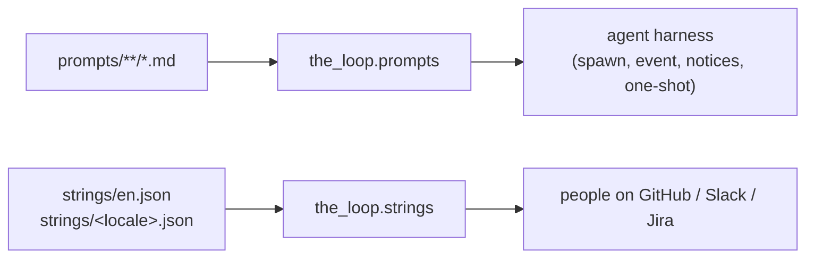

<!-- Authored per the the-loop:writing skill. -->

# Capability: prompts and strings

> Every prompt the CLI sends to an agent is a Markdown file. Every catalogued
> human-facing message comes from one JSON file. Prose is edited as data, and
> the-loop can be localised without touching code.

## What it is

Two small stdlib modules and two data directories inside the `the_loop` package:

| Piece | Path | Read with |
|---|---|---|
| prompt files | `cli/the_loop/prompts/<area>/<name>.md` | `prompts.load(name)`, `prompts.render(name, **slots)` |
| string catalog | `cli/the_loop/strings/en.json` (+ `<locale>.json`) | `strings.t(key, **vars)`, `strings.section(prefix)` |

Python call sites keep the logic: which fragment, in which order, under which
condition. The words live in the files.

## Current behaviour

### Prompts

- The CLI SHALL keep every prompt and prompt fragment it sends to an agent harness as a
  `.md` file under `cli/the_loop/prompts/`, read through `the_loop.prompts`.
- `prompts.load(name)` SHALL return the file verbatim. `inline=True` drops its one
  trailing newline, for a fragment joined into a line.
- A prompt name SHALL be lowercase slash-separated segments (`graph-context/header`).
  Any other name, `..` included, SHALL raise `ValueError`.
- IF a prompt file is missing THEN the CLI SHALL raise `FileNotFoundError` naming
  `prompts/<name>.md`. A blank prompt is never sent.
- The webhook templates (`webhook/event.md`, `webhook/autoexecute.md`) SHALL use
  `string.Template` `$slots`, the syntax an operator's `routing.promptTemplate` uses.
  Every other prompt SHALL use `str.format` `{slots}`. Both are single-pass: a `$x` or
  `{x}` inside an untrusted value is inserted literally.
- `skills/the-loop/templates/webhook-event-prompt.md` and
  `webhook-autoexecute-prompt.md` SHALL be byte-identical to the packaged webhook
  prompts. They are what operators read and copy, and a test pins them.
- Prompt files are excluded from markdownlint. A prompt is a byte-for-byte contract,
  and a lint fix would change what the agent reads.
- A test (`cli/tests/test_prompts_guard.py`) SHALL fail when a module defines a
  multi-line string constant whose name says it is a prompt (`*PROMPT*`,
  `*DIRECTIVE*`, `*TEMPLATE*`, `*NOTICE*`, `*NUDGE*`).

**Areas today:** `webhook/`, `interaction/`, `graph-context/`, `assignment/`,
`prnotice/`, `cimonitor/`, `attachments/`, `sessions/`, `standing/`, `selfdiagnosis/`,
`mcp/`, `modelprobe/`, `codex/`.

**Left inline, on purpose:**

- MCP tool docstrings in `api/mcp.py`. They double as the Python API docs and are
  pinned by the API/SDK parity tests.
- `hooks/the-loop-gate.py`. It runs without the package installed.
- `codex_support.conversation_marker`. A machine token, matched back against Codex
  rollouts.
- Graph hook messages and CLI envelopes. The agent reads them as CLI output.
- Prompts the caller supplies: critic prompts, standing-session briefs, API `prompt`
  fields.

### Strings

- `cli/the_loop/strings/en.json` SHALL be one flat JSON object of dotted keys
  (`slack.title.decision-pending`) to message text with named `{fields}`.
- `strings.t(key, **vars)` SHALL return the active locale's text for `key`, falling back
  to `en`, formatted with `vars`. IF `key` is absent from `en` THEN it SHALL raise
  `KeyError` naming the key.
- The active locale SHALL be the one passed to `strings.set_locale`, else
  `THE_LOOP_LOCALE`, else `en`. A locale name SHALL match `^[a-z]{2,3}([_-][A-Za-z0-9]{2,8})*$`.
- IF a locale's file is missing THEN lookups SHALL fall back to `en` silently. IF it is
  malformed THEN the CLI SHALL log one warning and fall back to `en`. An `en.json` that
  fails to parse SHALL raise.
- `strings.section(prefix)` SHALL return `{suffix: text}` for every key under the prefix.
  The migrated per-module dictionaries keep their `Dict[str, str]` shape this way. A
  module captures the locale active when it is imported.
- Tests SHALL verify that every key the code looks up exists in `en.json`, that every
  catalog entry is used, and that each `t` call passes exactly the fields its text uses.

**Catalogued today:** `dispatcher.refusal.*`, `slack.kickoff-refusal.*`,
`slack.command-description.*`, `slack.command-button.*`, `slack.button.*`,
`slack.title.*`, `attachments.reason.*`, `bodies.mirror.*`, `digest.pointer.*`,
`quiz.title.*`.

**Not catalogued yet:** free-form f-strings in comment builders, CLI stdout and
`argparse` help, and the UI. These migrate module by module onto this catalog in
follow-up work. Log lines and exception messages stay in English: they are for
operators and are grepped.

### Adding things

- **A prompt:** write `cli/the_loop/prompts/<area>/<name>.md`, then call
  `prompts.load("<area>/<name>")` or `prompts.render(...)` where the text is used.
- **A message:** add `"<module>.<what>.<code>": "…"` to `en.json`, then call
  `strings.t("<module>.<what>.<code>", …)`.
- **A locale:** add `cli/the_loop/strings/<locale>.json` with the keys you translate.
  Run with `THE_LOOP_LOCALE=<locale>`.

## Design

- [`docs/specs/issue-540/design.md`](../specs/issue-540/design.md): the loader, the
  lookup, the inventory, and the security design (single-pass substitution, keys from
  code only).

## History

| Work item | What changed | Links |
|---|---|---|
| issue-540 | Created: prompts moved to Markdown files; the string catalog and its first keyed dictionaries | [spec](../specs/issue-540/requirements.md) · [#541](https://github.com/MadaraUchiha-314/the-loop/pull/541) |
