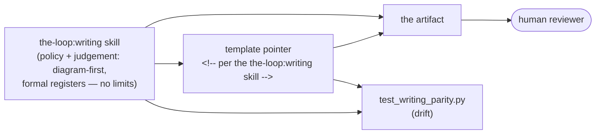

# Capability: writing-style

> How the-loop writes the artifacts a human has to read — the shape, the register and
> the diagram rule that keep them readable.

## What it is

A reviewer approving a work item reads `requirements.md`, `design.md`, `testing-plan.md`
and the PR briefing. Before issue-165 nothing set a shape, a length or a register for
them, and the harness's only verbosity rule (the token-economy guidance's concise
narration) compresses *chat narration* while explicitly **preserving** specs — aimed away
from the documents the reviewer actually opens.

This capability is the writing contract: a bundled **`the-loop:writing`** skill carrying
both the judgement and the policy (diagram-first, the formal-register carve-out), a
pointer to the skill in each human-read template, and a parity test catching the drift
prose cannot. Nothing about it is configured — until issue-352 the policy half sat in a
`userInteraction.writingStyle` block of the harness config; the skill is now the contract
on its own.

It carries **no length limits**, deliberately. A work item's scope is not known in
advance, so a number that fits a two-line bug fix is wrong for a new subsystem, and a cap
only pushes prose into an appendix ([decision-061](../decisions/decision-061.md)). The
test is density, not length — and density is a review judgement.

## Current behaviour

- the-loop SHALL bundle a second skill, `skills/writing/`, discoverable by the Agent
  Skills standard and resolving as **`the-loop:writing`**; its `reference/tells.md` holds
  the tells catalogue, loaded only for a revise pass so the skill body stays short.
- WHEN an artifact a human reads is authored or revised THEN it SHALL follow that skill:
  the bottom line first, then the reasoning as a story in connected sentences; the
  four-part spine (what was broken → what we did → what it costs → what to check);
  conclusion-first sections; and the revise pass.
- The skill SHALL carry three rules borrowed from Simplified Technical English
  (sentences of about 25 words, one idea per sentence, no stack of more than three
  nouns) and plain-language habits ("you", present tense, short words, verbs as verbs).
  The STE dictionary is not adopted. Numbered steps take one imperative action each.
- Every human-read spec template (`brainstorm.md`, `requirements.md`, `bugfix.md`,
  `design.md`, `testing-plan.md`, `tasks.md`) and the PR briefing SHALL open with a card,
  `## The short version`: what changes, why, and what to check. The skill gives it a
  soft guide of about 120 words that nothing measures
  ([decision-152](../decisions/decision-152.md)). Detail only some readers need goes in
  a reference layer at the end or in a collapsed block; gated sections stay put.
- `design.md` SHALL hold Interfaces, Architecture and Technology choices (then Security
  design and Testing strategy) and SHALL carry no function or method names, signatures,
  class layouts, algorithms, code snippets, internal data structures or file-by-file
  change lists.
- The PR briefing SHALL carry a 1–5 review-effort score and a guided tour: ordered stops,
  each a link to a line in the diff with one sentence on why it matters.
- Each template producing a human-read artifact SHALL name the governing skill in a
  pointer comment, so an author starting from the template is governed by the contract
  without having to know it exists.
- The contract SHALL declare **no length limits**. WHEN an artifact is judged too long
  THEN the test SHALL be density — whether a sentence can be removed without losing
  information — assessed in review, never by a gate. A sentence that links two ideas
  ("because", "so") counts as information.
- IF shortening a document would delete a gated section THEN the section SHALL stay,
  recorded empty with its reason. Concision governs words, not coverage.
- WHERE prose would describe a structure, sequence or state change with three or more
  named parts THEN a mermaid diagram SHALL be authored instead (the skill's diagram-first
  rule); `design.md` carries at least one.
- The skill's fixed formal registers — EARS acceptance criteria, abuse cases, API
  contracts, JSON-Schema descriptions, RFC-2119 keywords — SHALL NOT be relaxed into
  informal prose. Explanation around them is ordinary prose.
- A revise pass SHALL NOT rewrite quoted material, code, committed evidence, third-party
  text, or historical specs under `docs/specs/`.
- `cli/tests/test_writing_parity.py` SHALL assert the mechanical half of the contract
  (the skill parses, every human-read template points at it, the pointer names the
  bundled skill, no length limits have crept back in, no P0 tell reaches shipped prose,
  every card template opens with `## The short version`, the design template has its
  sections in order, the briefing has review effort and a guided tour, and the review
  reference carries the standing checks)
  and SHALL NOT assert whether a document is well written or how long it is — presence
  is mechanical, quality is a review item.
- Production-code comments SHALL explain the code in its own terms and SHALL NOT cite
  work items, decisions, requirement ids, review rounds or spec files; test docstrings
  keep their `Requirement:` links. The rule applies going forward, and every self-review
  and critic round checks it, with the `design.md` level check, as a standing check
  (`reference/reviewing.md`).
- Third-party writing skills SHALL NOT be vendored ([decision-062](../decisions/decision-062.md));
  the-loop implements their techniques natively and the harness discovers whatever skills
  it has itself — there is no registry to add them to.

## Design

[`docs/specs/issue-165/design.md`](../specs/issue-165/design.md) ·
[literature survey](../specs/issue-165/brainstorm.md) ·
[`skills/writing/SKILL.md`](../../skills/writing/SKILL.md) ·
[`reference/token-economy.md`](../../skills/the-loop/reference/token-economy.md) (the
neighbouring, output-side guidance)

## History

| Work item | What changed | Links |
|-----------|--------------|-------|
| issue-544 | Story-first, layered artifacts: the bottom line then a story, three borrowed STE rules and plain language; the `## The short version` card on every spec template and the PR briefing (soft ~120-word guide); `design.md` reshaped to Interfaces, Architecture and Technology choices with no code-level detail; the code-comment rule and the standing review checks; review effort and a guided tour in the briefing | [spec](../specs/issue-544/), [decision-152](../decisions/decision-152.md), [issue](https://github.com/MadaraUchiha-314/the-loop/issues/544) |
| issue-352 | The `userInteraction` block left the harness config (2026-09-12): the writing contract is the `the-loop:writing` skill itself — diagram-first, fixed formal registers, no length limits (decision-061) — with mermaid diagrams, the mandatory PR briefing and educating the user fixed rules rather than settings. `externalTools` left too; third-party writing skills are neither vendored nor registered | [spec](../specs/issue-352/), [decision-123](../decisions/decision-123.md), [issue](https://github.com/MadaraUchiha-314/the-loop/issues/352) |
| issue-165 | Introduced the capability: the `the-loop:writing` skill and its tells catalogue, `userInteraction.writingStyle` (diagram-first, formal carve-out), a skill pointer in eight templates, and `test_writing_parity.py`. Per-artifact word budgets were proposed and **rejected in review** — scope is not knowable in advance | [spec](../specs/issue-165/), [decision-061](../decisions/decision-061.md), [decision-062](../decisions/decision-062.md), PR #168 |
