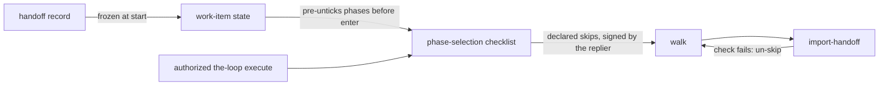

<!-- Written per the `the-loop:writing` skill. -->

# Decision 150: A handoff pre-fills phase selection rather than bypassing it

- **Status:** accepted (the owner approved the design at `design-approval`, 2026-10-21)
- **Date:** 2026-10-21
- **Deciders:** MadaraUchiha-314 (the ask and the design approval), the-loop (the
  mechanism)
- **Work item:** [issue-517](https://github.com/MadaraUchiha-314/the-loop/issues/517)
- **Spec:** [`docs/specs/issue-517/`](../specs/issue-517/) (design § Trade-offs & decisions)
- **Keeps:** [decision-068](decision-068.md): `phase-selection` is the outer loop's one
  unskippable node, and an authorized reply to it is the only act that authorizes a walk.

## Context

Issue-517 lets a developer hand a conversation with Claude to the-loop at the stage it
reached: still exploring, brainstorm settled, requirements settled or design settled.
The issue asked for "one command, one confirmation": the developer says yes in the chat,
and the work item starts past the phases the chat already covered.

That would be literally true only if the chat confirmation authorized the walk. The
handoff record is a comment on a public issue. If its arrival moved the pointer, a
comment's author could declare skips with no authorized `the-loop execute`. That breaks
decision-068's invariant that every phase which does not run is attributable to a named,
authorized human who chose it at `phase-selection`.

## Decision

**The handoff record is a proposal that phase selection renders. It is never an
authorization.**

1. The poller freezes the record into `work-item-state.json` once, at `Runtime.start`.
   It is admitted only from an authorized author.
2. The phase-selection checklist renders every phase before the record's `enter` node
   **unticked**, with one line naming the handoff.
3. The developer's ordinary `the-loop execute` reply turns those rows into declared
   skips. The replier signs them, and each one cites the record (`handoff: <url>`).
4. A new `import-handoff` node, which only a handed-off item walks (`requiresHandoff`),
   checks the carried files. It can only **un-skip**: a failed check demotes the walk to
   the phase that produces the file, and nothing it does adds a skip.
5. The approval gates are unchanged. The chat confirmation may approve only the earlier
   carried artifacts, and the furthest one waits for its own gate.

## Consequences

- A handoff costs one reply on the ticket. Because the checklist is pre-unticked, that
  reply is the execute keyword alone.
- `check`, `--recompute`, `skipped_artifacts` and the frozen graph need no new concept:
  a handoff's skips are declared skips with one extra provenance field, and
  `the-loop check` reports them as *skipped by handoff*.
- A forged, late or edited record cannot widen a walk. It is ignored if unauthorized,
  ignored once the walk has begun, and even an honoured one only proposes rows that an
  authorized reply must still sign.
- An item with no handoff walks exactly as before: `import-handoff` is skipped
  `via: no-handoff`.

## Alternatives considered

- **A start-node override.** The record names the node and `Runtime.start` places the
  pointer there. Rejected: it is a second way to move a pointer, which `check`,
  `--recompute` and `skipped_artifacts` would each have to learn, and the skipped phases
  would carry no human's attribution.
- **Chat confirmation as authorization.** The developer's quoted "yes" in the record is
  treated as the selection. Rejected: the-loop cannot verify who typed text in another
  surface. The record's author is the only identity it can check, and decision-068 makes
  the reply at `phase-selection` the single authorizing act.
