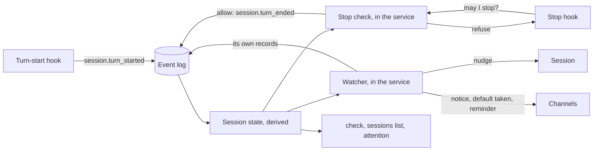

<!-- Written per the `the-loop:writing` skill. -->

# Decision 155: the-loop observes a session through harness turn hooks, the service decides a stop, and one watcher derives everything from the event log

- **Status:** accepted
- **Date:** 2026-11-20
- **Deciders:** MadaraUchiha-314 (the approvals at the requirements and design gates),
  the-loop (the mechanism)
- **Work item:** [issue-551](https://github.com/MadaraUchiha-314/the-loop/issues/551)
- **Spec:** [`docs/specs/issue-551/`](../specs/issue-551/)

## The short version

the-loop now knows whether a session is working, waiting or idle. Three choices make
that possible:

- **The harness says when a turn starts and ends.** Two plugin hooks record it.
- **The service decides whether a turn may end.** The Stop hook asks; it does not judge.
- **One watcher in the control-plane service acts on idle sessions and ask deadlines.**
  It keeps no state of its own and derives everything from the event log.

## Context

A daemon-driven session could end its turn with work still owed, and nothing noticed.
On issue-549 it did so twice, for 43 and 36 minutes, right after it advanced the graph
itself. It also waited 8.5 hours on a question that did not need to block. Each time
the author had to ask what was happening.

Three gaps were behind it. the-loop had no record of a turn, so it could not tell a
working session from an idle one. The Stop gate ran inside the hook script, which knew
nothing of an open ask or a wait, and it switched itself off after the first approved
human gate. Every existing timer lived in one ingress, so an instance that ran only the
gateway client had none.

## Decision

1. **Turn records come from harness hooks.** A turn-start hook
   (`hooks/the-loop-turn-start.py`) records `session.turn_started`. The Stop hook's
   allowed stop records `session.turn_ended` with its reason. Claude Code, Codex and
   Cursor each have both hook points.
2. **The stop verdict is made by the service**, behind
   `the-loop sessions stop-check`. The verdict needs the event log (asks and waits) and
   the graph definition (who owns each node). The hook script stays stdlib-only and
   keeps two things: the attempt cap, and a fallback to `the-loop check` for an older
   CLI or a service that does not answer.
3. **One watcher runs in the control-plane service**, on a 30-second tick. It nudges a
   stalled session, publishes the stall notice, takes an ask's default at its deadline
   and sends an ask's reminder.
4. **Session state is derived from the event log and stored nowhere.** The Stop check,
   the watcher and the status surfaces read one derivation. An act is owed only while
   the log holds no record of it.
5. **Background work is a harness fact.** The Stop check believes the harness's own
   list of running background tasks. Where a harness gives none, the session declares a
   wait, which is bounded and recorded.

## Consequences

- **One more hook per harness.** A Codex user reviews and trusts two hooks, not one.
- **One service call at every turn end, and one at every turn start.** The Stop hook
  bounds its call at 20 seconds and falls back to `check`.
- **A session without the hooks is not watched.** It has no turn record, the watcher
  leaves it alone, and every status surface says `not watched`.
- **A restart loses nothing and repeats nothing**, because nothing is held in memory.
- **No event log, no watcher.** The record of an act is the only memory of it. With the
  event log off or unwritable the watcher does nothing, and says so once in the service
  log, because an act it could not record would be repeated on every tick.
- **A pull request's own session is watched for its asks only.** The Stop check reads
  the outer loop, cannot place such a session on a node, and records its stops as
  `inconclusive`. A stop the-loop cannot place owes no nudge and no notice. Judging the
  inner loop's node is left for a separate work item.
- **A person's word closes every open ask.** An authorized comment on the work item or
  on one of its pull requests cancels every default open there, whichever question it
  was written under. One default may be taken per step: a second ask with a deadline at
  the same step is refused, so a session cannot go on without a person indefinitely.
- **The status surfaces cannot disagree with the watcher**, because they share the
  derivation.
- **The binding check is not authentication.** The service authenticates no caller
  ([decision-059](decision-059.md)). The three session operations answer only for a ref
  that has a live registered session, and the CLI refuses a ref other than the
  session's `THE_LOOP_WORK_ITEM`. A process that can reach the service can still call
  them for any live work item. That is the same limit every service operation carries.
- **A turn that hangs in the middle is not detected.** The signal is the end of a turn.
  A hung tool call needs a different signal and is a separate work item.

## Alternatives considered

- **tmux pane activity.** Rejected: pane output is an inference about a turn. The
  hooks are the harness's own statement of one, and all three harnesses have them.
- **The age of the harness's transcript file.** Rejected: the harness writes its
  transcript late, so a fresh turn can look idle and the age is not a safe signal.
- **A timer in each ingress** (webhook receiver, poller, gateway client). Rejected: it
  means three copies of the rule, and an instance that runs only the gateway client
  would have none. Every deployment has the service.
- **A watchdog state file**, or fields on the session record. Rejected: a second store
  can drift from the log, and a restart must reconcile it. The log already holds asks
  and replies the same way.
- **Trusting the session's word about background work.** Rejected: a session steered
  by untrusted text could excuse every stop. A harness fact beats a claim, and the
  declared wait is the one fallback: it covers one stop and has a limit.
- **Judging the stop in the hook script**, with more fields on `check`. Rejected: the
  script is stdlib-only by contract and must work without the CLI installed.
