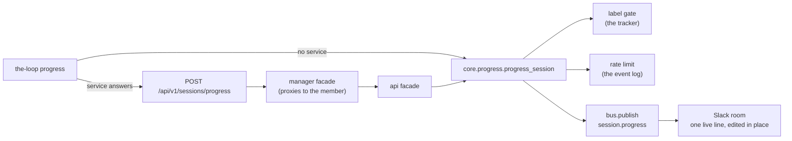

<!-- Authored per the the-loop:writing skill. -->

# Design: `the-loop progress`

> Phase 2 of 4. Derived from [`requirements.md`](requirements.md). It follows the path
> `ask` laid ([issue-208](../issue-208/design.md), [issue-482](../issue-482/design.md)); the
> parts that are new are the label gate, the rate limit and one Slack rule.

## Overview

`core/progress.py` owns the verb; the CLI, the route, the manager facade and the SDK are thin
callers, as for every session verb. Core never prints: it returns `messages`, `exitCode` and
a `status`.

## Decisions

| # | Decision | Why |
|---|----------|-----|
| D1 | The verb is `progress`, a sibling of `ask`, and shares its routing | The same constraint holds: a spawned session has no token, and the label read and the room post need one |
| D2 | The opt-in is a **label read at call time**, not config | The issue asks for add-the-label-and-it-works: no edit, no restart, per issue |
| D3 | `status` is one of `sent`, `disabled`, `not-opted-in`, `rate-limited`, `label-unreadable`; the first four exit 0 | An agent can call the verb unconditionally without its exit code meaning "I failed" |
| D4 | The rate-limit clock is the **event log**: the newest `session.progress` for the item | The log is the source of truth for what was emitted (decision-025); a second store would be a second thing to drift |
| D5 | A too-soon report is **dropped, with the wait named**, not queued | A trailing flush needs a timer in a process the verb does not own; the agent's next call is the newest report anyway (see open question 1) |
| D6 | The event is **not recorded** on the ledger | The issue calls it "a signal, not a record"; the ticket already holds the detail |
| D7 | In an agentic room the line is **edited in place**, under its own key | `room_policy` already lists `session.progress` among its progress events; keyed by phase it would overwrite the runtime's message, so it is keyed `session.progress` |
| D8 | The text is defused in `SlackBotChannel.post`, before any rendering | Slack parses the plain-text fallback as well as the blocks, so defusing the blocks alone left a `<!channel>` live |
| D9 | The config is a top-level `progress` block; the config version is not bumped | The block is optional and adds a key rather than moving or removing one, as `selfDiagnosis` did |
| D10 | The feature is in no default subscription | An operator who has not asked for progress hears none, so existing deployments are unchanged |
| D11 | The watchdog is a **scan of what is already recorded**: the registry's active sessions and the event log | It adds no instrumentation to the session path and no new store |
| D12 | "Activity" is any record naming the work item **except** `session.silent`, `bus.*` and `channel.*` | Publishing the silence leaves bus and channel records; counted, they would end the silence they report |
| D13 | One `session.silent` per silence: skipped while the newest `session.silent` is at least as new as the newest activity | The state is the log itself, so a restart forgets nothing and two daemons agree |
| D14 | The label is read **only for a session already past the threshold** | A healthy deployment makes no tracker call; the cost is paid when something is wrong |
| D15 | The watcher runs in the poller and the webhook receiver, started beside self-diagnosis, and does not start with the event log off | No new service (R6.5); the log is its clock, so without it every session would look silent |
| D16 | It reports a stuck **session**, not a dead daemon | It runs inside the daemons; the issue's "dead poller" case needs a check from outside, which the existing `poller/heartbeat.py` file is the natural input for (open question 5) |

## Components

- **`core/progress.py`** — `ProgressConfig`, `shorten`, `progress_session`. Reads the label
  through the tracker (`github_ops` client for GitHub, `JiraClient.labels` for Jira) and the
  rate-limit clock through `core.events.query_events(..., since=)`.
- **`commands/progress_cmd.py`** — the CLI, routed with `harness_routed` exactly as `ask` is.
- **API** — `SessionProgressBody`, `POST /sessions/progress`, `CoreFacade.progress_session`,
  `ManagerFacade.progress_session`, the OpenAPI contract.
- **`channels/events.py`, `eventlog.py`** — the catalog row and the event-log row.
- **`channels/room_policy.py`** — the key for the live line.
- **`channels/slack.py`** — the title, and the defusing at `post`.
- **`core/silence.py`** (part 2) — `scan`, `start_watcher`, `watch_interval`; started from
  `poller/daemon.py` and `webhook/daemon.py`. `session.silent` joins the catalog and the
  event log; `progress.silenceSeconds` joins the config block.

## Error handling

| Situation | Result |
|-----------|--------|
| Empty text, malformed ref | `ValueError` before any read; CLI exit 2, route 400 |
| Label missing | `not-opted-in`, exit 0, nothing emitted |
| Feature off (`label: ""`) | `disabled`, exit 0, no tracker call |
| Tracker error reading labels | `label-unreadable`, exit 1, nothing emitted |
| Inside the interval | `rate-limited` with `retryAfterSeconds`, exit 0 |
| No channel subscribes | `sent`, with a note that nobody subscribes; the event is still logged |

## Security design

- *Untrusted text* — defused before rendering, plain-text fallback included (D8, R4.4); never
  written on the ticket (D6).
- *Flood* — three independent brakes: the label, the interval, the two-line cap; an unreadable
  label fails closed (R2.5).
- *Self-enabling* — the verb reads the label and never writes it.
- *Credential reach* — nothing new; the service holds the token, the session holds none.

## Open questions

1. **Keep the newest, or drop the late one?** The issue says reports faster than the interval
   should keep the newest. D5 drops the too-soon one and names the wait, which makes the
   agent's next call the newest. A true trailing flush needs a timer in the service. Which
   does the owner want?
2. **Edit in place, or reply in the thread?** An edit shows one current line and does not
   notify; a reply notifies and keeps history. D7 follows the room policy's existing intent.
3. **Where does the config live?** A top-level `progress` block is easiest to read. It could
   sit under `channels` or `routing` instead.
4. **Risk tier.** Declared 4 because a schema file changes; the owner may lower it.
5. **A dead daemon.** The watchdog cannot report the daemon it runs in. Should a second,
   external check read `poller/heartbeat.py`'s file, or is that out of scope here?
