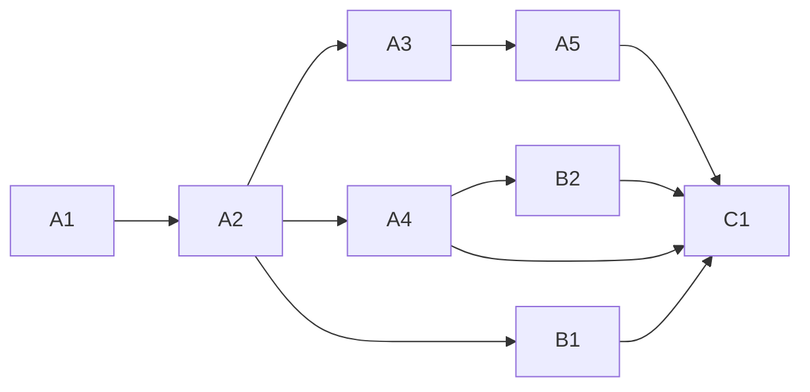

<!-- Authored per the the-loop:writing skill. -->

# Tasks: `the-loop progress`

## Task list

- [x] **A1: tests.** Core, route, CLI, room-policy and Slack-room tests. Written with the
      code, not before it; `evidence/verification.md` records a mutation check in place of
      a red run. *Req:* R1–R4 · *Test:* T1–T5.
- [x] **A2: the core verb.** `core/progress.py`. *Req:* R1–R3 · *Test:* T1, T2. *Deps:* A1.
- [x] **A3: the event.** Catalog row, event-log row. *Req:* R4.1 · *Test:* T6. *Deps:* A2.
- [x] **A4: every seam.** CLI command, route and body, API facade, manager facade, SDK,
      OpenAPI contract. *Req:* R1.5 · *Test:* T3, T6. *Deps:* A2.
- [x] **A5: the room.** Room-policy key, Slack title, defusing at `post`. *Req:* R4.3, R4.4
      · *Test:* T4, T5. *Deps:* A3.
- [x] **B1: configuration.** Both schema copies, the shipped template. *Req:* R5.1 ·
      *Test:* T6. *Deps:* A2.
- [x] **B2: skill text.** `reference/collaboration.md`, `reference/automation.md`.
      *Req:* R5.2. *Deps:* A4.
- [x] **C1: docs and evidence.** Command page, config page, indexes, capability docs, the
      evidence files. *Deps:* A4, A5, B1, B2.

## Dependency graph (DAG)

