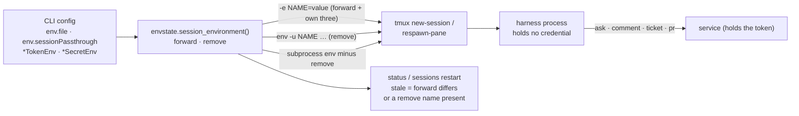

<!-- Authored per the the-loop:writing skill. -->

# Design: spawned sessions never receive a secret

> Phase 2 of 4. Derived from [`requirements.md`](requirements.md).

## Overview

One new idea, the **session environment**: two lists the-loop computes per spawn from the
CLI config. `forward` is what a pane is given (the passthrough names and their values).
`remove` is what a pane must not hold (every `env.file` name and every credential name,
minus `forward`). Everything else follows from it:

## Components

### `envstate` (the boundary)

- `credential_names(config) -> FrozenSet[str]`: walks the whole config; every string (or
  string in a list) under a key matching `(?i)(token|secret)Env$`, plus the built-in
  defaults `GH_TOKEN`, `GITHUB_TOKEN` (`ghapi.DEFAULT_TOKEN_ENVS`),
  `THE_LOOP_GH_WEBHOOK_SECRET`, `THE_LOOP_SLACK_BOT_TOKEN`, `THE_LOOP_SLACK_APP_TOKEN`
  (the schema defaults). A walk, not a list of paths, so a credential key added later is
  covered without touching this module.
- `passthrough_names(config) -> Tuple[str, ...]`: `env.sessionPassthrough`, valid names
  only, credential names dropped with one warning each naming the variable (R4.3).
- `SessionEnvironment(forward: Dict[str, str], remove: Tuple[str, ...])`, a frozen
  dataclass.
- `session_environment(config, config_path) -> Optional[SessionEnvironment]`: `None` when
  neither `env.file` nor `env.sessionPassthrough` is set (the "not configured" state
  issue-410's `status` and `restart` already distinguish). `forward` takes each
  passthrough name from the file when it declares it, else from `os.environ`, else skips
  it (R4.4). `remove` is `(file names ∪ credential names) − forward − the-loop's three`.
- `spawn_environment(config_getter) -> SessionEnvironment`: the runner's provider. Never
  raises. With no file and no passthrough it still returns `remove = credential names`,
  so a deployment without `env.file` is protected too (R1.3, R1.4).
- `compare(env, actual)`: the names where `forward` differs, plus the `remove` names
  `actual` carries (R5.1). `environ_matches_declared` takes the `SessionEnvironment`.

### `TmuxRunner` (R1, R2)

- `env_provider` now returns a `SessionEnvironment` (a bare mapping is still accepted and
  read as `forward`, so tests and embedders keep working).
- `_session_environment(work_item)` emits the `forward` pairs, then the-loop's three, as
  before. With the default empty allowlist that is the three only (R1.1, R1.2).
- The harness argv is prefixed with `env -u NAME …` for each `remove` name, after tmux's
  `--`. `env` then `exec`s the harness, so the pane's pid is the harness's pid and the
  issue-410 drift probe reads the right process. Names are not secrets; values never
  appear (R2.1). This works on any tmux, including the pre-3.2 ones that get no `-e`.
- `_run` starts tmux with `remove` deleted from its own environment, so a server a spawn
  starts inherits no credential (R2.3). Together with the above, the server's argv holds
  no credential value either (R2.2): the only `-e` values left are the three identifiers
  and the operator's non-secret passthrough.

Option 2 of [#485](https://github.com/MadaraUchiha-314/the-loop/issues/485)
(`tmux start-server` first) is not taken: tmux exits an empty server at once unless
`exit-empty` is turned off globally, which would change the operator's tmux. With no
secret in the argv, the server's name holding the argv is harmless.

### Session-side verbs (R3)

- `client.routing.daemon_spawned()`: true when `THE_LOOP_INSTANCE`, `THE_LOOP_WORK_ITEM`
  or `THE_LOOP_CLI_CONFIG` is set (R3.3).
- `harness_routed`: when no service answers and `daemon_spawned()`, raise
  `ServiceUnavailable` with "no control-plane service is answering at <url>; this
  session was started by the-loop's daemon and holds no credentials, so it cannot run
  this verb itself — start the service (`the-loop start`) or ask the operator to". The
  stale-service branch (a service that predates the verb) fails the same way, naming
  `the-loop restart`. Outside a daemon session nothing changes (R3.4).
- `ask` gets a route: `POST /api/v1/sessions/ask` (`askSession`), body
  `{ref, question, summary, default, actor, instance}`, served by
  `facade.ask_session` → `core.sessions.ask_session`. `ask_session` takes an `actor`
  argument so the audit trail still names the person or account that ran the CLI, not
  the service's user. `ask_cmd` calls it through `harness_routed`. The contract is
  added to `docs/api-specs/openapi/the-loop.v1.yaml` first. No MCP tool is added: an
  agent asks through the CLI, and the MCP surface is a separate decision.
- `sessions link-pr` already uses `routed` (service-only, auto-start), so it needs
  nothing.

### Config (R4)

`env.sessionPassthrough`: `array` of strings matching `^[A-Za-z_][A-Za-z0-9_]*$`, default
`[]`, in `cli/the_loop/schemas/cli-config.schema.json`. Additive and optional, so the
config version (0.12.0) does not move and no migration is needed.

### Drift and restart (R5)

`core.sessions._declared_environment` returns the `SessionEnvironment` (or `None`).
`environment_drift` and `restart_sessions` use it for the comparison; `restart` hands the
same object to the runner, so a relaunched pane is born on the new boundary. The
"declares no usable variable" refusal is removed: with `remove` non-empty, a relaunch
always changes something. Rendering names a differing forward variable by fingerprint, as
today, and a removed variable as "present, must be absent".

## Data models

No persisted model changes. `SessionEnvironment` is computed per call and never written.

## Error handling

| Situation | Behaviour |
|---|---|
| `env.file` unreadable | `forward` from `os.environ` only; `remove` still holds the credential names |
| A passthrough name is a credential | dropped; one warning naming the variable |
| A passthrough name is invalid | dropped; one warning naming it (it is not a value) |
| `env` not on `PATH` | not checked: it is POSIX and present wherever tmux is |
| Daemon session, no service | verb exits 2 with the message above; nothing in-process |

## Security design

- The boundary is computed from the config, not from what a pane happens to inherit:
  the credential names do not depend on the env file being readable (fail-closed).
- Three layers, each sufficient for one leak path: no secret `-e` (argv), `env -u`
  (inheritance from any tmux server, however started), scrubbed tmux client environment
  (a new server's own environment).
- A daemon session never falls back in-process, so a steered agent cannot reach for a
  token through the CLI (A5); and it holds none to reach for.
- `fingerprint` is still the only form a value takes in output.

## Upgrade (R6)

Panes spawned by an earlier version keep `-e NAME=value` in their argv, and a tmux
server one of them started keeps it in its name. `the-loop sessions restart --all`
relaunches each pane through `respawn-pane`, whose argv carries no secret, and
`status` reports a pane still holding a removed name as stale. The server's own name only
clears when the server exits: `tmux kill-server` once no session needs keeping. The
changelog and `docs/cli/commands/sessions.md` say so.

## Testing strategy

Unit tests on `envstate` (the walk, the allowlist, the boundary), on the runner's argv and
subprocess environment, and on `harness_routed`'s new branch; a contract test for the new
route; the issue-410 restart integration test updated to the new comparison. See
[`testing-plan.md`](testing-plan.md).
