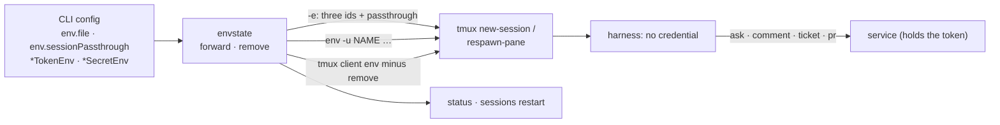

# Spawned sessions never receive a secret (issue-482, issue-485): reviewer briefing

## TL;DR

Every `env.file` value used to reach every agent pane as `tmux new-session -e
NAME=value`. So `GH_TOKEN` sat in `ps`, and when that call started the tmux server, in
the server's process name for days (#485). Now a pane gets only the-loop's three
identifiers plus non-secret names the operator lists in a new `env.sessionPassthrough`
(credentials refused). Every other `env.file` name and every credential name is stripped
with `env -u`, and tmux itself runs without them. Session-side verbs in a daemon-spawned
session go through the service or fail; `ask` gets a service route. Risk tier 4:
**breaking**, and it needs a named security sign-off.

## Where to focus (in this order)

1. **`envstate.session_environment` / `credential_names`** (`cli/the_loop/envstate.py`).
   Is the boundary right? Credential names are a walk for `*tokenEnv`/`*secretEnv` keys
   plus `GH_TOKEN`, `GITHUB_TOKEN` and the Slack/webhook defaults.
2. **`TmuxRunner.spawn_in` / `respawn_in` / `_harness_command` / `_run`**
   (`cli/the_loop/runner.py`). The three layers: no secret `-e`, `env -u` before the
   harness, a scrubbed environment for the tmux client.
3. **`harness_routed`** (`cli/the_loop/client/routing.py`). A session counts as
   daemon-spawned when any of the three identifiers is set. With no service, it raises
   instead of running in-process.
4. **Skim:** the `ask` route (contract, route, facade, CLI), the drift and restart
   changes in `core/sessions.py`, the docs.

## What changed (map)

## Key decisions & why (education)

- **Strip, don't just stop forwarding.** The daemon loads `env.file` into its own
  environment, and a tmux server it starts inherits that. Without `env -u`, a pane would
  still inherit the token from the server.
- **#485's option 2 (`tmux start-server` first) not taken.** tmux exits an empty server at
  once unless `exit-empty` is turned off globally, which would change the operator's tmux.
  With no secret in the argv, the server's name keeping it is harmless.
- **"Daemon-spawned" = any of the three identifiers set.** That is what the daemon
  exports, so no new variable is introduced. A person who exports `THE_LOOP_CLI_CONFIG` is
  treated the same, which fits "a daemon-hosted box"; the message names the variable.
- **`sessions restart` no longer refuses an env file that declares nothing.** A relaunch
  now always changes something (it strips credentials), and it is the upgrade path.
- **Major version.** Operators who relied on `env.file` reaching panes (such as `gh`
  reading `GH_TOKEN`) lose that. The commit carries a `BREAKING CHANGE:` footer with the
  upgrade note.

## Evidence

- [`verification.md`](verification.md): the full suite, lint, typecheck, and the
  real-tmux test red on the old code, green on the new.
- [`security-review.md`](security-review.md): each abuse case mapped to a test.
- [`self-review.md`](self-review.md), [`documentation.md`](documentation.md).

## Open questions for the reviewer

1. Is a major bump right, or do you want the old forwarding behind an opt-in for one
   release?
2. The in-process fallback outside a daemon session is unchanged (#482 R3 defers its
   opt-in). Should that be filed now?
3. The trust pre-seed in #482 § Related is out of scope. Should it get its own ticket?
