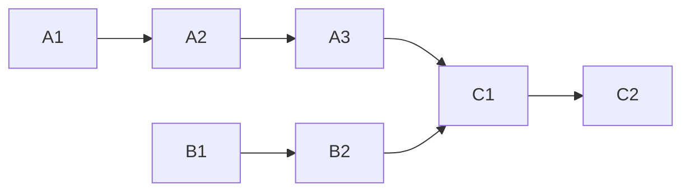

<!-- Authored per the the-loop:writing skill. -->

# Tasks: spawned sessions never receive a secret

## Task list

- [x] **A1: the boundary.** `envstate.credential_names`, `passthrough_names`,
      `SessionEnvironment`, `session_environment`, `spawn_environment`, `compare`; the
      schema key. *Req:* R1.3, R4 · *Test:* T1, T9.
- [x] **A2: the runner.** `-e` from `forward` only; `env -u` prefix; scrubbed tmux
      environment. *Req:* R1, R2 · *Test:* T2, T3, T4. *Deps:* A1.
- [x] **A3: drift and restart.** `_declared_environment`, `environment_drift`,
      `restart_sessions` on the new boundary. *Req:* R5 · *Test:* T8. *Deps:* A1, A2.
- [x] **B1: routing.** `daemon_spawned`, the no-fallback branch of `harness_routed`.
      *Req:* R3.2–R3.4 · *Test:* T5.
- [x] **B2: the ask route.** Contract first, then route, facade, `actor` argument and the
      CLI. *Req:* R3.1 · *Test:* T6, T7. *Deps:* B1.
- [x] **C1: docs.** Config reference, `sessions` and `status` command docs, the
      issue-410 security note, capability docs, the changelog's upgrade note.
      *Req:* R6 · *Deps:* A3, B2.
- [x] **C2: verify and ship.** Run the testing plan, record the evidence, self-review,
      security review, reviewer briefing, PR. *Test:* T10, T11. *Deps:* C1.

