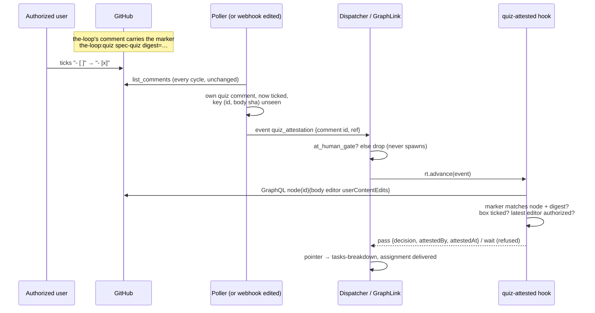

<!-- Authored per the the-loop:writing skill. -->

# Design: the explainer, the spec quiz and the code quiz

> Phase 2 of 4. Derived from the approved [`requirements.md`](requirements.md). Its four
> open questions were approved with their defaults: the spec quiz sits after
> `design-approval`, the committed HTML is viewed with a copy-paste command, one box
> controls everything, and a tick advances a gate with no reply.

## Overview

**What was in the way.** The approved flow has two blockers. A session cannot do work at a
human node: `render_assignment` tells it not to start the work a human gate guards
(`graph/hooks/assignment.py:91-100`). And the-loop never sees a comment being edited:
the poller dedupes by comment id and drops its own comments for good
(`poller/poller.py:1458`, `:1480-1484`). A docstring also records the reason ticks were
never trusted on their own: "GitHub cannot tell us who edited a comment"
(`graph/hooks/selection.py:16-24`). That is true of the REST API. The GraphQL API does
say who edited, through `userContentEdits{editor}`, and the client already speaks
GraphQL (`ghapi.py:881`).

**What we do.**

- **Four nodes, not three.** Each quiz is an agent node that writes the page, followed by
  a human node that waits for the tick: `spec-explainer` → `spec-quiz`, and
  `code-explainer` → `code-quiz`. The requirements name three. The split is how
  requirement 2.2 ("WHEN `spec-quiz` is entered THEN the agent SHALL produce the spec
  explainer") can be met while a human node stays a node no session works at.
- **One `explainer` row** under the checklist's Settings, ticked by default. Unticking it
  declares all four nodes skipped, under one token and with the usual provenance.
- **Two new hooks.** `post-quiz-attestation` (entry) posts the-loop's checkbox comment.
  `quiz-attested` (exit) passes only when GraphQL shows the box was ticked by an
  authorized user.
- **Edits become visible.** The poller already re-reads the whole thread every cycle, so
  it can spot its own checkbox comment changing from unticked to ticked. When it does, it
  sends a new event, `quiz_attestation`, which only re-evaluates the waiting gate. The
  webhook's `issue_comment.edited` action feeds the same event.
- **The page is the agent's work.** A new skill reference, `reference/explainer.md`, holds
  the depth ladder, the section contract, the quiz rules and the publishing table. A new
  template, `templates/explainer.html`, carries the quiz engine and the tab shell. A new
  slash command, `/the-loop:explain`, drives both agent nodes.

**What it costs.** Four nodes and a skip set in the shipped graph, one checklist row, two
hooks, one GraphQL query, a poller step, one webhook carve-out and one event kind. That
is about 600 lines of Python plus tests. One documented decision, that ticks are never
attributable, is superseded (see Trade-offs).

## Architecture

```mermaid
flowchart LR
  DA[design-approval] --> SE["spec-explainer<br/>(agent)"]
  SE --> SQ["spec-quiz<br/>(human)"]
  SQ -->|pass| TB[tasks-breakdown]
  SQ -->|stale| SE
  TB --> IM[implementation] --> VE[verification]
  VE --> SR[self-review] --> CR[critic-review] --> SEC[security-review]
  SEC --> CE["code-explainer<br/>(agent)"]
  CE --> EV[evidence] --> CD[capability-docs] --> RB[reviewer-briefing]
  RB --> CQ["code-quiz<br/>(human)"]
  CQ --> HA[human-approval]
  SE -. skipped .-> SQ
  SQ -. skipped .-> TB
  CE -. skipped .-> EV
  CQ -. skipped .-> HA
```



The tick reaches the gate like this:



## Components & interfaces

### C1 — the graph (`cli/the_loop/graph/pdlc-work-item-loop.yaml`) · R1.2, R2.1, R3.1, R3.6

| Node | Actor | Placed | Entry | Exit | `on:` edges |
|---|---|---|---|---|---|
| `spec-explainer` | agent | after `design-approval` | `deliver-assignment` | `validate-artifacts {validates: evidence/spec-explainer.md, sections: ["Spec explainer"]}` | `pass` → `spec-quiz`, `skipped` → `spec-quiz` |
| `spec-quiz` | human, `session: inherit` | after `spec-explainer` | `post-quiz-attestation {node: spec-quiz, record: evidence/spec-explainer.md, on: ticket, digest: [requirements.md\|bugfix.md, design.md, testing-plan.md]}`, `notify {event: quiz-pending}` | `quiz-attested {digest: [requirements.md\|bugfix.md, design.md, testing-plan.md]}` | `pass` → `tasks-breakdown`, `stale` → `spec-explainer`, `skipped` → `tasks-breakdown` |
| `code-explainer` | agent | after `security-review` | `deliver-assignment` | `validate-artifacts {validates: evidence/explainer.md, sections: ["Explainer"]}` | `pass`/`skipped` → `evidence` |
| `code-quiz` | human, `session: inherit` | after `reviewer-briefing` | `post-quiz-attestation {node: code-quiz, record: evidence/explainer.md, on: pull-requests}`, `notify {event: quiz-pending}` | `quiz-attested` | `pass`/`skipped` → `human-approval` |

- All four are `skippable: true`. A test requires every node outside the protected set to
  be skippable (`cli/tests/test_graph_skips.py:221-235`).
- None carries `phase:`. The ticket label inherits the previous phase: `test-planning`
  while the spec quiz waits, `needs-review` while the code quiz waits
  (`runtime.py:375-389`). `critic-review` and `design-critic-review` set the precedent,
  and a new label would have to be created in every consuming repository.
- Both agent nodes carry `command: explain`.
- The skip set `explainer` lists all four nodes, so `the-loop graph skip <id> --node
  explainer` does from a shell what the unticked row does. The node is named
  `code-explainer`, not `explainer`, because `expand_skip_tokens` checks skip-set names
  first (`model.py:448`) and a node with the same name would be unreachable as a token.
- The edges `design-approval → tasks-breakdown`, `security-review → evidence` and
  `reviewer-briefing → human-approval`, plus their `skipped` twins, are re-pointed
  through the new nodes.

### C2 — the checklist row (`graph/hooks/selection.py`, `channels/slack.py`) · R1

- `EXPLAINER_TOKEN = "explainer"` joins `_NON_PHASE_TOKENS`. `_phase_rows` leaves out
  every member of the `explainer` skip set, so the four nodes never appear as phase rows.
- `_checklist_body` adds a Settings section, rendered only when the graph defines that
  skip set. Only `pdlc-work-item-loop` does, which satisfies R1.6:

  ```markdown
  #### 🎓 Explain the change and quiz the author?

  **Default:** yes, already ticked. Untick it to skip all three.

  - [x] `explainer` — a spec explainer and quiz before code generation, an explainer of
    the change for the reviewer, and a code quiz before review is requested.
  ```

- `_parse_explainer(lines) -> bool`: a row that is present and unticked means **off**,
  and anything else means **on** (R1.4). An absent row stays on, which keeps Slack's
  Execute button correct: it leaves non-phase rows out of the reply it composes
  (`channels/slack.py:956-983`).
- When the row is off, `classify_phase_selection` adds the skip set's members to
  `declaredSkips`, each as `{"via": "selection", "token": "explainer", "by": "@actor",
  "reason": ""}`. `_frozen_graph` marks them skipped, and the runtime records them with
  no change (`runtime.py:647-668`).
- `_confirmation` adds one line, in either direction (R1.5):
  "Explainer and quizzes: **on**" or "**off**, as declared by @x — `spec-explainer`,
  `spec-quiz`, `code-explainer`, `code-quiz` skipped".
- Slack: `EXPLAINER_TOKEN` joins its mirrored token list, which is pinned by
  `test_selection_control.py:237-248`. `selection_rows` files it under `others`, and
  `apply_without` keeps it (R1.7).

### C3 — `post-quiz-attestation` (entry hook, new `graph/hooks/quiz.py`) · R2.4, R3.6, R3.10, R5.4

- Reads the record named by `record:` (C6) for `Location` (an artifact URL, or a repo
  path). With `digest:` it also computes the **spec digest**: the first 12 hex
  characters of the sha256 of the listed files' bytes, in the listed order, with an
  absent file contributing nothing. The digest goes into the marker, which binds the
  comment to the spec as it stood when the quiz was posted.
- Posts one comment through the existing `add-comment` integration, marked with
  `mark_self_authored` plus `<!-- the-loop:quiz <node> digest=<12 hex> -->`:

  ```markdown
  🎓 **Spec quiz** — read the spec explainer and take its quiz before code generation
  starts: <link or view command>

  - [ ] I have read the spec explainer and taken the spec quiz.

  Ticking the box is enough — no reply needed. Only a user authorized for this
  repository's the-loop can tick it for the work item to move on.
  ```

- With `on: ticket` it posts on the work item. With `on: pull-requests` it posts on
  every pull request in `state.pull_requests`, falling back to the ticket when there are
  none (R3.10).
- If `Location` is a repo path (the HTML fallback), the link is replaced by two
  copy-paste commands. One works for any repository, the other for a public one (R5.4):

  ```sh
  gh api -H 'Accept: application/vnd.github.raw' 'repos/O/R/contents/docs/specs/<id>/explainer/explainer.html?ref=<branch>' > /tmp/<id>-explainer.html && python3 -m webbrowser /tmp/<id>-explainer.html
  curl -fsSL 'https://raw.githubusercontent.com/O/R/<branch>/docs/specs/<id>/explainer/explainer.html' -o /tmp/<id>-explainer.html && python3 -m webbrowser /tmp/<id>-explainer.html
  ```

  `python3 -m webbrowser` opens the file on macOS, Linux and Windows. Nothing is sent to
  a third-party renderer.
- Idempotent in the same way as `post-phase-selection`: it scans `list-comments` for the
  marker carrying the same node and digest, so a re-entry after `stale` posts a new
  comment only when the digest changed.
- A missing or unreadable record means the comment is not posted and the result is
  `block` with the reason (R5 fail-closed). The agent node before it gates that record,
  so this is belt-and-braces.

### C4 — `quiz-attested` (exit hook, `graph/hooks/quiz.py`) · R2.5–2.7, R3.7–3.8, R5.6, abuse cases 1, 2, 4, 6

```text
quiz-attested(ctx) ->
  if digest param set and digest(files now) != the posted comment's marker digest -> pass with outcome "stale"
  att = ctx.event.get("attestation")              # from the quiz_attestation event
  if att: c = call("comment-edits", id=att.comment_id)
          require c.body has the marker for this node (+ current digest)   # else wait
          require c.body is self-authored                                  # forgery: wait
          require the attestation box is ticked                            # else wait
          editor = c.edits[0].editor if c.edits else None                  # newest first
          require editor and is_authorized(editor, ctx.config.authorizedUsers)
            else wait, data {refused: editor or "unknown"}                 # logged
          pass, data {decision: <node>, attestedBy: editor, attestedAt, comment: url}
  for comment in ctx.event.comments (authorized, not self-authored):       # typed fallback
    if it carries the attestation line ticked -> pass, attestedBy = its author
  wait
```

- **Fail closed.** If the GraphQL call fails, returns no edit history, or returns an
  editor with no login, the hook answers `wait`. `is_authorized(None, …)` returns True
  for CI events (`authz.py:271`), so a missing editor is rejected before that call.
- **The latest edit is the one that counts.** If an authorized user ticks and an
  unauthorized user edits afterwards, the latest editor is unauthorized and the gate
  keeps waiting. That is safe, and the authorized user can tick again.
- **The typed fallback.** An authorized new comment containing `- [x] I have read the …`
  satisfies the gate. This works where edits cannot be seen at all: Jira, and webhook
  mode without the GraphQL scope. It is the same rule `phase-selection` already follows,
  where the reply's own checklist wins.
- **Recording the decision.** The runtime stores a result's `decision` through
  `state.decisions.setdefault` (`runtime.py:591-645`). That path gains `attestedBy`,
  `attestedAt` and `comment` (R2.6, R3.8), so `the-loop check` shows who attested.
- **Logging a refusal.** A refused tick emits `graph.quiz_refused {node, editor}` to the
  event log (abuse case 1). The poller dedupes by body hash, so it is logged once.

### C5 — edit detection (`poller/poller.py`, `webhook/router.py`, `webhook/dispatcher.py`, `ghapi.py`, `graph/integrations/github.py`) · R2.6, R3.8

- **`ghapi.GitHubClient.comment_edits(node_id, host)`**: one GraphQL query,
  `node(id:){... on IssueComment {body url author{login} lastEditedAt
  userContentEdits(first: 5){nodes{editor{login} editedAt}}}}`. It returns
  `GhCommentEdits(body, url, author, edits=[(login, at)])`, newest first. The integration
  op `comment-edits` is added to `OPERATIONS` (`graph/integrations/github.py:37-47`).
  Jira inherits the op set; Jira's op returns `unsupported`, so the hook falls back to
  the typed path.
- **Poller.** In `_process_item`, before the `seen` skip at `:1458`, each comment is
  checked: self-authored, carries the `<!-- the-loop:quiz` marker, and has its attestation box
  ticked. A matching comment is keyed `(comment.id, sha256(body)[:16])`. An unseen key
  goes to `PollState.quizSeen` (a new list beside `seenComments`, with the same
  per-item file and the same cap) and is emitted as one `quiz_attestation` event. A
  string check per comment costs nothing extra: the thread is already fetched.
- **Webhook.** In `EventRouter.route`, before the self-reply guard at `:904`: an
  `issue_comment` with `action == "edited"`, the quiz marker and a ticked box is
  rewritten to `quiz_attestation`. Attribution still comes from GraphQL, not the
  payload's `sender`, so both ingresses share one trust path.
- **Dispatcher.** `quiz_attestation` is a delivery-only kind. It never arms, never
  spawns and never renders an event prompt. If `ctx.at_human_gate` holds, it calls
  `graphlink.on_event` with `{"attestation": {"comment_id", "url"}}`. When the gate
  advances, the normal assignment delivery tells the session where it is. In every other
  state it is dropped with `reason: no-gate`.
- **`comments_from` is unchanged.** The new kind carries its own key, so no code path
  mistakes it for a human comment.

### C6 — the evidence records · R3.5

`evidence/spec-explainer.md` (section `## Spec explainer`) and `evidence/explainer.md`
(section `## Explainer`) each hold:

```markdown
## Spec explainer

| Field | Value |
|---|---|
| Depth | standard |
| Location | https://claude.ai/code/artifact/… — or docs/specs/<id>/explainer/explainer.html |
| Published as | spec-chain artifact tab · own artifact · committed HTML |
| Questions | 3 |
```

The record carries no digest: the entry hook computes it (C3), so the agent never hashes
anything. Both rows are added to `.the-loop/manifest.yaml`'s evidence list.

### C7 — the agent's procedure (`skills/the-loop/reference/explainer.md`, `commands/explain.md`, `templates/explainer.html`) · R2.2–2.3, R3.2–3.4, R4, R5.1–5.3, R6

- **`commands/explain.md`** reads the current node from `work-item-state.json`.
  - At `spec-explainer` it writes the spec-level page from requirements, design and
    testing plan. It includes no code-level detail unless `design.md` does (R2.3).
  - At `code-explainer` it explores the diff grounded in the spec: the hunks, the code
    around each touched function, and the tests, config and data models relied on. Then
    it writes the code page with a mixed quiz (R3.2–3.4).
  - Both write the record (C6) and run `the-loop graph complete`.
- **`reference/explainer.md`** holds:
  - the depth ladder table, with `micro` / `standard` / `deep`, 0 / 3 / 5 questions, and
    the depth stated in the header line;
  - the prose budget;
  - the section contract: Background, Intuition, Code ordered by execution flow with
    `file:line` excerpts and a closing Risks & limits note, then Quiz;
  - the spec-only variant;
  - the quiz rules R6.1–6.7, verbatim as a checklist the agent ticks mentally before
    publishing;
  - the publishing table (below).
- **`templates/explainer.html`** is the self-contained shell prototyped in
  [`design/explainer.html`](design/explainer.html). The agent fills in tab content and a
  `QUIZ` JSON block and never touches the engine. The engine:
  - shuffles nothing at runtime: positions are fixed by the agent and balanced per R6.5;
  - gives every option the same markup and the same `aria-label` pattern;
  - keeps answers and feedback in the `QUIZ` object and adds the feedback node to the
    DOM only after a selection (R6.6);
  - renders every agent-supplied string through `textContent`, never `innerHTML`
    (abuse case 3).

Publishing, in the order the session tries it (R5.1–5.3):

| Condition | Action |
|---|---|
| `claudeArtifact: true` and an artifact tool | Add tabs "Spec explainer" and "Spec quiz" (later "Explainer" and "Code quiz") to the spec-chain artifact and republish it to its URL. `Location` is that URL. |
| `claudeArtifact: false` and an artifact tool | Publish one artifact titled `<id>: explainer` from the filled template. Republish it to the same URL when the code tabs arrive. |
| No artifact tool | Write `docs/specs/<id>/explainer/explainer.html`, run the evidence redaction pass, commit and push. `Location` is the path. |

A `graph complete` claim with no page anywhere has no record to show, so it blocks the
agent node (R5 fail-closed).

### C8 — prompt line, briefing and docs · R3.9, NFR docs

- No new state field. The assignment for an agent node already names `/the-loop:explain`,
  and a skipped node is never assigned. Unlike `claude-artifact`, nothing needs a
  graph-context line.
- `templates/pr-briefing.md` gains a first row, "Start here: the explainer
  (`<Location>`)", which is present when `evidence/explainer.md` exists (R3.9).
- `notify` gains the event `quiz-pending`, so channels subscribed to it hear that the
  author has a quiz waiting.
- The same PR updates these docs:
  - `SKILL.md`: the chain section, and one operating-principles bullet;
  - `reference/workflow.md`: a new section, "The explainer and the quizzes";
  - `docs/capabilities/process-graph.md` and `spec-workflow.md`: behaviour and history
    rows;
  - `docs/cli/commands/graph.md` and the README flow;
  - `ui/src/demo/fixture.ts`: node list.

## UI/UX design

The page is user-facing: authors and reviewers read it and take the quiz on it.

| Artifact | Type | Location / link | Covers (screen · requirement) | Status |
|----------|------|-----------------|-------------------------------|--------|
| `design/explainer.html` | html-prototype | [`design/explainer.html`](design/explainer.html) | Spec explainer, Spec quiz, Explainer, Code quiz tabs · R2.2, R3.3, R4.1, R6 | draft |

- **Flows and states.**
  - Four tabs: Spec explainer, Spec quiz, Explainer, Code quiz. A page published before
    the code nodes holds only the first two.
  - Each quiz question moves from unanswered to answered, either correct or not, with
    feedback shown.
  - The answer can be changed, and doing so re-reveals the feedback.
  - A progress line reads "n of N answered".
- **Design system and tokens.** Colour tokens sit on `:root`, with dark-mode overrides
  under `prefers-color-scheme` and a `data-theme` switch. It uses the system font stack,
  so no remote fonts load.
- **Accessibility and responsiveness.**
  - Tabs follow the WAI-ARIA tabs pattern, operable with the arrow keys.
  - Options are native radio inputs.
  - Feedback says "Correct" or "Not quite" in words, and colour is a second signal
    (NFR a11y).
  - The layout is a single column up to 760 px, with a 16 px gutter at phone width.
- **Evidence.** Prototype renderings sit in [`design/screenshots/`](design/screenshots/):
  `spec-explainer-{light,dark,mobile}.png`, `spec-quiz-{light,dark}.png` (two questions
  answered, one right and one wrong) and `explainer-{light,dark}.png`. A headless check
  found no horizontal scroll at 375 px, no network request, no script error, zero
  feedback nodes before a selection, and arrow-key tab switching. Verification captures
  the same set from the shipped template.
- **Designer.** `.the-loop/collaborators.yaml` names no designer. The rendering is
  reviewed at `design-approval`, together with this document.

## Data models

| Where | Change |
|---|---|
| `pdlc-work-item-loop.yaml` | 4 nodes, 1 skip set (`explainer`), edges re-pointed |
| `work-item-state.json` | No new key. Skips use the existing `skips`, and attestations are entries in `decisions["spec-quiz"]` / `decisions["code-quiz"]` with `{at, attestedBy, attestedAt, comment}` |
| Per-item poll state (`portable/`) | `quizSeen: [ "<comment id>:<body sha16>" ]`, capped like `seenComments` |
| Event kinds | `quiz_attestation` (internal), and the notify event `quiz-pending` |
| Evidence | `evidence/spec-explainer.md`, `evidence/explainer.md` (C6) |
| Comment marker | `<!-- the-loop:quiz <node> digest=<hex12\|-> -->` |

No `*schema*` file changes: the graph format, `cli-config` and `collaborators` schemas are
untouched. The tier stays 3.

## Error handling

| Failure | Response |
|---|---|
| GraphQL `comment-edits` errors or rate-limits | `quiz-attested` → `wait`, with `graph.quiz_unverified` logged. The poller's key is not marked seen, so the next cycle retries |
| The checkbox comment was deleted | The poller never sees a tick. `the-loop check` shows the gate waiting. An operator re-runs the entry chain with `the-loop graph advance`, which reposts (the marker scan finds nothing) |
| The record is missing at `spec-quiz` / `code-quiz` entry | `block`, naming the missing record |
| The spec changed after the explainer was written | `stale` edge back to `spec-explainer`. The new page gets a new digest and a new comment, and the old comment's tick is ignored (its marker digest no longer matches) |
| No delivering PR at `code-quiz` | Post on the ticket instead (C3) |
| The artifact tool fails mid-publish | The agent falls back to the committed HTML row, and the record says so |

Every refusal or wait is logged through the existing event log at the same level in dev
and in a daemon.

## Security design

| Boundary (requirements) | Enforcement |
|---|---|
| Who ticked the box → gate decision | `quiz-attested` reads the editor from GraphQL `userContentEdits`, never from the comment's author or a webhook payload, and requires `is_authorized(editor)` with a non-empty editor. A synthetic `quiz_attestation` event carries only a comment id, so a forged event can point at a comment but cannot claim an editor |
| Untrusted ticket and diff text → the page | The template renders agent-supplied strings with `textContent`. The agent's tab HTML is authored with escaping, and the reference forbids pasting raw ticket or diff HTML. In a Claude artifact the page is private. The committed HTML passes the evidence redaction rule before commit |
| Self-attested quiz | Stated on the page and in the comment. Nothing is recorded as "passed", only "attested by @x" |

- **AuthN/AuthZ.** The GitHub identity comes from GraphQL. Authorization is checked
  against `routing.authorizedUsers` through the gate's allow-list
  (`ctx.config["authorizedUsers"]`), the same allow-list every gate uses. Collaborators
  are not gate authority.
- **Input validation and injection surfaces.**
  - The comment body is parsed with one anchored regex for the attestation line and one
    for the marker.
  - The edit list is read as data.
  - The view command interpolates only the owner, repo, branch and spec-dir path the CLI
    already holds, with no ticket text, so ticket content cannot reach a shell.
- **Secrets.** No new credential. `comment-edits` uses the existing client token, which
  the service holds where a daemon runs. The query needs only read access to the
  repository, which the token already has.
- **Least privilege.** The new event kind cannot spawn or arm. It can only re-evaluate a
  gate that is already waiting.
- **Fail closed.** A missing editor, a failed query, a marker mismatch or an unknown
  digest all mean `wait`, never `pass`.
- **Abuse-case coverage.**

| Abuse case | Mechanism | Negative test |
|---|---|---|
| 1 — an unauthorized user ticks | editor not in the allow-list → `wait` + `graph.quiz_refused` | `test_quiz_attested_refuses_unauthorized_editor` |
| 2 — the editor is unknown | empty `edits`, null `editor` or a query error → `wait` | `test_quiz_attested_fails_closed_without_editor` |
| 3 — HTML or script in ticket or diff text | template `textContent` and the reference rule | `test_explainer_template_renders_text_not_markup` (DOM check on a fixture with `<script>`) |
| 4 — "approved" on the artifact | artifact comments never reach `quiz-attested`, which reads only GitHub comments by id or the typed line | `test_quiz_attested_ignores_unmarked_and_artifact_text` |
| 5 — secrets in the committed HTML | the evidence redaction pass is named in the reference's publishing step | manual: verification greps the committed file |
| 6 — a forged checkbox comment | requires the self-authored marker and the node + digest marker, and the event is keyed by the-loop's own comment | `test_quiz_attested_ignores_forged_comment` |

## Testing strategy

- **Unit tests cover:**
  - the row parser: absent is on, unticked is off;
  - the skips the row declares, with their provenance;
  - `quiz-attested` across every branch in C4;
  - the digest;
  - `post-quiz-attestation`: idempotency, the PR fan-out, and the view-command
    rendering;
  - the poller's `quizSeen` keying;
  - the webhook rewrite;
  - the dispatcher dropping a `quiz_attestation` with no gate.
- **Integration scenarios** carry Gherkin docstrings (`cli/tests/test_*_integration.py`):
  - "Scenario: a tick by an authorized user advances the spec quiz";
  - "Scenario: a tick by an unauthorized user is refused";
  - "Scenario: an unticked explainer row skips all four nodes";
  - "Scenario: a changed spec sends the spec quiz back to the explainer".
- **Existing tests updated:** the e2e scenario traces in `test_pdlc_e2e`, the pinned
  layout and skip-set tests, and the Jira checklist fixtures.
- **The page:** the template is checked headlessly for its tabs, quiz reveal-after-select
  and `textContent` rendering.

The matrix, the environment and the evidence belong to `testing-plan.md`.

## Trade-offs & decisions

- **Ticks are now attributable (supersedes the reasoning at `selection.py:16-24`).**
  Phase-selection keeps its "the reply is the signature" rule, because its checklist is a
  configuration anyone can edit before execute. The quiz box is a single attestation by
  whoever ticked it, and GraphQL names that person. Recorded as **decision-143** in the
  implementation PR.
- **Four nodes instead of three.** This keeps "a human node is never worked by a
  session" intact, and the extra node is invisible on the checklist.
- **No new phase label.** The label reads `test-planning` / `needs-review` while a quiz
  waits. A `loop:quiz` label would mean setup work in every consuming repository.
- **One GraphQL query per tick, not per cycle.** The poller detects ticks from the body
  it already fetches, and only a candidate costs a query.
- **The typed fallback.** It covers Jira and missed edits at the price of a second way to
  answer. It is the same shape as `phase-selection`'s reply-checklist, so no new idea is
  added.
- **Not done.** No verification of quiz answers, no hosting of the HTML, no explainer in
  inner loops or contributions, and no Jira edit ingestion (Jira uses the typed
  fallback).

## Open questions

None open. The four requirements questions were answered by approval with defaults
(see the PR #489 thread).

## Review comments

> Appended by the-loop's `record-feedback` hook when a human gate approves with
> comments (issue-109). Append-only and attributed.
