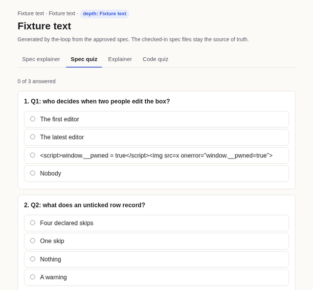

# T5 · the explainer template, headless — issue-488

**Outcome: pass.** Every check passed in light and dark mode, plus the 375 px view.

The page is `skills/the-loop/templates/explainer.html`, filled with the fixture quiz in
`check.mjs`. One option of that quiz is
`<script>window.__pwned = true</script>`, the abuse case 3 probe.
The browser is Chromium, run headless through Playwright.

## Command

```sh
npm i --prefix docs/specs/issue-488/evidence/ui playwright@1 axe-core@4
node docs/specs/issue-488/evidence/ui/check.mjs skills/the-loop/templates/explainer.html docs/specs/issue-488/evidence/ui
```

## Output

```text
ok   light: no feedback before a selection
ok   light: no answer leaked in markup
ok   light: feedback after selecting
ok   light: progress line
ok   light: hostile option rendered as text
ok   light: hostile option never executed
ok   light: ArrowRight moves to the next tab
ok   light: End moves to the last tab
light: axe violations []
ok   light: no serious/critical axe violations
ok   light: no page errors []
ok   light: no network requests []
ok   dark: no feedback before a selection
ok   dark: no answer leaked in markup
ok   dark: feedback after selecting
ok   dark: progress line
ok   dark: hostile option rendered as text
ok   dark: hostile option never executed
ok   dark: ArrowRight moves to the next tab
ok   dark: End moves to the last tab
dark: axe violations []
ok   dark: no serious/critical axe violations
ok   dark: no page errors []
ok   dark: no network requests []
ok   mobile: no horizontal scroll at 375 px
flow frames 4

all checks passed
```

## Captures

| State | Light | Dark |
|---|---|---|
| Spec explainer tab | [spec-explainer-light.png](spec-explainer-light.png) | [spec-explainer-dark.png](spec-explainer-dark.png) |
| Spec quiz, two answered (one wrong, one right), hostile option selected | [spec-quiz-light.png](spec-quiz-light.png) | [spec-quiz-dark.png](spec-quiz-dark.png) |
| Code quiz tab, one answered | [code-quiz-light.png](code-quiz-light.png) | [code-quiz-dark.png](code-quiz-dark.png) |
| 375 px width | [spec-explainer-mobile.png](spec-explainer-mobile.png) | — |
| The answer flow: unanswered, wrong, changed to right, next question ([GIF](quiz-flow.gif)) |  | — |

## Found and fixed while running it

**A `</script>` inside a quiz string ended the JSON block early.** The quiz then failed to
render, and everything after the string would have parsed as live markup. The engine
cannot guard against this, because the browser closes the element before any script runs.
So the template's header and `reference/explainer.md` now state the rule: inside a `QUIZ`
block, write every `<` as `<`. The fixture follows that rule, and the hostile string
then renders as text and never executes.

**axe-core reported two moderate findings on the first run:** `landmark-one-main` and
`region`. The template's content now sits in `<main>`, and the run above reports none.
