<!-- Authored per the the-loop:writing skill. -->

# Requirements: the explainer, the spec quiz and the code quiz

> Phase 1 of 4 (requirements → design → testing plan → tasks). Tier 3
> (`human-approves-pr`): it adds nodes to the shipped outer-loop graph, one row to the
> `phase-selection` checklist and two human gates. No credential or token scope changes.
> If the design has to touch a `*schema*` file (a sensitive path), the tier rises to 4.

## Introduction

[Issue #488](https://github.com/MadaraUchiha-314/the-loop/issues/488), opened by
@L-u-k-e and shaped in the thread with @MadaraUchiha-314.

**What is broken.** the-loop writes a full spec chain and then a diff, and the people
who have to stand behind both — the author who drives the work and the reviewer who
approves it — get them as technical documents only. Nothing explains *why* the change
exists in plain terms, and nothing checks that the author understood the spec before
code generation started or the code before review was requested. The issue cites
Geoffrey Litt's `explain-diff` skill
([gist](https://gist.github.com/geoffreylitt/a29df1b5f9865506e8952488eac3d524), talk
*"Understanding is the new bottleneck"*): when an agent writes the code, understanding
becomes the bottleneck.

**What this changes.** Three new steps, on by default and switched off with one box at
`phase-selection`:

```mermaid
flowchart LR
  DA[design-approval] --> SQ["spec-quiz (new, human)<br/>spec explainer + spec quiz,<br/>author ticks a box"]
  SQ --> TB[tasks-breakdown] --> IM[implementation] --> VE[verification]
  VE --> RC["self-review → critic-review<br/>→ security-review"]
  RC --> EX["explainer (new, agent)<br/>code explainer + code quiz"]
  EX --> EV["evidence → capability-docs<br/>→ reviewer-briefing"]
  EV --> CQ["code-quiz (new, human)<br/>author ticks a box"]
  CQ --> HA[human-approval]
```

- **Spec quiz** — after the design and testing plan are approved, before any code. The
  agent writes a spec-level explainer and quiz; the author reads it, takes the quiz and
  ticks a box in a ticket comment. Code generation waits for the tick.
- **Explainer** — after the review chain, the agent writes the explainer of the actual
  change (Background, Intuition, a Code walkthrough, Risks & limits) and the code quiz.
  It is the reviewer's starting point.
- **Code quiz** — before human review is requested, the author takes the code quiz and
  ticks a box in a PR comment. The `human-approval` request waits for the tick.

Where the page lives depends on the existing `claude-artifact` choice (issue-471) and the
harness, as agreed in the thread:

| `claude-artifact` | Harness can publish a Claude artifact | Where the explainer and quizzes go |
|---|---|---|
| ticked | yes | new tabs in the work item's one spec-chain artifact |
| unticked | yes | one Claude artifact of their own, the explainer and both quizzes as tabs |
| either | no | one self-contained HTML file in the repository, with an easy way to view it |

## Requirements

### Requirement 1 — one box at `phase-selection`, on by default

**User story:** As the author of a work item, I want the explainer and both quizzes to
run unless I say otherwise, and to switch all three off with one box, so the default
teaches and a trivial change can opt out cheaply.

#### Acceptance criteria (EARS)

1.1 WHEN the `phase-selection` checklist is posted for `pdlc-work-item-loop` THEN the
system SHALL render one row `explainer`, **ticked**, with a one-line description naming
the spec quiz, the explainer and the code quiz.

1.2 WHEN an authorized `the-loop execute` resolves the selection with the `explainer` row
ticked THEN the system SHALL walk the `spec-quiz`, `explainer` and `code-quiz` nodes.

1.3 WHEN the row is unticked THEN the system SHALL record all three nodes as declared
skips attributed to the replying user, with the same provenance every declared skip
carries (work-item state, confirmation comment, `the-loop check`).

1.4 WHEN the checklist cannot be read, or the row is absent from a reply that carries its
own checklist THEN the system SHALL treat the row as ticked (the default stands).

1.5 The confirmation comment SHALL say whether the explainer and quizzes will run.

1.6 WHEN the loop is not `pdlc-work-item-loop` (a pull request's inner loop, a
contribution, an ad-hoc task, a review) THEN the system SHALL NOT render the row and
SHALL NOT walk the three nodes.

1.7 A Slack mirror of the checklist SHALL carry the row with the same default.

### Requirement 2 — the spec quiz gates code generation

**User story:** As the author, I want to be made to read and be quizzed on the approved
spec before code generation starts, so I am not approving a diff I never understood the
plan for.

#### Acceptance criteria (EARS)

2.1 WHEN `design-approval` passes THEN the system SHALL enter a human node `spec-quiz`
before `tasks-breakdown`.

2.2 WHEN `spec-quiz` is entered THEN the agent SHALL produce the **spec explainer** — the
explainer's four sections applied to the plan being approved (Background = the problem
space, Intuition = the approach and what becomes true if approved, a walkthrough of the
spec in approval order, then the quiz) — and publish it per Requirement 5.

2.3 The spec quiz SHALL test only what `requirements.md`, `design.md` and
`testing-plan.md` state. It SHALL include low-level detail only where `design.md` itself
chose to.

2.4 WHEN the spec explainer is published THEN the system SHALL post one ticket comment
that links it and carries one unticked checkbox reading, in substance, "I have read the
spec explainer and taken the spec quiz".

2.5 WHILE that box is unticked the system SHALL NOT leave `spec-quiz`.

2.6 WHEN an authorized user ticks the box THEN the system SHALL notice the tick without a
further reply, record who ticked it and when, and advance to `tasks-breakdown`.

2.7 WHEN the depth is `micro` (Requirement 4) THEN the spec explainer SHALL carry no quiz,
and the comment's checkbox SHALL attest reading only.

### Requirement 3 — the explainer and the code quiz gate the review request

**User story:** As the reviewer, I want an explainer of the actual change as my starting
point, so I learn why it exists before I read the diff. As the author, I want to be
quizzed on the code before I ask anyone to review it.

#### Acceptance criteria (EARS)

3.1 WHEN `security-review` passes THEN the system SHALL enter an agent node `explainer`
before `evidence`.

3.2 WHEN `explainer` is entered THEN the agent SHALL explore the change grounded in the
spec — the hunks, the code around each touched function or module, and the tests, config
and data models the change relies on — and write the **code explainer** and the
**code quiz**, published per Requirement 5.

3.3 The code explainer SHALL have four sections in this order: **Background** (the system
for a reader arriving cold, then the touched components' prior behaviour), **Intuition**
(the core idea with small concrete examples and old-vs-new comparisons), **Code** (a
walkthrough in conceptual groups ordered by execution flow — never file order — each a
prose explanation plus an excerpt with `file:line` references, never the whole diff,
ending with a **Risks & limits** note), and **Quiz**.

3.4 The code quiz SHALL mix code-level and spec-level questions.

3.5 The `explainer` node SHALL NOT pass until its record (an evidence file naming the
depth, the published location and the question count) exists.

3.6 WHEN `reviewer-briefing` passes THEN the system SHALL enter a human node `code-quiz`
before `human-approval`, and post one comment on the delivering pull request that links
the explainer and carries one unticked checkbox reading, in substance, "I have read the
explainer and taken the code quiz".

3.7 WHILE that box is unticked the system SHALL NOT enter `human-approval`, and SHALL NOT
request review.

3.8 WHEN an authorized user ticks the box THEN the system SHALL notice the tick without a
further reply, record who ticked it and when, and advance to `human-approval`.

3.9 The reviewer briefing SHALL link the explainer as the place to start.

3.10 WHEN a work item has more than one delivering pull request THEN the system SHALL post
the code-quiz comment on each, and the box on any one of them SHALL satisfy the gate.

### Requirement 4 — sized by the depth ladder

**User story:** As a reader, I want the explainer's length to follow how much my mental
model has to change, not how many lines changed.

#### Acceptance criteria (EARS)

4.1 The agent SHALL classify each explainer (spec and code, separately) at one depth and
state it in the page's header line:

| Depth | Signals | Form | Quiz questions |
|---|---|---|---|
| `micro` | mechanical or cosmetic — no behaviour or contract change | half a page; Background and Intuition a few sentences each; a 1–2 stop tour | 0 |
| `standard` | behaviour changes within existing concepts | one-paragraph Background, a short tour | 3 |
| `deep` | a new subsystem or concept, a contract or interface change, tier 4–5, wide blast radius | all four sections in full | 5 |

4.2 Background SHALL be delta-only: it SHALL NOT restate what the reader already knows,
and a section with nothing non-obvious to say SHALL be one sentence or omitted.

4.3 The explainer SHALL explain why before what, define jargon on first use, and use
callouts for definitions, invariants, edge cases and practical consequences.

### Requirement 5 — where the page is published

**User story:** As the author and the reviewer, I want the explainer in the place I
already read the spec, and an easy way to view it when that place is not a Claude
artifact.

#### Acceptance criteria (EARS)

5.1 WHEN the work item's state has `claudeArtifact: true` AND the session can publish a
Claude artifact THEN the system SHALL add the spec explainer and spec quiz, and later the
code explainer and code quiz, as tabs of the work item's one spec-chain artifact,
republished to its existing URL.

5.2 WHEN `claudeArtifact` is false AND the session can publish a Claude artifact THEN the
system SHALL publish one Claude artifact of their own per work item, holding the
explainer and quiz tabs, republished to the same URL as tabs are added.

5.3 WHEN the session cannot publish a Claude artifact (any non-`claude` harness, or the
tool is unavailable) THEN the system SHALL commit one self-contained HTML file under
`docs/specs/<id>/explainer/` — every style and script inline, no network fetch — holding
the same tabs.

5.4 IF the page is a committed HTML file THEN the linking comment SHALL give a way to
view it rendered, not as GitHub's raw source: at least one copy-paste command that
fetches the file and opens it in a local browser.

5.5 The checked-in specs SHALL stay the source of truth: no gate SHALL read the explainer
or the quiz to decide anything except the checkbox gates of Requirements 2 and 3.

5.6 WHEN a spec file changes after the spec explainer was published THEN the system SHALL
regenerate the spec explainer before the `spec-quiz` box can satisfy the gate.

### Requirement 6 — quiz quality

**User story:** As the author, I want a quiz that tests understanding rather than
recall or test-taking tricks, so passing it means something.

#### Acceptance criteria (EARS)

6.1 Each question SHALL be multiple-choice, medium difficulty, and about behaviour,
causality, contracts or trade-offs.

6.2 The system SHALL NOT ask trivia: no line numbers, file names or identifier spellings.

6.3 Every distractor SHALL encode a genuine misunderstanding; there SHALL be no joke
answers and no "all/none of the above".

6.4 Options SHALL be comparable in length, grammar, specificity and confidence; the
correct answer SHALL NOT be the conspicuously longer or more qualified one.

6.5 Correct-answer positions SHALL be randomized and balanced across a quiz's questions.

6.6 Feedback SHALL work offline, from the page's own script, and SHALL be revealed only
after the reader selects an option. The correct answer SHALL NOT be discoverable from
styling, option order, or accessibility labels before selection.

6.7 The spec quiz and the code quiz SHALL be different quizzes: the spec quiz carries no
code-level detail; the code quiz carries both.

## Non-functional requirements

- **Cost.** Each explainer is one generation by the working session; no extra model or
  critic is invoked for it.
- **Accessibility.** The page SHALL be keyboard-operable, and the quiz's selection and
  feedback SHALL be perceivable without colour alone.
- **Docs.** The skill (`SKILL.md`, `reference/workflow.md`), the process-graph and
  spec-workflow capability docs, and the README's flow description SHALL describe the
  three steps in the same PR.

## Security considerations

- **Actors & trust.** The authorized user ticking a box; any other GitHub user who can
  edit or comment on the thread (untrusted); the work item's own title, body and comments
  (untrusted content the explainer is written from); the session (trusted, posts under
  the operator's credentials).
- **Trust boundaries & data.**
  - *Who ticked the box* crosses into a gate decision. GitHub lets the issue author and
    anyone with triage access tick a checkbox in another user's comment, so the tick is
    trusted only when the editor is an authorized user.
  - *The explainer page* renders text derived from untrusted ticket content and from the
    diff. A Claude artifact is private to the operator; a committed HTML file is as public
    as the repository.
  - *The quiz* is self-attested: answers live in the page's script, so the-loop cannot
    and does not verify that the quiz was passed — only that an authorized user said so.
- **Abuse cases (EARS).**
  1. WHEN a user not in `routing.authorizedUsers` ticks a quiz box THEN the system SHALL
     NOT advance the gate, and SHALL record the refused tick.
  2. WHEN the identity of the editor who ticked the box cannot be established THEN the
     system SHALL NOT advance the gate (fail closed).
  3. WHEN ticket or diff content contains HTML or script THEN the system SHALL render it
     as text in the page, never as markup or code.
  4. WHEN a comment posted on the explainer artifact says "approved" or "quiz passed"
     THEN the system SHALL NOT treat it as a gate answer.
  5. WHEN the committed HTML would carry a token, cookie, personal data or internal
     hostname THEN the system SHALL redact it before commit, under the existing evidence
     redaction rule.
  6. WHEN the checkbox comment is a forgery (posted by someone other than the-loop, without
     its marker) THEN the system SHALL ignore it and read only the comment it posted.
- **Fail closed.** No authorized editor, no unreadable comment, no advance. A page that
  cannot be published anywhere SHALL block the node with the reason, never pass it.

## Out of scope

- **Verifying quiz answers.** The quiz is a speed regulator, not an exam; scores are not
  collected or recorded.
- **Hosting the HTML file** (GitHub Pages or any third-party renderer). The thread asked
  for an easy view, not a host; see Open question 2.
- **An explainer for the inner loop or for contributions.** Only the outer loop gets it.
- **Generating the explainer with a different model.** Same session, same model.

## Open questions

Raised on the pull request carrying this spec. Each has a default the design will take if
no one objects.

1. **Where the spec quiz sits.** Default: directly after `design-approval`, before
   `tasks-breakdown` — the ticket's order (design → spec quiz → code generation). The
   alternative is after `tasks-breakdown`, so the quiz may cover the task plan too.
2. **Viewing the committed HTML.** Default: a copy-paste command that fetches and opens
   it (5.4). @L-u-k-e noted the same approach went largely unused elsewhere; a renderer
   link (`htmlpreview.github.io` and the like) works only for public repositories and
   sends the page to a third party, so it is not the default.
3. **One box or three.** Default: one `explainer` row toggling all three nodes, as the
   ticket asks. Three rows would let an author keep the explainer for the reviewer while
   skipping their own quizzes.
4. **Ticking alone.** Default: a tick advances the gate with no reply (2.6, 3.8), which
   needs the-loop to notice an edited comment — today it ingests new comments only. The
   cheaper alternative is "tick, then reply `the-loop execute`", as `phase-selection`
   works.

## Review comments

> Appended by the-loop's `record-feedback` hook when a human gate approves with
> comments (issue-109). Append-only and attributed.

### 2026-10-15 — approved

**@MadaraUchiha-314** wrote:

approved
