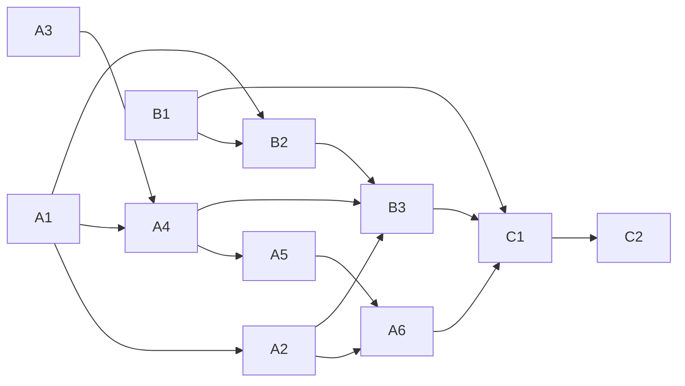

<!-- Authored per the the-loop:writing skill. -->

# Tasks: the explainer, the spec quiz and the code quiz

> Derived from the approved [`requirements.md`](requirements.md), [`design.md`](design.md)
> and [`testing-plan.md`](testing-plan.md). The work is all in this repository, so no
> other repositories are declared. Every code task is written test-first: the named test
> goes red, then green, and that change is recorded in the commit that carries it.

## Task list

- [ ] **A1: the graph.** Add `spec-explainer`, `spec-quiz`, `code-explainer` and
  `code-quiz` to `pdlc-work-item-loop.yaml`, along with the skip set `explainer`, the
  re-pointed `pass`/`skipped` edges and the `stale` back-edge. Register the new hook
  names as placeholders that `A4` fills in, and add the notify event `quiz-pending` to
  the event catalogue. Update the pinned tests: `test_graph_skips.py` (skip-set
  equality), `test_graph_model.py`, the e2e traces (`happy-path`, `trivial-tier`,
  `review-rejection`, `gh-unreachable`), and the new `explainer-off` scenario.
  - _Depends on:_ none
  - _Requirements:_ R1.2, R1.6, R2.1, R3.1, R3.6
  - _Test:_ T4 (e2e walk through the four nodes, and the `explainer-off` scenario); T10
    `test_frozen_graph_without_quiz_nodes_keeps_walking`
- [ ] **A2: the checklist row.** In `selection.py`, add `EXPLAINER_TOKEN`, exclude the
  skip-set members from `_phase_rows`, add the Settings section (rendered only when the
  graph defines the skip set), `_parse_explainer` (absent → on), the four declared skips
  carrying `token: explainer`, the `_frozen_graph` marks and the confirmation line. Pin
  the token in Slack's list (`channels/slack.py`), and update `test_selection_layout.py`,
  `test_selection_control.py` and the Jira checklist fixtures.
  - _Depends on:_ A1
  - _Requirements:_ R1.1, R1.3, R1.4, R1.5, R1.6, R1.7
  - _Test:_ T1 (row parser, skip provenance, Slack `without`); T6 (checklist and
    confirmation snapshots)
- [ ] **A3: who edited a comment.** Add `GitHubClient.comment_edits(node_id, host)` (one
  GraphQL query) returning `GhCommentEdits`, newest edit first. Add the `comment-edits`
  op in `graph/integrations/github.py`; the Jira op set answers `unsupported`.
  - _Depends on:_ none
  - _Requirements:_ R2.6, R3.8
  - _Test:_ T1 `comment_edits` mapping against recorded fixtures in
    `cli/tests/fixtures/github/comment_edits/` (authorized, unauthorized, null editor,
    empty history, error)
- [ ] **A4: the two hooks.** Write `graph/hooks/quiz.py` with `post-quiz-attestation`
  (record read, spec digest into the marker, ticket or PR fan-out with ticket fallback,
  the view commands for a repo-path `Location`, idempotent marker scan, `block` on a
  missing record) and `quiz-attested` (stale digest → `stale`, GraphQL attribution,
  self-authored and node/digest marker checks, non-empty authorized editor, typed
  fallback, `graph.quiz_refused`). In the runtime's decision path, copy `attestedBy`,
  `attestedAt` and `comment`.
  - _Depends on:_ A1, A3
  - _Requirements:_ R2.4–2.7, R3.6–3.8, R3.10, R5.4, R5.6; abuse cases 1, 2, 4, 6
  - _Test:_ T1 (every branch of `quiz-attested`, the digest, idempotency, fan-out); T6
    (quiz comment bodies); T8 `test_quiz_attested_refuses_unauthorized_editor`,
    `test_quiz_attested_fails_closed_without_editor`,
    `test_quiz_attested_ignores_unmarked_and_artifact_text`,
    `test_quiz_attested_ignores_forged_comment`
- [ ] **A5: edits reach the gate.** In the poller, add tick detection before the `seen`
  skip, plus `PollState.quizSeen`. In the webhook, rewrite an `issue_comment.edited`
  that carries the quiz marker and a ticked box to `quiz_attestation`, before the
  self-reply guard. In the dispatcher, make `quiz_attestation` delivery-only: it calls
  `graphlink.on_event` with `{"attestation": …}` at a human gate, and is dropped with
  `reason: no-gate` otherwise. It never arms or spawns.
  - _Depends on:_ A4
  - _Requirements:_ R2.6, R3.8; design C5
  - _Test:_ T1 (poller keying, webhook rewrite, dispatcher drop)
- [ ] **A6: the scenarios.** Write `cli/tests/test_quiz_integration.py` with Gherkin
  docstrings that link the requirements.
  - _Depends on:_ A2, A5
  - _Requirements:_ R1.3, R2.5, R2.6, R3.7, R3.8, R5.6
  - _Test:_ T2: the six `Scenario:` titles in `testing-plan.md`
- [ ] **B1: the page template.** Create `skills/the-loop/templates/explainer.html` from
  the approved prototype: placeholder tab content, an empty `QUIZ` block, and the engine
  unchanged. Add the check script `docs/specs/issue-488/evidence/ui/check.mjs`
  (Playwright plus axe-core), and a fixture fill that puts a `<script>` string in one
  option.
  - _Depends on:_ none
  - _Requirements:_ R3.3, R4.1, R6.6, NFR accessibility; abuse case 3
  - _Test:_ T5 (tabs, reveal-after-select, no network, no errors, 375 px); T8
    `test_explainer_template_renders_text_not_markup`; T9 (axe, keyboard)
- [ ] **B2: the agent's procedure.**
  - New `skills/the-loop/reference/explainer.md`: depth ladder, prose budget, section
    contract, spec-only variant, R6 quiz checklist, publishing table, redaction step,
    and "never tick an attestation box".
  - New `commands/explain.md`, which branches on the current node.
  - The `explain` command name is valid for the graph.
  - The `pr-briefing.md` "Start here: the explainer" row.
  - The `.the-loop/manifest.yaml` evidence rows `spec-explainer.md` and `explainer.md`.
  - _Depends on:_ A1, B1
  - _Requirements:_ R2.2, R2.3, R3.2–3.5, R3.9, R4, R5.1–5.3, R6
  - _Test:_ T1 (the graph's `command:` resolves to `commands/explain.md`; manifest
    validation via `make validate`); the R6 content rules are judged in review
    (`testing-plan.md` § Scenarios)
- [ ] **B3: the documentation.**
  - `SKILL.md`: the chain section, and one operating-principles bullet.
  - `reference/workflow.md`: a new section, "The explainer and the quizzes".
  - Capability docs `process-graph.md` and `spec-workflow.md`: behaviour plus history
    rows.
  - `docs/cli/commands/graph.md`: the checklist.
  - The README flow.
  - `ui/src/demo/fixture.ts`: the node list.
  - `docs/decisions/decision-143.md` (ticks are attributable for quiz gates) and its
    index row.
  - _Depends on:_ A2, A4, B2
  - _Requirements:_ NFR documentation
  - _Test:_ `make lint` (markdown across the repo); `make validate`
- [ ] **C1: verify.** Run `testing-plan.md`: T1–T11. T11 needs @MadaraUchiha-314 to tick
  a sandbox quiz comment; ask for it on PR #489 with `the-loop ask`. Commit the evidence
  under `evidence/`.
  - _Depends on:_ A6, B1, B2, B3
  - _Requirements:_ all
  - _Test:_ every activity in `testing-plan.md` § Verification activities
- [ ] **C2: review and ship.** Self-review rounds, critic rounds, the security review,
  this work item's own explainer and code quiz, the documentation record, and the
  reviewer briefing on PR #489.
  - _Depends on:_ C1
  - _Requirements:_ all
  - _Test:_ the review-chain records (`evidence/self-review.md`, `critic-review.md`,
    `security-review.md`, `explainer.md`, `documentation.md`, `final-validation.md`)

## Dependency graph (DAG)

A1, A3 and B1 have no dependencies and can start in parallel.

## Checkpoints

- After **A1**, **A4** and **A6**: `make test`. The graph, the hooks and the scenarios
  are the three points where a regression in the existing walk would first show.
- Before every commit: the repository's pre-commit hooks (`make lint`, `make
  format-check`, `make typecheck`, `make test`), which are the same commands as CI.
- After **B1**: the T5 check script against the template.
- After the last task, the `verification` node executes `testing-plan.md`. The review
  chain follows.

## Review comments

> Appended by the-loop's `record-feedback` hook when a human gate approves with
> comments (issue-109). Append-only and attributed.
