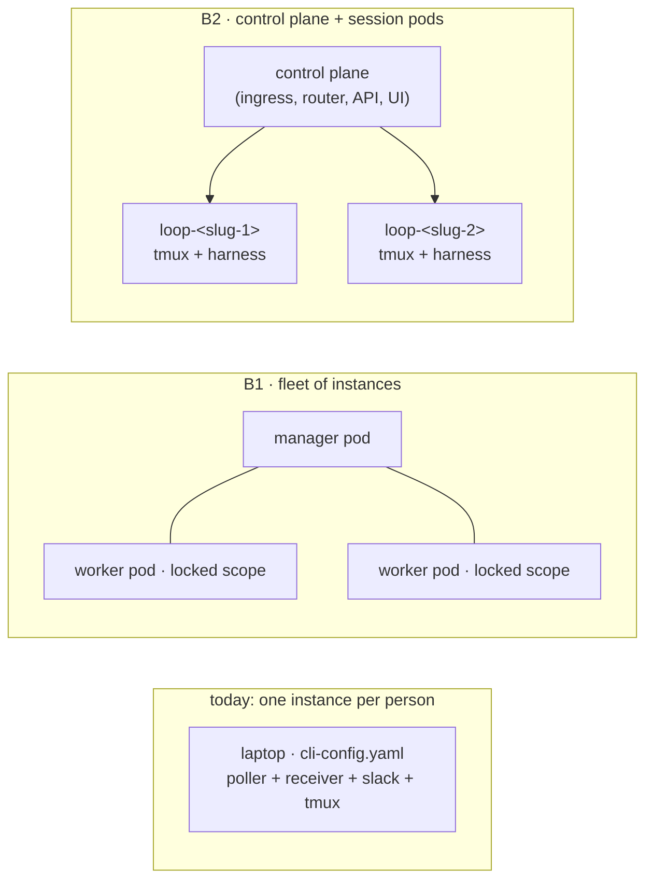
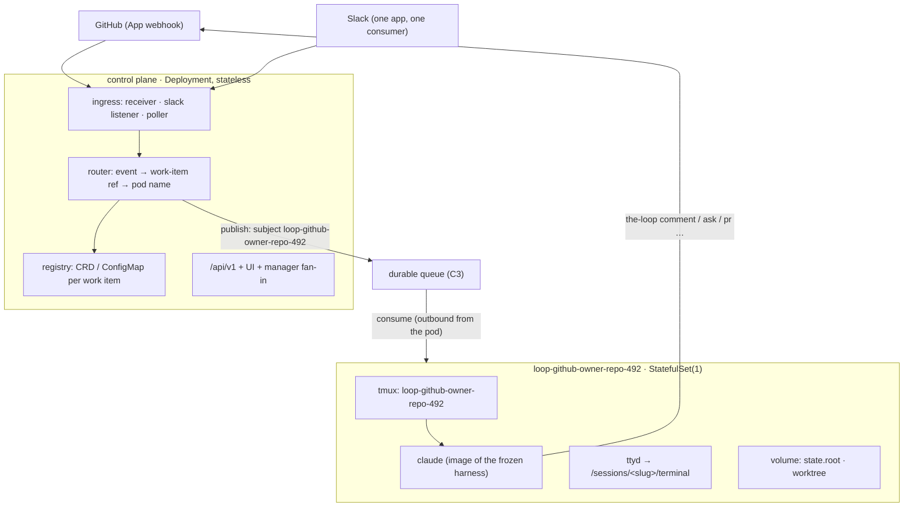
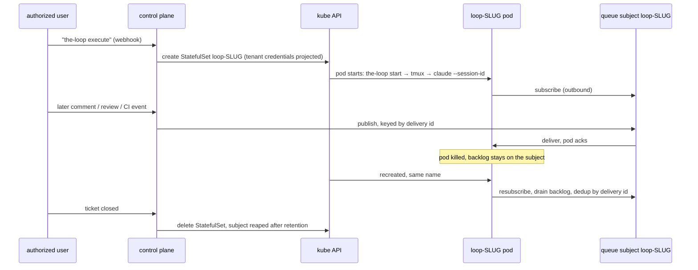

# Brainstorm: Containerize and offer the-loop as a SaaS product

> Phase 0 scratchpad for issue-492. Nothing here is a commitment; it converges on the
> pull request that carries it and then becomes `requirements.md`.

## Problem / opportunity

**Every adopter of the-loop today runs their own instance on their own machine, and that
is the single biggest source of adoption friction.** One `cli-config.yaml` is one
instance: its own daemons, its own `state.root`, its own tmux server, its own checkouts
(`docs/capabilities/instances.md`). To get there a person installs Python, `tmux`, `git`,
a harness CLI, logs the harness in, mints a GitHub token, and, if they want Slack,
**creates a Slack app of their own** because the Socket Mode transport delivers each
event to one connected consumer, so two instances on one app silently halve each
other's inbound (`docs/capabilities/channels.md`, `the-loop doctor slack` exists only to
detect that). The ticket asks whether all of that can instead be **one horizontally
scaled service** that people sign into.

The opportunity is bigger than packaging: the-loop's own operating model (a work item
is a durable state machine on disk, a session is a named tmux session, every event is
routed by work-item ref) maps unusually well onto Kubernetes primitives, so the SaaS
shape may be mostly *deployment* rather than new product code. The brainstorm's job is
to find out how much is really new.

## Context & constraints

**What already exists and is load-bearing for this ticket (verified in the tree):**

- **The service is mountable, as the ticket suspected.** `the_loop.sdk.TheLoop.mount(app)`
  includes one `APIRouter` (the same object `create_app` serves) into any FastAPI app,
  with `dependencies=` as the authorization seam; the standalone service carries **no
  in-app authentication** by design (decision-059) and binds loopback unless
  `service.exposed: true` (`docs/capabilities/sdk.md`, `docs/capabilities/control-plane.md`).
  A gateway owning auth is already the stated deployment model, which is what a SaaS
  needs anyway.
- **Multi-worker is already a documented hazard.** `service.hostIngresses` (default true)
  starts the poller, the receiver and the Slack listener *inside the service process*;
  under several uvicorn workers each would start its own poller and only the first would
  win (`docs/sdk/embedding.md`). Horizontal scaling therefore starts by **separating
  ingress from service**, not by adding replicas.
- **Sharding exists in embryo: instance scopes and the manager.** An instance has a name
  and a scope mode, `open | addressed | locked`, plus a declared list of work items; a
  `locked` instance refuses every event not on its list, and a comment can address an
  instance by name (`the-loop start instance:laptop-b`, issue-322). A **manager**
  (`instance.role: manager`, issue-374) serves one `/api/v1` over the whole fleet,
  routing a keyed operation to the member that manages it. What the manager does *not*
  do is route **ingress events**: every member still runs its own poller or receiver and
  judges each delivery against its own scope.
- **The environment contract names every binary, and already sketches the image.**
  `the_loop.sdk.REQUIREMENTS` lists `claude`, `codex`, `cursor-agent`, `tmux`, `git`,
  `ttyd`; `docs/sdk/environment.md` carries a `python:3.12-slim` Dockerfile snippet.
  **No `gh` and no `jira` CLI**, confirming the ticket: GitHub goes through PyGithub under
  `GH_TOKEN` (issue-442, decision-139) and Jira through the `jira` SDK (issue-475).
- **Routing's truth is per-instance files.** The session registry is one JSON per work
  item under `<state.root>/sessions/`; the event log is a JSONL under `state.root`; the
  poll ledger and control records sit beside them (`cli/the_loop/sessions/registry.py`).
  Each record names the work item's tmux target, harness session id and PRs. Delivery is
  deduplicated per session by delivery id (restart-surviving, capped at 50).
- **Sessions are tmux, and respawn resumes by id.** The only runner is tmux (decision-021,
  issue-156): `loop-<slug>` per work item. A dead session is respawned with
  `claude --resume <id>` (`resumeOnRespawn`, issue-89) — which works only while the
  harness's own conversation store (Claude Code keeps it under the user's home, outside
  `state.root`) survives. A browser terminal already exists: `ttyd` under
  `routing.webTerminal.enabled` (issue-32, issue-65), serving the tmux sessions.
- **Checkouts are worktrees under a workspace root**: one shared clone per repository and
  one `git worktree` per work item (`cli/the_loop/workspace.py`), credentials supplied by
  the environment, never by the-loop.
- **What the work item persists, and where.** `work-item-state.json` is written by the
  runtime into the checkout under `docs/specs/<id>/` and is, by convention, **not
  committed** (one of the 193 spec folders in `main` carries one); the spec chain and
  `evidence/` are committed and pushed. The ticket's assumption that progress "is
  generally stored in git" holds for the artifacts and not for the pointer.
- **Two ingress modes, with different scaling properties.** The GitHub receiver is a
  push surface (`/gh-webhook`, HMAC-verified); the poller is pull. Slack has `read.mode:
  socket` (Socket Mode, one app-level token, a press-capable connection) and a `poll` read
  mode; the-loop exposes no public Slack Request URL today.
- **Identity is personal, not an app's.** the-loop posts under the operator's own GitHub
  token (decision-023), which is why every comment carries the loop-prevention marker.
  A multi-tenant service posting as *one* login for everyone, or holding every tenant's
  personal token, is a product and security decision, not a deployment detail.
- **Lifecycle and graph hooks exist** (`hooks[]`, issue-344; `routing.graph.hooks`,
  issue-248): operator code runs before a start, a launch, a wait, a phase change and an
  end. A "push state on every transition" behaviour is a hook away.

**Constraints / non-negotiables carried in:**

- tmux stays the runner (decision-021). A pod hosts a tmux server; nothing here replaces
  it with a process model of its own.
- The CLI config stays the instance (decision-110 D1). A pod *is* a running
  `cli-config.yaml`; the SaaS composes instances, it does not invent a second config.
- No in-app auth (decision-059): the gateway, the mesh or the cluster's RBAC own it.
- The daemon never provides the environment (instances.md: "the machine, the container,
  the checkout root and the port range are the operator's"). The image and the chart
  *are* that environment, so this ticket is where that statement is finally honoured
  with an artifact rather than left to each adopter.
- Nothing may weaken the authorized-actor guard, the marker, or the scope decision.

## Ideas & options

The ticket is seven questions wearing one title. Each gets its own options; the leaning
at the end composes one answer from them.

### A — Packaging: what is in the image

- **A1 — One image, every harness.** `the-loopy-one` + `tmux` + `git` + `ttyd` +
  `claude` + `codex` + `cursor-agent`. Pros: one artifact, one `the-loop start` entry
  point, the environment contract satisfied unconditionally. Cons: large (three vendor
  CLIs, a Node runtime), and a harness update rebuilds everything.
- **A2 — A base image plus one layer per harness** (`the-loop:base`, `the-loop:claude`,
  `the-loop:codex`). Pros: a pod runs the harness its work item froze at
  `phase-selection` (`harness-*`, issue-440) and nothing else. Cons: a work item that
  changes harness needs a different pod image, so the image choice becomes part of the
  routing decision.
- **A3 — Split roles: a *control-plane* image (service, ingress, no harness) and a
  *runner* image (tmux + harness + git + ttyd).** Pros: the control plane scales
  statelessly and carries no vendor CLI; the runner is exactly today's instance. Cons:
  two images to version in lockstep, and the SDK's `check_environment()` report becomes
  role-dependent.

*Leaning: A3 for the topology below, with A2's per-harness variants of the runner as a
follow-up. The control plane needs no `tmux`; a runner needs no uvicorn workers.*

> **Decided in review (A1, [thread](https://github.com/MadaraUchiha-314/the-loop/pull/493#discussion_r4300383076), 2026-10-17; it replaces the A2 decision of
> [the earlier thread](https://github.com/MadaraUchiha-314/the-loop/pull/493#discussion_r4296967363)):
> one image, every harness.** The author's reason: maintaining several images is hard.
> The one image carries the-loop, `tmux`, `git`, `ttyd` and all three harness CLIs; the
> control plane and every session pod run it, differing only by rendered configuration.
> A1's costs (size, a harness update rebuilds everything) are accepted for one artifact
> to maintain.

### B — Topology: how many pods, and what each one is

- **B1 — A fleet of today's instances.** N worker pods, each a full instance with
  `scope.mode: locked` and a declared work-item list, one manager pod serving the
  dashboard and the fleet API. Everything exists; the new work is a chart and a
  *scheduler* that edits each worker's `scope.workItems` through the config splice
  when a work item is armed. Cons: every worker still runs its own poller against
  GitHub (N× API budget), Slack Socket Mode cannot be shared by N consumers at all, and
  a worker pod is a pet: its `state.root` and tmux server are the only copy of its work
  items' state.
- **B2 — One control plane, one pod per work item (the runner pattern).** The control
  plane owns *all* ingress (one GitHub webhook, one Slack consumer, one poller), keeps
  the registry, and forwards each event to the session pod for its work item — a pod
  named deterministically from the ref, `loop-<slug>`, exactly as tmux sessions are
  named today. The pod runs tmux + harness + the-loop CLI and nothing else; it comes up
  on the arming event (`the-loop execute`) and goes away when the ticket closes. This is
  how CI runners, Argo workflow pods and Codespaces are shaped.

  *Does one control plane owning all ingress become the bottleneck at 1, 10, 1000s of
  users?* ([thread](https://github.com/MadaraUchiha-314/the-loop/pull/493#discussion_r4298464660))
  Only polling has that shape, and polling is the fallback. GitHub and Jira events
  arrive by **webhook**: one URL, verified and published by a stateless receiver that
  holds no connection per issue and scales by replicas behind the load balancer. The
  **poller** is per *source*, not per issue (one request per repository per cycle), it
  exists for reconciliation and for sources without a webhook, and sources shard across
  control-plane replicas by consistent hashing under a per-tenant rate budget. **Slack**
  Socket Mode is one long-lived connection per Slack app, so with each tenant bringing
  their own app it is one connection per workspace, sharded the same way. The queue in
  C3 decouples ingress replicas from session pods, so neither count constrains the
  other. One user is one replica; ten users is still one replica; thousands of users is
  more ingress replicas and more session pods, with no singleton anywhere.
- **B3 — Shared session pods with a quota (X work items per pod).** A pool of runner
  pods, each hosting up to X tmux sessions; the router assigns a work item to a pod with
  capacity and remembers it. Pros: fewer pods, warm tmux servers. Cons: noisy neighbours
  inside one pod (one harness fork-bombing a shared tmux server), per-pod state that
  mixes tenants, and a placement table that B2 gets for free from pod naming.

*Leaning: B2 as the target, with the pod's deterministic name as the routing table
(section C). B1 is the honest first milestone because it needs no new routing code. B3
is the configurable middle ground the ticket names ("X number of work items in a pod")
and is expressible later as "a session pod may host up to X work items" without changing
the control plane's contract.*

### C — Routing: how the pod that owns a work item receives its events

The ticket's core worry. Today every event already resolves to a work-item ref before
anything acts on it (the router's linkage step, `webhook/router.py`), and the registry
maps ref → tmux target. In a cluster the map must point at a *pod*.

- **C1 — Pod name is the route.** The control plane forwards an event for
  `github:owner/repo#492` to the pod (or Service) named `loop-github-owner-repo-492`
  over the pod's own small HTTP surface (the session pod already has the-loop's API:
  `POST /api/v1/sessions/reply` is how a reply reaches a session today). No shared store,
  no placement table; a recreated pod has the same name and is found the same way.
  Resolution is a DNS or Kubernetes-API lookup; "no such pod" means "not armed" or
  "finished", which is precisely the refusal the dispatcher makes today for an unstarted
  work item.
- **C2 — Fan-out with scope.** Deliver every event to every runner pod and let each
  apply its scope — B1's model. Works at small N; wasteful at large N; impossible for
  Slack Socket Mode (one consumer only).
- **C3 — A queue per work item.** The control plane publishes each event to a subject
  keyed by ref (NATS, Redis Streams, SQS); a pod subscribes to its own subject. Pros: a
  pod that is down receives the backlog when it returns; delivery is decoupled from pod
  readiness. Cons: a new infrastructure dependency and a new place for events to be
  lost, when today's poller and the ledger already give at-least-once semantics (a
  comment not yet acknowledged is re-read on the next cycle, deduplicated by delivery
  id).

For Slack: whichever option wins, **the control plane is the one Socket Mode consumer**
(or the one public Request URL, which the-loop would gain for the first time), and
Slack's `work-item.reply` becomes an internal forward like any other event. This alone
retires "everyone creates a Slack app".

*Leaning: C1, with the poller's at-least-once re-read as the backlog mechanism instead of
a queue: a pod that was down when a webhook arrived is reconciled by the control plane's
poller on the next cycle, which already exists (`polling.sources`). C3 is reserved for
the day the GitHub API budget makes polling untenable.*

> **Decided in review (C3, [thread](https://github.com/MadaraUchiha-314/the-loop/pull/493#discussion_r4298570896)):
> a durable queue, one subject per work item.** The author's reasoning: C1 needs
> resiliency for a pod that is down anyway, so a durable delivery path is needed
> regardless, and the queue is that path. C1's naming survives as the subject name
> (`loop-<slug>`), and the session pod becomes a *consumer*: it opens an outbound
> connection to the queue and needs no inbound surface of its own, which is a stronger
> isolation story than the forward. The queue technology is a design choice behind one
> interface (NATS JetStream, Redis Streams, a cloud queue); at-least-once delivery with
> consumer acknowledgement and deduplication by delivery id is the contract.

### D — Isolation: what shares a pod, and what runs inside another container

- **D1 — Per-user pod.** One runner per tenant, hosting all of that tenant's work items
  (today's "my laptop" boundary, moved into the cluster). Simple credential story (one
  GitHub token, one harness login per pod); weak blast-radius story between a tenant's
  own work items.
- **D2 — Per-work-item pod** (B2's natural unit). Strongest isolation the cluster gives
  for free: its own filesystem, network policy, resource limits, lifetime. Credentials
  must be *mounted per work item* (a Secret per tenant projected into each of their pods).
- **D3 — X work items per pod** (B3). A tunable between D1 and D2.
- **D4 — A nested sandbox per work item inside the pod** (the ticket's "another container
  within a pod"). Running the harness under gVisor, Kata or a sidecar container that
  shares only the tmux socket and the worktree. Buys protection against a harness that
  escapes the worktree; costs a privileged runtime or a sidecar protocol. **Not a first
  move**: D2 already gives a pod-level boundary that `kubectl` can police, and the
  harness CLIs carry their own sandboxing flags (`codex --sandbox`, Claude Code's
  permission modes).

The dimensions the ticket lists are all expressible as **one knob on the control
plane: the placement policy** (`per-user | per-work-item | pool(X)`), because every
option is "which pod does ref R go to", and C1's naming scheme can carry each
(`loop-<user>`, `loop-<slug>`, `loop-pool-<n>`).

*Leaning: D2 by default, D1 and D3 as policy values, D4 declared as a follow-up with its
threat model written down rather than silently skipped.*

> **Decided in review (D2, [thread](https://github.com/MadaraUchiha-314/the-loop/pull/493#discussion_r4298549938),
> [thread](https://github.com/MadaraUchiha-314/the-loop/pull/493#discussion_r4298639603)):
> per-work-item pod, the only placement in scope.** D1 and D3 leave the requirements;
> D4 stays a declared follow-up.

### E — Durability: what survives a pod being killed

What a running work item holds today, and where it would live in a cluster:

| State | Today | Lost on pod death unless… |
|---|---|---|
| The pointer: `work-item-state.json`, attempts, skips, decisions | in the checkout, uncommitted | committed/pushed, or on a volume |
| The spec chain and `evidence/` | committed and pushed at each step | nothing — already durable |
| Uncommitted implementation work in the worktree | the worktree | WIP committed (the context rule already demands it per task), or a volume |
| Session registry, event log, poll ledger, outbox | `state.root` | a volume, or re-homed to the control plane |
| The harness conversation (what `--resume <id>` needs) | the harness's own home directory | a volume carrying that home |
| The tmux server and its panes | memory | nothing — always recreated (today's respawn path) |

- **E1 — Git is the durable store.** Commit and push the pointer and the WIP at every
  transition (a `phase.changed` lifecycle hook, plus the task-boundary checkpoint the
  skill already requires). Pros: zero new infrastructure; the record is reviewable; it
  is where the artifacts already go. Cons: `work-item-state.json` becomes a committed
  file (a convention change, with merge noise on every transition), the harness
  conversation is **not** git-shaped, and `state.root` holds things that must not be
  committed (tokens in the outbox, personal data in the event log).
- **E2 — A PersistentVolumeClaim per session pod** carrying `state.root`, the harness
  home and the workspace, named like the pod so the recreated pod re-mounts it. Pros:
  everything survives, including the harness conversation, with no new code: the pod
  restarts, `the-loop start` runs, the dispatcher's existing respawn-and-resume path
  does the rest. Cons: a PVC pins the pod to a zone or needs RWX storage; volumes
  accumulate and need a reaper tied to ticket closure.
- **E3 — A durable-execution engine (Temporal).** Model the outer loop as a Temporal
  workflow, with each node an activity. Pros: retries, timers, visibility, history as a
  first-class record. Cons: the outer loop is *already* a persisted state machine with an
  idempotent `graph complete` claim and a dedup ledger; Temporal would duplicate that
  layer and still cannot replay the one thing that is actually hard to recover, the
  harness's conversation. Rejected as the first move; recorded so the question has an
  answer rather than a shrug.
- **E4 — Checkpoint `state.root` and the harness home to object storage** on each
  transition, restore on start. A poor person's E2 for clusters without good block
  storage; same reaper problem.

*Leaning: E2 for the session pod, E1 for the pointer only (commit `work-item-state.json`
with the artifacts, since a reviewer benefits from seeing where the item stands), and
the control plane's own registry on its own volume or in the cluster's API (a
ConfigMap/CRD per work item is the cluster-native registry). Temporal is not needed to
reach B2; revisit if the control plane grows timers and retries of its own.*

> **Decided in review ([thread](https://github.com/MadaraUchiha-314/the-loop/pull/493#discussion_r4298637719)):
> durability of the harness conversation is decoupled from this work.** A restarted
> pod resumes from the committed spec chain in a fresh conversation and says so on the
> work item; E2's volume-backed resume becomes a follow-up ticket. Event *delivery*
> durability is not deferred: C3 carries it.

### F — Troubleshooting: reaching the tmux session in a pod

- **F1 — `ttyd` per session pod behind the gateway.** Already built
  (`routing.webTerminal`); the new work is exposing it per pod under the gateway's auth
  (`/sessions/<slug>/terminal`) and making the dashboard's session card link to it.
- **F2 — `kubectl exec -it loop-<slug> -- tmux attach`.** Zero product code; needs
  cluster RBAC. The operator's escape hatch, not the user's.
- **F3 — The dashboard's transcript stream** (`transcript` frames on `/api/v1/stream`,
  fanned in by the manager) for read-only watching.

*Leaning: all three; F1 is the user-facing one and the only one with new work.*

### G — Tenancy and identity (the part that makes it a *product*)

- **G1 — Posting identity.** Today the loop posts as a personal token. A SaaS should be a
  **GitHub App**: installed on an org, events arrive on the App's one webhook, and the
  loop posts as the App under short-lived installation tokens. The marker rule stays; the
  authorized-actor guard reads the installation's allow-list instead of a hand-typed
  `routing.authorizedUsers`.
- **G2 — Harness credentials are the tenant's.** The service cannot run every tenant's
  work on one Claude or OpenAI login. BYO harness credentials, projected as a Secret into
  that tenant's pods only (per D2), is the only shape that is both licensable and
  isolating. This is the hard product question and the first human decision below.
- **G3 — Slack.** One Slack app, installed per workspace via OAuth, with the control
  plane as its one consumer (section C). Issue-387 ("a Slack app anyone can install")
  already brainstormed the manifest side.

> **Decided in review ([thread](https://github.com/MadaraUchiha-314/the-loop/pull/493#discussion_r4298609618),
> [thread](https://github.com/MadaraUchiha-314/the-loop/pull/493#discussion_r4298630674)):
> users bring every credential: the harness token (Claude, Codex or Cursor), the Slack
> token, the GitHub token and the Jira token, through an API and a portal on the control
> plane where they are provided, rotated and maintained when they expire.** The
> consequence for G1: the posting identity stays the user's own GitHub token, as today
> (decision-023), so a GitHub App is not needed for posting; it remains an option for
> webhook ingress at scale. For G3: each tenant's own Slack app token is one Socket Mode
> connection held by the control plane.

## Sketches & notes

Target shape as decided in review, A1 + B2 + C3 + D2 + F1 (updated 2026-10-17; the
original A3 + C1 + E2 sketch is in this file's history):

Lifecycle of one work item under that shape:

Notes:

- The session pod needs the-loop's API only for `sessions/reply` and health; everything
  else it does is *outbound* (`the-loop comment`, `pr create`) with the tenant's token.
  That is a strong argument for the control plane's forward being the pod's **only**
  inbound surface, under network policy.
- The existing `instance:<name>` addressing and `locked` scope are what a session pod
  would run with: `instance.name = loop-<slug>`, `scope.workItems = [<ref>]`. The chart
  can render that config from the ref alone.
- The harness session id is pre-assigned for Claude (`--session-id`) and recency-based
  for Codex (issue-449's A1); E2's volume makes both resumable.
- Rate limits: one poller for the whole cluster is also one GitHub API budget, which
  argues for the App (G1, per-installation limits) over a personal token.

## Open questions

Questions 1–4 were decided in the review of PR #493 on 2026-10-16 (the quoted blocks
in sections A–G carry each decision and its thread):

| # | Question | Decision |
|---|---|---|
| 1 | Scope | all three milestones in this work item, as a stack of pull requests ([thread](https://github.com/MadaraUchiha-314/the-loop/pull/493#discussion_r4298617505)) |
| 2 | Credential tenancy | users bring every credential; an API and a portal to provide and maintain them ([thread](https://github.com/MadaraUchiha-314/the-loop/pull/493#discussion_r4298630674)) |
| 3 | Durability bar | conversation durability decoupled, a follow-up; event delivery durable via the queue ([thread](https://github.com/MadaraUchiha-314/the-loop/pull/493#discussion_r4298637719)) |
| 4 | Isolation default | per-work-item pod ([thread](https://github.com/MadaraUchiha-314/the-loop/pull/493#discussion_r4298639603)) |

1. **(human, decided) Scope of this ticket.** The brainstorm reads as three milestones:
   **M1** an image and a chart that run *today's* instance in a cluster (A3's runner
   image, one StatefulSet + PVC per instance, `locked` scope, ttyd behind the gateway);
   **M2** the control plane with routed ingress and one pod per work item (B2 + C1 +
   D2 + E2); **M3** the multi-tenant product (GitHub App, BYO harness credentials, Slack
   OAuth install, per-tenant isolation and billing). Is this work item M1 only, M1 + M2,
   or the epic with M1 as its first PR? *(raised on the ticket)*
2. **(human, decided) Tenancy model for credentials.** Does each tenant bring their own GitHub
   token and harness login (G2), or does the service hold a GitHub App and only the
   harness credential is the tenant's? This decides whether M3 is a product the author
   wants to run, and it shapes M2's Secret layout. *(raised on the ticket)*
3. **(human, decided) Durability bar.** Is "the harness conversation survives a pod restart" a
   requirement (forces E2's volume) or is "the loop resumes from the last committed
   artifact in a fresh conversation" acceptable (E1 only, cheaper, lossy)? And is
   Temporal a preference or a question? The brainstorm answers "question, not needed".
   *(raised on the ticket)*
4. **(human, decided) Isolation default.** Per-work-item pod (D2) as the default placement
   policy, with per-user and pool(X) as configurable alternatives? And is a nested
   sandbox (D4) in scope or a declared follow-up? *(raised on the ticket)*
5. **(design-phase measurement)** Does Claude Code resume cleanly when its home
   directory is restored onto a new pod with a different hostname and uid? Same for
   `codex resume --last` with a restored `CODEX_HOME`. Measured, not assumed.
6. **(design-phase)** Does GitHub App authentication fit PyGithub's current use in
   `ghapi.py` without touching every call site (installation-token refresh), and what
   does the authorized-actor guard read when `routing.authorizedUsers` is per-tenant?
7. **(design-phase)** Which Kubernetes distribution and packaging: Helm chart in this
   repository, kustomize, or both; and whether the registry's cluster-native form is a
   ConfigMap, a CRD, or simply the StatefulSet's existence.
8. **(design-phase)** What `the-loop start` becomes inside a session pod: the full
   daemon set with ingress disabled (`service.hostIngresses: false` already exists), or
   a new `the-loop serve --role session` that runs only the dispatcher and the API.

## Leaning / working hypothesis

**As decided in review: A1 + B2 + C3 + D2 + F1 + G, all three milestones in this work
item, delivered as a stack of pull requests.** The thesis stands: the-loop's existing
shape, a per-work-item durable state machine, a named tmux session per work item, an
instance that is a config file with a lockable scope, and a mountable API with no
in-app auth, already *is* the session pod. The genuinely new code is (1) one image carrying
the-loop and every harness, (2) a control plane that owns all ingress and publishes
each event to a durable queue subject named from the work-item ref, (3) a scheduler
that creates a session pod per work item on arm and reaps it on close, the pod
consuming its own subject, and (4) a credential store with an API and a portal through
which each user brings their harness, Slack, GitHub and Jira tokens. The posting
identity stays the user's own token. Temporal is not needed; the harness conversation's
survival across a restart is a follow-up. Slack's "one app per person" becomes "one
token per tenant, held by the control plane".

## Hand-off → requirements

Carries forward (converged 2026-10-16): all three milestones as the scope; EARS criteria
around the image (one image with every binary of the environment contract and all
three harness CLIs, `the-loop start` as entry point, config rendered
from environment, no credential baked in), the chart (control plane plus one
StatefulSet per work item, `locked` scope rendered from the ref, ttyd behind the
gateway, resource limits, network policy with the gateway as the only inbound source),
the control plane (one ingress of each kind, sharded across replicas; every event
published to a durable subject named from the ref; the session pod as the subject's
consumer; at-least-once with acknowledgement and deduplication by delivery id), the
scheduler (pod created on an authorized arm, reaped on close with a retention period),
scaling tiers (1 / 10 / 1000s of users with no singleton), and tenancy (every
credential the user's own, a credential API and portal, expiry and rotation, the
posting identity unchanged). Security considerations seeded here: tenant credentials
projected per pod only, the session pod with no inbound surface except the gateway's
terminal route, per-pod queue credentials scoped to one subject, webhook HMAC at the
control plane only, the web terminal behind the gateway's auth, the credential store
encrypted at rest and never logged, the marker and authorized-actor guard unchanged, and
D4's threat model written as a follow-up. Stays behind: B1, B3, C1's forward, D1/D3,
E2's volume-backed conversation resume (follow-up ticket), E3 and E4.

## Review comments

> Appended by the-loop's `record-feedback` hook when a human gate approves with
> comments (issue-109). Append-only and attributed.
