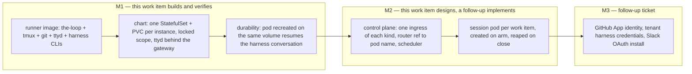

<!-- Authored per the the-loop:writing skill. Derived from brainstorm.md (same folder). -->

# Requirements: Containerize and offer the-loop as a SaaS product

> Phase 1 of 4 (requirements → design → testing plan → tasks). Tier 4
> (`human-approves-pr`, plus a named human security sign-off): the change projects
> tenant credentials into pods, puts a shell behind a gateway, and adds an inbound
> surface through which one process drives another.

## Introduction

[Issue #492](https://github.com/MadaraUchiha-314/the-loop/issues/492): "Containerize and
offer the-loop as a SaaS product."

**What is broken.** the-loop runs as one instance per person: a `cli-config.yaml` on a
laptop that owns its own poller, its own webhook receiver, its own Slack app and its own
tmux server. Nothing packages that instance for a cluster, so every adopter builds the
environment by hand from the Dockerfile snippet in `docs/sdk/environment.md`; nothing
survives the machine (the harness conversation and `work-item-state.json` live outside
git); and a second user needs a second Slack app, because Slack's Socket Mode allows one
consumer per app.

**What this changes.** The brainstorm ([`brainstorm.md`](brainstorm.md)) chose to build
the deployment first and the product second, on one thesis: the-loop's existing shape
already is the session pod. A work item is a durable state machine on disk, a session is a
tmux session named from the work-item ref, an instance is a config file with a lockable
scope, the API is mountable with no in-app auth, and a reply reaches a session through
`POST /api/v1/sessions/reply`. The new code is therefore an image, a chart, a router, a
scheduler and, later, an identity.

**Scope, as assumed.** The brainstorm's four human decisions (its open questions 1–4) were
put on the ticket and had no reply when the graph advanced this work item to
requirements. This document therefore carries the brainstorm's stated defaults as
**assumptions**, listed under *Open questions* below, and the `requirements-approval`
gate is where they are confirmed or redirected: an approval of this document is the
decision, a `changes-requested` is the correction. The assumptions are:

| # | Decision | Assumed answer |
|---|---|---|
| 1 | Scope of this work item | **M1 implemented and verified here; M2 designed here** (its requirements R6–R9 shape the M1 artifacts), implemented by a follow-up work item; M3 a follow-up ticket |
| 2 | Credential tenancy | GitHub App for the posting identity (M3); harness credentials are always the tenant's, projected into that tenant's pods only |
| 3 | Durability bar | the harness conversation survives a pod restart (a volume per pod); the pointer is committed with the artifacts; Temporal not used |
| 4 | Isolation default | per-work-item pod is the default placement; per-user and pool(X) are policy values; a nested sandbox is a declared follow-up |

**Delivery.** M1 is expected as a short stack of pull requests recorded against this work
item (image, chart, durability and docs), each small enough to review; the design decides
the exact split.

## Requirements

R1–R5 are milestone M1 and are implemented and verified by this work item. R6–R9 are
milestone M2: this work item produces their design, so that M1's image, chart and volume
layout are the ones M2 will run, and a follow-up work item implements them against the
design. R10 covers records and documentation.

### Requirement 1 — a runner image that satisfies the environment contract

**User story:** As an operator, I want one published container image that runs today's
instance unchanged, so that a pod is a `cli-config.yaml` and nothing else has to be
installed by hand.

#### Acceptance criteria (EARS)

1.1 The system SHALL publish a runner image whose entry point is `the-loop start`, built
from a Dockerfile kept in this repository and versioned with the CLI (the image tag SHALL
be the-loop's release version).

1.2 WHEN the SDK's environment check (`the_loop.sdk.check_environment`, the same check
`the-loop check` runs) is executed inside the image THEN it SHALL report every binary of
the environment contract present: `claude`, `codex`, `cursor-agent`, `tmux`, `git`,
`ttyd`.

1.3 The image SHALL carry no credential, token, harness login or `cli-config.yaml`: every
secret and the configuration SHALL enter at run time through environment variables or
mounted files, and a scan of the image's layers for the secret patterns the design names
SHALL find none.

1.4 The image SHALL run its process as a non-root user with a writable home directory,
because the harness CLIs keep their conversation store under the user's home.

1.5 WHEN the image starts with a `cli-config.yaml` mounted or rendered from the
environment THEN `the-loop start` SHALL bring up exactly the daemons that configuration
enables (`service.hostIngresses`, the web terminal, the poller), as it does on a host
today, with no image-specific code path in the CLI.

1.6 The Dockerfile snippet in `docs/sdk/environment.md` SHALL be replaced by, or made
identical to, the one the image is built from, so the documented environment and the
shipped environment cannot drift.

### Requirement 2 — a chart that runs instances in a cluster

**User story:** As an operator, I want a Kubernetes chart that runs one or more instances
from values, so that the instance's locked scope, its ports, its secrets and its storage
are declared once rather than hand-assembled.

#### Acceptance criteria (EARS)

2.1 The system SHALL ship a chart (the packaging format is the design's choice, open
question 7) that renders, for each declared instance, one StatefulSet with one replica and
one PersistentVolumeClaim, named from the instance name.

2.2 WHEN an instance is declared with a list of work items THEN the rendered
`cli-config.yaml` SHALL set `instance.name` to the instance's name and
`instance.scope.mode: locked` with exactly that list, so the pod refuses every event not
on its list, as a locked instance does today (issue-322).

2.3 The chart SHALL take every secret by reference to a Kubernetes Secret (the GitHub
token, the webhook secret, Slack tokens, each harness's credential) and SHALL NOT accept a
secret value in a chart value.

2.4 WHEN the chart renders THEN each pod SHALL carry CPU and memory requests and limits
from values, SHALL run with no privileged security context and no host path or host
network, and SHALL set `service.exposed: true` only behind a cluster-internal Service that
is not of type LoadBalancer or NodePort.

2.5 The chart SHALL render a NetworkPolicy for each instance pod that admits inbound
traffic only from the gateway (for the web terminal and the API) and, in M2, from the
control plane; all other inbound traffic SHALL be denied.

2.6 The chart SHALL expose the pod's web terminal (`routing.webTerminal`, ttyd) and its
API only through an ingress or gateway route that the operator's values bind to an
authentication mechanism, and WHEN no such mechanism is configured THEN the chart SHALL
render no route to the terminal.

2.7 The chart SHALL define liveness and readiness probes from the service's existing
health endpoint, so a pod whose service is down is restarted and a pod that is not ready
receives no traffic.

2.8 WHERE the operator declares a manager instance (`instance.role: manager`, issue-374)
the chart SHALL render it as one more instance with the fleet's members in its
configuration, and the dashboard served by it SHALL list every member's sessions.

2.9 WHEN the operator declares the poller, the webhook receiver or the Slack listener on
more than one instance of the fleet THEN the chart SHALL refuse to render (a validation
failure naming the duplicated ingress), because two consumers of one Slack app and two
pollers of one GitHub source are the documented multi-worker hazard.

### Requirement 3 — a pod recreated on the same volume resumes its work

**User story:** As a user whose work item is in progress, I want a pod that is killed,
rescheduled or upgraded to resume the harness conversation where it was, so that a pod
restart costs minutes, not the whole context.

#### Acceptance criteria (EARS)

3.1 The persistent volume of an instance pod SHALL carry `state.root` (the session
registry, event log, poll ledger and outbox), the harness's conversation store (the
harness home directory) and the workspace root (clones and worktrees), so that nothing a
running work item depends on lives only in the container's writable layer.

3.2 WHEN an instance pod is deleted and recreated on the same volume THEN `the-loop
start` SHALL find its session registry intact, the dispatcher's existing respawn path
(`resumeOnRespawn`, issue-89) SHALL respawn each registered session, and the harness SHALL
resume the recorded conversation (`claude --resume <id>`; Codex per issue-449's recency
rule) with the pre-restart context available to it. This SHALL be measured, not assumed
(open question 5).

3.3 WHEN a pod is recreated THEN delivery deduplication by delivery id SHALL continue
across the restart, so an event delivered before the restart is not replayed into the
session after it.

3.4 The system SHALL offer a way to commit and push `work-item-state.json` with the
artifacts at each phase change (a lifecycle hook on `phase.changed`, issue-344, enabled
from chart values and on by default in the chart), so that a reviewer sees where the item
stands and the pointer survives the loss of the volume.

3.5 WHEN the volume is lost THEN the work item SHALL be resumable from its committed spec
chain and pointer in a fresh conversation: a degraded resume, reported on the work item as
such, never a silent restart from `not-started`.

### Requirement 4 — a session is reachable for troubleshooting

**User story:** As an operator or an authorized user, I want to watch and, when needed,
drive a session's tmux window inside its pod, so that a stuck session can be diagnosed
without cluster shell access.

#### Acceptance criteria (EARS)

4.1 WHEN the web terminal is enabled for an instance THEN each of its tmux sessions SHALL
be reachable through the gateway at a path derived from the session's slug, under the
gateway's authentication (R2.6).

4.2 The dashboard's session card SHALL link to that path for the session it shows, on the
member instance and, where a manager is deployed, through the manager.

4.3 The transcript stream (`transcript` frames on `/api/v1/stream`) SHALL work for a
session inside a pod exactly as on a host, including through the manager's fan-in.

4.4 The documentation SHALL state the cluster-level escape hatch (`kubectl exec` into the
pod and `tmux attach`), the RBAC it needs, and that it is an operator's tool rather than a
user's.

### Requirement 5 — the image and chart are built, tested and published by CI

**User story:** As a maintainer, I want the image and the chart built and smoke-tested on
every release, so that a release that cannot run in a cluster is caught before it is
tagged.

#### Acceptance criteria (EARS)

5.1 WHEN a release is cut THEN CI SHALL build the runner image, run the environment check
inside it (R1.2) and the secret scan (R1.3), and publish it to the project's registry
under the release tag.

5.2 WHEN a pull request changes the Dockerfile, the chart or the start path THEN CI SHALL
render the chart with its default values and with the repository's own
`.the-loop/harness-config.yaml`-style example values, and SHALL fail on a rendering error
or on a validation failure (R2.9).

5.3 CI SHALL bring the chart up in a disposable cluster (kind or equivalent) at least on
release, run an instance to readiness (R2.7) and exercise R3.2's recreate-and-resume path
with a harness stub where a vendor login is unavailable.

### Requirement 6 — [M2, designed here] a control-plane role that owns all ingress

**User story:** As an operator of several users' work items, I want one process to own
the GitHub webhook, the poller and the Slack consumer for the whole deployment, so that
a second user never needs a second Slack app and no two pods poll the same source.

#### Acceptance criteria (EARS)

6.1 The system SHALL provide a control-plane role (image and start mode are the design's,
open question 8) that hosts the webhook receiver, the poller, the Slack listener, the
registry, the API and the dashboard, and launches no harness session itself.

6.2 WHEN the control plane runs with more than one replica THEN exactly one SHALL consume
each source (one Slack Socket Mode connection, one poll cycle per source), by a mechanism
the design names (leader election or single-replica ingress), so that scaling the API does
not multiply ingress.

6.3 The control plane SHALL carry no harness binary and no tenant harness credential.

6.4 The control plane SHALL be stateless beyond its registry, and its registry SHALL live
on a volume of its own or in the cluster's API (a ConfigMap or custom resource per work
item), never on a session pod's volume.

### Requirement 7 — [M2, designed here] events route to the session pod by name

**User story:** As the control plane, I want to forward an event for a work item to the
pod that owns it without a placement table, so that a recreated pod is found the same way
as the original.

#### Acceptance criteria (EARS)

7.1 WHEN an event resolves to a work-item ref THEN the control plane SHALL derive the
session pod's name deterministically from the ref with the slug rule tmux sessions use
today (`loop-<slug>`), and SHALL forward the event to that pod's `sessions/reply` surface.

7.2 WHEN no pod of that name exists THEN the control plane SHALL refuse the event with the
same classification the dispatcher gives an unstarted or finished work item today, and
SHALL NOT create a pod from it unless the event is an authorized arming event (R8.1).

7.3 WHEN a forward fails because the pod is not ready THEN the event SHALL be re-delivered
by the control plane's poller reconciliation on a later cycle, deduplicated by delivery
id, so that no queue is required for at-least-once delivery.

7.4 The Slack `work-item.reply` path SHALL become one more forward through R7.1, with the
control plane as the single Socket Mode consumer.

7.5 The forward from the control plane to a session pod SHALL be authenticated by a
mechanism the design names (a mesh identity, a per-deployment shared token, or the
cluster's network policy as the minimum), and a session pod SHALL accept a forward from no
other source.

### Requirement 8 — [M2, designed here] session pods are scheduled on arm and reaped on close

**User story:** As an operator, I want a work item's pod and volume to appear when an
authorized user arms the item and to disappear after it closes, so that capacity follows
the work and nothing lingers holding credentials.

#### Acceptance criteria (EARS)

8.1 WHEN an authorized user arms a work item (`the-loop execute`, under the existing
authorized-actor guard) THEN the control plane SHALL create a StatefulSet and a
PersistentVolumeClaim named from the ref, with a rendered `cli-config.yaml` whose instance
is `locked` to that one work item, and with only that work item's tenant Secrets mounted.

8.2 WHEN the work item's ticket is closed THEN the control plane SHALL delete the
workload and SHALL retain the volume for a configurable retention period before reaping
it, and the session's transcript SHALL remain readable for that period.

8.3 The placement policy SHALL be one control-plane setting with the values
`per-work-item` (default), `per-user` and `pool(X)`, and the pod naming rule SHALL carry
each (`loop-<slug>`, `loop-<user>`, `loop-pool-<n>`); only `per-work-item` is required to
be implemented by the follow-up, the other two being accepted values whose mechanics are
out of this work item's scope.

8.4 WHEN a session pod exceeds its resource limits or its process exits THEN the cluster
SHALL restart it on the same volume and R3.2 SHALL apply, with no control-plane action.

### Requirement 9 — [M2, designed here] a session pod has one inbound surface

**User story:** As a security reviewer, I want a session pod to accept traffic only from
the control plane and the gateway, so that a harness running arbitrary repository code
cannot be reached by, or reach into, another tenant's pod.

#### Acceptance criteria (EARS)

9.1 A session pod SHALL run with `service.hostIngresses: false`: no poller, no receiver,
no Slack listener of its own.

9.2 The session pod's NetworkPolicy SHALL admit inbound traffic only from the control
plane (the forward, R7) and the gateway (the web terminal, R4), and SHALL deny pod-to-pod
traffic between session pods.

9.3 Everything a session pod does toward GitHub, Jira or Slack SHALL be outbound, under
the credentials mounted into it (R8.1), as the CLI verbs do today.

### Requirement 10 — records and documentation

**User story:** As a reader of the capability docs, I want the deployment shape, its
decisions and the reasons for the rejected options to be findable, so that the next
adopter does not re-derive them.

#### Acceptance criteria (EARS)

10.1 The system SHALL add a capability doc for deployment (the image, the chart, the
volume layout, the troubleshooting paths, the M2 topology as designed) and SHALL update
`docs/capabilities/instances.md`, `docs/capabilities/control-plane.md`,
`docs/capabilities/interactive-sessions.md` and `docs/sdk/environment.md` where their
statements change, in the same pull requests as the change.

10.2 The system SHALL record as decisions under `docs/decisions/`: the role split (A3),
one pod per work item with the pod name as the route (B2 + C1), the volume per session pod
(E2) with the committed pointer (E1), and that a durable-execution engine (Temporal) is
not adopted and why.

10.3 The follow-up work items (M2 implementation, M3, the nested sandbox D4) SHALL be
opened as tickets that link this spec, before this work item completes.

## Non-functional requirements

- **Scaling.** The control plane's API scales by replicas (R6.2); session capacity scales
  by pods. Nothing in M1 or M2 introduces a component that must be a singleton other than
  the per-source ingress consumer.
- **Observability.** A pod logs to stdout as the daemons do on a host; the event log,
  the control records and the transcript stream are unchanged, so the existing dashboard
  and `the-loop sessions` verbs are the observability surface. Pod recreation, respawn
  and resume SHALL each leave a record in the event log.
- **Upgrades.** An image upgrade is a StatefulSet rollout on the same volume, so R3.2 is
  also the upgrade path. The chart version pins the image tag it was tested with.
- **Portability.** The chart SHALL assume only a ReadWriteOnce storage class, an ingress
  or gateway implementation and NetworkPolicy support; a cluster without NetworkPolicy
  enforcement SHALL be named as unsupported in the docs rather than silently weaker.
- **Cost of a session pod.** Requests and limits are values, not constants; the docs
  state a measured baseline (memory of tmux + one harness + ttyd at idle) from
  verification, not an estimate.

## Security considerations

- **Actors & trust.**
  - *Trusted:* the cluster operator (holds the chart values and the Secrets, has
    `kubectl`); authorized users on `routing.authorizedUsers`, who arm and answer gates.
  - *Semi-trusted:* the harness process inside a session pod. It runs repository code and
    acts on content from the work item, so it is assumed to be steerable by prompt
    injection and is contained, not trusted.
  - *Untrusted:* every GitHub, Jira or Slack user who can comment on a watched item;
    webhook request bodies until their HMAC verifies; the content of tickets, comments,
    PR titles and branches; the code in the repository being worked (a PR can carry
    arbitrary code the harness will run); any other pod in the cluster.
- **Trust boundaries & data.**
  1. Internet → control plane / instance ingress: unauthenticated until the GitHub HMAC
     verifies, the Slack signature verifies, or the poll response arrives over the
     authenticated API.
  2. Control plane → session pod forward (M2): a cluster-internal request that drives a
     harness session; whoever can reach it can inject into a session.
  3. Gateway → web terminal: a shell into the pod; the gateway's authentication is the
     only thing between the internet and `tmux attach`.
  4. Secrets → pod: the GitHub token, the webhook secret, Slack tokens and the tenant's
     harness credentials are projected as mounted Secrets; the harness home on the volume
     holds the harness's own login state.
  5. The volume: `state.root` carries the outbox (which may hold tokens), the event log
     (which carries personal data such as handles and comment text) and the harness
     conversation; a volume is per instance or per work item and is never shared across
     tenants.
  6. Image build: vendor CLIs are downloaded at build time; the image is a supply-chain
     artifact.
  7. `kubectl exec` and `tmux attach`: cluster RBAC is the boundary.
- **Abuse cases (EARS).**
  1. WHEN a GitHub webhook delivery to a pod or the control plane has a missing or invalid
     signature THEN the system SHALL reject it and SHALL NOT parse or route its body (the
     receiver's existing behaviour).
  2. WHEN the chart renders a control plane or an instance with the webhook receiver
     enabled and no webhook secret referenced THEN the chart SHALL refuse to render
     (stricter than the host receiver, which today warns and accepts unsigned deliveries
     when no secret is set).
  3. WHEN a request reaches a session pod's `sessions/reply` surface from any source other
     than the control plane (M2) or the gateway THEN the pod SHALL be unreachable to it by
     network policy, and the API SHALL additionally refuse it under R7.5's mechanism.
  4. WHEN an unauthenticated request reaches the gateway path of a web terminal THEN the
     gateway SHALL refuse it, and WHEN no authentication mechanism is configured THEN no
     terminal route SHALL exist at all (R2.6).
  5. WHEN a Secret belonging to tenant A is referenced by a pod rendered for tenant B's
     work item (M2) THEN the control plane SHALL refuse to create the pod; a pod SHALL
     mount only the Secrets of the tenant whose work item it is locked to.
  6. WHEN a session pod attempts to open a connection to another session pod or to the
     control plane's ingress ports THEN the NetworkPolicy SHALL deny it.
  7. WHEN a harness inside a session pod escapes its worktree THEN it SHALL still be
     confined to its own pod: no privileged context, no host path, no host network, no
     service-account token mounted unless the design names a use for it.
  8. WHEN an unauthorized user comments `the-loop execute` on a work item THEN the control
     plane SHALL NOT create a pod (R7.2, R8.1), exactly as the dispatcher refuses an
     unauthorized start today.
  9. WHEN a comment carries the-loop's own loop-prevention marker THEN it SHALL NOT be
     forwarded to a session, so the deployment cannot drive itself.
  10. WHEN an image is built THEN it SHALL contain no credential (R1.3), and WHEN a pod
      logs a request, a forward or an error THEN it SHALL NOT log a token, an
      `Authorization` header or a Secret's contents.
  11. WHEN a volume is retained after a work item closes (R8.2) THEN no other work item's
      pod SHALL be able to mount it (the claim is named from the ref and is
      ReadWriteOnce).
  12. WHEN ticket, comment or PR content is placed into a harness prompt THEN it SHALL be
      framed as untrusted data, as today; nothing in this work item changes the
      authorized-actor guard, the marker or the scope decision (a constraint carried in
      from the brainstorm).
- **Fail closed.** Missing webhook secret → the receiver is not rendered; missing gateway
  authentication → no terminal route; missing harness credential for a pod → the pod
  starts the-loop but no session, and reports it on the work item; an event whose ref
  resolves to no pod → refused, never a pod created; an ambiguous tenant for a Secret →
  the pod is not created; a cluster without NetworkPolicy enforcement → documented as
  unsupported, and the chart's values SHALL require an explicit acknowledgement to render
  without the policies.

## Out of scope

- **M3, the product tier:** the GitHub App posting identity, tenant onboarding and
  bring-your-own harness credentials as a flow, the Slack OAuth install (issue-387),
  billing and per-tenant quotas. Its assumptions (decision 2) shape M2's Secret layout
  and nothing else here.
- **The M2 implementation** itself: its requirements (R6–R9) are designed in this work
  item so that M1's artifacts are the ones M2 will run; a follow-up work item implements
  them (R10.3). An approver who widens the scope to "M1 + M2 implemented" does so at the
  gate, and the design then covers both.
- **D4, a nested sandbox** (gVisor, Kata or a sidecar) inside the session pod: a declared
  follow-up with its own threat model, not silently skipped.
- **C3, a queue per work item**, and **E3/E4**, a durable-execution engine or object-store
  checkpoints: rejected in the brainstorm for the reasons recorded there.
- **B3's pool placement mechanics** beyond accepting `pool(X)` as a policy value (R8.3).
- A second packaging format (kustomize alongside a chart, or the reverse) beyond the one
  the design picks.

## Open questions

Decisions 1–4 were raised on the ticket ([the ask of 2026-10-16](https://github.com/MadaraUchiha-314/the-loop/issues/492#issuecomment-6218447073))
and are carried here as assumptions pending the `requirements-approval` gate:

1. **Scope** — assumed M1 implemented, M2 designed, M3 a follow-up (see *Introduction*).
   A different answer changes which of R6–R9 are implemented here and the risk tier's
   sign-off surface, not the requirements' content.
2. **Credential tenancy** — assumed GitHub App identity later, harness credentials always
   the tenant's. The alternative (the service holds every tenant's personal token) would
   add a credential store to M2 and raise the tier further.
3. **Durability bar** — assumed the conversation survives a restart (R3), pointer
   committed (R3.4), no Temporal (R10.2). The lossy alternative deletes R3.1–R3.3 and
   keeps R3.5 only.
4. **Isolation default** — assumed per-work-item (R8.3), nested sandbox a follow-up.

Design-phase questions carried from the brainstorm, answered by measurement in `design.md`:

- **Q5.** Does Claude Code resume from a restored home on a pod with a different hostname and
   uid; does `codex resume --last` with a restored `CODEX_HOME`? (R3.2)
- **Q6.** Does GitHub App authentication fit PyGithub's current use without touching every call
   site, and what does the authorized-actor guard read when the allow-list is per tenant?
   (M3-facing, settled enough in design to keep M2's Secret layout right.)
- **Q7.** Packaging: Helm chart in this repository, kustomize, or both; and the cluster-native
   form of M2's registry (ConfigMap, custom resource, or the StatefulSet's existence).
- **Q8.** What `the-loop start` becomes in a session pod and in the control plane: the daemon
   set with ingress disabled, or a new role flag that runs only the dispatcher and the
   API.

## Review comments

> Appended by the-loop's `record-feedback` hook when a human gate approves with
> comments (issue-109). Append-only and attributed: an approval never silently
> discards a reviewer's suggestions, and the feedback travels with the document
> it concerns rather than living in a side-channel tracker.
