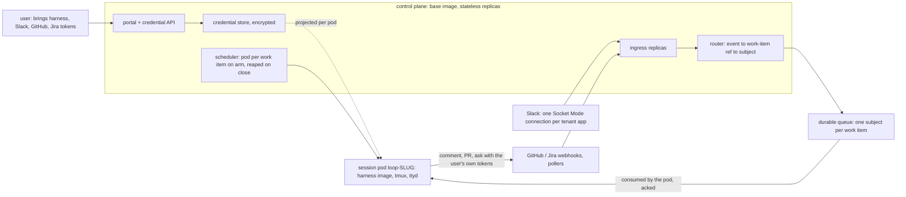

<!-- Authored per the the-loop:writing skill. Derived from brainstorm.md (same folder),
     re-derived on 2026-10-16 after the review of PR #493 decided its open questions. -->

# Requirements: Containerize and offer the-loop as a SaaS product

> Phase 1 of 4 (requirements → design → testing plan → tasks). Tier 5
> (`human-approves-spec-and-pr`, plus a named human security sign-off): the change
> stores every user's harness, Slack, GitHub and Jira tokens in a multi-tenant credential
> store, exposes a portal to manage them, projects them into pods, and puts a shell
> behind a gateway.

## Introduction

[Issue #492](https://github.com/MadaraUchiha-314/the-loop/issues/492): "Containerize and
offer the-loop as a SaaS product."

**What is broken.** the-loop runs as one instance per person: a `cli-config.yaml` on a
laptop that owns its own poller, its own webhook receiver, its own Slack app and its own
tmux server. Nothing packages that instance for a cluster, so every adopter builds the
environment by hand from the Dockerfile snippet in `docs/sdk/environment.md`; a second
user needs a second Slack app, because Slack's Socket Mode allows one consumer per app;
and there is no way for a user to hand the system their credentials other than editing a
config file on the machine that runs it.

**What this changes.** The brainstorm ([`brainstorm.md`](brainstorm.md)) and the review
of PR #493 settled the shape on one thesis: the-loop's existing shape already is the
session pod. A work item is a durable state machine on disk, a session is a tmux session
named from the work-item ref, an instance is a config file with a lockable scope, and the
API is mountable with no in-app auth. The new code is images, a chart, a control plane
that publishes every event to a durable queue, a scheduler, and a credential store with a
portal.

**Decisions carried in from the review** (each links its thread on PR #493):

| # | Decision | Answer |
|---|---|---|
| 1 | Scope | all three milestones in this work item, delivered as a stack of pull requests recorded against #492 ([thread](https://github.com/MadaraUchiha-314/the-loop/pull/493#discussion_r4298617505)) |
| 2 | Packaging | a base image plus one image per harness; the base image is the control plane's ([thread](https://github.com/MadaraUchiha-314/the-loop/pull/493#discussion_r4296967363)) |
| 3 | Routing | a durable queue with one subject per work item; the session pod consumes its own subject ([thread](https://github.com/MadaraUchiha-314/the-loop/pull/493#discussion_r4298570896)) |
| 4 | Isolation | one pod per work item, the only placement in scope ([thread](https://github.com/MadaraUchiha-314/the-loop/pull/493#discussion_r4298549938), [thread](https://github.com/MadaraUchiha-314/the-loop/pull/493#discussion_r4298639603)) |
| 5 | Credentials | users bring every credential, through an API and a portal that also maintain them when they expire ([thread](https://github.com/MadaraUchiha-314/the-loop/pull/493#discussion_r4298609618), [thread](https://github.com/MadaraUchiha-314/the-loop/pull/493#discussion_r4298630674)) |
| 6 | Durability | the harness conversation's survival across a restart is decoupled, a follow-up; event delivery is durable through the queue ([thread](https://github.com/MadaraUchiha-314/the-loop/pull/493#discussion_r4298637719)) |
| 7 | Scale | one control plane must not become the bottleneck from 1 to 10 to thousands of users ([thread](https://github.com/MadaraUchiha-314/the-loop/pull/493#discussion_r4298464660)) |

**Milestones and delivery.** M1 images and a chart that run an instance in a cluster
(R1, R2, R5); M2 the control plane, the queue and the scheduler (R3, R4, R6, R7, R8); M3
tenancy, the credential store and the portal (R9, R10). Each milestone is one or more
pull requests recorded in `evidence/pull-requests.md`; the design fixes the split and the
order.

## Requirements

### Requirement 1 — a base image and one image per harness

**User story:** As an operator, I want published container images in which a pod is a
`cli-config.yaml` and nothing else, so that the control plane runs on a base image with
no vendor CLI and a session pod runs only the harness its work item chose.

#### Acceptance criteria (EARS)

1.1 The system SHALL publish a base image carrying the-loop and the non-harness binaries
of the environment contract (`tmux`, `git`, `ttyd`) and no harness, and one image per
harness (`claude`, `codex`, `cursor-agent`) layered on that base, all built from
Dockerfiles kept in this repository and tagged with the-loop's release version.

1.2 WHEN the SDK's environment check (`the_loop.sdk.check_environment`, the same check
`the-loop check` runs) is executed inside a harness image THEN it SHALL report that
harness's binary present together with `tmux`, `git` and `ttyd`; WHEN it is executed
inside the base image THEN it SHALL report the harness binaries absent as expected for
the control-plane role rather than as a failure.

1.3 WHEN a session pod is created for a work item THEN it SHALL run the image of the
harness that work item froze at `phase-selection` (the `harness-*` decision, issue-440).

1.4 No image SHALL carry a credential, token, harness login or `cli-config.yaml`: every
secret and the configuration SHALL enter at run time through environment variables or
mounted files, and a scan of each image's layers for the secret patterns the design names
SHALL find none.

1.5 Each image SHALL run its process as a non-root user with a writable home directory,
because the harness CLIs keep their state under the user's home.

1.6 The entry point of every image SHALL be `the-loop start`; the role a container plays
(control plane or session) SHALL come from its rendered configuration, with no
image-specific code path in the CLI.

1.7 The Dockerfile snippet in `docs/sdk/environment.md` SHALL be replaced by, or made
identical to, the base Dockerfile the images are built from.

### Requirement 2 — a chart that runs the deployment from values

**User story:** As an operator, I want one chart that renders the control plane and the
template of a session pod from values, so that ports, limits, secrets and network
policies are declared once.

#### Acceptance criteria (EARS)

2.1 The system SHALL ship a chart (format per open question Q7) that renders the control
plane as a Deployment with a configurable replica count, the queue's connection, the
gateway routes, and the template the scheduler uses for session pods.

2.2 WHEN a session pod is rendered for a work item THEN its `cli-config.yaml` SHALL set
`instance.name` to the pod's name and `instance.scope.mode: locked` with exactly that one
work item, so the pod refuses every event not addressed to it (issue-322), and
`service.hostIngresses: false`, so it runs no poller, receiver or Slack listener of its
own.

2.3 The chart SHALL take every secret by reference to a Kubernetes Secret or to the
credential store (R9) and SHALL NOT accept a secret value in a chart value.

2.4 Every rendered pod SHALL carry CPU and memory requests and limits from values, SHALL
run with no privileged security context, no host path, no host network and no
service-account token unless the design names a use for it, and SHALL expose the API
only through a cluster-internal Service.

2.5 The chart SHALL render a NetworkPolicy for each session pod that admits inbound
traffic only from the gateway (the web terminal), denies traffic between session pods,
and allows outbound traffic only to the queue, the control plane's API and the internet
hosts the work needs (GitHub, Jira, Slack, the harness vendor).

2.6 The chart SHALL expose a session pod's web terminal (`routing.webTerminal`, ttyd)
and the control plane's portal and API only through a gateway route bound to the
operator's authentication mechanism, and WHEN no such mechanism is configured THEN the
chart SHALL render no terminal route and no portal route.

2.7 The chart SHALL define liveness and readiness probes from the service's existing
health endpoint for the control plane and for session pods.

2.8 WHEN the chart renders the webhook receiver with no webhook secret referenced THEN it
SHALL refuse to render, naming the missing reference.

2.9 WHERE an operator wants M1 alone (a single instance in a cluster, no control plane)
the chart SHALL render that instance as one StatefulSet with one replica and one volume,
with the same probes, limits and policies, so M1 is a usable deployment and not only a
stepping stone.

### Requirement 3 — a control plane that owns all ingress and scales by replicas

**User story:** As an operator of many users' work items, I want one deployment to own
every webhook, poller and Slack connection, so that no two pods consume the same source
and no user needs their own Slack app.

#### Acceptance criteria (EARS)

3.1 The system SHALL provide a control-plane role, running on the base image, that hosts
the webhook receiver, the pollers, the Slack listeners, the registry, the API, the
dashboard and the portal (R10), and launches no harness session itself.

3.2 WHEN a GitHub or Jira webhook delivery arrives at any control-plane replica THEN that
replica SHALL verify it, resolve it to a work-item ref and publish it to the queue (R4)
without holding any per-issue state, so the receiver scales by replica count behind the
load balancer.

3.3 Polling SHALL be per source (one request per repository or Jira project per cycle),
not per issue, and WHEN the control plane runs with more than one replica THEN each
configured source SHALL be polled by exactly one replica, assigned by a shard key the
design names, so that adding replicas divides the poll load and never multiplies it.

3.4 WHEN a tenant has registered a Slack token (R9) THEN exactly one control-plane
replica SHALL hold that tenant's Socket Mode connection, assigned by the same sharding,
and the connection SHALL move to another replica when its holder is unavailable.

3.5 The control plane SHALL carry no harness binary and no tenant harness credential in
its own process environment; credentials it holds live in the credential store (R9) and
reach a session pod only by projection (R9.4).

3.6 The control plane SHALL be stateless beyond the registry and the credential store,
and its registry SHALL live in the cluster's API (a ConfigMap or custom resource per
work item) or on a volume of its own, never on a session pod's volume.

3.7 The deployment SHALL have no singleton: for 1 user, 10 users and thousands of users
the design SHALL show which components scale by replica, which by session pod, and the
shard key for each per-source consumer, and verification SHALL exercise at least the
two-replica case with sources on both replicas.

### Requirement 4 — events reach the session pod through a durable queue

**User story:** As the control plane, I want to publish an event once and know that the
pod owning the work item receives it, whether that pod is up now or comes back later, so
that nothing a user says is lost while a pod is down.

#### Acceptance criteria (EARS)

4.1 WHEN an event resolves to a work-item ref THEN the control plane SHALL publish it on
a subject named deterministically from the ref with the slug rule tmux sessions use today
(`loop-<slug>`), keyed by the event's delivery id.

4.2 A session pod SHALL consume only its own subject, over an outbound connection it
opens with credentials scoped to that one subject (R9.5), and SHALL acknowledge an event
only after the dispatcher has recorded it for the session.

4.3 WHEN a session pod is down, not yet created, or not ready THEN its subject SHALL
retain the events published to it, and WHEN the pod subscribes THEN it SHALL receive them
in publish order; the retention SHALL be at least the work item's lifetime plus the
reaping retention of R6.2.

4.4 Delivery SHALL be at least once, and the dispatcher's existing deduplication by
delivery id SHALL make a redelivered event idempotent, so a crash between delivery and
acknowledgement cannot replay a comment into a session.

4.5 WHEN an event resolves to a work item that has no subject (never armed, or reaped)
THEN the control plane SHALL refuse it with the classification the dispatcher gives an
unstarted or finished work item today, and SHALL NOT create a subject or a pod from it
unless the event is an authorized arming event (R6.1).

4.6 The queue SHALL sit behind one interface in the CLI with the technology chosen in
design (Q9), so that a deployment can pick NATS JetStream, Redis Streams or a cloud queue
without a code change, and the Slack `work-item.reply` path SHALL publish through the
same interface.

4.7 The control plane SHALL expose, on its API and dashboard, each subject's backlog
depth and the age of its oldest unacknowledged event, so an operator can see a pod that
is not consuming.

### Requirement 5 — a session is reachable for troubleshooting

**User story:** As an operator or an authorized user, I want to watch and, when needed,
drive a session's tmux window inside its pod, so that a stuck session can be diagnosed
without cluster shell access.

#### Acceptance criteria (EARS)

5.1 WHEN the web terminal is enabled THEN each session pod's tmux session SHALL be
reachable through the gateway at a path derived from the session's slug, under the
gateway's authentication (R2.6), and only by users of the tenant that owns the work item
(R10.3).

5.2 The dashboard's session card SHALL link to that path for the session it shows.

5.3 The transcript stream (`transcript` frames on `/api/v1/stream`) SHALL work for a
session inside a pod exactly as on a host, fanned in through the control plane.

5.4 The documentation SHALL state the cluster-level escape hatch (`kubectl exec` into the
pod and `tmux attach`), the RBAC it needs, and that it is an operator's tool rather than a
user's.

### Requirement 6 — session pods are scheduled on arm and reaped on close

**User story:** As an operator, I want a work item's pod to appear when an authorized
user arms the item and to disappear after it closes, so that capacity follows the work
and nothing lingers holding credentials.

#### Acceptance criteria (EARS)

6.1 WHEN an authorized user arms a work item (`the-loop execute`, under the existing
authorized-actor guard) THEN the control plane SHALL create the subject (R4.1) and a
StatefulSet named from the ref, running the harness image of R1.3, with a rendered
`cli-config.yaml` locked to that one work item (R2.2) and with only that work item's
owner's credentials projected (R9.4).

6.2 WHEN the work item's ticket is closed THEN the control plane SHALL delete the
workload, retain the pod's volume and the subject for a configurable retention period
during which the session's transcript stays readable, then reap both.

6.3 WHEN a session pod exceeds its limits or its process exits THEN the cluster SHALL
restart it under the same name with no control-plane action, and R7 SHALL apply.

6.4 Placement SHALL be one pod per work item. No other placement (per user, a shared
pool) is in scope; the design MAY leave the naming rule open to them.

6.5 WHEN a tenant's registered credentials are revoked or expired (R9.6) THEN the control
plane SHALL NOT create new pods for that tenant's work items, and SHALL report the
reason on the work item that asked.

### Requirement 7 — a restarted pod resumes from the committed record

**User story:** As a user whose work item is in progress, I want a pod that is killed or
upgraded to pick the work up again from its committed spec chain, so that a restart costs
a re-read, not the work.

#### Acceptance criteria (EARS)

7.1 WHEN a session pod starts and finds a session registered for its work item THEN the
dispatcher's existing respawn path SHALL start the harness, and WHERE the harness's
conversation is not available on the pod THEN the session SHALL resume from the committed
spec chain and `work-item-state.json` in a fresh conversation, and SHALL say so on the
work item (a degraded resume, never a silent restart from `not-started`).

7.2 The pod's volume, where the chart gives it one, SHALL carry `state.root` and the
workspace; whether the harness's conversation store also survives a restart is the
follow-up decided in review (decision 6) and SHALL be opened as a ticket (R11.3).

7.3 WHEN a pod restarts THEN delivery deduplication (R4.4) SHALL continue across the
restart, so events acknowledged before it are not replayed after it.

### Requirement 8 — the deployment is built, tested and published by CI

**User story:** As a maintainer, I want the images and the chart built and smoke-tested
on every release, so that a release that cannot run in a cluster is caught before it is
tagged.

#### Acceptance criteria (EARS)

8.1 WHEN a release is cut THEN CI SHALL build every image, run the environment check
inside each (R1.2) and the secret scan (R1.4), and publish them under the release tag.

8.2 WHEN a pull request changes a Dockerfile, the chart or the start path THEN CI SHALL
render the chart with its default values and with example values, and SHALL fail on a
rendering error or a validation refusal (R2.8).

8.3 CI SHALL bring the chart up in a disposable cluster at least on release, run the
control plane to readiness with two replicas (R3.7), arm a work item with a harness stub,
observe the pod created and the subject consumed, kill the pod while an event is
published, and observe the event delivered after the restart (R4.3).

### Requirement 9 — users bring every credential, through an API and a portal

**User story:** As a user of the service, I want to give it my own harness, Slack,
GitHub and Jira tokens once, see when they expire, and replace them, so that the work
runs under my identities and I never hand them to an operator.

#### Acceptance criteria (EARS)

9.1 The control plane SHALL provide a credential API under `/api/v1` and a portal page on
which an authenticated user (R10.1) registers, replaces and deletes credentials of the
kinds `harness` (Claude, Codex or Cursor, the design naming each vendor's token form),
`slack`, `github` and `jira`, with an optional expiry and a label.

9.2 WHEN a credential is registered THEN the system SHALL validate it against its provider
(a read of the authenticated identity) before storing it, SHALL store it encrypted at rest
in a store the design names (Kubernetes Secrets with encryption at rest, or an external
secret store), and SHALL return to the user only the credential's id, kind, label,
provider identity and expiry, never its value.

9.3 WHEN a user lists credentials THEN the system SHALL return only that user's, and no
API or portal path SHALL return a stored value to anyone, including the operator.

9.4 WHEN a session pod is created for a work item THEN only the credentials of the user
who armed it SHALL be projected into the pod, in the environment the CLI and the harness
already read (`GH_TOKEN`, the Jira and Slack variables, each harness's login), and no
credential SHALL be written to `state.root`, the workspace or a log.

9.5 Every session pod SHALL receive queue credentials scoped to its own subject (R4.2),
issued at creation and revoked at reaping.

9.6 WHEN a credential's expiry is within a threshold the operator configures, or a
provider rejects it as invalid THEN the system SHALL mark it as expiring or revoked, SHALL
notify the user through the operator's channel and on the portal, and SHALL stop
projecting it into new pods (R6.5); running pods SHALL keep the credential they started
with until they are reaped.

9.7 WHEN a user replaces a credential THEN pods created afterwards SHALL receive the new
value, and the old value SHALL be deleted from the store once no running pod references
it.

9.8 Every credential operation (register, replace, delete, project, expire) SHALL leave
an audit record naming the user, the kind, the credential id and the time, never the
value.

9.9 The posting identity SHALL remain the user's own GitHub token (decision-023): every
comment, label and pull request the loop makes for a work item SHALL be made with the
token of the user who armed it, and the loop-prevention marker SHALL stay on every
comment, so a tenant's own comments cannot resume their own session.

### Requirement 10 — a tenant sees only their own work

**User story:** As a user of a shared deployment, I want my work items, sessions,
terminals and credentials to be visible and operable only by me and the people I
authorize, so that sharing the deployment shares none of my work.

#### Acceptance criteria (EARS)

10.1 Identity SHALL come from the gateway (decision-059: no in-app auth): the control
plane SHALL read the authenticated user from the gateway's identity header on every
portal, API and terminal request, SHALL treat a request without one as anonymous and
refuse everything but health, and the chart SHALL configure the gateway to strip that
header from incoming traffic so a client cannot supply it.

10.2 A work item SHALL belong to the user who armed it, and that user's
`routing.authorizedUsers` entry SHALL be the one the authorized-actor guard reads for
that work item, so that one tenant's allow-list never authorizes another tenant's items.

10.3 WHEN a user requests a work item, a session, a terminal, a transcript or a
credential they do not own THEN the system SHALL respond as if it did not exist.

10.4 The dashboard SHALL list, for the authenticated user, only their work items and
sessions; an operator role, named in the chart's values, MAY see every tenant's work
items and sessions but never a credential value.

10.5 WHEN a tenant registers a Slack token THEN the Slack rooms it can reach SHALL be
usable only as that tenant's channels, and a `work-item.reply` from that Slack workspace
SHALL be routed only to that tenant's work items.

### Requirement 11 — records and documentation

**User story:** As a reader of the capability docs, I want the deployment shape, its
decisions and the reasons for the rejected options to be findable, so that the next
adopter does not re-derive them.

#### Acceptance criteria (EARS)

11.1 The system SHALL add a capability doc for deployment (the images, the chart, the
control plane and queue, the scheduler, the credential store and portal, the
troubleshooting paths, the scaling model with its shard keys) and SHALL update
`docs/capabilities/instances.md`, `docs/capabilities/control-plane.md`,
`docs/capabilities/channels.md`, `docs/capabilities/interactive-sessions.md` and
`docs/sdk/environment.md` where their statements change, in the same pull requests as the
change.

11.2 The system SHALL record as decisions under `docs/decisions/`: the base-plus-harness
images, one pod per work item with a queue subject per work item, the user-owned
credential model with the posting identity unchanged, and that a durable-execution
engine (Temporal) is not adopted and why.

11.3 The follow-up work items (volume-backed survival of the harness conversation, the
nested sandbox D4, a GitHub App for webhook ingress at scale) SHALL be opened as tickets
that link this spec before this work item completes.

## Non-functional requirements

- **Scaling.** R3.7 is the requirement; the design carries the capacity model. Nothing in
  the deployment is a singleton: ingress scales by control-plane replicas, sessions by
  pods, the queue by its own technology's clustering.
- **Observability.** A pod logs to stdout as the daemons do on a host; the event log, the
  control records and the transcript stream are unchanged. The control plane exposes
  per-subject backlog (R4.7), per-replica shard assignment (R3.3) and credential expiry
  state (R9.6) on its API and dashboard.
- **Upgrades.** An image upgrade is a rollout: the control plane by Deployment, a session
  pod by StatefulSet under R7. The chart version pins the image tags it was tested with.
- **Portability.** The chart assumes an ingress or gateway implementation that can inject
  an identity header, NetworkPolicy enforcement, and one supported queue; a cluster
  without NetworkPolicy enforcement is named unsupported in the docs, and the chart
  requires an explicit acknowledgement to render without the policies.
- **Cost of a session pod.** Requests and limits are values, not constants; the docs
  state a measured baseline (tmux + one harness + ttyd at idle) from verification.
- **Portal.** The portal is a user-facing surface: `design/` carries its prototypes and
  the designer collaborator reviews them (the skill's design-artifacts rule).

## Security considerations

- **Actors & trust.**
  - *Trusted:* the cluster operator (chart values, the gateway, `kubectl`), who can see
    every tenant's work items but no credential value.
  - *Tenant users:* authenticated by the gateway, trusted for their own work items and
    credentials only; each is an untrusted actor toward every other tenant.
  - *Semi-trusted:* the harness process inside a session pod. It runs repository code and
    acts on work-item content, so it is assumed steerable by prompt injection and is
    contained, not trusted.
  - *Untrusted:* every GitHub, Jira or Slack user who can comment on a watched item;
    webhook bodies until their signature verifies; ticket, comment, PR and branch content;
    the code in the repository being worked; any other pod in the cluster; any client of
    the portal before the gateway authenticates it.
- **Trust boundaries & data.**
  1. Internet → gateway → control plane: the identity header is minted by the gateway
     and is the only identity the control plane has.
  2. Internet → webhook receiver: unauthenticated until the HMAC or signature verifies.
  3. Control plane → queue → session pod: the queue carries events that drive a harness;
     whoever can publish to a subject can inject into that session, whoever can subscribe
     can read what users said.
  4. Gateway → web terminal: a shell into a pod; the gateway's authentication plus R10.3
     are the only things between the internet and `tmux attach`.
  5. Credential store: every user's harness, Slack, GitHub and Jira tokens at rest; the
     projection path into pods; the audit log.
  6. The pod's volume and `state.root`: the outbox, the event log (handles, comment
     text), the harness state; per work item, never shared.
  7. Image build: vendor CLIs downloaded at build time; the images are supply-chain
     artifacts.
  8. `kubectl exec`: cluster RBAC.
- **Abuse cases (EARS).**
  1. WHEN a webhook delivery has a missing or invalid signature THEN the system SHALL
     reject it and SHALL NOT parse, publish or route its body.
  2. WHEN a request carries the gateway's identity header but did not pass through the
     gateway THEN the gateway configuration SHALL have stripped it, and a request reaching
     the control plane with no header SHALL be anonymous and refused (R10.1).
  3. WHEN a session pod's queue credentials are used to publish, or to subscribe to any
     subject other than its own THEN the queue SHALL refuse the operation (R9.5).
  4. WHEN a client reaches a terminal path for a session its user does not own THEN the
     system SHALL respond as if it did not exist (R10.3), and WHEN no gateway
     authentication is configured THEN no terminal or portal route SHALL exist (R2.6).
  5. WHEN a credential of user A would be projected into a pod for a work item armed by
     user B THEN the control plane SHALL refuse to create the pod (R9.4).
  6. WHEN any API or portal path is asked for a credential's value THEN the system SHALL
     NOT return it, to anyone, under any role (R9.3).
  7. WHEN a session pod opens a connection to another session pod, to the control plane's
     ingress ports or to a host outside its allow-list THEN the NetworkPolicy SHALL deny
     it (R2.5).
  8. WHEN a harness inside a session pod escapes its worktree THEN it SHALL still be
     confined to its pod: no privileged context, no host path, no host network, no
     service-account token, and only its own user's credentials in reach.
  9. WHEN an unauthorized user comments `the-loop execute` THEN the control plane SHALL
     NOT create a subject or a pod (R4.5, R6.1), as the dispatcher refuses an
     unauthorized start today.
  10. WHEN a comment carries the-loop's own loop-prevention marker THEN it SHALL NOT be
      published to a subject, so the deployment cannot drive itself.
  11. WHEN an image is built THEN it SHALL contain no credential (R1.4), and WHEN any
      component logs a request, an event, a projection or an error THEN it SHALL NOT log a
      token, an `Authorization` header, a queue credential or a stored value.
  12. WHEN a subject or volume is retained after a work item closes (R6.2) THEN no other
      work item's pod SHALL be able to consume or mount it.
  13. WHEN a credential is reported invalid by its provider THEN it SHALL stop being
      projected (R9.6) and the event SHALL be audited (R9.8), so a leaked token that was
      revoked upstream cannot keep starting pods.
  14. WHEN ticket, comment or PR content is placed into a harness prompt THEN it SHALL be
      framed as untrusted data, as today; nothing in this work item changes the
      authorized-actor guard, the marker or the scope decision.
- **Fail closed.** No identity header → anonymous, refused; no gateway authentication →
  no portal and no terminal route; no webhook secret → the receiver is not rendered; a
  credential missing, expired or revoked for a pod → the pod is not created and the work
  item is told; an event whose ref has no subject → refused, never a subject created; an
  ambiguous owner for a credential or a work item → refused; a queue credential that
  cannot be scoped to one subject → the pod is not created; a cluster without
  NetworkPolicy enforcement → unsupported unless explicitly acknowledged in values.

## Out of scope

- **Volume-backed survival of the harness conversation across a pod restart** (E2):
  decoupled in review, a follow-up ticket (R11.3). R7 states the degraded resume this
  work item guarantees.
- **D4, a nested sandbox** inside the session pod: a declared follow-up with its own
  threat model.
- **A GitHub App** as posting identity: not needed, since users bring their own GitHub
  token (R9.9). As an ingress for webhooks at scale it is a follow-up (R11.3).
- **Other placements** (per user, a shared pool): per-work-item is the only one (R6.4).
- **Billing, quotas and plans:** not raised; a tenant's isolation is in scope, their
  metering is not.
- **E3 and E4** (a durable-execution engine, object-store checkpoints) and **C1's
  forward**: rejected in the brainstorm for the reasons recorded there.
- A second packaging format beyond the one the design picks.

## Open questions

The brainstorm's four human questions are decided (the table in the *Introduction*).
Design-phase questions, answered by measurement or choice in `design.md`:

- **Q5.** Does Claude Code resume from a restored home on a pod with a different hostname
  and uid; does `codex resume --last` with a restored `CODEX_HOME`? (Informs the follow-up
  of R7.2, not this work item's gate.)
- **Q6.** What does the authorized-actor guard read when the allow-list is per tenant
  (R10.2), and how does a tenant declare the users they authorize?
- **Q7.** Packaging: Helm chart in this repository, kustomize, or both; and the
  cluster-native form of the registry (ConfigMap, custom resource, or the StatefulSet's
  existence).
- **Q8.** What `the-loop start` becomes in a session pod and in the control plane: the
  daemon set with ingress disabled, or a role flag that runs only the dispatcher and the
  API.
- **Q9.** The queue technology behind R4.6's interface (NATS JetStream, Redis Streams, a
  cloud queue) and how per-subject credentials (R9.5) are issued on each.
- **Q10.** The credential store (Kubernetes Secrets with encryption at rest, or an external
  secret store) and the projection mechanism into pods.
- **Q11.** Which gateway identity mechanism the reference deployment documents (an OIDC
  proxy is the likely candidate), and the exact header contract.
- **Q12.** The shard key for pollers and Slack connections across replicas (R3.3, R3.4):
  consistent hashing with leases, or a leader that assigns.

## Review comments

> Appended by the-loop's `record-feedback` hook when a human gate approves with
> comments (issue-109). Append-only and attributed: an approval never silently
> discards a reviewer's suggestions, and the feedback travels with the document
> it concerns rather than living in a side-channel tracker.
