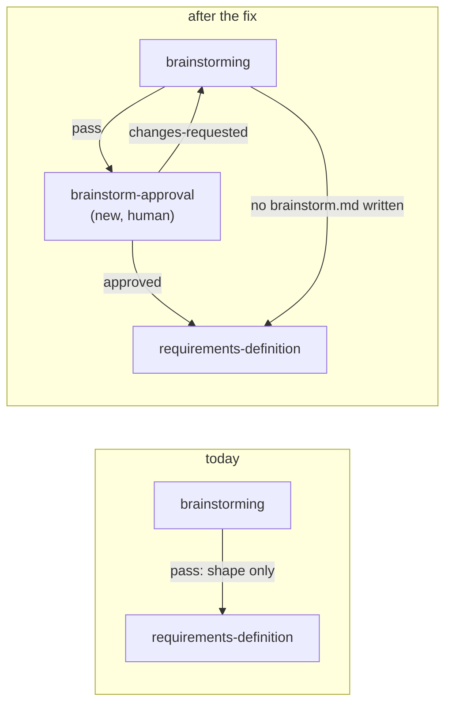

<!-- Authored per the the-loop:writing skill. -->

# Bugfix spec: a brainstorm moves on before its author has finished with it

> Phase 1 (bugfix → design → testing plan → tasks). Tier 3 (`human-approves-pr`): it adds
> a human gate to the shipped outer-loop graph and a row to the `phase-selection`
> checklist. No credential, token scope or schema changes.

## Summary

[Issue #494](https://github.com/MadaraUchiha-314/the-loop/issues/494), opened by
@MadaraUchiha-314: *"Any comment on the PR or work item in the brainstorming phase
immediately moves it to requirements phase."* The fix the issue asks for: *"an approval
phase for the brainstorming phase as well … so that the author can add multiple comments
during the brainstorming phase and ask clarification questions."*

**Impact.** Brainstorming is the one phase meant to stay open while the author thinks out
loud. Today it closes on the first reply, so the author's second comment arrives in
requirements, and the thing being discussed is no longer the brainstorm.

## Steps to reproduce

1. Arm a work item and leave `brainstorming` ticked at `phase-selection`.
2. The session writes `brainstorm.md`, pushes it to the PR and runs
   `the-loop graph complete <id>`.
3. The author comments on the PR with a question.
4. The session answers, edits `brainstorm.md`, and runs `graph complete` again (or has
   already). The pointer is on `requirements-definition`, and the label is
   `loop:requirements-definition`.

## Expected vs actual

- **Expected:** the brainstorm stays open across any number of comments and questions.
  It moves to requirements only when an authorized person approves it, as requirements
  and design already do.
- **Actual:** `brainstorming` has no approval node after it. Its exit chain checks shape
  only (`validate-artifacts` for *Problem / opportunity* and *Open questions*, then
  `lint-artifacts`), so it passes as soon as `brainstorm.md` exists, and its `pass` edge
  goes straight to `requirements-definition`.

## Root cause (confirmed)

issue-281 decided that `brainstorm.md` has no gate and advances on shape alone
(`skills/the-loop/SKILL.md`, *Gate-less artifacts advance on shape alone*). That rule
holds for `tasks.md`, which is derived from a pair the human has just approved. It does
not hold for `brainstorm.md`: a brainstorm is the root artifact, nothing upstream of it
was approved, and its whole job is to be discussed. The graph
(`cli/the_loop/graph/pdlc-work-item-loop.yaml`) encodes the rule as
`{from: brainstorming, to: requirements-definition, on: pass}`.

## Requirements

### Requirement 1 — the brainstorm waits for its author's approval

**User story:** as the author of a brainstorm, I want it to stay open until I approve it,
so that I can comment and ask questions as many times as I need first.

#### Acceptance criteria (EARS)

1. WHEN `brainstorming` passes with `brainstorm.md` present THEN the outer loop SHALL
   enter a human approval node, `brainstorm-approval`, rather than
   `requirements-definition`.
2. WHILE the pointer is on `brainstorm-approval`, WHEN a comment arrives that does not
   decide the review (a question, a partial review, a remark) THEN the gate SHALL keep
   waiting, and the work item SHALL stay in the `brainstorming` phase, its label
   `loop:brainstorming`.
3. WHEN an authorized user approves (or approves with comments) at `brainstorm-approval`
   THEN the loop SHALL record the feedback in `brainstorm.md`'s *Review comments*, set
   `status: approved` and the approvers in its front matter, and move to
   `requirements-definition`.
4. WHEN an authorized user requests changes at `brainstorm-approval` THEN the loop SHALL
   return to `brainstorming`.
5. The gate SHALL reuse the existing human-gate hooks (`request-review`, `notify`,
   `classify-feedback`, `record-feedback`, `lock-artifacts`), so its authorization and
   classification are identical to `requirements-approval`'s.
6. The fix SHALL include regression tests that fail before the fix and pass after it: a
   graph walk where an indecisive comment leaves the item at `brainstorm-approval`, and
   one where an approval locks `brainstorm.md` and reaches `requirements-definition`.

### Requirement 2 — a work item that does not brainstorm is not held

**User story:** as an author whose scope is already clear, I want to leave brainstorming
out without being asked to approve a document that does not exist.

#### Acceptance criteria (EARS)

1. WHEN `brainstorming` completes without producing `brainstorm.md` THEN the loop SHALL
   route directly to `requirements-definition` and SHALL NOT enter
   `brainstorm-approval`.
2. WHEN `brainstorming` is declared skipped THEN the loop SHALL route to
   `requirements-definition`, and `brainstorm-approval` SHALL NOT be entered.
3. `brainstorm-approval` SHALL be selectable at `phase-selection` (a ticked-by-default
   row, like `requirements-approval`) and a member of the `spec-chain` skip set. WHEN it
   alone is declared skipped THEN `brainstorming` SHALL route to
   `requirements-definition` on `pass`, as it does today.
4. A custom graph whose optional node does not ask for the new routing SHALL behave
   exactly as before: the "nothing produced" route is opted into per hook entry.

### Requirement 3 — the documentation says what the graph does

1. The skill, the workflow reference, the `brainstorm`, `new-requirement` and `work-on`
   commands and the `spec-workflow` capability doc SHALL describe `brainstorm-approval`,
   and SHALL no longer say that `brainstorm.md` has no gate or is never approved.
2. `new-requirement`'s instruction to lock an unlocked brainstorm first SHALL account for
   a `brainstorm-approval` that was declared skipped.

## Security considerations

No new attack surface, and the one trust boundary involved is reused, not widened.

- **Untrusted actors.** Anyone who can comment on the public issue or PR. Their comment
  text reaches `classify-feedback`.
- **Trust boundary.** The comment → gate classification boundary, which
  `requirements-approval` and `design-approval` already cross. The new gate uses the
  same hooks, so only `authorizedUsers` are read, self-authored comments are ignored,
  and the classification is a closed set that only the graph's declared edges route on.
- **Abuse case.** An unauthorized commenter writes "approved" on a brainstorm PR to push
  the item into requirements. Defeated by `classify-feedback` reading authorized authors
  only; the regression test asserts the gate keeps waiting.
- **Abuse case.** A repository-supplied (`x-`) hook declares the new "not entered"
  outcome to bypass the gate. Defeated by the chain's existing `_disarm_routing`, which
  drops any outcome a repository hook declares.
- **Fail closed.** No reply, or a reply that is not decisive, leaves the gate waiting. It
  never times out into approval.

## Out of scope

- Changing how `classify-feedback` decides what is "decisive". The gate inherits it as it
  is.
- An approval gate for `tasks.md`. It is derived from a pair the human has just approved,
  which is the case issue-281's rule was right about.
- Migrating work items already past `brainstorming`.

## Open questions

None open. The issue states the fix, and the owner declared `requirements-approval` and
`design-approval` skipped for this item, so the spec is reviewed on the PR with the code.
