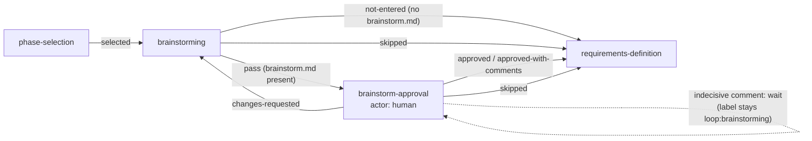

<!-- Authored per the the-loop:writing skill. -->

# Design: gate the brainstorm on its author's approval

> Derives from [`bugfix.md`](bugfix.md). Reviewed on
> [PR #495](https://github.com/MadaraUchiha-314/the-loop/pull/495) with the code, because
> `design-approval` was declared skipped for this item.

## Overview

One new human node, `brainstorm-approval`, copied from `requirements-approval`, sits
between `brainstorming` and `requirements-definition`. Two things keep it from holding up
a work item that has nothing to approve:

1. **No brainstorm, no gate.** `validate-artifacts` gains an opt-in parameter,
   `absentOutcome`. On an optional node that produced nothing, the hook's skip carries
   that outcome, and `brainstorming` routes on it straight to `requirements-definition`.
2. **Skipping the brainstorm skips its gate.** `brainstorming`'s `skipped` edge goes to
   `requirements-definition`, not to the gate.
3. **The status report agrees.** `classify-feedback` gains an opt-in `whenPresent`, so
   the gate skips while `brainstorm.md` is absent. `check --recompute` scores every node
   in declaration order rather than walking edges, so without this it would report an
   item with no brainstorm as stuck at the gate. (Added during implementation, when
   `test_gate_pointer_integration.py` caught it.)

No Python changes are needed for the gate itself. The human-gate hooks are generic, and
`classify-feedback` already returns `wait` for any comment that does not decide the
review. That is the multi-comment behaviour the issue asks for.

## Architecture



The phase label stays `loop:brainstorming` for as long as the gate is open, because
`brainstorm-approval` declares no `phase:`. `set-phase-label` leaves the label alone for a
node with no phase, and `Runtime.phase_of` inherits the phase of the node before it. This
is how `requirements-approval` already sits under `loop:requirements-definition`.

## Components & interfaces

### `pdlc-work-item-loop.yaml`

```yaml
  - id: brainstorming
    ...
    exit:
      - {hook: validate-artifacts, with: {sections: ["Problem / opportunity", "Open questions"], absentOutcome: not-entered}}
      - lint-artifacts

  - id: brainstorm-approval
    actor: human
    session: inherit
    skippable: true
    entry: [set-phase-label, request-review, {hook: notify, with: {event: phase-approval-pending, artifact: brainstorm.md}}]
    exit:
      - {hook: classify-feedback, with: {whenPresent: brainstorm.md}}
      - {hook: record-feedback, with: {into: brainstorm.md}}
      - {hook: lock-artifacts, with: {artifacts: [brainstorm.md]}}
```

The edges change as follows:

| From | On | Before | After |
|------|----|--------|-------|
| `brainstorming` | `pass` | `requirements-definition` | `brainstorm-approval` |
| `brainstorming` | `not-entered` | — | `requirements-definition` (new) |
| `brainstorming` | `skipped` | `requirements-definition` | unchanged |
| `brainstorm-approval` | `approved`, `approved-with-comments`, `skipped` | — | `requirements-definition` (new) |
| `brainstorm-approval` | `pass` (only when `whenPresent` finds no `brainstorm.md`) | — | `requirements-definition` (new) |
| `brainstorm-approval` | `changes-requested` | — | `brainstorming` (new) |

`brainstorm-approval` joins the `spec-chain` skip set, so `--node spec-chain` still
declares the whole chain away.

### `validate-artifacts`: the `absentOutcome` parameter

The existing branch for an optional node returns a plain skip when nothing was produced.
With `absentOutcome` set, the same skip carries `data["outcome"] = <absentOutcome>`.
`ChainOutcome.outcome` already reads the last explicit `data["outcome"]` in the chain,
including from a skipped result, so the edge routes on it. Without the parameter, the
behaviour is byte-for-byte what it is today (bugfix R2.4). The parameter has no effect on
a node that is not `optional`, or once the artifact exists.

The parameter is a hook argument, not a new node attribute, because routing on absence is
a decision this one gate makes. A custom graph's optional node keeps its single `pass`
edge and keeps working.

### `classify-feedback`: the `whenPresent` parameter

`{hook: classify-feedback, with: {whenPresent: brainstorm.md}}` returns a skip, with no
outcome, while the named artifact is absent, or while its authoring node is declared
skipped (the walk routes past the gate then, even if a stray copy is on disk; critic
finding C1). The chain then passes and routes on `pass`.
With the artifact present, classification is unchanged. `brainstorm-approval`'s exit
chain uses it.

### The `phase-selection` checklist

`_phase_rows` lists skippable nodes in graph order, so `brainstorm-approval` appears as a
ticked row between `brainstorming` and `requirements-definition`. No code change. The
rendered fixtures (Jira wiki/ADF/read) and any test that pins the row list are updated.

### Documentation

| File | Change |
|------|--------|
| `skills/the-loop/SKILL.md` | The chain, the phase list, *Gate-less artifacts…*: `brainstorm.md` now has a gate; only `tasks.md` advances on shape alone |
| `skills/the-loop/reference/workflow.md` | Phase 0 and the human-gate list |
| `skills/the-loop/templates/brainstorm.md` | Front-matter comments and the header note |
| `commands/brainstorm.md`, `commands/work-on.md`, `commands/new-requirement.md` | The gate, and the declared-skip case for converting an unlocked brainstorm |
| `docs/capabilities/spec-workflow.md` | The gate in the capability's flow |

## Data models

No schema changes. `work-item-state.json` gains a `brainstorm-approval` node record the
same way it gains any other node. A work item whose `phase-selection` froze a graph
before this change was never offered the gate, so `Runtime.declared_skips` skips it as
`not-offered` (issue-488's rule for nodes a frozen selection never listed): an in-flight
item keeps the route it was started on, and only items armed after the change meet the
gate.

## Error handling

- **No reply, or an indecisive one.** `classify-feedback` returns `wait`, and the node
  parks with "feedback so far is not decisive; the gate stays open".
- **`brainstorm.md` deleted while the gate is open.** `classify-feedback`'s
  `whenPresent` skips, the chain passes, and the `pass` edge takes the item to
  `requirements-definition`: there is nothing left to approve. Without that edge the
  item would escalate on `no_edge` (found in self-review, pinned by
  `test_a_brainstorm_removed_while_the_gate_is_open_does_not_wedge_it`).
- **Malformed front matter.** `lock-artifacts` blocks, as it does for every gate.

## Security design

- **Trust boundary: comment → classification.** It is enforced by the reused `classify-feedback`:
  only `authorizedUsers` are read, self-authored comments are dropped, and the result is
  confined to `approved | approved-with-comments | changes-requested`. Defeats the first
  abuse case (an unauthorized "approved"). Negative test: T3.
- **Abuse case: routing by repository hooks.** `not-entered` is declared only by the built-in
  `validate-artifacts`. `_disarm_routing` drops any `data["outcome"]` from an `x-` hook,
  so a repository hook cannot declare it to skip the gate (second abuse case). It is
  already covered by the extensions tests, and this change adds no new path around it.
- **Fail closed.** The gate has no timeout and no default verdict.
- **Secrets, least privilege.** Not touched.

## Testing strategy

Graph-level unit tests pin the new node, its edges and the skip set. Runtime tests drive a
work item through the gate with real hook chains over a temporary spec directory: an
indecisive comment parks it, an approval locks `brainstorm.md` and reaches
`requirements-definition`, changes-requested returns it, and a work item with no
`brainstorm.md` goes straight past. The existing e2e scenarios and checklist fixtures are
updated wherever they pin the walk. The full suite and `make check` run as in CI. Details
are in [`testing-plan.md`](testing-plan.md).
