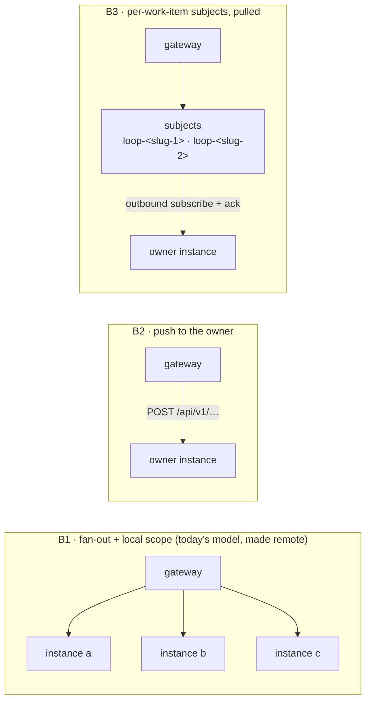
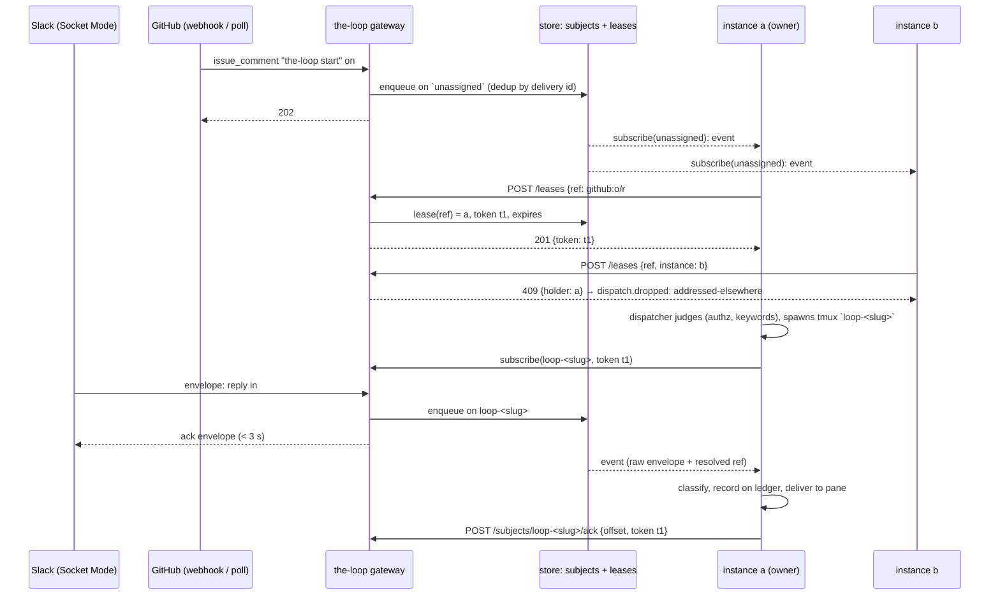

# Brainstorm: the-loop gateway — one ingress, many instances

> Phase 0, the root artifact for
> [issue #496](https://github.com/MadaraUchiha-314/the-loop/issues/496). Nothing here is
> a commitment; it converges on the ticket (the outer loop runs on the work item, by the
> author's phase selection) and then becomes `requirements.md`. The questions a human must
> answer are collected under **Open questions** and asked on the ticket.

## Problem / opportunity

**Every instance of the-loop owns its own inbound transports, and two of those transports
cannot be shared.** An instance is one `cli-config.yaml` with its own webhook receiver,
poller and Slack Socket Mode listener (`docs/capabilities/instances.md`). Slack delivers
each Socket Mode envelope to **one** of an app's open connections, so two instances on
one Slack app silently halve each other's inbound; the-loop already ships two detectors
for exactly that failure (`the-loop doctor slack`, and the listener's own split check,
issue-393/413) and the Slack guide's rule is *run one listener per app*. The consequence
is the ticket's complaint: every operator, and every extra instance of one operator,
creates a Slack app of its own. GitHub has the softer version of the same shape: a
webhook has one Request URL, so a second instance either runs a second webhook on the
repository or falls back to polling, and two pollers on one repository spend the API
budget twice and both judge every delivery.

The ask is a **gateway**: one long-running process that holds every inbound surface
(GitHub, Slack and Jira webhooks; the one Slack Socket Mode connection; the pollers) and
hands each event to the one instance that owns the work item it is about, so that
instances scale horizontally behind one Slack app and one webhook URL, and no instance
needs a Slack connection of its own.

**Why now, and why this is smaller than it looks.** The sibling work item
[issue-492](https://github.com/MadaraUchiha-314/the-loop/issues/492) (the-loop as a SaaS)
reached the same conclusion from the other direction and its author **decided in
review** on a control plane that owns all ingress and publishes every event to a
**durable queue with one subject per work item**, the session pod consuming its own
subject (its `requirements.md` R3 and R4, on `feat/issue-492-saas`). The gateway is that
control plane's *ingress half*, extracted so it runs without Kubernetes: on a VPS, a
home server or the same laptop, serving today's tmux-hosted instances. Done right, 492's
control plane *is* the gateway plus a scheduler, and the two work items share one queue
contract instead of inventing two.

## Context & constraints

**What already exists (verified in the tree and the capability docs):**

- **Ingress is already three thin front doors over one dispatcher.** The GitHub receiver
  (`webhook/server.py`, a stdlib `ThreadingHTTPServer`; HMAC `X-Hub-Signature-256`;
  bounded by the top-level `repositories`, decision-121), the Jira doorbell
  (`/jira-webhook` on the same server, `webhook/jira.py`, issue-475) and the poller
  (`poller/poller.py` over `polling.sources[]`, decision-022) all produce the same thing:
  a `RoutedEvent` (`webhook/router.py`) carrying a delivery id, resolved by the
  **router** to work-item refs, judged by the **dispatcher** (`Dispatcher.handle`,
  `webhook/dispatcher.py`: linkage → control parse → instance scope → authorization →
  record → match → deliver or spawn), which already keeps **one FIFO queue and one worker
  thread per work item** in memory. Every ingress calls that pair inside its own process;
  no cross-process queue exists. Dedup is layered: an in-memory LRU per process
  (`routing.dedupCacheSize`), the session record's last 50 delivery ids (survives a
  restart), and a flock'd `control-deliveries.json` so a control keyword executes once
  across both ingresses; Jira gives both of its ingresses the same id
  (`jira-comment-<site>-<id>`). The gateway's job ends where the dispatcher's begins.
- **Slack is a channel on one event bus** (decision-103): the Socket Mode listener
  (`channels/slack.py:run_socket_listener`, on `slack_sdk`'s `SocketModeClient`)
  **acknowledges each envelope before handling it**, then classifies it into exactly one
  event type (`work-item.reply`, `gate.feedback`, `control.command`, `context.added`, …),
  records it on the ledger (GitHub) as a marked comment, and the ledger's ingress does the
  rest on its next delivery or poll. So **most Slack traffic already reaches a session
  through GitHub**, not through the socket; what needs the socket is the three-second
  acknowledgement (buttons, slash commands, shortcuts) and the ledger write itself. The
  thread → work-item binding the classifier relies on is **machine-local**
  (`<state.root>/channels/slack.json`, flock'd), which matters for F below.
- **The hosted ingresses are hot-reloaded today** (issue-395): `api/ingress.py`'s
  `HostedIngresses` re-hashes the config every five seconds and starts or stops the
  poller, the receiver and the Slack listener as the enabled set changes, recording
  `config.reloaded`; `reload.py`'s `Reloader` keeps the previous config on a bad edit.
  Two limits to carry: the receiver's bind address and secret are start-time only, and
  the Slack listener **freezes its config until it restarts**. The lifecycle verbs are one
  surface for every service (`the-loop start|stop|status|restart` over `core.lifecycle`,
  pidfile flock as the lock, decision-076). `the-loop gateway start|stop|restart` has a
  precedent to copy, not a pattern to invent.
- **Two instances on one machine already collide on tmux.** Session names are
  `loop-<slug>` with no instance prefix (`runner.py`), the tmux server is per user, and
  decision-055 routes into a live `loop-<slug>` rather than spawning over it, so a second
  instance on the same box would type into the first's pane. The runner takes no tmux
  socket of its own today. Any two-instance proof on one machine needs a per-instance
  tmux socket (`tmux -L <instance>`) or two users or containers.
- **Ownership exists in embryo, and is local.** An instance has a name, a scope mode
  (`open | addressed | locked`) and a declared work-item list; its **managed set** is
  derived (declared ∪ live sessions ∪ control records, decision-110 D2). Two `open`
  instances still take the same start, "instances share nothing and never talk to each
  other" (D8), and a **manager** (issue-374) aggregates the fleet's *API* but routes no
  *ingress event*. Nothing today can promise *one owner per work item* across machines.
- **An instance's control-plane API is loopback-bound and has no in-app auth**
  (decision-059); "a gateway terminates auth" is the stated deployment model, so the
  word **gateway already means an auth proxy** in this repository's decisions. The
  ticket's word is kept here; whether the shipped name is `gateway` or something that
  does not collide (`ingress`, `relay`, `hub`) is a question below. The stream is SSE,
  not WebSocket (decision-087). New dependencies are refused where the stdlib serves
  (decision-138 D10, the minimalism ladder).
- **Ownership has a precedent on paper.** The control record a start writes carries
  `instance` (decision-141: a work item is registered on the instance that *accepted*
  it), and the lifecycle guard reads it. It is the closest thing to an ownership token
  today, and it is per instance, never compared across them.
- **The author's identity is the operator's token.** the-loop posts as the operator
  (decision-023); every comment carries the loop-prevention marker. The gateway must
  never post, and never hold a GitHub token for posting.

**Constraints / non-negotiables carried in:**

- The dispatcher's judgement stays on the instance: authorization, the control grammar,
  the self-marker check, scope. The gateway **transports and classifies**; it never
  decides whether a human is authorized or what a keyword means.
- At-least-once delivery with an idempotent consumer, deduplicated by delivery id, is
  the contract 492 fixed; the gateway keeps it. Nothing is acknowledged to Slack or
  GitHub before it is durably stored.
- Instances are often laptops behind NAT: an instance **opens outbound** to the gateway;
  the gateway never needs to reach an instance.
- A deliberately refused event (`awaiting-start`, `session-paused`) is never replayed
  (issue-270). A queue must not quietly undo that rule by holding the backlog forever.
- The queue technology sits behind one interface (492 R4.6). A laptop operator must get
  a working gateway with **no external broker**.

## Ideas & options

### A — What the gateway is, relative to issue-492

- **A1 — A new, separate product surface** with its own router and its own event model.
  Rejected: two ingress stacks to keep in parity, and 492 would have to rewrite onto it.
- **A2 — 492's control plane minus the scheduler and the credential store**, shipped as
  `the-loop gateway` in the same package, runnable on one box. The queue contract (one
  subject per work item, delivery-id keyed, consumer acks) is defined **here**, and 492's
  M2 consumes it. *Leaning.* The cost is coordination: 496 lands first and 492's design
  must derive from this contract, which is the right order, since the SaaS needs an
  ingress before it needs a scheduler.

### B — The hand-off mechanism: is a queue right?

The author's question. Four shapes:

- **B1 — Fan everything out, every instance judges with its scope.** Works for `locked`
  and `addressed` instances; two `open` ones spawn twice, exactly today's bug. Wasteful at
  N; needs no ownership. Rejected as the mechanism, kept as the honest description of
  what an *unowned* arming event must do (see C).
- **B2 — The gateway pushes to the owner's API.** The instance already has
  `POST /api/v1/sessions/reply`-shaped routes. Rejected: it needs an inbound path to a
  laptop, a store of instance addresses, and a retry buffer for a laptop that is asleep,
  which is a queue with worse ergonomics.
- **B3 — One subject per work item; the owner subscribes outbound and acknowledges.**
  Decided for 492. The subject name is the slug tmux already uses (`loop-<slug>`), so
  "which events are relevant to me" has a trivial answer: **the subjects of the work
  items in my managed set**. A down instance finds its backlog when it returns; a
  laptop needs only outbound HTTPS. *Leaning.*
- **B4 — No queue: the gateway keeps a cursor-addressable log and instances long-poll
  it** with per-subject cursors (the SSE stream with `Last-Event-ID` already does this
  for the event log, decision-087). This is B3 *implemented* without a broker: an
  append-only store (SQLite in the gateway's `state.root`; the stdlib has it) behind the
  queue interface, SSE or long-poll for delivery, an explicit ack moving the subject's
  committed offset. **B4 is B3's default backend, not a rival**: the interface is the
  queue, the first implementation is the file, NATS JetStream or Redis Streams are the
  cluster's choice under 492.

So: **yes, a queue, as a contract; no broker as a requirement.**

### C — Relevance: how an instance knows an event is for it

Three kinds of event, three answers:

| Event is about… | Who receives it | How |
|---|---|---|
| a work item **somebody owns** | the owner, alone | its subject `loop-<slug>` |
| a work item **nobody owns yet** (a `the-loop start` on a fresh issue, a Slack kickoff) | every instance whose registered **scope admits it** | an `unassigned` subject per gateway; each instance judges with today's scope rules, then **claims** (D) before acting; losers get `409` and record `dispatch.dropped: addressed-elsewhere`, the no-mark drop that already exists |
| **no work item** (`/the-loop status`, a fleet verb, an unmatched comment) | the gateway answers itself, or the manager if one is registered | not queued; the `/the-loop` command's status/restart family already goes through the facade, not the ledger (decision-116) |

Deterministic assignment (consistent hashing of refs to instances) was considered and
rejected: it gives no operator control and fights the existing `scope` and
`instance:<name>` address token, which already express *where* a work item should run.

### D — One owner per work item: ensuring it

The author proposes a token registered with the gateway at start. That is the right
primitive; the choices are its lifetime and what it fences.

- **D1 — A lease at the gateway.** `POST /leases {ref, instance}` → `{token, expires}`;
  the holder renews (heartbeat) and releases on close; a second claim is `409` naming
  the holder; an expired lease frees the ref. The token is a **fencing token**: an ack or
  a renew with a stale token is refused, so an instance that lost the lease while
  partitioned cannot consume after a new owner took over. The gateway delivers a subject
  only to its lease holder. *Leaning.* Lease length and renew cadence are design
  numbers; the failure to get right is a laptop that sleeps for an hour.
- **D2 — Registration without expiry** (the author's token, literal). Simple, but an
  instance that dies holds the ref forever and needs a manual `the-loop gateway
  release`. Kept as the operator's override (`--force` with a reason, audited as
  `graph force` is), not as the mechanism.
- **D3 — The ledger as the lock.** The announcement comment (*the-loop started an
  interactive session*, which already names the instance) becomes the claim; a second
  instance that reads one for a live session stands down. Works with no gateway and
  survives a gateway outage, but a GitHub comment is a racy lock (two announcements
  within a poll interval) and it only fences spawning, not consuming. Kept as the
  **belt to D1's braces**: the announcement keeps naming the instance, so a human can
  see ownership on the ticket, and the gateway's lease is what the machines trust.
- **D4 — The manager assigns.** A manager's resolvers (`by_ref`, decision-138 D6) already
  answer "which instance manages this ref" and refuse ambiguity. Rejected as the
  mechanism (a manager is optional; the gateway must work with none), but a manager
  **reads** the gateway's lease table so its `409` and the gateway's agree.

**What "owner" fences and what it does not.** The lease fences *consumption of the
subject* and *the right to spawn for the ref*. It does not fence posting to GitHub (the
instance posts with the operator's token regardless) and it does not move a live tmux
session: ownership transfer is `the-loop stop` on one instance and `the-loop start
instance:<other>` on the ticket, as today, with the lease released and reclaimed in
between.

### E — Which transports move into the gateway

| Transport | Today | In the gateway | Note |
|---|---|---|---|
| Slack Socket Mode | one listener per instance, one app per operator | **one connection per Slack app**, in the gateway | the ticket's highest priority; today's listener acks first and handles second, so the one ordering change is **enqueue durably, then ack**, still inside Slack's 3 s |
| Slack Events API (HTTP) | not offered | `POST /slack/events` (+ `/slack/interactions`, `/slack/commands`), Slack signing secret, `url_verification` | new; gives Slack a Request URL for the first time. Offer both; Socket Mode stays the default because it needs no public URL |
| GitHub webhook | per instance, `/gh-webhook` | `POST /gh-webhook`, same HMAC, same header contract | the receiver module moves, the route does not change |
| Jira webhook | per instance, `/jira-webhook` | `POST /jira-webhook`, same secret | same |
| GitHub / Jira poller | per instance, per source | **in the gateway, once per source** | one API budget per repository; the poller is already the reconciliation path and the fallback for sources without a webhook |

An instance that names a gateway in its config runs **no ingress of its own**
(`service.hostIngresses: false` in effect, as 492 R2.2 renders for a pod). The instance's
own `/gh-webhook` keeps working for operators who run no gateway: the gateway is
additive, never required.

### F — Where Slack classification happens

Today the listener classifies an envelope (mention grammar, grants, the collaborator
allow-list) and writes the ledger record. Two placements:

- **F1 — Classify in the gateway, enqueue the classified event.** The gateway needs the
  Slack-id allow-list and the grants, which are the instance's config today. Pros: one
  place; the ledger write happens once. Cons: moves authorization-adjacent policy into
  the transport, against the constraint above.
- **F2 — Enqueue the raw envelope on the work item's subject; the owner classifies and
  records on the ledger as today.** The gateway only resolves *which work item* (the
  thread binding, `channels threads`, and the room → work item declaration) and acks
  Slack. Pros: the instance keeps every judgement; the existing pipeline is reused
  intact. Cons: the thread → work item map must be readable by the gateway (it is the
  owner's machine-local `channels/slack.json` today), and a kickoff from a room has no
  work item yet (it goes to `unassigned`, C). *Leaning F2*, with the binding map
  **published to the gateway by the owner** when it opens a thread (one small write per
  work item; the gateway keeps `thread_ts → ref`, never the message bodies).

### G — Configuration and lifecycle

- **G1 — A separate `gateway-config.yaml`** (the author's proposal), validated against a
  fourth plugin-shipped schema (`.the-loop/gateway-config.schema.json`, beside the three
  of issue-220), scaffolded by `/the-loop:init` when the operator says they run one, hot
  reloaded by the same five-second hash supervisor. Contents: listen address and
  exposure guard, the ingress blocks (moved from `webhooks.*`, `polling.*`,
  `channels.slack.read.*` with their token *variable names*), the queue backend, lease
  timings, the instance registry (names and their bearer-token variable names). Pros: a
  gateway is a different process on a possibly different box; a cli-config carries
  dozens of keys it does not need. Cons: a fourth file. *Leaning G1.*
- **G2 — A `gateway:` role inside `cli-config.yaml`** (as `instance.role: manager` was
  done). Pros: one file, one loader. Cons: a gateway is not an instance (it spawns
  nothing, owns no sessions), so `role` would be a lie, and every instance key would be
  present and meaningless.
- Either way the **client half is one block on the instance**: `gateway: {url,
  tokenEnv, instance: <name>}`, and an instance with a `gateway` block **must be named**
  (the lease is in its name), which the unnamed default violates today, so `start`
  refuses an unnamed instance with a gateway configured, as decision-138 D11 refuses an
  unnamed manager.
- Verbs: `the-loop gateway start|stop|status|restart` over `core.lifecycle`, pidfile
  flock, logfile under its `state.root`, modelled on `api/ingress.py`'s hosted starters
  and `core/daemons.py`'s `daemon_entry`; `the-loop gateway leases` (who owns what),
  `the-loop gateway subjects` (backlog depth, oldest unacked age, 492 R4.7),
  `the-loop gateway release <ref> --reason` (D2's audited override).

### H — Horizontal scale of the gateway itself

The author wants the gateway horizontally scalable. In the first landing it is **one
process** (one Socket Mode connection per app, one poller per source, one store), and
that is the right size for every deployment this ticket names: Slack's constraint *is*
one connection, and GitHub webhooks for one operator are a trickle. Scaling the gateway
is the cluster's problem under 492 (stateless receiver replicas behind a load balancer
over a shared broker; Socket Mode connections and poll sources sharded across replicas,
492 R3.2–3.4). What 496 must not do is close that door: the queue interface, the
delivery-id dedup and the lease table all have to be *the store's*, never a process's
memory, so a second replica over a shared backend is a configuration change.

## Sketches & notes

**The shape, with the ownership path:**

**Contracts to fix in `design.md` (shape, not final):**

- *Ingress*: the webhook routes keep the upstream contracts verbatim, since the gateway
  is what the provider is pointed at — `POST /gh-webhook` (GitHub's headers and HMAC),
  `POST /jira-webhook`, `POST /slack/events|interactions|commands` (Slack's
  `X-Slack-Signature` / `X-Slack-Request-Timestamp`, the `url_verification` challenge,
  3 s response); plus the Socket Mode client.
- *Queue event envelope*: `{id, subject, provider, source: webhook|socket|poll,
  deliveryId, receivedAt, workItem: <ref or null>, kind: <provider event name>,
  headers: <allow-listed>, payload: <verbatim>, attempt}` — the payload is **untrusted
  data** end to end, carried, never interpreted by the gateway beyond resolving the ref.
- *Consumer API*: `GET /api/v1/gateway/subjects/{subject}/events` (SSE, `Last-Event-ID`
  as the cursor, bearer token, lease token required for a work-item subject),
  `POST …/ack {offset}`, `POST /api/v1/gateway/leases`, `PUT …/leases/{ref}` (renew),
  `DELETE …/leases/{ref}`, `POST …/bindings {ref, slack: {channel, threadTs}}` (F2),
  `GET /api/v1/gateway/health|subjects|leases|instances`. Authored first in
  `docs/api-specs/openapi/` as a second document beside `the-loop.v1.yaml` (this repo's
  `apiSpecs.rest.dir`), parity-tested like the first.
- *Dedup*: the gateway dedups by `(provider, deliveryId)` at ingress with a bounded,
  persisted window; the consumer keeps its `dedupCacheSize` cache, so a redelivery after
  a gateway restart is still dropped once.
- *Ack and the refused event*: an event the dispatcher drops on purpose is **acked**
  (consumed, never redelivered), keeping issue-270's rule; only a failed delivery stays
  unacked for redelivery, bounded by `polling.maxRetries`'s sibling on the subject.

**What verification needs from the author (the ticket asks):**

| To prove | Needed | Who provides |
|---|---|---|
| Slack Socket Mode from the gateway (highest priority) | one Slack app with Socket Mode, bot + app-level tokens in the gateway box's env, a test channel the bot is in; **two** instances (two named cli-configs, two state roots, two service ports) with Slack disabled locally, **on two machines, two users or two containers** until the runner takes a per-instance tmux socket (see Context) | author: the app and tokens, by variable name; the second box or container |
| GitHub webhook through the gateway | the gateway reachable from GitHub: a public URL or a tunnel (`cloudflared`, `smee.io`, `ngrok`) and a webhook on `the-loop-testing` with its secret | author: the tunnel choice and the webhook; the-loop can fall back to the gateway's **poller** on `the-loop-testing` if no tunnel is wanted |
| Jira webhook | a Jira Cloud site, a project mapped in `integrations.jira.projects`, API token, and the same tunnel | author, **or** declare Jira as poll-only for the e2e proof and prove the webhook route with signed synthetic deliveries in integration tests |
| one owner per work item | the two instances above, an issue on `the-loop-testing` armed with `the-loop start`: one spawns, the other records `addressed-elsewhere`; then the owner is stopped and the other claims | nothing beyond the above |
| durability | kill the owner mid-thread, post two Slack replies, restart it, see both delivered in order | nothing beyond the above |

## Open questions

Raised on the ticket; the first three are the ones requirements cannot be written
without.

1. **(human)** Relationship to issue-492: do you accept that the gateway defines the queue
   contract 492's control plane will consume (A2), so 492's design derives from this work
   item's `design.md` rather than the reverse? And the first landing is **one** gateway
   process with a broker-free built-in store (B4 as B3's default backend), with
   multi-replica scaling left to 492?
2. **(human)** Separate `gateway-config.yaml` (G1) over a role in `cli-config.yaml` (G2),
   and the consequence that an instance pointing at a gateway must be **named**?
3. **(human)** Authentication between instance and gateway. The gateway is the first
   component of the-loop that is deliberately reachable from the internet on *both* sides
   (providers inbound, laptops outbound). Decision-059 keeps auth out of the service; the
   gateway's consumer API cannot. Proposed: a per-instance bearer token by variable name
   in the first landing (`gateway.instances[].tokenEnv`), TLS termination the operator's
   (reverse proxy or the tunnel), with subject-scoped lease tokens as the fencing layer
   — the shape 492 R9.5 asks for later. Acceptable, or is mTLS / an OIDC-issued token
   wanted from the start?
4. **(human)** For verification, which of the rows above can you provide, and is a
   tunnel acceptable for the GitHub and Jira webhook rows? Is Jira **poll-only** for the
   e2e proof acceptable, with the webhook route proved by signed synthetic deliveries?
5. **(design-phase)** Lease timings: lease length, renew cadence and what a renewed-late
   lease does to a session that is still alive (sleeping laptop). Measured against
   `routing.tmux` respawn behaviour, not guessed.
6. **(design-phase)** Slack classification placement (F2) requires the thread → work-item
   binding to be visible to the gateway. Decide whether the owner publishes bindings
   (one write per thread) or the gateway opens the thread itself and tells the owner.
7. **(design-phase)** The Slack HTTP Events API route (E): ship it in the first landing
   beside Socket Mode, or declare it a follow-up once the gateway has a public URL in
   practice?
8. **(design-phase)** Whether `the-loop gateway` runs **inside** an existing instance's
   service process as a hosted role for the one-laptop operator (so a single
   `the-loop start` brings up both), or is always its own process. The ticket says
   separate verbs; the question is only whether a co-located mode is also offered.
9. **(human, small)** The name. `gateway` already means "the auth proxy in front of the
   service" in decision-059 and the SDK docs. Keep `gateway` and reword decision-059's
   successors, or ship the verb under a name that does not collide?
10. **(design-phase)** A per-instance tmux socket (`tmux -L <instance>`) so two instances
    can share one machine without typing into each other's panes. Not strictly this
    work item's, but the e2e proof needs either it or two machines; decide which.

## Leaning / working hypothesis

**Build A2 + B3-over-B4 + C + D1 (with D3 as the visible trail) + E (all five
transports, Socket Mode first) + F2 + G1, in three milestones.** (1) *The contract and
the store*: the queue interface with its built-in SQLite backend, subjects, leases with
fencing tokens, the consumer API in OpenAPI, the `gateway` client block on an instance
that turns its own ingresses off and subscribes to its managed set and to `unassigned`,
the lease claim inserted into `Dispatcher.handle` beside the scope decision. (2) *The
transports move*: the Slack Socket Mode listener runs in the gateway and enqueues raw
envelopes on the resolved subject (the e2e proof against `the-loop-testing` with two
instances and one Slack app is this milestone's gate); then the GitHub and Jira webhook
routes and the pollers. (3) *Operability*: `gateway-config.yaml` hot reload, `the-loop
gateway leases|subjects|release`, backlog depth on the dashboard, the Slack HTTP Events
route if Q7 says now. The gateway never authorizes a human, never posts to a ledger and
never holds a posting token; everything the dispatcher judges today it judges tomorrow,
on the owner.

## Hand-off → requirements

Carries forward when converged: the A2 scope and its three milestones; EARS criteria
around — the five ingress routes keeping their providers' contracts; the enqueue-before-ack
rule for Slack (3 s) and webhooks; the queue envelope and the consumer API as an
OpenAPI document; the subject naming (`loop-<slug>`) and the `unassigned` subject; the
lease claim, renew, release, `409` on conflict, expiry and fencing; the no-ingress
behaviour of an instance with a `gateway` block, and the named-instance precondition;
the dedup window at ingress and the consumer's cache; the acked-on-purposeful-drop rule
(issue-270 preserved); hot reload of `gateway-config.yaml`; the lifecycle verbs; the
observability verbs and events (`gateway.*`, `lease.*`, `subject.*`); and the e2e proof
on `the-loop-testing` with one Slack app and two instances. Security considerations
seeded here: the gateway as an internet-facing surface on both sides (HMAC and Slack
signature verification unchanged and mandatory; instance bearer tokens; fencing tokens);
the payload as untrusted data the gateway carries but never interprets; no posting
token and no authorization decision in the gateway; a stale owner that must not consume;
a `release --reason` that is audited. Stays behind: B1, B2, D2 as the mechanism, D4, F1,
G2, consistent hashing, and multi-replica gateways (492's).

## Review comments

> Appended by the-loop's `record-feedback` hook when a human gate approves with
> comments (issue-109). Append-only and attributed: an approval never silently
> discards a reviewer's suggestions, and the feedback travels with the document
> it concerns rather than living in a side-channel tracker.
