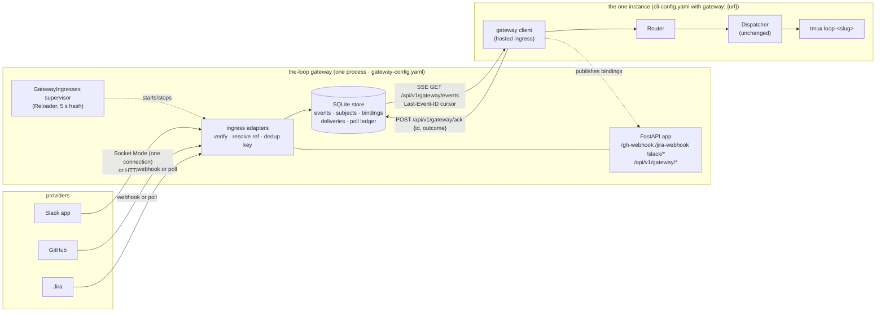
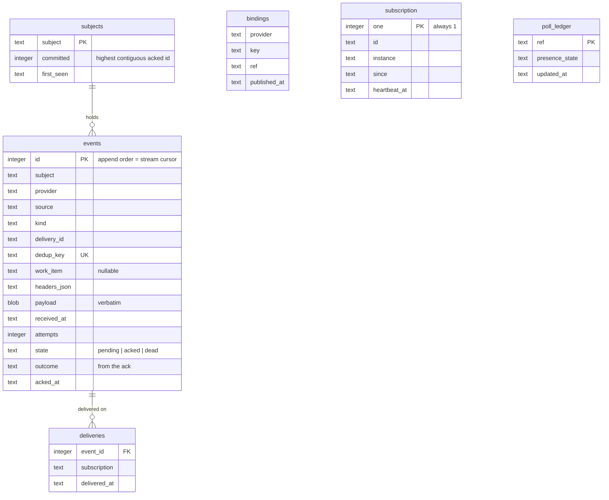

<!-- Authored per the the-loop:writing skill, derived from the approved requirements.md in
     this folder (locked 2026-10-18). Every file:line below was read in the tree at
     commit 8b5aaba; line numbers drift, names do not. -->

# Design: the-loop gateway — one ingress, many instances

> Phase 2 of 4 (requirements → design → testing plan → tasks). Derives from the approved
> requirements. Reviewed with `testing-plan.md` at the one `design-approval` gate.

## Overview

**The gateway is the existing ingress code moved into its own process, with a SQLite
store between arrival and dispatch.** Today each inbound transport (the GitHub receiver,
the Jira doorbell, the poller, the Slack Socket Mode listener) parses, verifies and hands
its event to a `Dispatcher` inside the same process. The gateway keeps the first two
steps, verify and resolve, and replaces the third with an append to a durable store. The
instance replaces its four transports with one **gateway client**, a hosted ingress that
reads the store over Server-Sent Events, runs the unchanged `Router` → `Dispatcher`
pipeline on each event, and acknowledges the result. Nothing the dispatcher judges moves.

Three facts from the tree shape the design more than the requirements did:

1. **There is no single dispatcher today.** The receiver builds one in
   `webhook/daemon.py:_build_ingress` and the poller another in
   `poller/daemon.py:_build_dispatcher`, each with its own in-memory `Deduper`. The
   gateway client builds **one**, so an instance behind a gateway has one queue per work
   item and one dedup cache for every transport. That is a simplification, not a cost.
2. **The poller wants an answer.** After `dispatcher.handle(...)` the poller reads
   `delivery_outcome(id)` and `delivery_status(id, refs)` synchronously to settle its
   per-work-item ledger (`seenComments`, `commentAttempts`, `spawn`, `gaveUp`) and count
   retries (`poller/poller.py`). In the gateway the poller and the dispatcher are in
   different processes, so **the ack carries the outcome back**, and the ledger's
   retry-and-give-up logic becomes the subject's redelivery bound. This is the one real
   refactor; the provider layer (`PollProvider`, `poller/base.py`) is reused untouched.
3. **The CLI config is not schema-validated at load**; validation runs on config writes
   and in CI. `gateway-config.yaml` **is** validated at start (R8.1) with the existing
   `configschema.validate`, which already resolves sibling `$ref`s.



**Requirement → component map.**

| Req | Satisfied by |
|---|---|
| R1 process, one Socket Mode connection, verbatim routes, pollers | `gateway/serve.py`, `gateway/ingresses.py`, `gateway/adapters/{github,jira,slack_http,slack_socket,poll}.py` |
| R2 subjects, store-before-ack, dedup, verbatim payload, retention | `gateway/store.py` (SQLite), the adapters' `accept()` path |
| R3 outbound SSE, acks, redelivery, dead-letter, no local ingress | `gateway/client.py`, `gateway/stream.py`, `core/lifecycle.enabled_services` |
| R4 one subscriber, 409 on a second, backlog to the next | `gateway/stream.py` `Subscription` (one row in the store) |
| R5 raw payload, instance judges, bindings | adapters resolve refs only; `gateway/client.py` runs `Router`/`Dispatcher`; `POST /bindings` from `channels/state.py` and `sessions link-pr` |
| R6 contracts | `docs/api-specs/openapi/the-loop-gateway.v1.yaml`, parity test |
| R7 transports side by side, dedup across | per-provider adapter pairs, `dedup_key()` per kind |
| R8 `gateway-config.yaml`, schema, hot reload, `gateway: {url}` on the instance | `gateway/config.py`, `.the-loop/gateway-config.schema.json`, `Reloader`, `cli-config.schema.json` `gateway` block |
| R9 verbs, doctor | `commands/gateway_cmd.py`, `core/daemons.py`, `doctor` |
| R10 events, dashboard | `eventlog.EVENT_TYPES` additions, `GET /api/v1/gateway` on the instance, `ui/src/views/InstanceDetail.tsx` card |
| R11 store-held state, follow-ups named | `gateway/store.py` interface, §Trade-offs |
| R12 e2e proof | `testing-plan.md` |
| R13 records | `docs/capabilities/gateway.md`, decisions, Slack guide |
| R14 co-location | distinct default port 8790, loopback no `exposed`, client back-off |

## Architecture

**Two processes, one contract.** The gateway is a FastAPI app served by uvicorn, exactly
as the control-plane service is (`api/serve.py`), with its own state root, pidfile and
logfile. The instance is unchanged except that, when its config has a `gateway` block,
its hosted-ingress set is `{gateway-client}` instead of `{gh-webhook, poller,
slack-listener}`.

```mermaid
sequenceDiagram
  participant SL as Slack (Socket Mode)
  participant GW as gateway adapter
  participant ST as store (SQLite)
  participant S as stream (SSE)
  participant CL as instance: gateway client
  participant D as instance: Router → Dispatcher
  SL->>GW: envelope (events_api, message in thread T)
  GW->>ST: resolve T → ref via bindings; dedup_key = slack event_id
  ST-->>GW: appended id=ev-42 on subject loop-<slug>
  GW-->>SL: SocketModeResponse(envelope_id)  [< 3 s, after the write]
  S-->>CL: event: ev-42 {subject, provider: slack, kind: message, payload}
  CL->>D: slack.dispatch_envelope(payload, cfg)  (today's classify → ledger write)
  D-->>CL: outcome (recorded / dropped: reason)
  CL->>S: POST /ack {id: ev-42, outcome}
  S->>ST: committed offset(loop-<slug>) = 42; deliveries.outcome = …
  Note over CL: cursor ev-42 persisted in <root>/local/gateway-cursor.json
```

**Where today's code goes.** The design moves modules, it does not rewrite them:

| Today | In the gateway | In the instance |
|---|---|---|
| `webhook/server.py` `verify_signature`, `make_handler` | `verify_signature` reused by the `/gh-webhook` FastAPI route; `make_handler` stays for the gateway-less instance | unchanged for operators with no gateway |
| `webhook/jira.py` `read_doorbell`, `jira_webhook_secret` | reused by `/jira-webhook` | `JiraDoorbell.ring` runs on the instance, fed from the stream |
| `poller/base.py` `PollProvider`, `poller/github.py`, `poller/jira.py` | reused as the **source** layer by `gateway/adapters/poll.py` | not run |
| `poller/poller.py` `Poller` (ledger, retries, dispatch) | replaced by `gateway/adapters/poll.py` + the store's `poll_ledger`; `Poller` stays for the gateway-less instance | not run |
| `channels/slack.py` `run_socket_listener` | `handle`'s **transport** half (connect, ack) in `gateway/adapters/slack_socket.py`; `SplitWatch` runs here | `handle`'s **classification** half extracted as `slack.dispatch_envelope(request_payload, cfg)`; called by the client and by the gateway-less listener |
| `webhook/router.py` `Router`, `webhook/dispatcher.py` `Dispatcher` | **not present** | built once by the client (`gateway/client.py`) |
| `api/ingress.py` `HostedIngresses`, `_HostedIngress`, `_host`, `reload.Reloader` | `gateway/ingresses.py` subclasses the same supervisor with its own `_STARTERS` | gains `_start_gateway_client` |
| `api/stream.py` `encode_frame`, `Frame` | reused by `gateway/stream.py` (store-backed cursor instead of a log tail) | the client parses frames with the same grammar |
| `core/daemons.py`, `runlock.RunLock`, `daemonize.open_logfile` | `gateway start / stop / status / restart` | unchanged |

## Components & interfaces

### `gateway/config.py` — load and validate `gateway-config.yaml`

- `default_gateway_config_path()`: `--config`, else `$THE_LOOP_GATEWAY_CONFIG`, else
  `./.the-loop/gateway-config.yaml`, else `~/.the-loop/gateway-config.yaml` (mirrors
  `cli_config.default_cli_config_path`).
- `load_gateway_config(path, *, strict=True) -> GatewayConfig`: YAML → `configschema.validate(data,
  load_schema("gateway-config"))`; a non-empty error list raises `ConfigError` naming
  each path (R8.1). `load_env_file()` first, as `daemon_entry` does.
- `GatewayConfig` (frozen dataclass): `state_root`, `listen: Listen(host, port=8790,
  exposed=False)`, `store: Store(path, retention_days=7, max_attempts=3,
  dedup_window=10_000)`, `github: Optional[GitHubIngress(webhook: {path, secret_env},
  poll: {sources[], interval_seconds})]`, `jira: Optional[JiraIngress(webhook: {secret_env},
  poll: {...}, projects)]`, `slack: Optional[SlackIngress(socket: {app_token_env,
  bot_token_env, split_check_beats}, http: {signing_secret_env}, rooms[])]`, `repositories`,
  `instances: Optional[list[str]]` (allow-list), `event_log`.
- Secrets are **names only**; the schema's `*Env` keys carry `"pattern":
  "^[A-Z][A-Z0-9_]*$"` so a pasted token fails validation (abuse case 7).

### `gateway/store.py` — the queue, behind one interface

```python
class Store(Protocol):
    def append(self, env: Envelope) -> AppendResult        # dedup inside; returns id or Duplicate
    def read(self, after: int, limit: int) -> list[Stored]  # every subject, append order
    def ack(self, event_id: int, outcome: str, subscription: str) -> AckResult
    def unacked(self, subject: str | None = None) -> list[Stored]
    def subjects(self) -> list[SubjectRow]                 # depth, oldest unacked age
    def bind(self, provider: str, key: str, ref: str) -> None
    def resolve(self, provider: str, key: str) -> str | None
    def subscribe(self, instance: str, lease_s: int) -> Subscription | Refused
    def heartbeat(self, subscription: str) -> bool
    def release(self, subscription: str) -> None
    def poll_ledger(self) -> PollLedger
    def expire(self, now: float) -> ExpireResult           # retention + dead-letter
```

`SqliteStore(path)` is the only implementation in this work item. It opens one connection
per thread (`check_same_thread=False` is **not** used), `journal_mode=WAL`,
`synchronous=NORMAL`, every public method one transaction. Tables are in §Data models.
Nothing is kept in process memory except the live SSE connection object (R11.1).

### `gateway/adapters/*` — the ingress adapters

Each adapter turns a provider delivery into an `Envelope` and calls `store.append`
**before** answering the provider. Shared helpers in `gateway/adapters/common.py`:

- `resolve_ref(provider, payload, store, config) -> str | None`: GitHub issue/PR number →
  `github:o/r#N` when the repository is declared, else a PR's binding; Jira key →
  `jira:site/KEY-N` when the project is mapped; Slack `thread_ts` → binding, else a
  declared room's work item, else `None` → `unassigned` if the kind can start one
  (`issue_comment` with the control grammar's start word is *not* checked; any
  `issue_comment`, `issues`, `pull_request` on a declared repo may start one), else
  `gateway.dropped: unbound`.
- `dedup_key(provider, kind, payload, delivery_id) -> str` (R7.3): GitHub `issue_comment`
  → `gh-comment-<comment.id>`; `issues`/`pull_request` → `gh-<event>-<action>-<number>-<updated_at>`;
  `check_run`/`check_suite`/`status` → `gh-ci-<ref>-<name>-<conclusion>`; closure →
  `gh-close-<ref>-<state>`; Jira comment → `jira-comment-<site>-<id>` (already shared by
  both Jira paths); Slack → `slack-<event_id>` (HTTP) and the same `event_id` from the
  Socket Mode envelope. The envelope keeps the provider's original `deliveryId`.

| Adapter | Transport | Verify | Resolve | Answer |
|---|---|---|---|---|
| `github.py` | `POST /gh-webhook` (FastAPI route) | `webhook/server.verify_signature(secret, body, X-Hub-Signature-256)`; missing/invalid → 401 `gateway.dropped: bad-signature` | number → ref; PR → binding or `unassigned` | 202 after append; 500 if the store fails (GitHub retries) |
| `jira.py` | `POST /jira-webhook` | `X-Hub-Signature` with `secretEnv`; 404 with no secret (as today) | `read_doorbell` → key → ref | 202 / 500 |
| `slack_http.py` | `POST /slack/events`, `/slack/interactions`, `/slack/commands` | `X-Slack-Signature` over `v0:<ts>:<body>` with the signing secret, `abs(now - ts) ≤ 300 s`; `url_verification` answered with `challenge` | thread → binding / room | 200 after append (Slack's 3 s) |
| `slack_socket.py` | `SocketModeClient` (one per app) | the connection is the auth | same | `send_socket_mode_response` **after** `append` returns; the heartbeat `message` kind is consumed here by `SplitWatch.observe`, not stored |
| `poll.py` | `PollProvider.list_work_items / list_comments / ci_events / closure` on each source every `interval_seconds` | the API token is the auth | from the provider's refs | nothing to answer; `poll_ledger` marks what was stored |

**The poller's ledger, relocated.** `gateway/adapters/poll.py` keeps `poll_ledger` rows
`(ref, seen_delivery_ids, presence_state)` in the store. A comment is "seen" once
`append` returns (storage is durable, so this is the old `seenComments` with a stronger
meaning). Presence (`poll-presence-<ref>-<uuid>`) is re-emitted every cycle only while
the ledger says `presence_state ∈ {unknown, awaiting-start}`; the client's **ack
outcome** updates it (`spawned`, `settled:<reason>`, `dropped:<reason>`), which is how
`delivery_outcome`'s answer gets back across the process boundary. `commentAttempts` and
`gaveUp` are gone: redelivery is the subject's (`attempt` on the envelope, dead-letter at
`store.max_attempts`, default 3 to match `polling.maxRetries`).

### `gateway/stream.py` — one subscriber, SSE out, acks in

- `GET /api/v1/gateway/events?instance=<name>` with optional `Last-Event-ID: <event id>`.
  - `store.subscribe(instance, lease_s=30)`: the `subscription` table has one row;
    inserting while a row is live returns `Refused(holder)` → **409**
    `{"holder": "<name>", "since": ...}` and `gateway.refused: second-subscriber` (R4.2).
    A live SSE connection heartbeats the row every 10 s; a row not heartbeated for
    `lease_s` is free, which is how a crashed instance frees the slot (R4.3). This is a
    *connection* lease, not the work-item lease the author removed.
  - Replay: `store.read(after=cursor)` in pages of 256, then live: a `threading.Condition`
    the adapters notify on `append`. Frame grammar is `api/stream.py`'s: `id: <event id>`,
    `event: gateway.event`, `data: <envelope JSON>`; keep-alive comments every 15 s; a
    `desync` frame when the cursor is below retention.
  - Delivery is **every subject on one stream** (R3.1); each frame's `data.subject`
    tags it. Order is append order, which is per-subject order.
- `POST /api/v1/gateway/ack {id, outcome, subscription}` → `store.ack`. An `id` not
  delivered on this subscription (not in the `deliveries` table with this subscription
  id) → **409** `ack-undelivered` (abuse case 5). On success the subject's `committed`
  advances to the highest contiguous acked id.
- Redelivery: on (re)connect the stream first sends `store.unacked()` with `attempt+1`;
  an event whose attempt exceeds `max_attempts` is acked as `dead-lettered` and recorded
  `subject.dead-lettered` (R3.6).
- `POST /api/v1/gateway/bindings {ref, provider, key}` → `store.bind` (R5.4).
- `GET /api/v1/gateway/health|subjects|instances`: health is `{ok, ingresses: {name:
  state}, slack: {socket: up|down|off}, store: {path, events, unacked}}`.

### `gateway/client.py` — the instance's hosted ingress

- `GatewayClient(cli_config, stop_event)` started by `api/ingress._start_gateway_client`
  (added to `_STARTERS`; `_wanted()` returns `{gateway-client}` alone when the config has
  a `gateway` block, via `core/lifecycle.enabled_services`, R3.8). Status words for the
  three disabled daemons read `off · gateway configured` in `the-loop status` and the
  dashboard.
- Builds **one** `Router` and **one** `Dispatcher` with the same arguments
  `webhook/daemon.py:_build_ingress` uses, plus the `JiraDoorbell` and the Slack
  classifier. Hot reload of `cli-config.yaml` keeps working through `dispatcher.reload`.
- Connects with `urllib.request` (what `manager/fleet.py` already uses), header
  `Accept: text/event-stream`, `Last-Event-ID` from `<root>/local/gateway-cursor.json`.
  Reconnects with exponential back-off 1 s → 60 s on any error, recording
  `gateway.unreachable` once per outage and `gateway.connected` on recovery (R14.4).
  A 409 is logged with the holder's name and retried on the same schedule (R4.2).
- Per frame, by `provider`:
  - `github` → `router.route(kind, payload, delivery_id)` → `dispatcher.handle(routed)`;
    then `delivery_status(id, refs)` → outcome. A `None` from the router (`routing.dropped`)
    is an outcome too.
  - `jira` → `JiraDoorbell.ring(bell)` as the receiver does today.
  - `slack` → `slack.dispatch_envelope(payload, cfg)` (the extracted classification half).
- Acks `{id, outcome}`; the cursor file is written **after** the ack succeeds, so a crash
  between dispatch and ack redelivers, and the dispatcher's three dedup layers drop the
  duplicate (R3.7).
- Publishes bindings: `channels/state.py:ChannelState.bind` gains an optional
  `publisher` callback the client sets; `sessions link-pr` and the router's PR-linkage
  result (when a PR event resolved to an issue) call `POST /bindings`.
- Exposes `GET /api/v1/gateway` on the **instance's** API (added to `the-loop.v1.yaml`):
  `{configured, url, state: connected|connecting|refused|unreachable|off, instance, since,
  cursor, health: <proxied>, subjects: <proxied>}` for the dashboard card (R10.3).

### `gateway/ingresses.py` and `gateway/serve.py` — the process

- `gateway/serve.py:main()` mirrors `api/serve.py`: load config, exposure guard (`if not
  is_loopback(host) and not exposed: exit 2`), configure the event log with
  `source="gateway"`, `uvicorn.run(create_app(config))`. `create_app` mounts the ingress
  routes and the `/api/v1/gateway/*` routes and starts `GatewayIngresses` in the lifespan.
- `GatewayIngresses(HostedIngresses)` reuses `_HostedIngress`, `_host`, `_acquire` and the
  `Reloader`; its `_STARTERS` are `slack-socket`, `github-poll`, `jira-poll` (the HTTP
  routes are app routes, enabled or 404 by config, so they need no thread). `reconcile`
  applies membership changes and records `config.reloaded`; a failed reload keeps the
  previous config (`Reloader.poll_for_change` returns `None`) and records
  `config.reload-failed` (R8.5). Listen address and Slack tokens are start-time only, and
  `gateway status` says `restart required` when the file's values differ from the running
  ones (R8.6).
- `commands/gateway_cmd.py` registers `gateway` with sub-actions
  `start|stop|status|restart|subjects` over `core/daemons.control_daemon`-shaped helpers:
  pidfile `<gateway state_root>/gateway.pid` (a `RunLock`), logfile
  `<state_root>/logs/gateway.out`, start = `Popen([python, "-m", "the_loop.gateway.serve"])`
  then wait on `/api/v1/gateway/health`. `the-loop doctor` gains a `gateway` section
  (reachable, socket up) and `doctor slack` counts the gateway's connection as the app's
  one listener (R9.3).

## UI/UX design

One card on an existing pane; no new screen.

| Artifact | Type | Location / link | Covers (screen · requirement) | Status |
|----------|------|-----------------|-------------------------------|--------|
| `design/gateway-card.html` | html-prototype | [`design/gateway-card.html`](design/gateway-card.html) | Instance detail · Gateway card · R10.3, R14.4, R4.2 | draft |

- **Flows & states:** the card on `InstanceDetail` shows URL, connection state in words
  beside the state dot (`connected · streaming`, `connecting · attempt n`, `refused ·
  second subscriber (409)`, `unreachable · retrying`, `not configured`), who it is
  connected as, since when with the cursor, the gateway's health line, and the subjects
  table (subject chip, backlog, oldest unacknowledged). The Daemons card's three rows read
  `off · gateway configured`. Refused and unreachable states add a notice saying what the
  instance is doing (retrying, not falling back) and the remedy.
- **Design system / tokens:** the dashboard's own (`ui/src/index.css`: `--state-*`,
  `--surface`, `--border`, `--radius`; `StatusDot`, `Card`, `Kicker`, `ref-chip`), copied
  inline so the prototype renders alone. Light and dark.
- **Accessibility & responsiveness:** the words carry the state, the dot is decorative
  (`aria-hidden`, as `StatusDot`); the table has an `aria-label`; one column under 900 px.
- **Evidence:** screenshots of the locked prototype are captured at verification under
  `evidence/` (`design.uiArtifacts.screenshotEvidence`).

## Data models

**`gateway-config.yaml`** (schema `.the-loop/gateway-config.schema.json`, packaged copy
`cli/the_loop/schemas/gateway-config.schema.json`, parity-tested; `/the-loop:init`
scaffolds it on request):

```yaml
version: "1"
state:
  root: ~/.the-loop/gateway            # pidfile, logs, gateway.db
listen:
  host: 127.0.0.1                      # non-loopback needs exposed: true
  port: 8790                           # ≠ service 8765, receiver 8787
  exposed: false
store:
  retentionDays: 7
  maxAttempts: 3                       # redeliveries before dead-letter (polling.maxRetries' sibling)
repositories: ["MadaraUchiha-314/the-loop-testing"]
github:
  webhook: { enabled: false, path: /gh-webhook, secretEnv: THE_LOOP_GH_WEBHOOK_SECRET }
  poll:    { enabled: true, intervalSeconds: 60, tokenEnv: GITHUB_TOKEN, sources: [...] }
jira:
  webhook: { enabled: false, secretEnv: THE_LOOP_JIRA_WEBHOOK_SECRET }
  poll:    { enabled: false, ... }
slack:
  socket:  { enabled: true, appTokenEnv: SLACK_APP_TOKEN, botTokenEnv: SLACK_BOT_TOKEN, splitCheckBeats: 3 }
  http:    { enabled: false, signingSecretEnv: SLACK_SIGNING_SECRET }
  rooms:   []                          # channel → work item declarations, as channels.slack.rooms
instances: []                          # optional allow-list of instance names
observability: { eventLog: { path: ~/.the-loop/gateway/logs/events.jsonl } }
```

**Instance side** (`cli-config.schema.json` gains):

```yaml
gateway:
  url: http://127.0.0.1:8790           # the only required key
```

**Envelope** (R6.2), the JSON in every SSE frame and the `events.payload` column:

```json
{ "id": 42, "subject": "loop-github-madarauchiha-314-the-loop-testing-14",
  "provider": "slack", "source": "socket", "deliveryId": "Ev0ABC…",
  "receivedAt": "2026-10-18T14:02:11.120Z",
  "workItem": "github:MadaraUchiha-314/the-loop-testing#14", "kind": "message",
  "headers": {"x-slack-request-timestamp": "…"}, "payload": { "…": "verbatim" },
  "attempt": 1 }
```

**SQLite schema** (`gateway.db`, WAL):



`dedup_key` is `UNIQUE`; `append` is `INSERT OR IGNORE` and reads back whether a row was
inserted, so dedup across transports is one index (R2.6, R7.3). Retention deletes `acked`
rows older than `retentionDays` and `dead` rows after twice that; `pending` rows older
than `retentionDays` are expired with `subject.expired` (R2.8).

**Event families** added to `eventlog.EVENT_TYPES` (R10.1): `gateway.started`,
`gateway.stopped`, `gateway.received`, `gateway.dropped` (`bad-signature`,
`replay-window`, `unbound`, `undeclared-repository`, `duplicate`), `gateway.refused`
(`second-subscriber`, `ack-undelivered`), `gateway.reloaded`, `gateway.subscribed`,
`gateway.unsubscribed`, `gateway.unreachable`, `gateway.connected`; `subject.appended`,
`subject.acked`, `subject.redelivered`, `subject.dead-lettered`, `subject.expired`. The
instance's `dispatch.*` records gain `gateway_event_id` (R10.2).

## Error handling

| Failure | Where | Behaviour | Surfaced as |
|---|---|---|---|
| Store write fails on ingress | adapters | webhook → 500, Slack → no ack (Slack redelivers), poll → the item stays unseen | `gateway.error` level error; health `store.ok=false` |
| Bad signature / replay window | `github.py`, `jira.py`, `slack_http.py` | 401, nothing stored | `gateway.dropped` with reason |
| Ref unresolvable, cannot start | `common.resolve_ref` | dropped, nothing stored | `gateway.dropped: unbound` |
| Second subscriber | `stream.py` | 409 with holder | `gateway.refused: second-subscriber` on both sides |
| Instance crashes mid-dispatch | client | event unacked; redelivered with `attempt+1` on reconnect; dispatcher dedup drops a true duplicate | `subject.redelivered`; `dispatch.dropped: duplicate-delivery` or `already-processed` |
| `attempt > maxAttempts` | `stream.py` | acked as `dead-lettered`, kept for inspection | `subject.dead-lettered`; `gateway subjects` shows the count |
| Gateway down | client | back-off 1 s → 60 s; instance keeps running; **no** fallback to local ingress | `gateway.unreachable` once; status `unreachable · retrying`; dashboard notice |
| Cursor below retention | `stream.py` | `desync` frame → client restarts from `unacked()` | `gateway.desync` |
| Bad `gateway-config.yaml` at start | `config.py` | exit 2 naming each path | stderr + `gateway status` |
| Bad edit while running | `Reloader` | previous config kept | `config.reload-failed` |
| Secret variable unset | adapter starter | that ingress not started | `ingress.hosted_failed: missing-secret`; health shows it |
| Socket Mode split suspected | `SplitWatch` in the gateway | as today | `channel.split_suspected` from `source=gateway` |
| Non-loopback bind, `exposed: false` | `serve.py` | refuse to start | exit 2 |

Observability is identical in tests and production: the same `eventlog.emit` calls, the
same JSONL file, read by `the-loop events` and the dashboard stream.

## Security design

> Enforces each **trust boundary** from `requirements.md` §Security considerations: the
> three boundaries (provider → gateway, gateway → instance, instance → gateway) and the
> seven abuse cases, mechanism by mechanism.

- **AuthN/AuthZ (the three trust boundaries).**
  - *Provider → gateway:* GitHub HMAC (`verify_signature`, constant-time compare), Jira
    `X-Hub-Signature`, Slack `v0` signature with the 300 s timestamp window; Socket Mode
    is authenticated by the app-level token at connect. Checked **before** the body is
    parsed; failure stores nothing.
  - *Instance → gateway:* **none, by the author's decision.** The boundary is the network:
    the exposure guard refuses a non-loopback bind without `listen.exposed: true`
    (`gateway/serve.py`, same check as `api/serve.py:41-48`), and
    `docs/capabilities/gateway.md` states in its first paragraph that an exposed gateway
    is readable and ackable by any peer on that network. The optional `instances`
    allow-list refuses an unknown `instance` name on subscribe, which is a guard against
    misconfiguration, not an authentication.
  - *Authorization of humans:* unchanged and **absent from the gateway**: the authorized-
    actor guard, the control grammar, the Slack allow-list and grants run in the
    instance's `Dispatcher` and `slack.dispatch_envelope`. The gateway module tree imports
    neither `webhook/dispatcher.py` nor `authz.py`; a test asserts that import graph.
- **Input validation & injection surfaces.**
  - Payloads are stored as **bytes** and forwarded verbatim; the gateway reads only the
    fields `resolve_ref` and `dedup_key` need, with `.get()` chains and type checks, and a
    payload that is not a JSON object is 400 (`invalid-payload`).
  - SQL: `sqlite3` with bound parameters only; no string-built SQL; a test greps the
    module for `f"` next to `execute`.
  - Path: `state.root` and `store.path` are resolved with `os.path.realpath` and must be
    under the state root; subject names are derived from refs by the existing slug
    function (`[a-z0-9-]`), never from payload text.
  - Prompt injection: text in a payload addressed to the agent travels unchanged to the
    instance, where today's untrusted-data framing applies (decision-023); the gateway
    never renders payload text into a comment, a log line beyond its length-capped
    `gateway.received` summary, or a command.
  - Headers: only the allow-listed routing headers (`X-GitHub-Event`,
    `X-GitHub-Delivery`, `X-Slack-Request-Timestamp`, `X-Atlassian-Webhook-Identifier`)
    are stored.
- **Secrets handling.** Config carries variable **names**; the schema pattern rejects
  values. Tokens are read from the process environment at adapter start and held in the
  adapter object only; they never reach the store, the event log (the log's redaction
  list gains the configured names) or `gateway status`. The gateway holds **no GitHub
  posting token**: its GitHub poll token needs `repo:read`; posting stays on the instance.
- **Least privilege.** The gateway spawns nothing, writes only under its state root, and
  needs: Slack `connections:write` (app token) and the bot's read scopes; GitHub read on
  the declared repositories; Jira read. The instance's client needs outbound HTTP to one
  URL.
- **Fail-closed behaviour.** Missing secret → that ingress does not start; invalid
  config → process does not start; store unwritable → provider gets a failure, nothing
  acked; unknown ref that cannot start → dropped and recorded; second subscriber → 409;
  undelivered ack → 409; non-loopback without `exposed` → exit 2.
- **Abuse-case coverage.**

| Abuse case (requirements) | Mechanism | Negative test |
|---|---|---|
| 1 bad / missing signature | `verify_signature` before parse; 401 | `Scenario: a webhook with a wrong signature is refused and stores nothing` |
| 2 Slack timestamp outside window | 300 s check in `slack_http.py` | `Scenario: a replayed Slack delivery is refused` |
| 3 prompt injection in a payload | bytes verbatim; instance's guard | `Scenario: an injected start keyword from an unauthorized actor is dropped on the instance` |
| 4 second subscriber | `subscription` single row; 409 | `Scenario: a second instance is refused while the first streams` |
| 5 ack for an undelivered offset | `deliveries` check; 409 | `Scenario: an ack for an event never delivered is refused` |
| 6 duplicate flood / unbounded growth | `dedup_key UNIQUE`; retention job | `Scenario: ten thousand duplicate deliveries store one row` and `Scenario: retention expires acked rows` |
| 7 literal token in config | schema `pattern` on `*Env` | `Scenario: a config with a pasted token fails validation naming the key` |

## Testing strategy

Requirements map to three layers. **Unit** tests cover the pure seams: `dedup_key` and
`resolve_ref` per provider and kind, `SqliteStore` (append/dedup, read after cursor,
ack-and-commit, unacked redelivery with attempts, dead-letter, retention, single
subscription with lease expiry, bindings), the `gateway-config` validator and its
negative cases, the SSE frame grammar shared with `api/stream.py`, and the client's
cursor and back-off logic with a fake stream. **Integration** tests (the `*_integration.py`
convention in `cli/tests/`) run a real gateway app in-process with the existing fakes:
`FakeSocketModeClient` for Slack (`test_channels_splitwatch_integration.py`), signed
synthetic GitHub deliveries as `test_webhook_routing_integration.py` builds them, the
`ghstub` loopback GitHub server for the poll adapter, and a real `GatewayClient` driving
a real `Dispatcher` with a fake tmux runner; the Gherkin titles are
`Scenario: a Slack envelope is stored before it is acknowledged`, `Scenario: an issue
comment through the gateway spawns on the instance with the gateway event id in its
dispatch record`, `Scenario: a crash between dispatch and ack redelivers once and the
dispatcher drops the duplicate`, `Scenario: a stopped instance finds its backlog in order`,
`Scenario: a webhook and a poll of the same comment store one row`, `Scenario: an instance
with a gateway block runs no ingress of its own`, `Scenario: a gateway and an instance
share one machine on loopback`, plus the seven abuse scenarios above. **Contract** tests
extend `test_api_contract_parity.py` to `the-loop-gateway.v1.yaml` against
`gateway.create_app(...).openapi()` and add the instance's `GET /api/v1/gateway` to
`the-loop.v1.yaml`; `test_config_schema_parity.py` gains `gateway-config`. The **e2e**
proof (R12) is manual against `the-loop-testing` with the author's Slack app, evidenced
under `evidence/`; the matrix, environment and evidence plan are `testing-plan.md`'s.

## Trade-offs & decisions

- **SQLite for the queue, beside a JSONL event log.** Decision-025 chose JSONL over SQLite
  for *observability* because many processes append without coordination. The gateway
  store is a different thing: one writer process, transactional offsets, a unique index
  for dedup, and a bounded delete. JSONL cannot do the last three. The event log stays
  JSONL; the store is SQLite; both from the standard library. → decision record.
- **One stream, not one per subject.** With one subscriber (R4) a per-subject stream buys
  nothing and costs a connection per work item. The subject stays on every event and in
  the `subjects` table, so the ownership follow-up adds `GET …/subjects/{subject}/events`
  without changing the envelope or the ack (R11.2). → named in the decision record.
- **A connection lease without a work-item lease.** The author removed work-item ownership;
  the single-subscriber rule still needs to know when a crashed instance is gone. A
  heartbeat on the one `subscription` row does that with no token on the instance side.
- **The ack carries the outcome.** The poller's synchronous `delivery_outcome` read cannot
  cross a process boundary; sending the dispatcher's outcome back on the ack keeps the
  poll ledger correct and gives `gateway subjects` an honest per-event state.
- **FastAPI routes instead of a second `ThreadingHTTPServer`.** The gateway is already a
  FastAPI process for its consumer API; mounting `/gh-webhook` beside it reuses
  `verify_signature` and avoids two servers on two ports. The stdlib receiver stays for
  operators who run no gateway.
- **Slack classification split in two.** Extracting `dispatch_envelope` from
  `run_socket_listener`'s inline `handle` is the one change to today's Slack path; the
  gateway-less listener calls the same function, so there is one classifier.
- **No fallback to local ingress when the gateway is down (R14.4).** A fallback would
  silently create the double-ingress the gateway exists to prevent. The cost is a dead
  instance while the gateway is down; the store's durability is what makes that cost
  acceptable.
- **Default port 8790** so the service (8765), the receiver (8787) and the gateway start on
  one laptop with no configuration (R14.2).
- **Deferred, by decision:** instance authentication (bearer token by variable name first;
  the `instances` allow-list is where it attaches), multi-instance ownership (per-subject
  streams and a work-item lease), multi-replica gateways (the store interface is the seam).

Durable records to write with the change (R13): `decision-1xx` the gateway as the
ingress process and its name beside decision-059's auth proxy; `decision-1xx` the queue
contract (subjects, store-before-ack, at-least-once, acks with outcomes) and the
one-instance assumption with its follow-ups; `decision-1xx` instance authentication
deferred and the exposure posture.

## Open questions

None for a human; the three design-phase questions from the requirements are answered
here: bindings are published by the instance (`ChannelState.bind` publisher,
`link-pr`); every transport lands in the first milestone except Slack HTTP, which ships
behind `slack.http.enabled` once the Socket Mode e2e proof passes; co-location is R14 and
needs no special mode.

## Review comments

> Appended by the-loop's `record-feedback` hook when a human gate approves with
> comments (issue-109). Append-only and attributed: an approval never silently
> discards a reviewer's suggestions, and the feedback travels with the document
> it concerns rather than living in a side-channel tracker.
