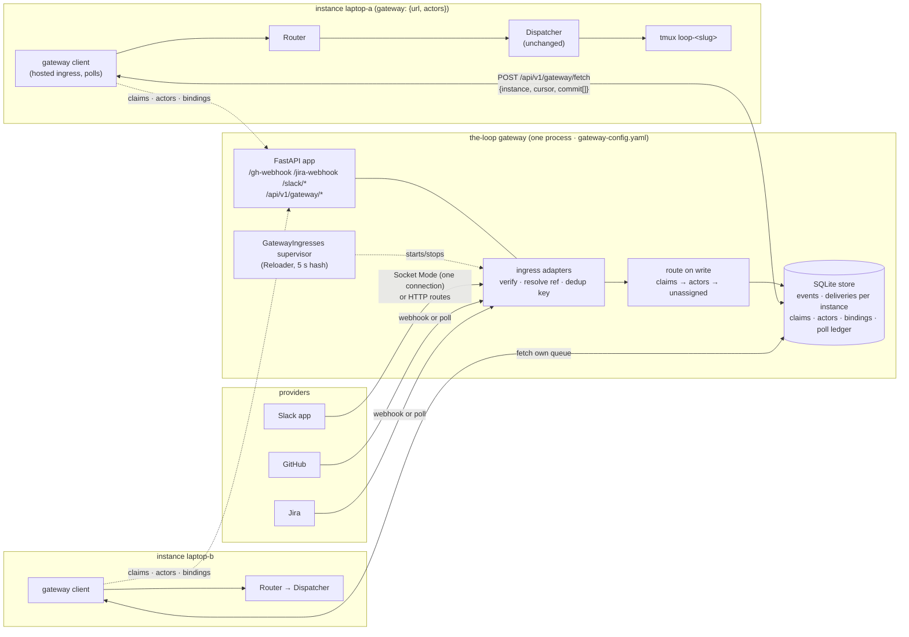
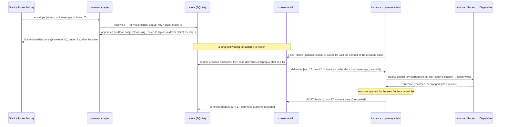
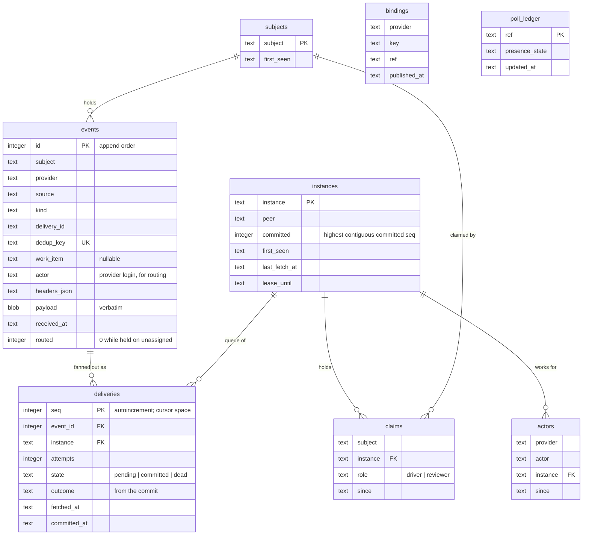

<!-- Authored per the the-loop:writing skill, derived from the approved requirements.md in
     this folder (amended 2026-10-19 for pull consumption and one queue per instance,
     re-approved by MadaraUchiha-314 the same day). Every file:line below was read in the
     tree at commit 8b5aaba; line numbers drift, names do not. -->

# Design: the-loop gateway — one ingress, many instances

> Phase 2 of 4 (requirements → design → testing plan → tasks). Derives from the approved
> requirements. Reviewed with `testing-plan.md` at the one `design-approval` gate.

## Overview

**The gateway is the existing ingress code moved into its own process, with a SQLite
store between arrival and dispatch, and a routing step that fans each event out to the
queue of every instance that consumes it.** Today each inbound transport (the GitHub
receiver, the Jira doorbell, the poller, the Slack Socket Mode listener) parses, verifies
and hands its event to a `Dispatcher` inside the same process. The gateway keeps the
first two steps, verify and resolve, and replaces the third with an append to a durable
store followed by **routing on write**: the subject's claimants, else the instance
registered for the event's actor, else the `unassigned` hold. The instance replaces its
four transports with one **gateway client**, a hosted ingress that **polls its own
queue**, runs the unchanged `Router` → `Dispatcher` pipeline on each delivery, and
**commits** the outcome on its next fetch. Nothing the dispatcher judges moves, and no
instance ever reads another's events.

Three facts from the tree shape the design more than the requirements did:

1. **There is no single dispatcher today.** The receiver builds one in
   `webhook/daemon.py:_build_ingress` and the poller another in
   `poller/daemon.py:_build_dispatcher`, each with its own in-memory `Deduper`. The
   gateway client builds **one**, so an instance behind a gateway has one queue per work
   item and one dedup cache for every transport. That is a simplification, not a cost.
2. **The poller wants an answer.** After `dispatcher.handle(...)` the poller reads
   `delivery_outcome(id)` and `delivery_status(id, refs)` synchronously to settle its
   per-work-item ledger (`seenComments`, `commentAttempts`, `spawn`, `gaveUp`) and count
   retries (`poller/poller.py`). In the gateway the poller and the dispatcher are in
   different processes, so **the commit carries the outcome back**, and the ledger's
   retry-and-give-up logic becomes the subject's redelivery bound. This is the one real
   refactor; the provider layer (`PollProvider`, `poller/base.py`) is reused untouched.
3. **The CLI config is not schema-validated at load**; validation runs on config writes
   and in CI. `gateway-config.yaml` **is** validated at start (R8.1) with the existing
   `configschema.validate`, which already resolves sibling `$ref`s.



**Requirement → component map.**

| Req | Satisfied by |
|---|---|
| R1 process, one Socket Mode connection, verbatim routes, pollers | `gateway/serve.py`, `gateway/ingresses.py`, `gateway/adapters/{github,jira,slack_http,slack_socket,poll}.py` |
| R2 subjects, store-before-ack, dedup, verbatim payload, retention | `gateway/store.py` (SQLite), the adapters' `accept()` path |
| R3 polling, commit with outcome, long-poll, redelivery, dead-letter, no local ingress | `gateway/client.py`, `gateway/consume.py`, `core/lifecycle.enabled_services` |
| R4 one queue per instance, fan-out on write, duplicate name refused, driver and reviewer apart | `gateway/store.py` `deliveries` per instance, `gateway/routing.py`, `instances` lease rows |
| R5 raw payload, consumers resolved at ingest (claims, actors), instance judges, bindings | `gateway/routing.py`; `PUT /claims` from the session registry, `PUT /actors` at client start, `POST /bindings` from `channels/state.py` and `sessions link-pr`; `gateway/client.py` runs `Router`/`Dispatcher` |
| R6 contracts | `docs/api-specs/openapi/the-loop-gateway.v1.yaml`, parity test |
| R7 transports side by side, dedup across | per-provider adapter pairs, `dedup_key()` per kind |
| R8 `gateway-config.yaml`, schema, hot reload, `gateway: {url}` on the instance | `gateway/config.py`, `.the-loop/gateway-config.schema.json`, `Reloader`, `cli-config.schema.json` `gateway` block |
| R9 verbs, doctor | `commands/gateway_cmd.py`, `core/daemons.py`, `doctor` |
| R10 events, dashboard | `eventlog.EVENT_TYPES` additions, `GET /api/v1/gateway` on the instance, `ui/src/views/InstanceDetail.tsx` card (queue backlog, claims) |
| R11 store-held state, follow-ups named | `gateway/store.py` interface, §Trade-offs |
| R12 e2e proof | `testing-plan.md` |
| R13 records | `docs/capabilities/gateway.md`, decisions, Slack guide |
| R14 co-location | distinct default port 8790, loopback no `exposed`, client back-off between fetches |

## Architecture

**Two processes, one contract.** The gateway is a FastAPI app served by uvicorn, exactly
as the control-plane service is (`api/serve.py`), with its own state root, pidfile and
logfile. The instance is unchanged except that, when its config has a `gateway` block,
its hosted-ingress set gains `gateway-client` and loses `slack-listener`; `gh-webhook`
and `poller` follow their own blocks (R3.8 as amended on the PR, 2026-10-19: the first
landing hosted `{gateway-client}` alone; the gateway's own pollers are opt-in).



**Where today's code goes.** The design moves modules, it does not rewrite them:

| Today | In the gateway | In the instance |
|---|---|---|
| `webhook/server.py` `verify_signature`, `make_handler` | `verify_signature` reused by the `/gh-webhook` FastAPI route; `make_handler` stays for the gateway-less instance | unchanged for operators with no gateway |
| `webhook/jira.py` `read_doorbell`, `jira_webhook_secret` | reused by `/jira-webhook` | `JiraDoorbell.ring` runs on the instance, fed from its queue |
| `poller/base.py` `PollProvider`, `poller/github.py`, `poller/jira.py` | reused as the **source** layer by `gateway/adapters/poll.py` | not run |
| `poller/poller.py` `Poller` (ledger, retries, dispatch) | replaced by `gateway/adapters/poll.py` + the store's `poll_ledger`; `Poller` stays for the gateway-less instance | not run |
| `channels/slack.py` `run_socket_listener` | `handle`'s **transport** half (connect, ack) in `gateway/adapters/slack_socket.py`; `SplitWatch` runs here | `handle`'s **classification** half extracted as `slack.dispatch_envelope(request_payload, cfg)`; called by the client and by the gateway-less listener |
| `webhook/router.py` `Router`, `webhook/dispatcher.py` `Dispatcher` | **not present** | built once by the client (`gateway/client.py`) |
| `api/ingress.py` `HostedIngresses`, `_HostedIngress`, `_host`, `reload.Reloader` | `gateway/ingresses.py` subclasses the same supervisor with its own `_STARTERS` | gains `_start_gateway_client` |
| `api/stream.py` `encode_frame`, `Frame` | **not used**: the consumer API is request/response JSON, no stream | the client is a polling loop over `urllib.request` |
| `core/daemons.py`, `runlock.RunLock`, `daemonize.open_logfile` | `gateway start / stop / status / restart` | unchanged |

## Components & interfaces

### `gateway/config.py` — load and validate `gateway-config.yaml`

- `default_gateway_config_path()`: `--config`, else `$THE_LOOP_GATEWAY_CONFIG`, else
  `./.the-loop/gateway-config.yaml`, else `~/.the-loop/gateway-config.yaml` (mirrors
  `cli_config.default_cli_config_path`).
- `load_gateway_config(path, *, strict=True) -> GatewayConfig`: YAML → `configschema.validate(data,
  load_schema("gateway-config"))`; a non-empty error list raises `ConfigError` naming
  each path (R8.1). The gateway config's own `env.file` is loaded first, through
  `envfile.load`, the way `cli_config.load_env_file` does it for the instance: a relative
  path resolves against the config file's directory, a set variable is never overwritten,
  a missing file is a warning naming the path.
- `GatewayConfig` (frozen dataclass): `state_root`, `listen: Listen(host, port=8790,
  exposed=False)`, `store: Store(path, retention_days=7, max_attempts=3,
  dedup_window=10_000)`, `consume: Consume(max_batch=256, max_wait_s=30, lease_s=(10, 300))`, `github: Optional[GitHubIngress(webhook: {path, secret_env},
  poll: {sources[], interval_seconds})]`, `jira: Optional[JiraIngress(webhook: {secret_env},
  poll: {...}, projects)]`, `slack: Optional[SlackIngress(socket: {app_token_env,
  bot_token_env, split_check_beats}, http: {signing_secret_env}, rooms[])]`, `repositories`,
  `instances: Optional[list[str]]` (allow-list), `event_log`, `env_file: Optional[Path]`.
- Secrets are **names only**; the schema's `*Env` keys carry `"pattern":
  "^[A-Z][A-Z0-9_]*$"` so a pasted token fails validation (abuse case 7).

### `gateway/store.py` — the queue, behind one interface

```python
class Store(Protocol):
    def append(self, env: Envelope, consumers: list[str]) -> AppendResult
        # dedup inside; one deliveries row per consumer, none when consumers is empty (unassigned)
    def fetch(self, instance: str, cursor: int, limit: int) -> list[Delivery]
        # that instance's queue after max(cursor, committed); attempts += 1 on each fetch
    def commit(self, instance: str, outcomes: list[tuple[int, str]]) -> CommitResult
        # refuses a seq the queue never fetched; advances committed contiguously
    def touch(self, instance: str, peer: str, lease_s: int) -> Lease | Refused   # duplicate-instance
    def claim(self, subject: str, instance: str, role: str) -> list[int]          # routes held events
    def release(self, subject: str, instance: str) -> None
    def claimants(self, subject: str) -> list[Claim]
    def register_actors(self, instance: str, actors: Actors) -> None | Refused   # duplicate-actor
    def instance_for_actor(self, provider: str, actor: str) -> str | None
    def bind(self, provider: str, key: str, ref: str) -> list[int]                # routes held events
    def resolve(self, provider: str, key: str) -> str | None
    def subjects(self) -> list[SubjectRow]       # claimants, depth and oldest uncommitted per queue
    def queues(self) -> list[QueueRow]           # per instance: committed, backlog, oldest
    def instances(self) -> list[InstanceRow]     # peer, last fetch, lease, actors
    def poll_ledger(self) -> PollLedger
    def expire(self, now: float) -> ExpireResult # retention + dead-letter
```

`SqliteStore(path)` is the only implementation in this work item. It opens one connection
per thread (`check_same_thread=False` is **not** used), `journal_mode=WAL`,
`synchronous=NORMAL`, every public method one transaction. Tables are in §Data models.
Nothing is kept in process memory except the `threading.Condition` that wakes long-polls
(R11.1): a gateway restart loses no offset, claim or registration.

### `gateway/routing.py` — consumers are decided on write

`consumers_for(subject, linked: list[str], actor: tuple[provider, login] | None, store)
-> list[str]` is called by every adapter between `resolve_ref` and `store.append`:

1. the claimants of `subject` plus the claimants of each `linked` subject (a pull request's
   linked ticket through bindings), de-duplicated (R5.3, R5.4);
2. when that set is empty, `store.instance_for_actor(provider, actor)` for the event's
   actor (the comment's `user.login`, Slack `user`, Jira `author.accountId`), one
   instance or none (R5.5);
3. when both are empty, `[]`: the event is held on `unassigned` (`events.routed = 0`),
   recorded as `subject.routed` with `to: unassigned`, and routed later by `store.claim`
   or `store.bind` when a claim or binding covers it (R2.2, R5.7).

Routing reads three small tables and writes `deliveries` rows in the same transaction as
the `events` row, so a provider's acknowledgement implies the fan-out is durable.

### `gateway/adapters/*` — the ingress adapters

Each adapter turns a provider delivery into an `Envelope` and calls `store.append`
**before** answering the provider. Shared helpers in `gateway/adapters/common.py`:

- `resolve_ref(provider, payload, store, config) -> str | None`: GitHub issue/PR number →
  `github:o/r#N` when the repository is declared, else a PR's binding; Jira key →
  `jira:site/KEY-N` when the project is mapped; Slack `thread_ts` → binding, else a
  declared room's work item, else `None` → `unassigned` if the kind can start one
  (`issue_comment` with the control grammar's start word is *not* checked; any
  `issue_comment`, `issues`, `pull_request` on a declared repo may start one), else
  `gateway.dropped: unbound`.
- `dedup_key(provider, kind, payload, delivery_id) -> str` (R7.3): GitHub `issue_comment`
  → `gh-comment-<comment.id>`; `issues`/`pull_request` → `gh-<event>-<action>-<number>-<updated_at>`;
  `check_run`/`check_suite`/`status` → `gh-ci-<ref>-<name>-<conclusion>`; closure →
  `gh-close-<ref>-<state>`; Jira comment → `jira-comment-<site>-<id>` (already shared by
  both Jira paths); Slack → `slack-<event_id>` (HTTP) and the same `event_id` from the
  Socket Mode envelope. The envelope keeps the provider's original `deliveryId`.

| Adapter | Transport | Verify | Resolve | Answer |
|---|---|---|---|---|
| `github.py` | `POST /gh-webhook` (FastAPI route) | `webhook/server.verify_signature(secret, body, X-Hub-Signature-256)`; missing/invalid → 401 `gateway.dropped: bad-signature` | number → ref; PR → binding or `unassigned` | 202 after append; 500 if the store fails (GitHub retries) |
| `jira.py` | `POST /jira-webhook` | `X-Hub-Signature` with `secretEnv`; 404 with no secret (as today) | `read_doorbell` → key → ref | 202 / 500 |
| `slack_http.py` | `POST /slack/events`, `/slack/interactions`, `/slack/commands` | `X-Slack-Signature` over `v0:<ts>:<body>` with the signing secret, `abs(now - ts) ≤ 300 s`; `url_verification` answered with `challenge` | thread → binding / room | 200 after append (Slack's 3 s) |
| `slack_socket.py` | `SocketModeClient` (one per app) | the connection is the auth | same | `send_socket_mode_response` **after** `append` returns; the heartbeat `message` kind is consumed here by `SplitWatch.observe`, not stored |
| `poll.py` | `PollProvider.list_work_items / list_comments / ci_events / closure` on each source every `interval_seconds` | the API token is the auth | from the provider's refs | nothing to answer; `poll_ledger` marks what was stored |

**The poller's ledger, relocated.** `gateway/adapters/poll.py` keeps `poll_ledger` rows
`(ref, seen_delivery_ids, presence_state)` in the store. A comment is "seen" once
`append` returns (storage is durable, so this is the old `seenComments` with a stronger
meaning). Presence (`poll-presence-<ref>-<uuid>`) is re-emitted every cycle only while
the ledger says `presence_state ∈ {unknown, awaiting-start}`; the client's **commit
outcome** updates it (`spawned`, `settled:<reason>`, `dropped:<reason>`), which is how
`delivery_outcome`'s answer gets back across the process boundary. `commentAttempts` and
`gaveUp` are gone: redelivery is the subject's (`attempt` on the envelope, dead-letter at
`store.max_attempts`, default 3 to match `polling.maxRetries`).

### `gateway/consume.py` — fetch and commit, claims, actors

The consumer API is pull. One call does the consumer loop's whole step, as a Kafka
consumer's fetch-and-commit does; the other routes are registrations and read-only views.

- `POST /api/v1/gateway/fetch` body `{instance, peer, cursor, max, wait, lease, commit:
  [{seq, outcome}]}`:
  1. `store.touch(instance, peer, lease)`: the `instances` row for the name records the
     `peer` (a random id the client persists in `<root>/local/gateway-peer.json`, so a
     restart of the same instance is the same peer) and `lease_until = now + lease`. A
     fetch from a **different** peer while the lease is live → **409**
     `{"error": "duplicate-instance", "holder": "<name>", "since": …}` and
     `gateway.refused: duplicate-instance` (R4.3). The client sends `lease = 3 ×
     pollIntervalSeconds + longPollSeconds`; the gateway clamps it to `consume.lease_s`.
     An `instances` allow-list in `gateway-config.yaml`, when set, refuses an unknown name
     here too.
  2. `store.commit(instance, commit)`: each `seq` must be a delivery of this queue that was
     fetched; otherwise **409** `commit-undelivered` and nothing is fetched (abuse case 5).
     `committed` advances to the highest contiguous committed seq. An outcome is one of
     `delivered`, `spawned`, `dropped:<reason>`, `failed`; `failed` leaves the row pending
     so a later fetch returns it.
  3. `store.fetch(instance, cursor, max)`: deliveries with `seq > max(cursor, committed)`,
     oldest first, at most `max` (clamped to `consume.max_batch`), each with `attempts`
     incremented. A delivery whose attempts exceed `maxAttempts` is marked `dead`,
     committed as `dead-lettered`, recorded `subject.dead-lettered`, and not returned (R3.6).
  4. Empty and `wait > 0` (clamped to `consume.max_wait_s`): wait on the instance's
     `Condition` until `append` routes something to this queue or `wait` elapses, then
     read once more (R3.3).
  5. Response `{"deliveries": [{seq, attempt, event: <envelope>}], "cursor": <last seq>,
     "committed": <seq>, "lease": {"expiresIn": s}}`.
- `POST /api/v1/gateway/commit {instance, peer, commit}`: step 2 alone, for `the-loop stop`
  and for a client that has nothing to fetch for a while.
- `PUT /api/v1/gateway/claims {instance, subject, role}` and `DELETE …/claims` with the
  same body → `store.claim` / `store.release`; `gateway.claimed` / `gateway.released`.
  A claim routes the events held on `unassigned` for that subject onto the claimant's
  queue in the same transaction (R2.2, R5.3). `role ∈ {driver, reviewer}`.
- `PUT /api/v1/gateway/actors {instance, actors: {github: [...], slack: [...], jira: [...]}}`
  replaces that instance's registration; an actor held by another instance whose lease is
  live → **409** `duplicate-actor` and `gateway.refused: duplicate-actor` (R5.5);
  otherwise `gateway.registered`.
- `POST /api/v1/gateway/bindings {ref, provider, key}` → `store.bind` (R5.7); it also
  routes held events whose key now resolves.
- `GET /api/v1/gateway/health|subjects|queues|instances`: health is `{ok, ingresses:
  {name: state}, slack: {socket: up|down|off}, store: {path, events, held, queues:
  {instance: backlog}}}`.

### `gateway/client.py` — the instance's hosted ingress

- `GatewayClient(cli_config, stop_event)` started by `api/ingress._start_gateway_client`
  (added to `_STARTERS`; `_wanted()` adds `gateway-client` and drops `slack-listener`
  when the config has a `gateway` block, via `core/lifecycle.enabled_services`, R3.8 as
  amended; `channels/watcher.start_watcher` returns `None` behind a gateway, so the poll
  reader is off too). The listener's status word reads `off · gateway configured` in
  `the-loop status` and the dashboard.
- Builds **one** `Router` and **one** `Dispatcher` with the same arguments
  `webhook/daemon.py:_build_ingress` uses, plus the `JiraDoorbell` and the Slack
  classifier. Hot reload of `cli-config.yaml` keeps working through `dispatcher.reload`.
- **Registers first.** On start and after every outage it sends `PUT /actors` with
  `gateway.actors` (R5.5) and re-asserts the claims of its live sessions (`PUT /claims`
  for each session the registry holds, R5.3), so a gateway restart or a lost registration
  is repaired by the client, not the operator. A `409 duplicate-actor` is logged as
  `gateway.refused` with the holder and retried on the back-off schedule.
- **Polls.** A loop over `urllib.request` (what `manager/fleet.py` already uses):
  `POST /fetch` with `instance = instance.name or "default"`, the persisted `peer`, the
  last `cursor`, `max = 64`, `wait = gateway.longPollSeconds`, and the `commit` list
  accumulated since the previous fetch; then sleeps `gateway.pollIntervalSeconds` only
  when the response was empty **and** `wait` was zero (a long-poll already waited). Any
  error → exponential back-off 1 s → 60 s, recording `gateway.unreachable` once per
  outage and `gateway.connected` on recovery (R14.4). A `409 duplicate-instance` is
  logged with the holder's name and retried on the same schedule (R4.3).
- Per delivery, by `provider`:
  - `github` → `router.route(kind, payload, delivery_id)` → `dispatcher.handle(routed)`;
    then `delivery_status(id, refs)` → outcome. A `None` from the router (`routing.dropped`)
    is an outcome too.
  - `jira` → `JiraDoorbell.ring(bell)` as the receiver does today.
  - `slack` → `slack.dispatch_envelope(payload, cfg)` (the extracted classification half).
- **Commits on the next fetch.** Each outcome is appended to the pending `commit` list and
  sent with the next `POST /fetch`; `the-loop stop` flushes it with `POST /commit`. A crash
  between dispatch and the next fetch leaves the batch uncommitted; the next fetch returns
  it with `attempt+1`, and the dispatcher's three dedup layers drop the duplicate (R3.6,
  R3.7). The cursor is a hint only: the server never returns a seq at or below `committed`.
- **Publishes claims and bindings.** `SessionRegistry` gains an optional `publisher`
  callback the client sets: `register`/`record_owning` of a session → `PUT /claims` with
  `driver` (or `reviewer` when the control record's command is `review`, bound to the PR as
  issue-279 does), `close` → `DELETE /claims`. `channels/state.py:ChannelState.bind` gains
  the same shape of callback for Slack threads; `sessions link-pr` and the router's
  PR-linkage result call `POST /bindings`.
- Exposes `GET /api/v1/gateway` on the **instance's** API (added to `the-loop.v1.yaml`):
  `{configured, url, state: connected|connecting|refused|unreachable|off, instance, peer,
  since, committed, mode: {pollIntervalSeconds, longPollSeconds}, claims: [{subject, role}],
  health: <proxied>, queue: <proxied queues[instance]>}` for the dashboard card (R10.3).

### `gateway/ingresses.py` and `gateway/serve.py` — the process

- `gateway/serve.py:main()` mirrors `api/serve.py`: load config, exposure guard (`if not
  is_loopback(host) and not exposed: exit 2`), configure the event log with
  `source="gateway"`, `uvicorn.run(create_app(config))`. `create_app` mounts the ingress
  routes and the `/api/v1/gateway/*` routes and starts `GatewayIngresses` in the lifespan.
- `GatewayIngresses(HostedIngresses)` reuses `_HostedIngress`, `_host`, `_acquire` and the
  `Reloader`; its `_STARTERS` are `slack-socket`, `github-poll`, `jira-poll` (the HTTP
  routes are app routes, enabled or 404 by config, so they need no thread). `reconcile`
  applies membership changes and records `config.reloaded`; a failed reload keeps the
  previous config (`Reloader.poll_for_change` returns `None`) and records
  `config.reload-failed` (R8.5). Listen address and Slack tokens are start-time only, and
  `gateway status` says `restart required` when the file's values differ from the running
  ones (R8.6).
- `commands/gateway_cmd.py` registers `gateway` with sub-actions
  `start|stop|status|restart|subjects` over `core/daemons.control_daemon`-shaped helpers:
  pidfile `<gateway state_root>/gateway.pid` (a `RunLock`), logfile
  `<state_root>/logs/gateway.out`, start = `Popen([python, "-m", "the_loop.gateway.serve"])`
  then wait on `/api/v1/gateway/health`. `the-loop doctor` gains a `gateway` section
  (reachable, socket up) and `doctor slack` counts the gateway's connection as the app's
  one listener (R9.3).

## UI/UX design

One card on an existing pane; no new screen.

| Artifact | Type | Location / link | Covers (screen · requirement) | Status |
|----------|------|-----------------|-------------------------------|--------|
| `design/gateway-card.html` | html-prototype | [`design/gateway-card.html`](design/gateway-card.html) | Instance detail · Gateway card · R10.3, R14.4, R4.3 | draft |

- **Flows & states:** the card on `InstanceDetail` shows URL, connection state in words
  beside the state dot (`connected · polling`, `connecting · attempt n`, `refused ·
  duplicate instance (409)`, `unreachable · retrying`, `not configured`), the instance
  name it polls as, since when with the committed offset, the gateway's health line, and
  the queue table (subject chip, this instance's role, backlog, oldest uncommitted). The
  Daemons card's three rows read `off · gateway configured`. Refused and unreachable states add a notice saying what the
  instance is doing (retrying, not falling back) and the remedy.
- **Design system / tokens:** the dashboard's own (`ui/src/index.css`: `--state-*`,
  `--surface`, `--border`, `--radius`; `StatusDot`, `Card`, `Kicker`, `ref-chip`), copied
  inline so the prototype renders alone. Light and dark.
- **Accessibility & responsiveness:** the words carry the state, the dot is decorative
  (`aria-hidden`, as `StatusDot`); the table has an `aria-label`; one column under 900 px.
- **Evidence:** screenshots of the locked prototype are captured at verification under
  `evidence/` (`design.uiArtifacts.screenshotEvidence`).

## Data models

**`gateway-config.yaml`** (schema `.the-loop/gateway-config.schema.json`, packaged copy
`cli/the_loop/schemas/gateway-config.schema.json`, parity-tested; `/the-loop:init`
scaffolds it on request):

```yaml
version: "1"
env:
  file: ~/.the-loop/the-loop.env       # dotenv the gateway loads first, as cli-config's env.file (issue-318); values never live here
state:
  root: ~/.the-loop/gateway            # pidfile, logs, gateway.db
listen:
  host: 127.0.0.1                      # non-loopback needs exposed: true
  port: 8790                           # ≠ service 8765, receiver 8787
  exposed: false
store:
  retentionDays: 7
  maxAttempts: 3                       # redeliveries before dead-letter (polling.maxRetries' sibling)
repositories: ["MadaraUchiha-314/the-loop-testing"]
github:
  webhook: { enabled: false, path: /gh-webhook, secretEnv: THE_LOOP_GH_WEBHOOK_SECRET }
  poll:    { enabled: true, intervalSeconds: 60, tokenEnv: GITHUB_TOKEN, sources: [...] }
jira:
  webhook: { enabled: false, secretEnv: THE_LOOP_JIRA_WEBHOOK_SECRET }
  poll:    { enabled: false, ... }
slack:
  socket:  { enabled: true, appTokenEnv: THE_LOOP_SLACK_APP_TOKEN, botTokenEnv: THE_LOOP_SLACK_BOT_TOKEN, splitCheckBeats: 3 }
  http:    { enabled: false, signingSecretEnv: SLACK_SIGNING_SECRET }
  rooms:   []                          # channel → work item declarations, as channels.slack.rooms
instances: []                          # optional allow-list of instance names
observability: { eventLog: { path: ~/.the-loop/gateway/logs/events.jsonl } }
```

**Instance side** (`cli-config.schema.json` gains):

```yaml
gateway:
  url: http://127.0.0.1:8790           # the only required key
  pollIntervalSeconds: 5               # sleep after an empty plain poll
  longPollSeconds: 20                  # 0 = plain polling, no request held open
  actors:                              # who this instance works for: routes unclaimed events here (R5.5)
    github: [MadaraUchiha-314]
    slack: [U0123ABCD]
    jira: []
```

Gateway side, `consume: { maxBatch: 256, maxWaitSeconds: 30, leaseSeconds: { min: 10,
max: 300 } }` joins the example above.

**Envelope** (R6.2), the `event` of every delivery in a fetch response and the
`events.payload` column:

```json
{ "id": 42, "subject": "loop-github-madarauchiha-314-the-loop-testing-14",
  "provider": "slack", "source": "socket", "deliveryId": "Ev0ABC…",
  "receivedAt": "2026-10-18T14:02:11.120Z",
  "workItem": "github:MadaraUchiha-314/the-loop-testing#14", "kind": "message",
  "headers": {"x-slack-request-timestamp": "…"}, "payload": { "…": "verbatim" },
  "attempt": 1 }
```

**SQLite schema** (`gateway.db`, WAL). The queue is `deliveries`: one row per (event,
consuming instance), with a per-table `seq` that is each instance's cursor space.



`dedup_key` is `UNIQUE`; `append` is `INSERT OR IGNORE` and reads back whether a row was
inserted, so dedup across transports is one index (R2.6, R7.3). `(provider, actor)` is
`UNIQUE` in `actors`, which is what makes `duplicate-actor` a constraint rather than a
check (R5.5). `fetch` is one range read on `deliveries(instance, seq)`, so its cost is
the fetching instance's backlog alone (NFR *Scalability*). Retention deletes `committed`
rows older than `retentionDays` and `dead` rows after twice that; `pending` rows and
held (`routed = 0`) events older than `retentionDays` are expired with `subject.expired`
(R2.8); an event with no remaining deliveries is deleted with its last one.

**Event families** added to `eventlog.EVENT_TYPES` (R10.1): `gateway.started`,
`gateway.stopped`, `gateway.received`, `gateway.dropped` (`bad-signature`,
`replay-window`, `unbound`, `undeclared-repository`, `duplicate`), `gateway.refused`
(`duplicate-instance`, `duplicate-actor`, `commit-undelivered`, `unknown-instance`),
`gateway.reloaded`, `gateway.claimed`, `gateway.released`, `gateway.registered`,
`gateway.unreachable`, `gateway.connected`; `subject.appended`, `subject.routed` (`to`: an
instance list or `unassigned`), `subject.committed`, `subject.redelivered`,
`subject.dead-lettered`, `subject.expired`. The instance's `dispatch.*` records gain
`gateway_event_id` (R10.2).

## Error handling

| Failure | Where | Behaviour | Surfaced as |
|---|---|---|---|
| Store write fails on ingress | adapters | webhook → 500, Slack → no ack (Slack redelivers), poll → the item stays unseen | `gateway.error` level error; health `store.ok=false` |
| Bad signature / replay window | `github.py`, `jira.py`, `slack_http.py` | 401, nothing stored | `gateway.dropped` with reason |
| Ref unresolvable, cannot start | `common.resolve_ref` | dropped, nothing stored | `gateway.dropped: unbound` |
| Second peer under a live instance name | `consume.py` | 409 with holder; nothing fetched or committed | `gateway.refused: duplicate-instance` on both sides |
| Actor registered by another live instance | `consume.py` | 409; the registration is not applied | `gateway.refused: duplicate-actor` on both sides |
| No consumer for an event | `routing.py` | held on `unassigned` until a claim, binding or registration covers it, or retention | `subject.routed: unassigned`; `gateway subjects` lists it |
| Instance crashes mid-dispatch | client | batch uncommitted; the next fetch returns it with `attempt+1`; dispatcher dedup drops a true duplicate | `subject.redelivered`; `dispatch.dropped: duplicate-delivery` or `already-processed` |
| `attempt > maxAttempts` | `consume.py` | committed as `dead-lettered`, kept for inspection | `subject.dead-lettered`; `gateway subjects` shows the count |
| Gateway down | client | back-off 1 s → 60 s between fetches; instance keeps running; **no** fallback to local ingress | `gateway.unreachable` once; status `unreachable · retrying`; dashboard notice |
| Client cursor behind `committed` | `consume.py` | the server reads from `committed`; the cursor is a hint | nothing; `fetch` returns `committed` |
| Bad `gateway-config.yaml` at start | `config.py` | exit 2 naming each path | stderr + `gateway status` |
| Bad edit while running | `Reloader` | previous config kept | `config.reload-failed` |
| Secret variable unset | adapter starter | that ingress not started | `ingress.hosted_failed: missing-secret`; health shows it |
| Socket Mode split suspected | `SplitWatch` in the gateway | as today | `channel.split_suspected` from `source=gateway` |
| Non-loopback bind, `exposed: false` | `serve.py` | refuse to start | exit 2 |

Observability is identical in tests and production: the same `eventlog.emit` calls, the
same JSONL file, read by `the-loop events` and the dashboard stream.

## Security design

> Enforces each **trust boundary** from `requirements.md` §Security considerations: the
> three boundaries (provider → gateway, gateway → instance, instance → gateway) and the
> eight abuse cases, mechanism by mechanism.

- **AuthN/AuthZ (the three trust boundaries).**
  - *Provider → gateway:* GitHub HMAC (`verify_signature`, constant-time compare), Jira
    `X-Hub-Signature`, Slack `v0` signature with the 300 s timestamp window; Socket Mode
    is authenticated by the app-level token at connect. Checked **before** the body is
    parsed; failure stores nothing.
  - *Instance → gateway:* **none, by the author's decision.** The boundary is the network:
    the exposure guard refuses a non-loopback bind without `listen.exposed: true`
    (`gateway/serve.py`, same check as `api/serve.py:41-48`), and
    `docs/capabilities/gateway.md` states in its first paragraph that an exposed gateway
    is readable, claimable and committable by any peer on that network. The optional
    `instances` allow-list refuses an unknown `instance` name on fetch, commit, claim,
    registration and binding, which is a guard against misconfiguration, not an
    authentication. Every claim, registration and binding is recorded with its instance
    and time (`gateway.claimed`, `gateway.registered`, `gateway.bound`) and listed by
    `gateway subjects` and `gateway instances`, so a misdirected work item is visible
    (abuse case 8).
  - *Authorization of humans:* unchanged and **absent from the gateway**: the authorized-
    actor guard, the control grammar, the Slack allow-list and grants run in the
    instance's `Dispatcher` and `slack.dispatch_envelope`. The gateway module tree imports
    neither `webhook/dispatcher.py` nor `authz.py`; a test asserts that import graph.
- **Input validation & injection surfaces.**
  - Payloads are stored as **bytes** and forwarded verbatim; the gateway reads only the
    fields `resolve_ref` and `dedup_key` need, with `.get()` chains and type checks, and a
    payload that is not a JSON object is 400 (`invalid-payload`).
  - SQL: `sqlite3` with bound parameters only; no string-built SQL; a test greps the
    module for `f"` next to `execute`.
  - Path: `state.root` and `store.path` are resolved with `os.path.realpath` and must be
    under the state root; subject names are derived from refs by the existing slug
    function (`[a-z0-9-]`), never from payload text.
  - Prompt injection: text in a payload addressed to the agent travels unchanged to the
    instance, where today's untrusted-data framing applies (decision-023); the gateway
    never renders payload text into a comment, a log line beyond its length-capped
    `gateway.received` summary, or a command.
  - Headers: only the allow-listed routing headers (`X-GitHub-Event`,
    `X-GitHub-Delivery`, `X-Slack-Request-Timestamp`, `X-Atlassian-Webhook-Identifier`)
    are stored.
- **Secrets handling.** Config carries variable **names**; the schema pattern rejects
  values. Tokens are read from the process environment at adapter start and held in the
  adapter object only; they never reach the store, the event log or `gateway status`
  by construction — every adapter and status line carries the variable's *name*, and
  `gateway status --format json` lists each declared name as set or unset
  (`secretsSet`), never a value (security review SEC-10a: the earlier wording promised
  a redaction list the log does not have). The gateway holds **no GitHub posting
  token**: its GitHub poll token needs `repo:read`; posting stays on the instance.
- **Least privilege.** The gateway spawns nothing, writes only under its state root, and
  needs: Slack `connections:write` (app token) and the bot's read scopes; GitHub read on
  the declared repositories; Jira read. The instance's client needs outbound HTTP to one
  URL.
- **Fail-closed behaviour.** Missing secret → that ingress does not start; invalid
  config → process does not start; store unwritable → provider gets a failure, nothing
  acked; unknown ref that cannot start → dropped and recorded; duplicate instance name →
  409; duplicate actor → 409; commit for a delivery the queue never fetched → 409;
  non-loopback without `exposed` → exit 2. Added by the security review (round 1,
  2026-10-19): a body field beyond its bound or a provider outside the enum → 422 at
  the door, nothing written (SEC-4, SEC-6); a declared body above 25 MiB → 413 before
  it is read (SEC-9); a header an unauthenticated peer chose is clipped to 200
  characters before it is logged (SEC-8); a non-ASCII signature is a 401, not a 500
  (SEC-7); at most one open long-poll per name and 32 in all, the rest plain polls, and
  256 open requests before uvicorn answers 503 (SEC-5); retention prunes a lapsed name
  with nothing queued and an empty subject (SEC-4); `/health` carries no path and no
  bind address (SEC-10c); a Jira poller without its secrets is off at start (SEC-10b);
  the network sees a peer fingerprint, never a peer id (SEC-1); a binding is published
  by a named, allow-listed, live peer and recorded (SEC-2); the instance treats a
  malformed fetch answer as unreachable (SEC-3).
- **Abuse-case coverage.**

| Abuse case (requirements) | Mechanism | Negative test |
|---|---|---|
| 1 bad / missing signature | `verify_signature` before parse; 401 | `Scenario: a webhook with a wrong signature is refused and stores nothing` |
| 2 Slack timestamp outside window | 300 s check in `slack_http.py` | `Scenario: a replayed Slack delivery is refused` |
| 3 prompt injection in a payload | bytes verbatim; instance's guard | `Scenario: an injected start keyword from an unauthorized actor is dropped on the instance` |
| 4 second peer under a live instance name | `instances.peer` + `lease_until`; 409 | `Scenario: a second peer under the same instance name is refused while the first polls` |
| 5 commit for a delivery never fetched | `deliveries(instance, seq)` check; 409 | `Scenario: a commit for a delivery never fetched is refused` |
| 6 duplicate flood / unbounded growth | `dedup_key UNIQUE`; retention job | `Scenario: ten thousand duplicate deliveries store one row` and `Scenario: retention expires committed rows` |
| 7 literal token in config | schema `pattern` on `*Env` | `Scenario: a config with a pasted token fails validation naming the key` |
| 8 a claim or registration steers a subject | recorded with instance and time; `duplicate-actor` refused; listed by `gateway subjects` | `Scenario: a duplicate actor registration is refused` and `Scenario: every claim is listed with its instance and time` |

## Testing strategy

Requirements map to three layers. **Unit** tests cover the pure seams: `dedup_key`,
`resolve_ref` and `consumers_for` per provider and kind, `SqliteStore` (append with
fan-out, dedup, fetch after cursor and committed, commit with contiguous advance,
re-fetch with attempts, dead-letter, retention, the per-name lease with peers, claims
routing held events, actor uniqueness, bindings), the `gateway-config` and `gateway`
block validators and their negative cases, and the client's fetch loop, commit batching
and back-off against a fake consume API. **Integration** tests (the `*_integration.py`
convention in `cli/tests/`) run a real gateway app in-process with the existing fakes:
`FakeSocketModeClient` for Slack (`test_channels_splitwatch_integration.py`), signed
synthetic GitHub deliveries as `test_webhook_routing_integration.py` builds them, the
`ghstub` loopback GitHub server for the poll adapter, and a real `GatewayClient` driving
a real `Dispatcher` with a fake tmux runner; the Gherkin titles are
`Scenario: a Slack envelope is stored before it is acknowledged`, `Scenario: an issue
comment through the gateway spawns on the instance with the gateway event id in its
dispatch record`, `Scenario: a crash between dispatch and commit redelivers once and the
dispatcher drops the duplicate`, `Scenario: a stopped instance finds its backlog in order`,
`Scenario: a driver and a reviewer on two instances each receive their own queue`,
`Scenario: a start by a registered actor lands on that actor's instance only`,
`Scenario: an event with no consumer waits on unassigned until a claim routes it`,
`Scenario: a long-poll returns within a second of an append`, `Scenario: a webhook and a
poll of the same comment store one row`, `Scenario: an instance with a gateway block runs
keeps its receiver and poller and loses only the listener`, `Scenario: a gateway and an instance share one machine on
loopback`, plus the eight abuse scenarios above. **Contract** tests
extend `test_api_contract_parity.py` to `the-loop-gateway.v1.yaml` against
`gateway.create_app(...).openapi()` and add the instance's `GET /api/v1/gateway` to
`the-loop.v1.yaml`; `test_config_schema_parity.py` gains `gateway-config`. The **e2e**
proof (R12) is manual against `the-loop-testing` with the author's Slack app, evidenced
under `evidence/`; the matrix, environment and evidence plan are `testing-plan.md`'s.

## Trade-offs & decisions

- **SQLite for the queue, beside a JSONL event log.** Decision-025 chose JSONL over SQLite
  for *observability* because many processes append without coordination. The gateway
  store is a different thing: one writer process, transactional offsets, a unique index
  for dedup, and a bounded delete. JSONL cannot do the last three. The event log stays
  JSONL; the store is SQLite; both from the standard library. → decision record.
- **Pull, not push (author's decision at the design gate).** The first draft streamed every
  event to one subscriber over SSE. A fleet of instances would hold a connection each, and
  each would filter the whole stream. Pull with an optional long-poll holds nothing between
  polls, lets each instance choose its latency, and is the shape Kafka's own consumers
  have. The cost is one poll interval of latency under plain polling, and the SSE grammar
  of decision-087 is not reused here. → decision record.
- **Fan-out on write, one queue per instance.** Routing once at ingest costs one
  `deliveries` row per consumer and three small table reads; routing on read would cost
  every instance a scan of everything. Events rarely have more than two consumers (a
  driver and a reviewer), so the write amplification is bounded and the read is an index
  range. The `subject` stays on every event, so splitting one user's subjects across
  instances later changes routing, not the envelope or the commit (R4.7, R11.2).
- **Claims and actors instead of a lease.** The author removed work-item ownership. The
  routing table still needs to know who consumes a subject: claims are what the sessions
  already know (which work item, which role, on which instance), published at the moment
  the registry learns it, and actors answer the one case no claim can, the first event
  about a work item. Neither carries a fencing token; a lease can later guard both.
- **The lease is per instance name, by peer.** Two processes polling as one name would
  split a queue silently. A persisted peer id plus a lease refreshed by each fetch makes
  the second one a visible 409, with no token exchange; the same instance restarting is
  the same peer and is never refused.
- **The commit rides on the fetch.** The poller's synchronous `delivery_outcome` read
  cannot cross a process boundary; sending the dispatcher's outcomes with the next fetch
  keeps the poll ledger correct, gives `gateway subjects` an honest per-delivery state,
  and makes the consumer loop one request per step.
- **FastAPI routes instead of a second `ThreadingHTTPServer`.** The gateway is already a
  FastAPI process for its consumer API; mounting `/gh-webhook` beside it reuses
  `verify_signature` and avoids two servers on two ports. The stdlib receiver stays for
  operators who run no gateway.
- **Slack classification split in two.** Extracting `dispatch_envelope` from
  `run_socket_listener`'s inline `handle` is the one change to today's Slack path; the
  gateway-less listener calls the same function, so there is one classifier.
- **No fallback to local ingress when the gateway is down (R14.4).** A fallback would
  silently create the double-ingress the gateway exists to prevent. The cost is a dead
  instance while the gateway is down; the store's durability is what makes that cost
  acceptable.
- **Default port 8790** so the service (8765), the receiver (8787) and the gateway start on
  one laptop with no configuration (R14.2).
- **Deferred, by decision:** instance authentication (bearer token by variable name first;
  the `instances` allow-list is where it attaches), a work-item lease over claims so one
  user's subjects can be split across instances, multi-replica gateways (the store
  interface is the seam).

Durable records to write with the change (R13): `decision-1xx` the gateway as the
ingress process and its name beside decision-059's auth proxy; `decision-1xx` the queue
contract (subjects, one queue per instance, store-before-ack, pull with commit,
at-least-once with idempotent consumers) and consumer resolution at ingest (claims, then
actors) with its follow-ups; `decision-1xx` instance authentication deferred and the
exposure posture.

## Open questions

None for a human; the three design-phase questions from the requirements are answered
here: bindings are published by the instance (`ChannelState.bind` publisher,
`link-pr`); every transport lands in the first milestone except Slack HTTP, which ships
behind `slack.http.enabled` once the Socket Mode e2e proof passes; co-location is R14 and
needs no special mode.

## Review comments

> Appended by the-loop's `record-feedback` hook when a human gate approves with
> comments (issue-109). Append-only and attributed: an approval never silently
> discards a reviewer's suggestions, and the feedback travels with the document
> it concerns rather than living in a side-channel tracker.

### 2026-10-18 — approved

**@MadaraUchiha-314** wrote:

approved
