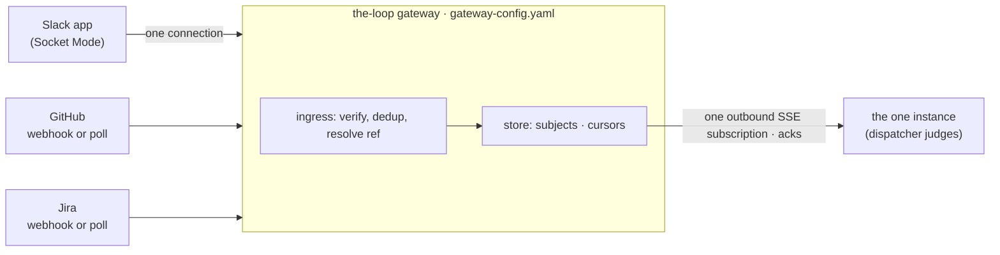

<!-- Authored per the the-loop:writing skill. Derived from the locked brainstorm.md in
     this folder (approved by MadaraUchiha-314 on 2026-10-18): its chosen direction is
     the introduction, its working hypothesis and hand-off are the requirements, its
     resolved constraints are the acceptance criteria. What the brainstorm considered
     and rejected stays there. -->

# Requirements: the-loop gateway — one ingress, many instances

> Phase 1 of 4 (requirements → design → testing plan → tasks). Tier 4
> (`human-approves-spec-and-pr`, plus a named human security sign-off): the change adds a
> process that is reachable from the internet on both sides, ships a fourth plugin
> schema under `.the-loop/`, and by the author's decision ships without authentication
> between an instance and the gateway.

## Introduction

[Issue #496](https://github.com/MadaraUchiha-314/the-loop/issues/496): "Introducing the-loop
gateway!"

**What is broken.** Every instance of the-loop owns its own inbound transports: a GitHub
webhook receiver, a Jira doorbell, a poller and a Slack Socket Mode listener. Two of those
cannot be shared. Slack delivers each Socket Mode envelope to **one** of an app's open
connections, so two instances on one Slack app silently halve each other's inbound, and
the shipped answer today is *one Slack app per listener*. A GitHub webhook has one Request
URL, so a second instance runs a second webhook or a second poller, spending the API
budget twice. Nothing promises that one work item is handled by **one** instance across
machines: two `open` instances both take the same `the-loop start`.

**What we do about it.** A **gateway**: one long-running process, `the-loop gateway`,
that holds every inbound surface (the GitHub, Jira and Slack webhooks, the one Slack
Socket Mode connection, the pollers) and deposits each event, durably and exactly as it
arrived, on a **subject** named after the work item it is about. Instances connect
**outbound** to the gateway, subscribe to the subjects of the work items they manage,
and acknowledge what they have handled. **One instance per gateway** is the first
landing's assumption, by the author's decision: the gateway serves a single subscriber
and refuses a second, and ownership across instances (a lease) is a later work item. The
dispatcher's judgement (authorization, the control grammar, scope) stays on the instance;
the gateway transports and resolves, it never decides. Configuration lives in a separate,
hot-reloaded `gateway-config.yaml`.

**What it costs.** A fourth config file and schema; a second process to run; and, by the
author's decision, a first landing with **no authentication** between an instance and the
gateway and **no multi-instance ownership**, so the gateway's consumer API is as exposed
as its network boundary and two instances still cannot share one gateway. The gateway is
**additive**: an instance with no `gateway` block runs exactly as today.

**What to check.** The Slack Socket Mode end-to-end proof on `the-loop-testing`: one Slack
app, one gateway, one instance with Slack disabled locally, the author's app and tokens,
every reply landing in the session through the gateway and surviving an instance restart.
It is the verification the author asked for, and the only live one.

**Decided on the ticket (2026-10-18), carried in as constraints:** the work item stands
alone from issue-492 and multi-replica scaling is a later work item (R1, R11); the
gateway has its own config file (R8); no instance authentication in the first landing
(Security considerations); the e2e proof is Slack only, with the author's app and tokens
(R12); the name is `gateway` (R13). **Review remarks on this file (2026-10-18,
[comment](https://github.com/MadaraUchiha-314/the-loop/issues/496#issuecomment-6252706097)):**
every provider's events reach the instance raw, not only Slack's (R5); every provider offers
each of its transports side by side, not only Slack (R7); and a gateway and an instance may
share one machine over a loopback URL (R14). **Second review remark (2026-10-18,
[comment](https://github.com/MadaraUchiha-314/the-loop/issues/496#issuecomment-6252841116)):**
no lease; one instance per gateway is assumed (R4), and everything the lease carried is out
of scope.

## Requirements

### Requirement 1 — a gateway process that owns every inbound transport

**User story:** As an operator running more than one instance, I want one process to hold
every webhook URL and the one Slack Socket Mode connection, so that my instances share
one Slack app and one Request URL per provider instead of one each.

#### Acceptance criteria (EARS)

1. WHEN `the-loop gateway start` runs with a valid `gateway-config.yaml` THEN the system
   SHALL start one gateway process that opens the enabled ingresses (GitHub webhook, Jira
   webhook, Slack webhook routes, Slack Socket Mode, the pollers) and no other surface.
2. WHEN the gateway is configured with a Slack app THEN the system SHALL open exactly one
   Socket Mode connection for that app for the lifetime of the process, reconnecting on
   loss, and SHALL never open a second.
3. WHEN GitHub delivers to `POST /gh-webhook` on the gateway THEN the system SHALL accept
   it under the same header and `X-Hub-Signature-256` HMAC contract the instance's
   receiver accepts today, so a webhook configured for an instance can be re-pointed at
   the gateway without change.
4. WHEN Jira delivers to `POST /jira-webhook` on the gateway THEN the system SHALL accept
   it under the instance doorbell's current secret contract.
5. WHEN a `polling.sources[]` entry is declared in `gateway-config.yaml` THEN the system
   SHALL poll that source once, from the gateway, and SHALL produce the same delivery ids
   (`poll-comment-<id>`, …) the instance poller produces today.
6. WHILE the gateway runs THEN the system SHALL be one process: one Socket Mode connection
   per app, one poller per source, one store. Replicas are out of scope (R11).

### Requirement 2 — events are deposited on per-work-item subjects, durably, before any acknowledgement

**User story:** As an instance, I want every event about a work item I manage to be
waiting for me on a subject I can read at my own pace, so that a sleeping laptop finds its
backlog when it returns and nothing is lost between the provider and me.

#### Acceptance criteria (EARS)

1. WHEN an ingress accepts an event the gateway can resolve to a work item THEN the system
   SHALL append it to the subject `loop-<slug>` of that work item, where `<slug>` is the
   slug tmux uses for the same work item today.
2. WHEN an ingress accepts an event it cannot resolve to a work item but which could arm
   one (a `the-loop start` on a fresh issue, a Slack kickoff in a declared room) THEN the
   system SHALL append it to the gateway's single `unassigned` subject.
3. WHEN an event arrives that is about no work item (a fleet verb, an unmatched comment)
   THEN the system SHALL NOT enqueue it; the gateway answers or drops it per the control
   grammar's existing facade rules.
4. WHEN an event is appended THEN the system SHALL write it to the store **before**
   returning the provider's acknowledgement: HTTP `202` to GitHub and Jira, the Socket
   Mode envelope ack to Slack. A store failure SHALL return a non-2xx response or no ack,
   so the provider retries.
5. WHEN a Slack Socket Mode envelope arrives THEN the system SHALL store it and ack it
   within Slack's three-second window.
6. WHEN the same `(provider, deliveryId)` arrives twice THEN the system SHALL store it
   once, within a bounded, persisted dedup window that survives a gateway restart.
7. WHEN an event is stored THEN the system SHALL carry the provider's payload verbatim and
   SHALL add only the envelope fields of R6; the gateway SHALL NOT interpret the payload
   beyond resolving the work-item reference.
8. WHILE a subject has unacknowledged events THEN the system SHALL retain them until a
   the instance acknowledges them or the subject's configured retention expires, whichever
   is first, and SHALL record `subject.expired` for anything dropped by retention.

### Requirement 3 — an instance subscribes outbound and acknowledges

**User story:** As an instance behind NAT, I want to open one outbound connection and
receive every event the gateway holds, in order per work item, so that the gateway never
needs to reach me.

#### Acceptance criteria (EARS)

1. WHEN an instance has a `gateway` block in its `cli-config.yaml` THEN the system SHALL,
   on `the-loop start`, connect outbound to `gateway.url`, subscribe to the gateway's
   whole stream (every subject, including `unassigned`), and keep the subscription while
   it runs.
2. WHEN a new subject appears on the gateway (an event about a work item not seen before)
   THEN the system SHALL deliver it on the same stream without the instance resubscribing.
3. WHEN an instance is subscribed THEN the system SHALL deliver events in append order
   within each subject, from each subject's committed offset, over Server-Sent Events
   with `Last-Event-ID` as the resume cursor (decision-087's transport, not WebSocket).
4. WHEN an instance has dispatched an event (delivered to a session, spawned one, or
   dropped it on purpose) THEN the system SHALL acknowledge it to the gateway, and the
   subject's committed offset SHALL advance.
5. WHEN an instance drops an event on purpose (`awaiting-start`, `session-paused`, a
   scope refusal, a self-marked comment) THEN the system SHALL acknowledge it, so
   a purposeful drop is never replayed (issue-270 preserved).
6. WHEN an instance fails to dispatch an event (a transport error, a crash before the ack)
   THEN the system SHALL leave it unacknowledged, and the gateway SHALL redeliver it on the
   next subscription, up to a configured retry bound, after which it is recorded as
   `subject.dead-lettered` and acknowledged.
7. WHEN a redelivered event reaches an instance THEN the system SHALL drop it as a
   duplicate when its delivery id is in the instance's existing dedup caches (the LRU, the
   session record's recent ids, `control-deliveries.json`), so at-least-once delivery
   meets an idempotent consumer.
8. WHEN an instance has a `gateway` block THEN the system SHALL run no ingress of its own:
   no webhook receiver, no poller, no Slack listener, regardless of what its `webhooks`,
   `polling` and `channels.slack.read` blocks say, and `the-loop status` SHALL say so.

### Requirement 4 — one instance per gateway, assumed and enforced

**User story:** As the author, I want the first landing to assume a single instance
processes everything a gateway receives, so that no ownership protocol is built now, while
the assumption is enforced rather than hoped, and a later work item can add ownership
across instances without changing the contracts.

> Decided on the ticket (2026-10-18): the lease, its fencing tokens, its verbs and its
> events are **not** built. The brainstorm's option D stays on record for the follow-up.

#### Acceptance criteria (EARS)

1. WHILE one instance is subscribed THEN the gateway SHALL deliver every stored event to it
   and to nothing else.
2. WHEN a second instance subscribes while one subscription is live THEN the gateway SHALL
   refuse it with `409` naming the connected instance, SHALL record `gateway.refused` with
   reason `second-subscriber`, and the refused instance SHALL log the refusal and retry
   with back-off; it SHALL NOT fall back to its own ingresses.
3. WHEN the subscribed instance disconnects (a stop, a crash, a network loss) THEN the
   gateway SHALL free the subscription so the same or another instance can connect, and
   the unacknowledged backlog SHALL be delivered to whichever connects next, in order.
4. WHEN an instance connects THEN it SHALL send its `instance.name` when it has one, and
   the gateway SHALL record it in `instances` for `gateway status`, so the operator sees
   who is connected; an unnamed instance connects as `default`.
5. WHEN the instance starts a session THEN the announcement comment SHALL keep naming the
   instance (decision-141), unchanged.
6. WHEN the design phase writes the store and consumer contracts THEN they SHALL be such
   that per-subject subscriptions and an ownership mechanism can be added later without
   changing the event envelope or the ack semantics (R11).

### Requirement 5 — every event reaches the instance raw; the instance judges

**User story:** As an operator, I want every judgement about an inbound event (who is
allowed, what a keyword means, what to post on the ledger, how a pull request links to a
work item) to stay on my instance, whichever provider it came from, so that the gateway
holds no allow-list, no grant and no posting token and the existing dispatch pipeline is
reused intact.

#### Acceptance criteria (EARS)

1. WHEN an event arrives at the gateway from any provider (GitHub, Jira, Slack) THEN the
   system SHALL resolve only **which work item** it concerns and SHALL enqueue the
   provider's payload unclassified on that subject, or on `unassigned` when the event
   could start one.
2. WHEN the gateway resolves the work item THEN it SHALL use only: the reference the
   payload names directly (a GitHub issue or pull-request number, a Jira issue key, a
   Slack thread), the bindings the instance has published (R5.4), and the rooms and projects
   declared in `gateway-config.yaml`. It SHALL NOT run the dispatcher, the control
   grammar, the authorized-actor guard or the self-marker check.
3. WHEN the instance receives an event from the stream THEN the system SHALL run
   today's pipeline unchanged for that provider: the router's linkage and the dispatcher's
   control parse, scope, authorization, record, match and deliver for GitHub and Jira; the
   listener's classification (`work-item.reply`, `gate.feedback`, `control.command`,
   `context.added`, …), allow-list, grants and ledger write for Slack.
4. WHEN the instance learns that a secondary object belongs to its work item (it
   binds a Slack thread, opens or links a pull request, maps a Jira key) THEN the system
   SHALL publish the binding `{ref, provider, key}` to the gateway, and the gateway SHALL
   keep only that mapping, never message or payload bodies, so later events on that object
   land on the right subject.
5. WHEN a GitHub event names a pull request the gateway has no binding for THEN the gateway
   SHALL enqueue it on `unassigned`, and the instance, recognising the linkage with
   today's router inference, SHALL publish the binding.
6. WHEN a Slack interaction requires a response inside Slack's three-second window (a
   button, a slash command, a shortcut) THEN the gateway SHALL ack the envelope itself
   after storing it; any visible reply is the instance's, posted through the channel as today.
7. WHEN an event concerns an object bound to no work item that cannot start one (a Slack
   thread outside any declared room, a Jira project not mapped, a repository not declared)
   THEN the gateway SHALL drop it and record `gateway.dropped` with reason `unbound`.

### Requirement 6 — the contracts are specified before they are implemented

**User story:** As an engineer, I want the ingress routes, the stored event envelope and
the consumer API written down as contracts, so that an instance, a later replica or
another product can implement against them without reading the gateway's code.

#### Acceptance criteria (EARS)

1. WHEN the design phase completes THEN the system SHALL have a second OpenAPI document
   beside `the-loop.v1.yaml` in this repository's `apiSpecs.rest.dir`, describing every
   gateway route of R6.3, parity-tested against the implementation like the first.
2. WHEN an event is stored THEN its envelope SHALL carry exactly: `id`, `subject`,
   `provider`, `source` (`webhook | socket | poll`), `deliveryId`, `receivedAt`,
   `workItem` (ref or null), `kind` (the provider's event name), `headers` (an allow-list
   of the provider's routing headers), `payload` (verbatim), `attempt`.
3. WHEN the consumer API is specified THEN it SHALL offer: a subject stream
   (`GET …/events`, SSE, `Last-Event-ID`, every subject on one stream, each event tagged
   with its subject), an ack (`POST …/ack`), binding publication (`POST …/bindings`), and
   read-only `health`, `subjects` and `instances`. A per-subject stream
   (`GET …/subjects/{subject}/events`) is reserved in the document for the ownership
   follow-up and not implemented.
4. WHEN the ingress routes are specified THEN they SHALL be the providers' own contracts
   verbatim (`POST /gh-webhook`, `POST /jira-webhook`, `POST /slack/events`,
   `/slack/interactions`, `/slack/commands` with Slack's signature headers and the
   `url_verification` challenge), since the provider is pointed at the gateway.
5. WHEN the store is specified THEN the queue SHALL sit behind one interface with the
   built-in file-backed store (SQLite from the standard library, in the gateway's state
   root) as its first and default implementation, and no broker SHALL be required to run
   a gateway.

### Requirement 7 — every provider offers each of its transports, side by side

**User story:** As an operator, I want to choose, per provider, a webhook, a poll or a
socket, or more than one at once, so that a gateway with a public URL and a gateway behind
NAT are both one configuration away.

| Provider | Transports offered | Default | Dedup key across them |
|---|---|---|---|
| Slack | Socket Mode; HTTP routes (`/slack/events`, `/slack/interactions`, `/slack/commands`) | Socket Mode (no public URL needed) | Slack event id |
| GitHub | webhook (`/gh-webhook`); poller per repository | poller (no public URL needed) | delivery id, with the poller's `poll-*` ids mapped to the webhook's `X-GitHub-Delivery` by object id |
| Jira | webhook (`/jira-webhook`); poller per project | poller | `jira-comment-<site>-<id>`, already shared by both today |

#### Acceptance criteria (EARS)

1. WHEN `gateway-config.yaml` enables any subset of a provider's transports THEN the
   system SHALL run exactly that subset, and each transport SHALL be enableable without
   the other.
2. WHEN `gateway-config.yaml` enables the Slack HTTP routes THEN the system SHALL verify
   `X-Slack-Signature` against the signing secret within the timestamp replay window and
   SHALL answer the `url_verification` challenge.
3. WHEN two transports of one provider deliver the same event THEN the system SHALL store
   it once, keyed per the table above, so a webhook and a poller on one repository, or a
   socket and an HTTP route on one app, never double-deliver.
4. WHEN a provider's webhook transport is enabled and its poller too THEN the poller SHALL
   remain the reconciliation path: an event the webhook missed is picked up by the poll
   and stored once.
5. IF the design phase finds a transport cannot land in the first milestone THEN the
   system SHALL ship the others, reserve the route in the OpenAPI document and record the
   omission in `design.md`; the defaults in the table need no public URL and SHALL land
   first.

### Requirement 8 — a separate, validated, hot-reloaded `gateway-config.yaml`

**User story:** As an operator, I want the gateway configured in its own file, so that a
process on another box carries none of an instance's keys and I can change its ingresses
without restarting it.

#### Acceptance criteria (EARS)

1. WHEN the plugin ships THEN it SHALL include a fourth schema,
   `.the-loop/gateway-config.schema.json`, beside the three of issue-220, and
   `the-loop gateway start` SHALL validate the file against it and refuse to start on a
   violation, naming the path.
2. WHEN `gateway-config.yaml` is written THEN it SHALL hold: the listen address and the
   exposure guard; the ingress blocks (GitHub webhook, Jira webhook, Slack Socket Mode and
   HTTP, polling sources) with every secret and token as an **environment-variable
   name**, never a value; the store backend and its retention; the dead-letter retry
   bound; and an optional allow-list of instance names.
3. WHEN `/the-loop:init` is run and the operator says they run a gateway THEN the system
   SHALL scaffold `gateway-config.yaml` with the same schema-driven approach the three
   existing files use.
4. WHEN the file changes while the gateway runs THEN the system SHALL re-read it within the
   same five-second hash cadence the hosted ingresses use today, apply the new enabled set
   (start or stop ingresses and pollers), and record `config.reloaded`.
5. WHEN a reload fails validation THEN the system SHALL keep the previous configuration
   running and record `config.reload-failed` with the error, never stopping an ingress on
   a bad edit.
6. WHEN the listen address or a Slack app's tokens change THEN the system SHALL apply them
   on the next `the-loop gateway restart` and SHALL say so in `gateway status`, matching
   the two start-time-only limits the instance's receiver and listener have today.
7. WHEN an instance's `cli-config.yaml` has a `gateway` block THEN it SHALL hold `url`
   and nothing else required; the instance's existing `instance.name`, when set, is what
   it announces on connect (R4.4). The named-instance precondition the brainstorm derived
   from the lease falls with the lease.

### Requirement 9 — the lifecycle and operability verbs

**User story:** As an operator, I want to run the gateway the way I run the service, so
that `start`, `stop`, `status` and `restart` mean the same thing on both.

#### Acceptance criteria (EARS)

1. WHEN `the-loop gateway start|stop|status|restart` runs THEN the system SHALL behave as
   `the-loop start|stop|status|restart` does for the service: pidfile under the gateway's
   state root as the lock, logfile beside it, a foreground entry point for a supervisor,
   and `status` reporting the pid, the enabled ingresses, the Socket Mode connection state
   and the store path.
2. WHEN `the-loop gateway subjects` runs THEN the system SHALL list every subject with its
   backlog depth and oldest unacknowledged age, and `gateway status` SHALL name the
   connected instance.
3. WHEN `the-loop doctor` runs on a box with a gateway configured THEN it SHALL check the
   gateway is reachable and the Socket Mode connection is up, and `doctor slack`'s split
   check SHALL count the gateway's connection as the app's one listener.

### Requirement 10 — observability through the existing event log

**User story:** As an operator, I want gateway activity on the same event log and
dashboard as everything else, so that I can see where an event went without a new tool.

#### Acceptance criteria (EARS)

1. WHEN the gateway acts THEN it SHALL record events on the JSONL event log in the existing
   shape (decision-025), under three new families: `gateway.*` (`started`, `stopped`,
   `received`, `dropped`, `refused`, `reloaded`, `subscribed`, `unsubscribed`) and
   `subject.*` (`appended`, `acked`, `redelivered`, `dead-lettered`, `expired`).
2. WHEN a stored event is delivered to an instance THEN the instance's `dispatch.*` records
   SHALL carry the gateway event `id` beside the delivery id, so one delivery can be
   followed from provider to session.
3. WHEN the dashboard renders an instance with a `gateway` block THEN it SHALL show the
   gateway's health and the instance's subscribed subjects with their backlog depth.

### Requirement 11 — the first landing leaves the door to replicas open

**User story:** As the author, I want multi-replica scaling handled later without a
rewrite, so that the first landing is one process but a second replica over a shared
store is a configuration change.

#### Acceptance criteria (EARS)

1. WHEN the gateway keeps dedup state or subject offsets THEN it SHALL keep
   them in the store, never in process memory alone, so a restart loses nothing and a
   second process over the same store would see the same state.
2. WHEN the store interface is designed THEN it SHALL be the only thing a replica would
   need to replace, and the design SHALL name what the two follow-ups must add, without
   implementing either: multi-instance ownership (per-subject subscriptions and a lease,
   brainstorm option D) and multi-replica gateways (sharding Socket Mode connections and
   poll sources).

### Requirement 12 — the Slack Socket Mode path is proved end to end

**User story:** As the author, I want to see one Slack app serve an instance through the
gateway on `the-loop-testing`, so that the ticket's highest-priority claim is demonstrated,
not asserted.

#### Acceptance criteria (EARS)

1. WHEN verification runs THEN the system SHALL be exercised with one Slack app (the
   author's, with its bot token and app-level token supplied by environment-variable
   name), one gateway, and one instance with Slack disabled locally, against issues on
   `the-loop-testing`; the gateway and the instance MAY share one machine (R14).
2. WHEN an issue on `the-loop-testing` is armed and started THEN the instance SHALL spawn
   for it from an event that travelled through the gateway, with the gateway event `id` in
   its `dispatch.*` record (R10.2).
3. WHEN a reply is posted in that work item's Slack thread THEN it SHALL reach the
   instance's session through the gateway, and the gateway's own log SHALL show the
   envelope stored before it was acknowledged to Slack.
4. WHEN the instance is stopped, two Slack replies are posted and the instance restarted
   THEN both replies SHALL be delivered in order, once.
5. WHEN a second instance is pointed at the same gateway while the first is connected THEN
   it SHALL be refused per R4.2 and the first SHALL keep receiving.
6. WHEN the GitHub and Jira webhook routes are verified THEN they SHALL be proved by signed
   synthetic deliveries in integration tests and by the gateway's poller on
   `the-loop-testing`; no tunnel and no live Jira site are required.
7. WHEN verification completes THEN the evidence SHALL be committed under
   `docs/specs/issue-496/evidence/`, redacted of tokens, Slack ids and hostnames.

### Requirement 13 — records and documentation

**User story:** As a reader of this repository, I want the gateway documented where every
other capability is and its decisions recorded, so that the next change starts from the
record rather than the code.

#### Acceptance criteria (EARS)

1. WHEN the change lands THEN `docs/capabilities/` SHALL carry a `gateway.md` describing the
   process, its config, its verbs, the subject model and the one-instance assumption, and
   `instances.md`,
   `channels.md`, `webhook-triggers.md` and `control-plane.md` SHALL be updated where the
   gateway changes their behaviour, in the same pull request as the code.
2. WHEN the change lands THEN a decision record SHALL fix the name `gateway` for the
   ingress process and disambiguate it from decision-059's "auth-terminating gateway", so
   both readings survive.
3. WHEN the change lands THEN decision records SHALL capture the queue contract (subjects,
   acks, at-least-once with idempotent consumers), the one-instance assumption with the
   ownership follow-up it defers, and the deferral of instance authentication with its
   accepted exposure posture.
4. WHEN the change lands THEN `docs/guide/slack.md` SHALL replace *run one listener per
   app* with *run one gateway per app* where a gateway is configured, and the app
   manifest guidance SHALL name the app-level token Socket Mode needs.

### Requirement 14 — a gateway and an instance may share one machine

**User story:** As a single-laptop operator, I want to run the gateway on the same machine
as my instance, so that I get one Slack connection and a durable inbox without a second
box, through the same configuration I would use for a remote gateway.

#### Acceptance criteria (EARS)

1. WHEN an instance's `gateway.url` is a loopback address (`http://127.0.0.1:<port>`)
   THEN the system SHALL behave exactly as with a remote URL: the same client block, the
   same subscription and acks, no special case in the instance.
2. WHEN a gateway and an instance run on one machine THEN they SHALL be separate processes
   with separate state roots, pidfiles and logfiles, and the gateway's default listen port
   SHALL differ from the service's default so both start with no configuration beyond the
   `gateway` block.
3. WHEN the gateway listens on loopback THEN the exposure acknowledgement SHALL NOT be
   required, matching the service's rule, and the no-auth gap of the Security
   considerations is bounded by the machine.
4. WHEN an instance with a `gateway` block starts and the gateway is unreachable THEN the
   instance SHALL start, record `gateway.unreachable`, retry with back-off, and SHALL NOT
   fall back to running its own ingresses; `the-loop status` SHALL show the gateway as
   down.
5. WHEN `the-loop start` and `the-loop gateway start` run on one machine in either order
   THEN both SHALL succeed, and the instance SHALL subscribe once the gateway is up.
6. WHEN the gateway runs beside an instance THEN it SHALL spawn no tmux session and hold
   no harness credentials, so the tmux-name collision that stops two *instances* sharing a
   machine does not apply to a gateway and an instance.

## Non-functional requirements

- **Latency.** A Slack envelope is stored and acked within three seconds (R2.5); a stored
  event reaches a subscribed instance within the SSE transport's existing latency, with no
  polling interval added by the gateway.
- **Durability.** Nothing acknowledged to a provider is lost on a gateway crash or restart
  (R2.4, R11.1). Retention and the dead-letter bound are configured, not hard-coded.
- **Footprint.** The gateway runs on the same Python and dependency set as the CLI, with
  SQLite from the standard library as its store; no new runtime dependency without a
  justification in `design.md` (decision-138 D10).
- **Compatibility.** An instance with no `gateway` block behaves exactly as today; the
  webhook routes keep the provider contracts verbatim so re-pointing a webhook is the only
  provider-side change.
- **Observability.** Every gateway decision is an event on the existing log (R10); the
  verbs of R9 read the store, never the log.

## Security considerations

> Threat-model-lite, captured with the requirements. The gateway is the first component
> of the-loop that is deliberately reachable from the internet on **both** sides:
> providers inbound, instances outbound. By the author's decision on the ticket
> (2026-10-18), it ships with **no authentication between an instance and the gateway**.
> That is recorded here as an accepted, time-boxed gap, not implied by omission.

- **Actors & trust.**
  - *Untrusted:* every inbound payload (GitHub, Jira, Slack webhooks and Socket Mode
    envelopes), which the gateway carries verbatim and never interprets beyond the
    work-item reference; any network peer able to reach the gateway's listen address,
    since the consumer API has no authentication.
  - *Trusted:* the operator who writes `gateway-config.yaml` and runs the verbs; the
    instances the operator runs, by virtue of sitting inside the operator's network
    boundary; the providers' signatures (GitHub HMAC, Slack signing secret), which are
    the gateway's only proof that an inbound event is real.
- **Trust boundaries & data.**
  - *Provider → gateway:* crossed at the webhook routes and the Socket Mode connection;
    guarded by signature verification, which stays mandatory and unchanged.
  - *Gateway → instance:* crossed when a stored envelope is streamed; the payload stays
    untrusted data end to end and the **instance's dispatcher** remains the only place a
    human is authorized or a keyword is interpreted. The gateway holds no allow-list, no
    grant and no posting token (R5), so compromising it yields no ability to post as the
    operator.
  - *Instance → gateway:* crossed at subscribe, ack and binding writes; **unauthenticated in
    the first landing**. The trust boundary is the operator's network: the gateway binds
    loopback by default and refuses a non-loopback bind unless the operator sets the
    explicit exposure acknowledgement, exactly decision-059's posture for the service.
  - *Sensitive data moved:* provider tokens and secrets (by environment-variable name in
    config, values only in the process environment); Slack thread bindings (`thread_ts →
    ref`, no bodies); event payloads, which may contain comment text and user ids, held in
    the store for the retention window and visible to anyone who can read the consumer API.
- **Abuse cases (EARS):**
  1. WHEN a webhook delivery arrives with a missing or invalid provider signature THEN the
     gateway SHALL reject it with `401` and record `gateway.dropped: bad-signature`, storing
     nothing.
  2. WHEN a Slack HTTP delivery's timestamp is outside the replay window THEN the gateway
     SHALL reject it and store nothing.
  3. WHEN a payload carries text addressed to the agent (a prompt injection in a comment)
     THEN the gateway SHALL store it unchanged and the instance SHALL treat it as
     today: untrusted data, with authorization decided by the authorized-actor guard, never
     by the payload.
  4. WHEN a second peer subscribes while the instance is connected THEN the gateway SHALL
     refuse it with `409` and record `gateway.refused`, so a stray or hostile subscriber
     cannot silently drain events away from the instance; the operator sees the refusal in
     the log and in `gateway status`.
  5. WHEN a peer acknowledges an offset it was never delivered THEN the gateway SHALL refuse
     the ack, so an unsubscribed peer cannot discard the instance's backlog.
  6. WHEN a peer floods an ingress with signed-but-duplicate deliveries THEN the dedup
     window SHALL store each once, and WHEN the store's retention is reached THEN the gateway
     SHALL expire the oldest rather than grow without bound.
  7. WHEN `gateway-config.yaml` contains a literal token value rather than a variable name
     THEN schema validation SHALL refuse to start the gateway, naming the key.
- **Fail closed.**
  - A non-loopback listen address without the exposure acknowledgement refuses to start.
  - A missing or unresolvable secret variable disables that ingress and says so in
    `gateway status`; it never starts an ingress that cannot verify.
  - A store that cannot be written returns non-2xx to providers and acks nothing to Slack.
  - A second subscriber, or an ack for an undelivered offset, is refused.
- **The accepted gap and its follow-up.** Without instance authentication, any peer that can
  reach the consumer API first can become the one subscriber, read every stored payload
  and acknowledge it away from the real instance. The first landing accepts this on the author's decision and bounds it by the
  exposure guard and the operator's network (VPN, tunnel, reverse proxy). The design SHALL
  carry a follow-up work item for per-instance authentication (bearer token by variable
  name, then stronger), and `docs/capabilities/gateway.md` SHALL state the gap plainly so
  no operator exposes an unauthenticated gateway unknowingly.
- **Risk tier.** 4: the change adds an internet-facing process, ships a schema under
  `.the-loop/`, and defers authentication by decision. A named human security sign-off is
  required before completion.

## Out of scope

Recorded in `brainstorm.md`'s options, not carried forward:

- Multi-replica gateways (sharded Socket Mode connections and pollers, a shared broker);
  a later work item (author's decision).
- Authentication between instance and gateway (bearer tokens, mTLS, OIDC); a later work
  item (author's decision).
- Ownership across instances: the lease, its fencing tokens, `gateway leases|release`,
  the `lease.*` events, per-subject subscriptions and a manager reading the lease table
  (brainstorm option D); a later work item (author's decision). Two instances cannot share
  one gateway in the first landing.
- Any coordination with issue-492; it is prior art only.
- Classifying Slack messages in the gateway (brainstorm F1), push delivery to instances
  (B2), fan-out to every instance as the mechanism (B1), registration without expiry as
  the mechanism (D2), manager-assigned ownership (D4), deterministic hashing of refs to
  instances, and a `gateway:` role inside `cli-config.yaml` (G2).
- A per-instance tmux socket so two instances share one machine (brainstorm Q10); moot
  while one instance per gateway is assumed.
- A live Jira site or a public tunnel for verification.

## Open questions

The author answered every human question raised at the brainstorm gate
([1–3](https://github.com/MadaraUchiha-314/the-loop/issues/496#issuecomment-6251750213),
[4](https://github.com/MadaraUchiha-314/the-loop/issues/496#issuecomment-6251761927),
[9](https://github.com/MadaraUchiha-314/the-loop/issues/496#issuecomment-6251765172)).
The remaining questions are design-phase and are answered in `design.md`, not here:

1. Whether the instance publishes bindings (R5.4, the leaning) or the gateway opens the
   thread itself.
2. Which transports land in the first milestone (R7.5 allows a subset; the defaults land
   first). Co-location is no longer a question: it is R14, on the author's review remark.

## Review comments

> Appended by the-loop's `record-feedback` hook when a human gate approves with
> comments (issue-109). Append-only and attributed: an approval never silently
> discards a reviewer's suggestions, and the feedback travels with the document
> it concerns rather than living in a side-channel tracker.
