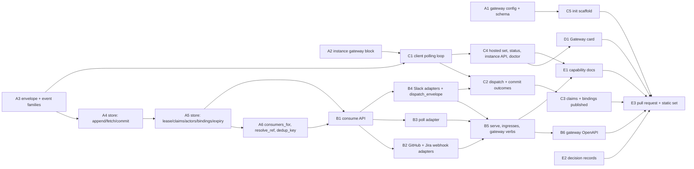

<!-- Authored per the the-loop:writing skill. -->

# Tasks: the-loop gateway — one ingress, many instances

> Derived from the locked [`requirements.md`](requirements.md), [`design.md`](design.md)
> and [`testing-plan.md`](testing-plan.md). The work is all in this repository, so no
> other repositories are declared. Every code task is written test-first: the named test
> goes red, then green, and that transition is recorded in the commit that carries it.
> Tasks are grouped by the layer they land in: **A** the store and routing core,
> **B** the gateway process, **C** the instance side, **D** the dashboard card,
> **E** the records. A task's `_Test:_` names a row of the testing plan's matrix.

## Task list

### A — the store and routing core (pure seams, unit-tested)

- [x] **A1: the gateway config and its schema.** Add `.the-loop/gateway-config.schema.json`
  with a byte-identical packaged copy under `cli/the_loop/schemas/`, covering every
  block of `design.md` §Data models (`env.file`, `state.root`, `listen`, `store`,
  `consume`, `repositories`, `github`, `jira`, `slack`, `instances`, `observability`),
  with the `^[A-Z][A-Z0-9_]*$` pattern on every `*Env` key. Write `gateway/config.py`:
  `default_gateway_config_path`, `load_gateway_config` (the config's `env.file` loaded
  first through `envfile.load`, relative to the file, never overwriting), the frozen
  `GatewayConfig` dataclasses with the defaults of the design (port 8790, retention 7,
  `maxAttempts` 3, `maxBatch` 256, `maxWaitSeconds` 30, lease 10–300 s). Extend
  `test_config_schema_parity.py` with the fourth schema.
  - _Depends on:_ none
  - _Requirements:_ R8.1, R8.2, R8.7 (gateway half), R14.2; abuse case 7
  - _Test:_ T1 `tests/test_gateway_config.py` (valid file loads; missing `listen` fails
    naming the path; a lowercase `*Env` value fails naming the key; `env.file` loaded
    and never overwriting); T3 `test_config_schema_parity.py::test_gateway_config_schema_parity`;
    T8 `Scenario: a config with a pasted token fails validation naming the key`
- [x] **A2: the instance `gateway` block.** Extend `cli-config.schema.json` (and its
  packaged copy) with the optional `gateway` block: `url` required, `pollIntervalSeconds`
  (default 5), `longPollSeconds` (default 20), `actors: {github, slack, jira}`. Parse it
  in `cli_config.py` into a `GatewayBlock`; `instance.name` falls back to `default`. The
  change is additive, so `make validate` on the repository's own config still passes.
  - _Depends on:_ none
  - _Requirements:_ R4.2, R8.7 (instance half), non-functional _Compatibility_
  - _Test:_ T1 `tests/test_gateway_config.py` (a block with only `url` validates and
    carries the defaults; a block without `url` fails); T10 `make validate`
- [x] **A3: the envelope and the event families.** Define `Envelope` (the ten fields of
  R6.2) and `Delivery` as dataclasses in `gateway/envelope.py` with `to_json` /
  `from_json`; add the `gateway.*` and `subject.*` families to `eventlog.EVENT_TYPES`
  with the reason vocabularies of `design.md` §Data models; add `gateway_event_id` to the
  `dispatch.*` record shape.
  - _Depends on:_ none
  - _Requirements:_ R6.2, R10.1, R10.2
  - _Test:_ T1 `tests/test_gateway_envelope.py` (round-trip; `headers` is the allow-list
    only; an unknown event type is refused by the catalogue test already pinned in
    `test_eventlog.py`)
- [x] **A4: `SqliteStore` — append, fetch, commit.** Write `gateway/store.py` with the
  `Store` protocol and `SqliteStore(path)`: the schema of the erDiagram (`schema_version`
  row included), WAL, one connection per thread, one transaction per public method.
  `append(env, consumers)` is `INSERT OR IGNORE` on `dedup_key` plus one `deliveries` row
  per consumer, `routed = 0` and no rows when `consumers` is empty; `fetch(instance,
  cursor, limit)` reads `seq > max(cursor, committed)` on the `(instance, seq)` index and
  increments `attempts`; `commit(instance, outcomes)` refuses an unfetched `seq`,
  advances `committed` contiguously, leaves `failed` pending.
  - _Depends on:_ A3
  - _Requirements:_ R2.1, R2.6, R2.8, R3.2, R3.4, R3.6, R4.1, R11.1; abuse case 5;
    non-functional _Scalability_
  - _Test:_ T1 `tests/test_gateway_store.py` (idempotent append; one row per consumer;
    fetch returns only that queue in seq order after `max(cursor, committed)`;
    contiguous commit; unfetched seq refused; `attempt+1` on re-fetch; the fetch query
    plan uses the index); T8 `Scenario: a commit for a delivery never fetched is refused`
- [x] **A5: `SqliteStore` — lease, claims, actors, bindings, views, expiry.** Add
  `touch` (peer and `lease_until`; a different peer under a live lease is `Refused`),
  `claim` / `release` / `claimants` (a claim routes the subject's held events onto the
  claimant's queue in the same transaction), `register_actors` (replaces the instance's
  set; `(provider, actor)` `UNIQUE`; an actor held by another live instance is
  `Refused`), `instance_for_actor`, `bind` / `resolve` (a binding routes held events
  whose key now resolves), `subjects` / `queues` / `instances`, `poll_ledger`, and
  `expire(now)` (retention for committed, dead and pending rows and held events;
  dead-letter at `max_attempts`; `subject.expired` and `subject.dead-lettered`).
  - _Depends on:_ A4
  - _Requirements:_ R2.2, R2.8, R3.6, R4.3, R4.4, R5.3, R5.5, R5.7, R9.2, R11.1; abuse
    cases 4, 6, 8
  - _Test:_ T1 `tests/test_gateway_store.py` (lease refuses a second peer and admits the
    same peer; claim and bind route held events; duplicate actor refused; views report
    depth and oldest age; retention order committed → pending → held; dead-letter at
    `maxAttempts`); T8 `Scenario: retention expires committed rows`, `Scenario: every
    claim is listed with its instance and time`
- [x] **A6: `consumers_for`, `resolve_ref`, `dedup_key`.** Write `gateway/routing.py`
  (`consumers_for(subject, linked, actor, store)`: claimants of the subject and of each
  linked subject, then the actor's instance, then `[]`) and `gateway/adapters/common.py`
  (`resolve_ref` per provider with declared repositories, mapped projects, rooms and
  bindings, returning `None` for a startable unbound kind and raising `Unbound` otherwise;
  `dedup_key` per provider and kind as tabled in `design.md`).
  - _Depends on:_ A5
  - _Requirements:_ R2.2, R2.3, R5.1, R5.2, R5.4, R5.5, R5.7, R5.8, R5.10, R7.3
  - _Test:_ T1 `tests/test_gateway_routing.py` (claimants first; a pull request's linked
    ticket's claimants too; registered actor when no claim; `[]` when neither) and
    `tests/test_gateway_adapters_common.py` (a webhook and a poll of one comment give one
    key; Slack socket and HTTP give one key; PR without binding → `None`; Slack thread
    outside any room → `Unbound`)

### B — the gateway process

- [x] **B1: the consume API.** Write `gateway/consume.py` as a FastAPI router:
  `POST /api/v1/gateway/fetch` in the design's five steps (touch → 409
  `duplicate-instance` or `unknown-instance`; commit → 409 `commit-undelivered`; fetch
  with `max` clamped to `maxBatch`; long-poll on a per-instance `threading.Condition`
  with `wait` clamped to `maxWaitSeconds`; the response with `cursor`, `committed` and
  `lease.expiresIn`), `POST /commit`, `PUT`/`DELETE /claims` (role `driver|reviewer`),
  `PUT /actors`, `POST /bindings`, `GET health|subjects|queues|instances`. `append`
  notifies the Condition of each consumer. Every decision emits its `gateway.*` or
  `subject.*` event.
  - _Depends on:_ A5, A6
  - _Requirements:_ R3.2, R3.3, R3.4, R3.6, R4.2, R4.3, R5.3, R5.5, R5.7, R6.3, R9.2,
    R10.1; abuse cases 4, 5, 8; non-functional _Latency_
  - _Test:_ T1 `tests/test_gateway_consume.py` (each route against an in-memory store
    through the FastAPI test client; clamping; the 409 bodies); T2
    `Scenario: a long-poll returns within a second of an append`, `Scenario: a fetch by
    one of fifty instances reads only its own queue`, `Scenario: an event with no
    consumer waits on unassigned until a claim routes it`; T8 `Scenario: a second peer
    under the same instance name is refused while the first polls`, `Scenario: a
    duplicate actor registration is refused`
- [x] **B2: the GitHub and Jira webhook adapters.** Write `gateway/adapters/github.py`
  (`POST /gh-webhook`: `verify_signature` before parse, 401 `bad-signature`; allow-listed
  headers; `resolve_ref` → `consumers_for` → `append`; 202 after the write, 500 on a
  store failure) and `gateway/adapters/jira.py` (`POST /jira-webhook` through
  `read_doorbell` and `jira_webhook_secret`; 404 with no secret). Record new GitHub
  fixtures under `cli/tests/fixtures/github/` (issue_comment, issues, pull_request,
  check_run).
  - _Depends on:_ B1
  - _Requirements:_ R1.3, R1.4, R2.1, R2.4, R2.7, R6.4, R7.1; abuse cases 1, 3
  - _Test:_ T2 `Scenario: an event about no work item is dropped and recorded as
    unbound`; T8 `Scenario: a webhook with a wrong signature is refused and stores
    nothing`, `Scenario: an injected start keyword from an unauthorized actor is dropped
    on the instance` (the gateway half: stored verbatim, unclassified)
- [x] **B3: the poll adapter.** Write `gateway/adapters/poll.py` over `PollProvider`
  (`poller/github.py`, `poller/jira.py` as the source layer): one thread per source every
  `intervalSeconds`, the same `poll-comment-<id>` / `poll-presence-<ref>-<uuid>` delivery
  ids as `poller/poller.py`, the ledger in `store.poll_ledger` (`seen` once `append`
  returns; presence re-emitted only while `presence_state ∈ {unknown, awaiting-start}`;
  the commit outcome updates it). `Poller` itself is untouched for the gateway-less
  instance.
  - _Depends on:_ B1
  - _Requirements:_ R1.5, R1.6, R7.1, R7.3, R7.4
  - _Test:_ T2 `Scenario: the gateway poller produces the same delivery ids the
    instance poller produces` (against `ghstub`), `Scenario: a webhook and a poll of the
    same comment store one row`
- [x] **B4: the Slack adapters and the extracted classifier.** Extract the classification
  half of `run_socket_listener`'s `handle` into `slack.dispatch_envelope(request_payload,
  cfg)` in `channels/slack.py`, called unchanged by the gateway-less listener (pinned by
  the existing Slack tests). Write `gateway/adapters/slack_socket.py` (one
  `SocketModeClient` per app, reconnecting; `send_socket_mode_response` after `append`
  returns; `SplitWatch.observe` on the heartbeat kind, not stored) and
  `gateway/adapters/slack_http.py` behind `slack.http.enabled` (`v0` signature within
  300 s, `url_verification` challenge, 200 after the write).
  - _Depends on:_ B1
  - _Requirements:_ R1.2, R2.4, R2.5, R2.7, R5.9, R6.4, R7.1, R7.2, R7.3, R7.5; abuse
    case 2
  - _Test:_ T2 `Scenario: a Slack envelope is stored before it is acknowledged`
    (`FakeSocketModeClient`); T7 `Scenario: a Slack envelope is acknowledged within three
    seconds with two thousand rows stored`; T8 `Scenario: a replayed Slack delivery is
    refused`; the existing `tests/test_channels_*.py` stay green through the extraction
- [x] **B5: the process — `serve.py`, `ingresses.py`, the `gateway` verbs.** Write
  `gateway/serve.py` (`main`: load config, exposure guard exit 2, event log with
  `source="gateway"`, `uvicorn.run(create_app(config))`; `create_app` mounts the ingress
  routes and the consume router, and the lifespan starts `GatewayIngresses`),
  `gateway/ingresses.py` (`GatewayIngresses(HostedIngresses)` with `_STARTERS`
  `slack-socket`, `github-poll`, `jira-poll`; `reconcile` on the `Reloader`'s five-second
  hash cadence records `config.reloaded`, a bad edit keeps the previous config and
  records `config.reload-failed`; a missing secret variable leaves that ingress off with
  `ingress.hosted_failed: missing-secret`; `restart required` when listen or Slack tokens
  differ from the running values), and `commands/gateway_cmd.py` (`start|stop|status|
  restart|subjects|instances` over `RunLock` at `<state_root>/gateway.pid`, logfile
  `logs/gateway.out`, wait on `/api/v1/gateway/health`). Run the retention `expire` on a
  timer in the lifespan.
  - _Depends on:_ B2, B3, B4
  - _Requirements:_ R1.1, R1.6, R8.4, R8.5, R8.6, R9.1, R9.2, R14.2, R14.3, R14.6; abuse
    case 6; fail-closed
  - _Test:_ T2 `Scenario: editing gateway-config.yaml starts a poller without a restart`,
    `Scenario: a bad edit keeps the previous configuration running`, `Scenario: a
    delivery that fails three times is dead-lettered and committed`; T7 `Scenario: ten
    thousand duplicate deliveries store one row`; T8 `Scenario: a non-loopback bind
    without exposed refuses to start`, `Scenario: a missing secret variable leaves that
    ingress off and says so in health`, `tests/test_gateway_security.py` (import graph:
    `gateway/*` imports neither `webhook/dispatcher.py` nor `authz.py`; no f-string next
    to `execute(`)
- [x] **B6: the gateway OpenAPI document.** Write
  `docs/api-specs/openapi/the-loop-gateway.v1.yaml` for every route of R6.3 and R6.4,
  with the envelope as a JSON Schema component; extend `test_api_contract_parity.py` to
  compare it with `gateway.create_app(...).openapi()`; validate every row T2 stores
  against the envelope schema.
  - _Depends on:_ B5
  - _Requirements:_ R6.1, R6.2, R6.3, R6.4
  - _Test:_ T3 `test_api_contract_parity.py::test_gateway_openapi_parity` and
    `::test_stored_envelopes_match_schema`

### C — the instance side

- [x] **C1: `GatewayClient` — the polling loop.** Write `gateway/client.py`:
  `GatewayClient(cli_config, stop_event)` over `urllib.request`; peer id persisted in
  `<root>/local/gateway-peer.json`; on start and after every outage `PUT /actors` then
  re-assert the live sessions' claims; `POST /fetch` with `instance.name or "default"`,
  the peer, the cursor, `max = 64`, `wait = longPollSeconds`, `lease = 3 ×
  pollIntervalSeconds + longPollSeconds` and the pending commit list; sleep
  `pollIntervalSeconds` only after an empty plain poll; back-off 1 s → 60 s with jitter
  on any error, `gateway.unreachable` once per outage and `gateway.connected` on
  recovery; a 409 (`duplicate-instance` or `duplicate-actor`) logged with the holder and
  retried on the same schedule; `stop` flushes with `POST /commit`.
  - _Depends on:_ A2, A3
  - _Requirements:_ R3.1, R3.3, R3.4, R3.5, R4.2, R4.3, R5.5, R14.1, R14.4
  - _Test:_ T1 `tests/test_gateway_client.py` against a fake consume API (interval
    after an empty plain poll and none after a long-poll; pending commits ride the next
    fetch and flush on stop; same peer across restarts; back-off bounds; a 409 retried)
- [x] **C2: dispatch per provider and the commit outcomes.** In the client, build one
  `Router` and one `Dispatcher` with `webhook/daemon.py:_build_ingress`'s arguments plus
  the `JiraDoorbell` and the Slack classifier; per delivery: `github` →
  `router.route` → `dispatcher.handle` → `delivery_status` → outcome (a router `None` is
  an outcome); `jira` → `JiraDoorbell.ring`; `slack` → `slack.dispatch_envelope`. Write
  `gateway_event_id` into the `dispatch.*` records; map every path to one of `delivered`,
  `spawned`, `dropped:<reason>`, `failed`. `dispatcher.reload` keeps hot reload working.
  - _Depends on:_ C1, B4
  - _Requirements:_ R3.4, R3.5, R3.6, R3.7, R5.6, R10.2; abuse case 3 (instance half)
  - _Test:_ T2 `Scenario: an issue comment through the gateway spawns on the instance
    with the gateway event id in its dispatch record`, `Scenario: a crash between
    dispatch and commit redelivers once and the dispatcher drops the duplicate`,
    `Scenario: a Jira comment through the gateway rings the instance's doorbell
    unchanged`; T8 `Scenario: an injected start keyword from an unauthorized actor is
    dropped on the instance`
- [x] **C3: claims and bindings published by the instance.** Give `SessionRegistry` an
  optional `publisher` callback: `register` / `record_owning` → `PUT /claims` with
  `driver`, or `reviewer` when the control record's command is `review` (bound to the PR
  as issue-279 does); `close` → `DELETE /claims`. Give `ChannelState.bind` the same shape
  of callback for Slack threads; `sessions link-pr` and the router's PR-linkage result
  call `POST /bindings`. The client sets all three.
  - _Depends on:_ C2
  - _Requirements:_ R3.9, R4.5, R5.3, R5.4, R5.7, R5.8, R12.8
  - _Test:_ T2 `Scenario: a driver and a reviewer on two instances each receive their
    own queue`, `Scenario: a start by a registered actor lands on that actor's instance
    only`, `Scenario: a pull request event with no binding is routed by actor and the
    instance publishes the binding`, `Scenario: the same instance resuming after a stop
    receives what was routed to it meanwhile`, `Scenario: a stopped instance finds its
    backlog in order`
- [x] **C4: the hosted set, status and the instance API.** Add `_start_gateway_client` to
  `api/ingress._STARTERS`; `core/lifecycle.enabled_services` returns `{gateway-client}`
  alone when the config has a `gateway` block, so no receiver, poller or listener starts
  regardless of their blocks; `the-loop status` reads `off · gateway configured` for the
  three and shows the gateway state; add `GET /api/v1/gateway` to the instance API and to
  `the-loop.v1.yaml` with the document of `design.md` §`gateway/client.py`; `the-loop
  doctor` gains the gateway section and `doctor slack` counts the gateway's connection
  as the app's one listener.
  - _Depends on:_ C1
  - _Requirements:_ R3.8, R9.3, R10.3, R14.1, R14.4, R14.5; non-functional
    _Compatibility_
  - _Test:_ T2 `Scenario: an instance with a gateway block runs no ingress of its own`,
    `Scenario: a gateway and an instance share one machine on loopback`; T3
    `test_api_contract_parity.py` (the instance document gains `GET /api/v1/gateway`);
    T10 `Scenario: an instance without a gateway block hosts the receiver, poller and
    listener as before` (`test_hosted_reconcile.py`, `test_core_lifecycle.py`)
- [x] **C5: `/the-loop:init` scaffolds the gateway config.** When the operator says they
  run a gateway, scaffold `gateway-config.yaml` from the schema the way the three
  existing files are scaffolded; update the init command's reference and its pinned
  tests.
  - _Depends on:_ A1
  - _Requirements:_ R8.3
  - _Test:_ T1 the init scaffold test extended with the fourth file (`tests/test_init_*.py`)

### D — the dashboard card

- [x] **D1: the Gateway card on `InstanceDetail`.** Implement the locked prototype
  (`design/gateway-card.html`): URL, state in words beside an `aria-hidden` `StatusDot`
  (`connected · polling`, `connecting · attempt n`, `refused · duplicate instance (409)`,
  `unreachable · retrying`, `not configured`), the name it polls as, since and committed
  offset, the health line, the queue table with `aria-label` and a role column, the
  refused and unreachable notices, one column under 900 px; the Daemons rows read
  `off · gateway configured`. Read `GET /api/v1/gateway` through `client.ts`; add the
  five states to `ui/src/demo/fixture.ts`.
  - _Depends on:_ C4
  - _Requirements:_ R4.3, R10.3, R14.4
  - _Test:_ T5 `cd ui && npm test` (`GatewayCard.test.tsx`: five states from the
    fixture, Daemons rows), screenshots beside the prototype's; T9 the DOM assertions
    (state readable without the dot; the table's accessible name)

### E — the records (same pull request as the code)

- [ ] **E1: capability docs.** Write `docs/capabilities/gateway.md` (the process, its
  config, its verbs, the subject, queue, claim and actor model; the first paragraph
  states the exposure posture of the no-auth boundary) and update `instances.md`,
  `channels.md`, `webhook-triggers.md`, `control-plane.md`, `cli.md`, `observability.md`
  and the capability index where the gateway changes their behaviour; replace _run one
  listener per app_ with _run one gateway per app_ in `docs/guide/slack.md` and name the
  app-level token in the manifest guidance.
  - _Depends on:_ B5, C4
  - _Requirements:_ R13.1, R13.4
  - _Test:_ T12 `make lint` (markdownlint) and the capability-index test if the repo
    pins one
- [ ] **E2: decision records.** Add three decisions and index rows: the name `gateway`
  for the ingress process beside decision-059's auth-terminating gateway; the queue
  contract (subjects, one queue per instance, store-before-ack, pull with commit,
  at-least-once with idempotent consumers) and consumer resolution at ingest (claims,
  then actors) with its deferred ownership follow-up; instance authentication deferred
  with the accepted exposure posture.
  - _Depends on:_ none
  - _Requirements:_ R13.2, R13.3
  - _Test:_ T12 `make lint`
- [ ] **E3: the pull request.** Open the implementation PR with `the-loop pr create
  --work-item github:MadaraUchiha-314/the-loop#496`, record it in
  `evidence/pull-requests.md`, and run the whole static set.
  - _Depends on:_ A1–A6, B1–B6, C1–C5, D1, E1, E2
  - _Requirements:_ all
  - _Test:_ T12 `make lint format-check typecheck validate`; full suite `make test`

## Dependency graph (DAG)

Three strands run independently once **A3** exists: the store (A4 → A5 → A6 → B1 → B2,
B3, B4 → B5 → B6), the client (A2, A3 → C1 → C2 → C3; C1 → C4 → D1), and the records
(E2 any time; E1 once B5 and C4 exist). A1 is needed only by B5's config loading and C5.
The two scenario-heavy tasks that need both strands are C2 (needs B4's classifier) and
C3 (needs B1's claims routes running in the in-process gateway).

## Checkpoints

- **After A6:** `cd cli && uv run python -m pytest -q tests/test_gateway_*.py` (T1
  green for config, envelope, store, routing, adapters-common) and
  `tests/test_config_schema_parity.py` (T3).
- **After B1:** the consume routes' unit tests and the first three T2 scenarios
  (long-poll latency, fifty-instance fetch, unassigned until claim), plus the two T8
  refusals (duplicate instance, duplicate actor).
- **After B5:** `make lint typecheck`; `tests/test_gateway_security.py` (import graph,
  f-string grep, exposure guard); the reload and dead-letter scenarios; a manual
  `the-loop gateway start --config <scratch>` on loopback to see `health` answer.
- **After B6:** `tests/test_api_contract_parity.py` with the second document.
- **After C2:** `tests/test_gateway_*_integration.py` at lag 0 and `--dispatch-lag=0.5`
  (the spawn and redelivery scenarios); the existing Slack and webhook suites still green.
- **After C4:** `tests/test_hosted_reconcile.py tests/test_core_lifecycle.py` (T10) and
  `make validate`.
- **After D1:** `cd ui && npm test`, then screenshots of the five states.
- **After E3:** `make lint format-check typecheck validate` and `make test` (T12 and the
  full suite); then the `verification` node executes `testing-plan.md` — T4's live Slack
  proof on `the-loop-testing` and T11's co-location checklist included — ticking each
  activity with its command, outcome and committed evidence, before the review phases
  run the self/critic rounds and the security review gate (tier 4: a named human
  security sign-off is required, recorded in `evidence/security-review.md`).

Each task's commit carries its test's red→green transition; no progress log is written
(issue-365). Implementation starts from these three locked files read from disk, in a
fresh context, and ticks each task here as it lands.

## Review comments

> Appended by the-loop's `record-feedback` hook when a human gate approves with
> comments (issue-109). Append-only and attributed: an approval never silently
> discards a reviewer's suggestions, and the feedback travels with the document
> it concerns rather than living in a side-channel tracker.
