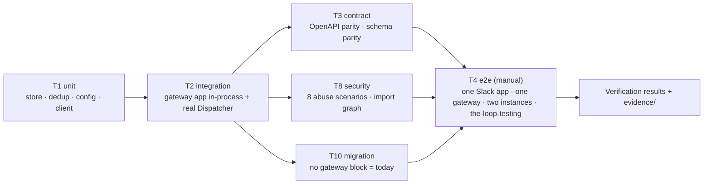

<!-- Authored per the the-loop:writing skill, derived from the approved requirements.md
     (amended and re-approved 2026-10-19) and the draft design.md in this folder. Executable content: it names commands an
     agent will run. Credentials by reference only. -->

# Testing plan: the-loop gateway — one ingress, many instances

> Derived from the approved `requirements.md` and `design.md`, **before** `tasks.md` —
> each task's `_Test:_` names a row of the matrix below. Authored at the `test-planning`
> node and **completed at the `verification` node**: the same file is written once as a
> plan and once as a record. See `reference/testing.md`.
>
> **This file is executable content.** Review it like code. Credentials appear **by
> reference only** (environment-variable name), never by value.

**The proof in one sentence:** every requirement is covered by an automated test in this
repository except the one the author asked to see live, the Slack Socket Mode path on
`the-loop-testing` with their app, which is a written manual procedure with committed,
redacted evidence.



## Test matrix

| # | Type | Applies? | Scope / what it proves | Where it runs |
|---|------|----------|------------------------|---------------|
| T1 | Unit | yes | `gateway/store.py` (append with fan-out and dedup, fetch after cursor and committed, commit with contiguous advance and refusal of an unfetched seq, re-fetch with attempts, dead-letter, retention, the per-name lease with peers, claims routing held events, actor uniqueness, bindings); `gateway/routing.py` `consumers_for` (claims, then actor, then unassigned; a pull request's linked ticket); `gateway/adapters/common.py` `dedup_key` and `resolve_ref` per provider and kind; `gateway/config.py` and the instance `gateway` block validation and their negative cases; `gateway/client.py` fetch loop, commit batching, peer persistence and back-off against a fake consume API; `slack.dispatch_envelope` extracted from the listener | `cd cli && uv run python -m pytest -q tests/test_gateway_*.py` |
| T2 | Integration (scenario) | yes | a real gateway app in-process (FastAPI test client plus the adapters' threads) driving a real `GatewayClient` and a real `Dispatcher` with the fake tmux runner; Slack through `FakeSocketModeClient`; GitHub through signed synthetic deliveries and the `ghstub` loopback server; every scenario Gherkin-documented with `Requirement:` links | `cd cli && uv run python -m pytest -q tests/test_gateway_*_integration.py`, then the same with `--dispatch-lag=0.5` (issue-251) |
| T3 | Contract (OpenAPI) | yes | `docs/api-specs/openapi/the-loop-gateway.v1.yaml` matches `gateway.create_app(...).openapi()` (`test_api_contract_parity.py` extended); `the-loop.v1.yaml` gains the instance's `GET /api/v1/gateway`; `.the-loop/gateway-config.schema.json` is byte-identical to the packaged copy (`test_config_schema_parity.py` extended); the envelope's JSON Schema in the OpenAPI document validates every stored row in T2 | `cd cli && uv run python -m pytest -q tests/test_api_contract_parity.py tests/test_config_schema_parity.py` |
| T4 | End-to-end | yes — the author's one live proof (R12) | one Slack app (the author's), one gateway, one instance with Slack disabled locally, against issues on `the-loop-testing`: arm through the gateway (routed by the author's registered actor), reply in the thread, restart the instance with two replies pending, a second instance under another name receiving nothing of the first's queue and a second peer under the same name refused; GitHub traffic reaches the gateway through its poller, no tunnel | manual procedure in §Verification environment, evidenced under `evidence/e2e-slack.md` |
| T5 | UI / visual | yes | the Gateway card on `InstanceDetail` renders the five states of the locked prototype (`design/gateway-card.html`) from a fixture `GET /api/v1/gateway` document; the Daemons rows read `off · gateway configured`; screenshots of the implementation beside the prototype's | `cd ui && npm test` (vitest), screenshots via headless Chromium of the dev server with the demo fixture |
| T6 | Snapshot | n/a — the only serialized shapes are the envelope and the API documents, which T3 checks against a contract; a snapshot would freeze the same thing twice | | |
| T7 | Performance / load | yes, bounded | three budgets, asserted inside T2 rather than a suite: a Slack envelope is stored and acknowledged within 3 s under `FakeSocketModeClient` with a 2 000-row store; ten thousand duplicate deliveries store one row and finish within 10 s on the CI runner; a long-poll fetch returns within 1 s of an append, and a fetch by one of fifty instances reads only its own queue (query plan uses the `(instance, seq)` index, row count equals its backlog) | the T2 command (`Scenario:` titles below) |
| T8 | Security / abuse case | yes | the eight abuse cases of `design.md` §Security design as negative tests; the import-graph assertion that `gateway/*` imports neither `webhook/dispatcher.py` nor `authz.py`; a grep test that no `execute(` in `gateway/` takes an f-string; the exposure guard refuses a non-loopback bind without `exposed` | `cd cli && uv run python -m pytest -q tests/test_gateway_security.py tests/test_gateway_abuse_integration.py` |
| T9 | Accessibility | yes, light | the card's state is carried by words (the dot is `aria-hidden`), the subjects table has an accessible name, the notices are plain text; a vitest assertion on the rendered DOM and a keyboard pass in T11 | `cd ui && npm test` |
| T10 | Migration / upgrade | yes | an instance config **without** a `gateway` block runs the receiver, poller and listener exactly as before (the hosted set and `the-loop status` unchanged); adding the block and restarting switches the hosted set to `{gateway-client}`; the `cli-config.schema.json` change is additive (`make validate` on the repo's dogfood config passes); the store carries a `schema_version` row so a later change can migrate | `cd cli && uv run python -m pytest -q tests/test_hosted_reconcile.py tests/test_core_lifecycle.py tests/test_gateway_client_integration.py` and `make validate` |
| T11 | Manual exploratory | yes | co-location on one laptop (R14): `the-loop gateway start` and `the-loop start` in either order, loopback URL, no `exposed`; `the-loop status`, `the-loop gateway status`, `the-loop gateway subjects`, `the-loop gateway instances` and `the-loop doctor` read correctly; `gateway status` says `restart required` after editing the listen port while running | procedure in §Verification environment, evidenced under `evidence/manual.md` |
| T12 | Static checks | yes | ruff, format, pyright, markdownlint, config validation, as every change | `make lint format-check typecheck validate` |

## Scenarios & requirement trace

| Row | Requirement(s) | Scenario / case |
|-----|----------------|-----------------|
| T1 | R2.1, R2.6, R2.8, R3.2, R3.4, R3.6, R4.1, R4.3, R5.7, R11.1 | `SqliteStore`: append is idempotent on `dedup_key` and writes one delivery per consumer; fetch returns only that instance's queue after `max(cursor, committed)` in seq order; commit advances `committed` only contiguously and refuses an unfetched seq; re-fetched rows carry `attempt+1`; dead-letter at `maxAttempts`; retention expires `committed`, then `pending`, then held events; the lease refuses a second peer under a live name and admits the same peer at once; bindings round-trip |
| T1 | R2.2, R5.2–5.5, R5.7 | `consumers_for`: claimants first; a pull request's linked ticket's claimants too; a registered actor when no claim; `[]` when neither; `store.claim` and `store.bind` route held events; `register_actors` refuses an actor held by a live instance |
| T1 | R5.2, R7.3 | `dedup_key`: a GitHub comment by webhook and by poll give one key; Slack socket and HTTP give one key; `resolve_ref`: number → ref on a declared repo, PR → binding or none, Slack thread → binding → room → `unbound` |
| T1 | R8.1, R8.2, R8.7 | `gateway-config` validation: a valid file loads; a missing `listen` fails naming the path; a `*Env` value with a lowercase character fails; an instance `gateway` block with only `url` validates and defaults `pollIntervalSeconds` 5, `longPollSeconds` 20 |
| T1 | R3.1, R3.3, R3.4, R3.7, R14.4 | client: polls at the interval after an empty plain poll and at once after a long-poll; sends the pending commits with the next fetch and flushes them on stop; keeps the same peer across restarts; back-off 1 s → 60 s with jitter; a 409 is retried on the same schedule |
| T2 | R2.4, R2.5, R1.2 | `Scenario: a Slack envelope is stored before it is acknowledged` |
| T2 | R1.3, R2.1, R3.4, R5.5, R10.2, R12.2 | `Scenario: an issue comment through the gateway spawns on the instance with the gateway event id in its dispatch record` |
| T2 | R3.6, R3.7 | `Scenario: a crash between dispatch and commit redelivers once and the dispatcher drops the duplicate` |
| T2 | R2.8, R3.2, R4.4, R12.4 | `Scenario: a stopped instance finds its backlog in order` |
| T2 | R4.1, R4.5, R5.3, R5.4, R12.8 | `Scenario: a driver and a reviewer on two instances each receive their own queue` (a PR review comment reaches both, a ticket comment the driver only) |
| T2 | R5.5, R4.1 | `Scenario: a start by a registered actor lands on that actor's instance only` |
| T2 | R2.2, R5.2, R5.3 | `Scenario: an event with no consumer waits on unassigned until a claim routes it` |
| T2, T7 | R3.3, non-functional *Latency* | `Scenario: a long-poll returns within a second of an append` |
| T2, T7 | non-functional *Scalability* | `Scenario: a fetch by one of fifty instances reads only its own queue` |
| T2 | R7.3, R7.4 | `Scenario: a webhook and a poll of the same comment store one row` |
| T2 | R3.8, R10.3 | `Scenario: an instance with a gateway block runs no ingress of its own` |
| T2 | R14.1, R14.2, R14.5 | `Scenario: a gateway and an instance share one machine on loopback` |
| T2 | R4.4, R3.9 | `Scenario: the same instance resuming after a stop receives what was routed to it meanwhile` |
| T2 | R5.1, R5.6 | `Scenario: a Jira comment through the gateway rings the instance's doorbell unchanged` |
| T2 | R5.7, R5.8 | `Scenario: a pull request event with no binding is routed by actor and the instance publishes the binding` |
| T2 | R2.3, R5.10 | `Scenario: an event about no work item is dropped and recorded as unbound` |
| T2 | R8.4, R8.5 | `Scenario: editing gateway-config.yaml starts a poller without a restart` and `Scenario: a bad edit keeps the previous configuration running` |
| T2 | R1.5, R7.1 | `Scenario: the gateway poller produces the same delivery ids the instance poller produces` |
| T2 | R3.6 | `Scenario: a delivery that fails three times is dead-lettered and committed` |
| T2, T7 | R2.5 | `Scenario: a Slack envelope is acknowledged within three seconds with two thousand rows stored` |
| T2, T7 | abuse 6 | `Scenario: ten thousand duplicate deliveries store one row` |
| T3 | R6.1–6.4 | parity of `the-loop-gateway.v1.yaml`; the envelope schema validates T2's rows; `the-loop.v1.yaml` carries `GET /api/v1/gateway` |
| T3 | R8.1 | schema parity for `gateway-config` |
| T4 | R12.1–12.5, R1.2 | the manual procedure below; each step's outcome recorded |
| T5 | R10.3, R14.4, R4.3 | the card's five states against the locked prototype; `off · gateway configured` rows |
| T8 | abuse 1 | `Scenario: a webhook with a wrong signature is refused and stores nothing` |
| T8 | abuse 2 | `Scenario: a replayed Slack delivery is refused` |
| T8 | abuse 3 | `Scenario: an injected start keyword from an unauthorized actor is dropped on the instance` |
| T8 | abuse 4 | `Scenario: a second peer under the same instance name is refused while the first polls` |
| T8 | abuse 5 | `Scenario: a commit for a delivery never fetched is refused` |
| T8 | abuse 6 | `Scenario: retention expires committed rows` |
| T8 | abuse 7 | `Scenario: a config with a pasted token fails validation naming the key` |
| T8 | abuse 8 | `Scenario: a duplicate actor registration is refused`; `Scenario: every claim is listed with its instance and time` |
| T8 | fail-closed | `Scenario: a non-loopback bind without exposed refuses to start`; `Scenario: a missing secret variable leaves that ingress off and says so in health`; the import-graph and f-string tests |
| T9 | R10.3 | the rendered card's state is readable without the dot; the table has an accessible name |
| T10 | R14.2, non-functional *Compatibility* | `Scenario: an instance without a gateway block hosts the receiver, poller and listener as before` |
| T11 | R9.1, R9.2, R9.3, R8.6, R14 | the manual checklist below |

The scenario table for the reviewer briefing is rendered, not pasted:
`the-loop scenarios --glob 'cli/tests/test_*_integration.py' --format markdown`.

## Verification environment

- **Repositories:** this repository on `feat/issue-496-gateway`. For T4, the issues live
  on `MadaraUchiha-314/the-loop-testing`; no checkout of it is needed beyond what the
  instance's workspace root clones when a session spawns.
- **Services / containers:** none for T1–T3, T5, T8–T10, T12 (hermetic; `cli/tests/conftest.py`
  isolates the event log, reactor and hooks; `ghstub` and `FakeSocketModeClient` stand
  in for GitHub and Slack). For T4 and T11: a gateway process and an instance process on
  the verification machine, both loopback.
- **Fixtures & data:** `cli/tests/fixtures/slack/*.json` (reused); new recorded GitHub
  payloads under `cli/tests/fixtures/github/` (issue_comment, issues, pull_request,
  check_run), signed at test time as `test_webhook_routing_integration.py` does; a
  `ui/src/demo/fixture.ts` entry for the five card states; two instance configs
  (`laptop-a`, `laptop-b`) with disjoint `gateway.actors` for the two-instance scenarios.
- **Credentials, by reference only:**
  - `THE_LOOP_SLACK_APP_TOKEN` — the author's Slack app-level token (`connections:write`).
    It sits in `~/.the-loop/the-loop.env` on the verification machine (the author's
    ticket comment of 2026-10-18); the e2e `gateway-config.yaml` names that file under
    `env.file`, so the gateway process reads it at start and nothing is exported by hand.
  - `THE_LOOP_SLACK_BOT_TOKEN` — the author's bot token, same file, same route.
  - `GITHUB_TOKEN` — a token with read access to `the-loop-testing` for the gateway's
    poller, and the instance's own token for posting, as today.
  - No Jira credential: Jira is poll-only and off for the proof (R12.6).
- **Bring-up (T4, T11):**

  ```bash
  # gateway: the e2e config lives in the scratchpad, never in the repo
  the-loop gateway start --config "$E2E/gateway-config.yaml"     # listen 127.0.0.1:8790, slack.socket on, github.poll on the-loop-testing
  the-loop gateway status --config "$E2E/gateway-config.yaml"
  # instance: a named cli-config (instance.name laptop-a) with gateway.url, gateway.actors naming the author, channels.slack.read disabled
  the-loop start --config "$E2E/cli-config.yaml"
  the-loop status --config "$E2E/cli-config.yaml"                # expects: gateway connected · polling; receiver/poller/listener off · gateway configured
  the-loop gateway instances --config "$E2E/gateway-config.yaml" # expects: laptop-a, last fetch seconds ago, the author's actors
  ```

  **Tear-down:** `the-loop stop --config "$E2E/cli-config.yaml"` then
  `the-loop gateway stop --config "$E2E/gateway-config.yaml"`; delete the scratchpad
  state roots.
- **T4 procedure** (each step's outcome goes into `evidence/e2e-slack.md`):
  1. Open an issue on `the-loop-testing`, add the auto-execute labels, comment
     `the-loop start`. Expect: the gateway log shows `subject.routed` to `laptop-a` by
     actor; one session spawns; its `dispatch.*` record carries `gateway_event_id`;
     `the-loop gateway subjects` shows the subject claimed by `laptop-a` as `driver` with
     backlog 0.
  2. Reply in the session's Slack thread. Expect: the reply reaches the pane; the
     gateway's event log shows `subject.appended` **before** the Socket Mode ack line.
  3. `the-loop stop` the instance; post two Slack replies; `the-loop start`. Expect: both
     replies delivered, in order, once; `subject.redelivered` absent, `subject.committed` × 2.
  4. Start a second instance config (`laptop-b`, other actors) against the same gateway.
     Expect: it polls, its queue stays empty, `gateway instances` lists both; then start a
     copy of `laptop-a`'s config from another state root. Expect: 409 in its log,
     `gateway.refused: duplicate-instance` on the gateway, the first keeps receiving.
  5. Close the issue. Expect: the session ends as today; the claim is released; the
     subject's backlog is 0.
- **T11 checklist:** both start orders succeed; `the-loop doctor` shows the gateway
  reachable and the socket up; `doctor slack` reports one listener; edit `listen.port`
  while running → `gateway status` says `restart required`; `the-loop gateway restart`
  applies it; `the-loop gateway subjects` lists claimants, depth and oldest-uncommitted
  age; `the-loop gateway instances` lists peers, last fetch and actors.
- **If bring-up fails:** record it under Verification results, leave T4 and T11
  unticked, and escalate on the ticket; the gate is not passed on an environment that
  never came up.

## Evidence plan

| Row | Evidence | Path under `evidence/` |
|-----|----------|------------------------|
| T1 | pytest summary (counts, duration) | `unit.md` |
| T2 | scenario table (`the-loop scenarios … --format markdown`) + run output at lag 0 and lag 0.5 | `integration.md` |
| T3 | parity test output; the two OpenAPI documents' operation lists | `contract.md` |
| T4 | the five steps with redacted event-log excerpts, `gateway subjects` output, and the thread's screenshot with Slack ids blurred | `e2e-slack.md`, `e2e/slack-thread.png` |
| T5 | vitest output; screenshots of each implemented state beside the prototype's | `ui.md`, `ui/gateway-card-<state>.png` (five), `ui/prototype-<state>.png` |
| T7 | the three budgets' measured values and the fetch query plan | in `integration.md` |
| T8 | the eight abuse scenarios' output, the import-graph and f-string test output | `security.md` |
| T9 | the DOM assertions' output and the keyboard pass note | in `ui.md` |
| T10 | the compatibility scenario output and `make validate` | `migration.md` |
| T11 | the checklist with each command's redacted output | `manual.md` |
| T12 | `make lint format-check typecheck validate` output | `lint-and-typecheck.md` |

Redaction before commit: tokens, Slack user and channel ids, hostnames, the author's
workspace paths. A capture that cannot be redacted is described in the results row, not
committed.

## Verification activities

- [x] T1 — `cd cli && uv run python -m pytest -q tests/test_gateway_*.py`
- [x] T2 — `cd cli && uv run python -m pytest -q tests/test_gateway_*_integration.py`
- [x] T2 (lag) — `cd cli && uv run python -m pytest -q --dispatch-lag=0.5 tests/test_gateway_*_integration.py`
- [x] T3 — `cd cli && uv run python -m pytest -q tests/test_api_contract_parity.py tests/test_config_schema_parity.py`
- [x] T4 — the five-step Slack procedure on `the-loop-testing`
- [x] T5 — `cd ui && npm test`, then the state screenshots
- [x] T8 — `cd cli && uv run python -m pytest -q tests/test_gateway_security.py tests/test_gateway_abuse_integration.py`
- [x] T9 — the DOM assertions in `cd ui && npm test` and the keyboard pass
- [x] T10 — `cd cli && uv run python -m pytest -q tests/test_hosted_reconcile.py tests/test_core_lifecycle.py tests/test_gateway_client_integration.py && cd .. && make validate`
- [x] T11 — the co-location and verbs checklist
- [x] T12 — `make lint format-check typecheck validate`
- [x] Full suite — `make test`

## Verification results

*Executed 2026-10-19 on `feat/issue-496-gateway` (PR #499).*

| Activity | Command / procedure | Outcome | Evidence |
|----------|--------------------|---------|----------|
| T1 | `cd cli && uv run python -m pytest -q tests/test_gateway_*.py` | pass — 187 passed | [`evidence/unit.md`](evidence/unit.md) |
| T2 | `… tests/test_gateway_*_integration.py` | pass — 49 passed (47 Gherkin scenarios) | [`evidence/integration.md`](evidence/integration.md) |
| T2 (lag) | `… --dispatch-lag=0.5 tests/test_gateway_*_integration.py` | pass — 49 passed, after one scenario's wait was made lag-proof (1e6e57a) | [`evidence/integration.md`](evidence/integration.md) |
| T3 | `… tests/test_api_contract_parity.py tests/test_config_schema_parity.py` | pass — 10 passed; both documents' operation lists recorded | [`evidence/contract.md`](evidence/contract.md) |
| T5 | `cd ui && NODE_OPTIONS=--no-experimental-webstorage vitest run`, then the screenshots | pass — 330 passed; five states beside the prototype's | [`evidence/ui.md`](evidence/ui.md), `evidence/ui/*.png` |
| T7 | the three budgets, measured in-process | pass — ack 0.03 s with 2 000 rows; 10 000 duplicates → 1 row in 0.7 s; long-poll wake 2 ms; fifty-instance fetch an index range | [`evidence/integration.md`](evidence/integration.md) |
| T8 | the eight abuse scenarios + `tests/test_gateway_security.py` (selected by scenario name; the scenarios landed beside the components they attack rather than in one file) | pass — 60 passed | [`evidence/security.md`](evidence/security.md) |
| T9 | the DOM assertions in the UI tests and the keyboard pass | pass | [`evidence/ui.md`](evidence/ui.md) |
| T10 | `tests/test_hosted_reconcile.py tests/test_core_lifecycle.py tests/test_gateway_client_integration.py` and `make validate` | pass — 32 passed; four configs valid | [`evidence/migration.md`](evidence/migration.md) |
| T12 | `make lint format-check typecheck validate` | pass, with one pre-existing finding: the approval gate's repeated same-day heading in `requirements.md` (exempted with a named comment, #500) | [`evidence/lint-and-typecheck.md`](evidence/lint-and-typecheck.md) |
| Full suite | `cd cli && uv run python -m pytest -q` (with `THE_LOOP_CLI_CONFIG` unset) | pass — 6345 passed on 2def361, the final head of verification (6340 on 591a9bd before the live-proof fixes). A first run on the same head had one failure, `test_session_secrets_integration::test_issue_485_…` reading an empty pane environment while the live proof was being torn down on the same tmux host; it passes alone and in the clean re-run | [`evidence/unit.md`](evidence/unit.md) |
| T4 | the five-step Slack procedure on `the-loop-testing#7` | pass — all five steps plus the mention re-run and the close, against the author's Slack app; four defects found and fixed (8071ad7, ddaac03, 2def361), one operator finding documented (`app_mentions:read`) | [`evidence/e2e-slack.md`](evidence/e2e-slack.md) |
| T11 | the co-location and verbs checklist | pass — every step; two defects found and fixed (d3da68e, 2def361) | [`evidence/manual.md`](evidence/manual.md) |

**Not executed:** nothing — every activity ran.

## Review comments

> Appended by the-loop's `record-feedback` hook when a human gate approves with
> comments (issue-109). Append-only and attributed: an approval never silently
> discards a reviewer's suggestions, and the feedback travels with the document
> it concerns rather than living in a side-channel tracker.

### 2026-10-18 — approved

**@MadaraUchiha-314** wrote:

approved
