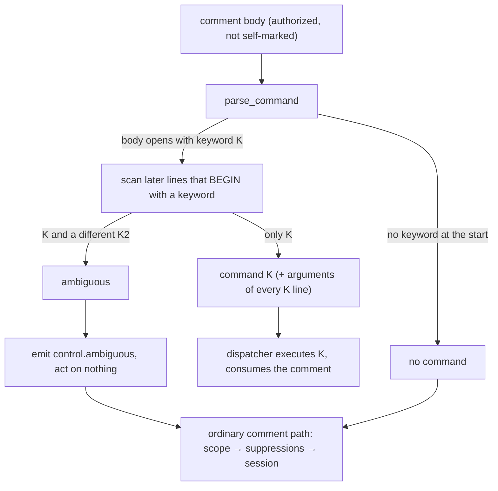

# Design: a control keyword must open the comment; an ambiguous body is conversation

## Overview

Two edits to existing code, no new component: `parse_command` anchors keywords to the
start of the body (and, for later commands, the start of a line), and the dispatcher stops
settling an ambiguous body and lets it take the ordinary comment path. The rest is text:
docstrings, the two schema descriptions, the capability doc and a learning.

## Architecture

## Components & interfaces

### 1. Parser — `cli/the_loop/control.py`

`parse_command(body, config)` changes how it finds keywords, and nothing about what it
returns:

1. `text = body.lstrip()`. If no configured keyword matches **at position 0** of `text`
   (`re.match`, the existing `_BOUNDARY_AFTER`, case-insensitive), return
   `ControlResult()`.
2. Otherwise find every keyword occurrence that **begins a line** of `text`: the pattern
   becomes `^` + `re.escape(keyword)` + `_BOUNDARY_AFTER` with `re.MULTILINE`. Column 0
   only — an indented line (markdown code), a `>` quote, a list item or a mid-line mention
   never matches. `_BOUNDARY_BEFORE` is no longer needed in the pattern: `^` is a
   stricter boundary.
3. More than one distinct command among those matches → `ambiguous=True` (R1.4).
   Exactly one → that command; argument commands iterate the same line-anchored matches
   for their subjects (R1.3), so `rest = text[match.end():]` and the two argument
   parsers are untouched.

Why line-anchored rather than first-line-only for the later occurrences: it keeps two
behaviours people use — several `the-loop add-collaborator @x` lines in one comment, and
the `pause`-then-`resume` guard — while a mention in prose can never be a command
because prose does not start a line with `the-loop <verb>` *and* sit in a body that
already opens with one.

Why no markdown stripping (the ticket's proposed fix 1): every case it was meant to cover
(inline code, a fenced block, a quote) puts something other than the keyword at the start
of the body or line, so the anchor already excludes it. A fenced block inside a body that
*opens* with a command can still carry a column-0 keyword line; if it is a different
command the body is ambiguous and nothing runs — the fail-closed direction.

Surfaces: the webhook dispatcher, the poller's first-sight scan and the Slack inbound
classifier all call `parse_command`; Slack strips the bot's own mention and composes a
leading verb into the keyword *before* calling it (`channels/verbs.py`), so a Slack
command already opens its text.

One producer did change (found by the full suite at task 6): the bus **relays** a Slack
`control.command` / `gate.feedback` onto the GitHub ticket as a comment the ledger's own
ingress then parses (`channels/bodies.py::relay_body`). It used to open with an
attribution header and quote the words (`> the-loop start`), which the anchored parser
reads as prose. The relay now puts the person's words **first, unquoted**, and the
attribution on a trailing line, so a relayed command still opens its comment (R1.5). The
gate's checklist reader accepts both shapes, so records already on tickets still read.

Docstrings corrected: the module's "one deliberate looseness" paragraph, `ControlResult`
("execute nothing, forward nothing" → "execute nothing; the caller routes it as
conversation"), and `parse_command`'s own.

### 1b. The phase-selection gate — `cli/the_loop/graph/hooks/selection.py`

Added after the critic round (finding P1). The gate's classifier released on any
authorized comment **containing** the execute keyword — a substring test the dispatcher
never applied. With R2 an ambiguous body now reaches the graph, so
`the-loop pause` + a line `the-loop execute` would have frozen a selection. The
classifier now asks `parse_command` (`_says_execute`) over the deployment's keywords,
which the bootstrap seeds as `controlKeywords` beside `executeKeyword`. A reply must open
with the execute keyword and carry no other command at the start of a line. The
checklist comment's help text says so ("Start your reply with `the-loop execute`"), and
a checklist pasted into the reply goes **below** the keyword.

### 2. Dispatcher — `cli/the_loop/webhook/dispatcher.py`

In `Dispatcher.handle`, the `control.ambiguous` branch keeps its warning log and its
`control.ambiguous` event and **drops the `_settle(…)` and `return`**. `control.command`
is `None` for an ambiguous result, so every later branch already treats the event as a
command-free comment: scope (issue-322), the reopen stamp, the paused / awaiting-start
suppressions, matching and enqueueing (R2.1, R2.2). `_refuse_scope` only reads
`control.command`, so it is unaffected.

`SETTLED_CONTROL_AMBIGUOUS` becomes unreachable and is removed, with its entries in
`SETTLED_OUTCOMES` and `ACK_STATES` and its name in `eventlog.py`'s settled-outcome
vocabulary. The `control.ambiguous` event description changes to say the comment was
routed as conversation. The poller docstring that explains why it does not hold back an
ambiguous comment at first sight is reworded (its behaviour is unchanged: such a comment
carries no command to catch up on, so it is baselined like any other conversation).

### 3. Text

| File | Change |
|------|--------|
| `cli/the_loop/schemas/cli-config.schema.json` and its copy `.the-loop/cli-config.schema.json` | `routing.control.keywords` description: "matched … at the start of a comment (and of each later line)…; two different commands execute nothing and the comment is forwarded as conversation" |
| `cli/the_loop/redact.py` | module docstring: drop "matches them anywhere"; defanging stays (out of scope) |
| `docs/capabilities/webhook-triggers.md` | the keyword EARS bullet states the leading rule and the ambiguous-body routing; changelog row for issue-498 |
| `docs/capabilities/channels.md` | the relay record's shape (words first) |
| `docs/learnings/learning-018.md` + index | what shipped versus learning-011's planned action |

## UI/UX design

None — the-loop has no UI, and this change has no user-facing surface beyond comment grammar.

## Data models

None change. `ControlResult` keeps its fields; one settled-outcome constant (`control-ambiguous`) is retired.

## Error handling

Nothing new can fail: the parser is pure and the dispatcher change removes a branch exit.
A body that is `None`/empty still returns `ControlResult()`.

## Security design

| Boundary (bugfix.md) | Enforcement |
|----------------------|-------------|
| **Trust boundary** — comment text → daemon action | Narrowed: a command must be at body start (`re.match` at 0) and every further command at column 0 of a line. Returned values remain declared constants and validated argument tokens. |
| **Abuse case: half a command executed** — two commands in one body | Still executes neither (`ambiguous`); proved by test. |
| **Abuse case: forwarding bypasses a gate** — ambiguous body → session | Enters the *same* code path as a command-free comment after `control.ambiguous` is logged, so scope, authorization, pause/awaiting-start suppression and the collaborator rules all apply. No new branch to audit. |
| **Untrusted actor / input** — upstream guards (self-marker, `authorizedUsers`) | Unchanged; they run before the parser. |

## Testing strategy

Unit tests in `cli/tests/test_control.py` for every placement; dispatcher tests in
`cli/tests/test_routing.py` / `test_reactions*.py` updated from "settled as
control-ambiguous" to "enqueued for the session". Detail in `testing-plan.md`.

## Trade-offs & decisions

- **Anchor instead of a markdown stripper** (§1): one regex flag versus a half-markdown parser; the author's ticket comment chose the anchor.
- **Line-anchored later commands kept**: preserves multi-line argument commands and the two-command guard.

### Compatibility

A comment that relied on a keyword mid-sentence ("ok, the-loop start") stops being a
command. That is the intended change; the capability doc says so. The CLI's own posted
comments (`command_comment`) already open with the keyword.

## Open questions

None.

## Review comments

| # | Where | Comment | Decision |
|---|-------|---------|----------|
| 1 | [PR #523](https://github.com/MadaraUchiha-314/the-loop/pull/523#issuecomment-6371767734) | Checklist-then-keyword replies to the phase-selection gate are now conversation — keep it strict (A) or add a gate-only last-line exception (B)? | **A — keep it strict** (author, "Yes, agreed"). One rule for every command; §1b stands unchanged. |
