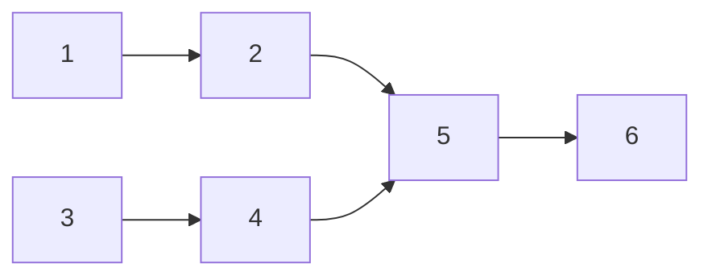

# Tasks: a control keyword must open the comment; an ambiguous body is conversation

## Task list

- [x] 1. Parser tests (red): placements of R1.1–R1.4 and the #496 body in `cli/tests/test_control.py`
  - _Depends on:_ none
  - _Requirements:_ R1.1, R1.2, R1.3, R1.4, R1.6
  - _Test:_ T1 — `uv run pytest cli/tests/test_control.py` (red before task 2)
- [x] 2. Anchor `parse_command` to the body start and later line starts; correct the module, `ControlResult` and `parse_command` docstrings
  - _Depends on:_ 1
  - _Requirements:_ R1, R3.2
  - _Test:_ T1 green; T8 (two leading commands → ambiguous, mid-prose → none)
- [x] 3. Dispatcher tests (red): an ambiguous comment is enqueued for the live session and executes nothing; the #496 comment reaches the session; a paused session still suppresses it
  - _Depends on:_ none
  - _Requirements:_ R2.1–R2.3
  - _Test:_ T2/T8 — `uv run pytest cli/tests/test_routing.py cli/tests/test_reactions.py cli/tests/test_reactions_integration.py`
- [x] 4. Dispatcher: stop settling an ambiguous body; retire `SETTLED_CONTROL_AMBIGUOUS` (outcomes, ACK states, eventlog vocabulary); reword the `control.ambiguous` event and the poller docstring
  - _Depends on:_ 3
  - _Requirements:_ R2
  - _Test:_ T2 green
- [x] 5. Text: both `cli-config.schema.json` copies, `redact.py` docstring, `docs/capabilities/webhook-triggers.md` (rule + changelog row), `docs/learnings/learning-018.md` + index
  - _Depends on:_ 2, 4
  - _Requirements:_ R3
  - _Test:_ T12 — `make check` (schema copies stay in sync)
- [x] 6. Full suite: fix any test that relied on a mid-body keyword
  - _Depends on:_ 2, 4, 5
  - _Requirements:_ R1.5
  - _Test:_ T12 — `make check`

## Dependency graph (DAG)

## Checkpoints

After task 2 (T1), after task 4 (T2), after task 6 (`make check`). Then the verification
node executes `testing-plan.md`.

## Review comments
