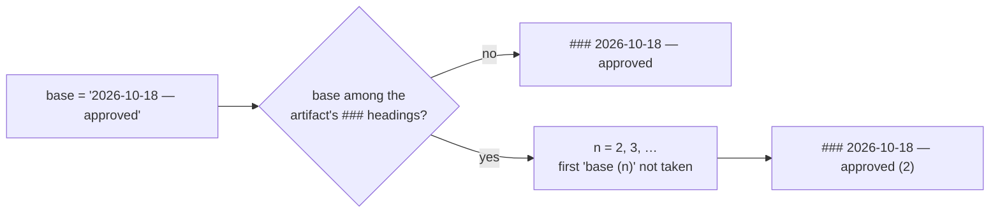

# Design: record-feedback appends duplicate sibling headings when a gate is approved twice on one day

> Phase 2 of 3 (bugfix → design → tasks). Derives from [`bugfix.md`](bugfix.md). The
> author declared `design-approval` skipped, so this design and the testing plan are
> reviewed on the pull request.

## Overview

Before appending, `record-feedback` collects the text of every `###` heading already in
the artifact. If the base heading `<YYYY-MM-DD> — <outcome>` is free, it is written as
today. If it is taken, the hook appends the smallest ` (n)` with `n ≥ 2` that is also
free. One new private helper, one changed line in the hook, no new inputs.

## Architecture

The change is local to `cli/the_loop/graph/hooks/feedback.py`. No graph YAML, schema,
CLI verb or other hook changes. `record-feedback` stays the only hook that writes
markdown into a checked-in artifact.

## Components & interfaces

- **`_unique_heading(text: str, base: str) -> str`** (new, private). Scans `text` line by
  line for ATX level-3 headings (`### …`), strips the marker and surrounding whitespace,
  and returns `base` if it is not among them, else `f"{base} ({n})"` for the smallest
  `n ≥ 2` not among them.
- **`record_feedback`** builds `base = f"{date.today().isoformat()} — {outcome}"` and
  writes `f"\n### {_unique_heading(text, base)}\n"` in place of the fixed heading.

Why the whole file rather than only the `## Review comments` section: the hook always
appends at the end of the file, and the section is in practice the last one, so the two
scopes coincide. Scanning the whole file is simpler and can only err toward adding a
suffix, which is harmless; it can never produce a duplicate.

## UI/UX design

N/A — no user-facing surface.

## Data models

None. The heading format is the only "schema" and it is extended, not changed: an
unsuffixed heading means the first recording of that date and outcome, exactly as before.

## Error handling

No new failure modes. The helper is pure string work over text the hook already read; the
loop over `n` terminates because the set of existing headings is finite.

## Security design

- **Input validation & injection surfaces:** the heading's inputs are the date, the
  classifier's outcome (confined to `OUTCOMES` or the literal `reviewed`) and the computed
  integer. Comment bodies and author handles are still written only into the block body,
  as today, and never into the heading.
- **Least privilege / AuthZ:** unchanged — the hook reads and writes the one artifact it
  is configured with (`into:`), and the authorization of who may approve lives in
  `classify-feedback`, which this change does not touch.
- **Fail-closed behaviour:** unchanged.
- **Abuse-case coverage:** a reviewer cannot influence the heading text, so cannot use it
  to forge another review's heading; no new negative test is needed beyond the regression
  test proving headings stay distinct.

## Testing strategy

Unit-level integration tests in `cli/tests/test_graph_integration.py` beside the existing
`record-feedback` tests (issue-247), each with a Gherkin docstring and a `Requirement:`
link into `bugfix.md`:

- *Scenario: a gate approved twice on one day records two distinct headings* (R1.1, R1.3,
  R3.1) — records into the same artifact twice and asserts the `###` heading texts are
  pairwise distinct, the second ending in `(2)`; a third recording yields `(3)`.
- *Scenario: a first recording keeps today's heading* (R1.2, R2.1, R2.2) — the existing
  tests already assert the unsuffixed form survives; one assertion that earlier headings
  are byte-identical after a second recording covers R2.2.

The executable detail is in [`testing-plan.md`](testing-plan.md).

## Trade-offs & decisions

**A counter suffix, not a time or a comment id** (the ticket offered all three):

| Option | Unique? | Deterministic in tests? | Inputs |
|---|---|---|---|
| `HH:MM` time | no — two recordings in one minute still collide | needs clock patching | clock |
| comment id | yes, when present | yes | needs the id plumbed through `_authorized_comments`, which keeps only author and body today |
| `(n)` counter | yes, by construction | yes | the file already read |

The counter is the only option that is unique by construction and needs no new input.
Not durable enough to warrant a decision record.

## Open questions

None.
