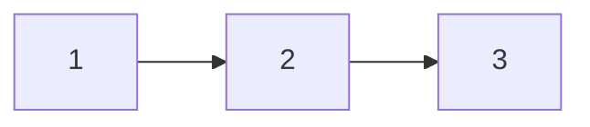

# Tasks: record-feedback appends duplicate sibling headings when a gate is approved twice on one day

## Task list

- [x] 1. Regression test (red): two then three same-day recordings into one artifact in `cli/tests/test_graph_integration.py`
  - _Depends on:_ none
  - _Requirements:_ R1.1, R1.2, R1.3, R2.2, R3.1
  - _Test:_ T2 — `uv run pytest cli/tests/test_graph_integration.py` (red before task 2)
- [x] 2. `_unique_heading` in `cli/the_loop/graph/hooks/feedback.py`; `record_feedback` uses it
  - _Depends on:_ 1
  - _Requirements:_ R1, R2.1
  - _Test:_ T2 green; T11 — markdownlint over the recorded artifact
- [x] 3. Capability doc: the `record-feedback` rule and a changelog row in `docs/capabilities/process-graph.md`
  - _Depends on:_ 2
  - _Requirements:_ R1
  - _Test:_ T12 — `make check`

## Dependency graph (DAG)

