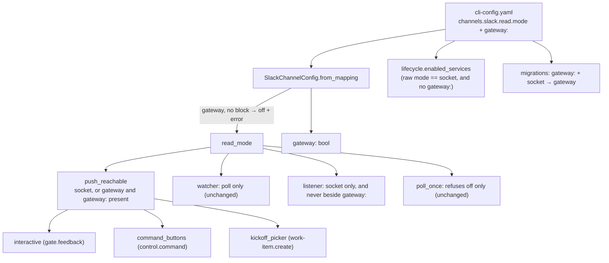

# Design: `read.mode: gateway`

## Overview

`gateway` becomes a fourth value of `channels.slack.read.mode`. One new property,
`SlackChannelConfig.push_reachable`, replaces the three `read_mode == "socket"` tests
that gate interactivity. It is true for `socket`, and for `gateway` when the gateway
block exists. A `gateway` mode with no usable `gateway:` block is resolved to `off` at
parse time. That is the same fail-closed move an unknown value already gets, so every
downstream reader stays correct without learning about the new case. A `socket` mode
beside a `gateway:` block keeps working as in 20.3.0. It is flagged in the log and in
`channels status`, and `migrate-config` rewrites it. Nothing outside the Slack channel
config, its status lines, the listener entry point and the migration changes.

## Architecture



Which process reads Slack, per config:

| `gateway:` block | `read.mode` | Socket Mode opened here | Poll reader | Interactivity | Notes |
|---|---|---|---|---|---|
| absent | `poll` / `socket` / `off` | as 20.3.0 | as 20.3.0 | as 20.3.0 | unchanged |
| absent | `gateway` | no | no | off | resolved to `off`, error logged (R3.1) |
| present | `gateway` | no | no | on (by grant) | the new form (R1, R2) |
| present | `socket` | no (suppressed, as 20.3.0) | no | on (by grant) | warning; needs migration (R4) |
| present | `poll` | no | no (as 20.3.0) | off | unchanged |
| present | `off` | no | no | off | unchanged |

## Components & interfaces

### `channels/slack.py`

- `READ_MODES = ("poll", "socket", "gateway", "off")`.
- `SlackChannelConfig` gains `gateway: bool = False`. It is set from
  `cli_config.gateway_block(config) is not None` in `from_mapping`. The full CLI config
  is already its input, so no caller changes.
- In `from_mapping`, after the unknown-value check: IF `mode == "gateway"` and there is
  no usable block, THEN log an error (`channels.slack.read.mode is 'gateway' but no
  usable gateway: block is configured — nothing is read from Slack (fail closed); add
  gateway.url or set read.mode`) and set `mode = "off"`.
- New property:

  ```python
  @property
  def push_reachable(self) -> bool:
      """Whether an interactive payload can reach this instance (issue-503): over its
      own Socket Mode connection, or delivered by the gateway client."""
      return self.read_mode == "socket" or (self.read_mode == "gateway" and self.gateway)
  ```

  Because of the parse-time resolution, `self.gateway` is always true when `read_mode`
  is `gateway`. The conjunct stays anyway, so a hand-built config cannot get it wrong.
- `interactive`, `command_buttons` and `kickoff_picker` change `self.read_mode ==
  "socket"` to `self.push_reachable`. Their grant halves are unchanged.
- `run_socket_listener` refuses, before it reads any token, in two cases:
  - when `read_mode == "gateway"`: "this instance consumes Slack from the gateway; the
    gateway holds the app's Socket Mode connection";
  - when `config.gateway` is true whatever the mode: the same reason, naming the
    `gateway:` block (R4.3).

  Both log at `error` and return `1`, like the existing refusals.

### `channels/inbound.py`

- No change in `poll_once`: it refuses only `off`, so `gateway` is allowed as a
  reconciliation, exactly like `socket` (R1.5). The kickoff press-time re-check already
  calls `config.kickoff_picker`, so it picks up R2.3 for free. Only the docstring is
  updated.

### `channels/watcher.py`

- No code change. `read_mode != "poll"` already returns `None` for `gateway` (R1.3).

### `core/lifecycle.py`

- `_slack_listener_enabled` reads the raw mode and compares it with `socket`, so
  `gateway` is already "not enabled". No change.
- The status rows (R6.2, R6.3):
  - with a `gateway:` block the existing `GATEWAY_OFF` row (`off · gateway configured`)
    stays, for every mode;
  - with no block and a raw mode of `gateway`, the `disabled` row's detail becomes
    `read.mode is gateway but no gateway block is configured — nothing reads Slack`,
    instead of the generic `read.mode is not socket`.
- New helper `socket_beside_gateway(config) -> bool`: a usable block and a raw mode of
  `socket`. The migration predicate and the warnings below share it.

### `api/ingress.py`

- `_start_gateway_client` logs one warning when `socket_beside_gateway(cli_config)`
  holds: `channels.slack.read.mode is 'socket' beside a gateway block — the listener
  stays off; set read.mode: gateway (the-loop migrate-config does it)`. The starter runs
  once at boot and again only when the hosted set changes, so the warning is not
  repeated every few seconds (R4.2).

### `commands/channels_cmd.py` (`channels status`)

- `read:` line: for `gateway`, print `gateway — events arrive through the gateway
  client (<url>); no Socket Mode connection here`.
- When the raw mode is `gateway` and no block exists, print
  `[!] read.mode is gateway but no gateway block is configured — nothing reads Slack`
  (R3.2). The parsed mode is `off`, so the existing `off` text follows.
- When `socket_beside_gateway`, print `[!] read.mode is socket beside a gateway block —
  the listener stays off; run the-loop migrate-config to set read.mode: gateway` (R4.2).
- `commands:`, `mentions:`, `shortcuts:` and the kickoff "asks which repository" line
  key on `slack.push_reachable` rather than `read_mode == "socket"`. The transport
  phrase becomes `over Socket Mode` or `through the gateway`, depending on the mode.
- `_button_lines`: in `gateway` mode the app-level-token step is not printed, because
  the gateway holds that token. The `set read.mode` step names `socket` (or `gateway`
  when a block exists) only while `push_reachable` is false.
- `_split_check_lines`: unchanged. The check belongs to a listener that this instance
  does not run in `gateway` mode, and `diagnose`'s gateway section already reports the
  gateway's socket.

### `migrations.py`

- `needs_migration` returns true when `socket_beside_gateway(config)` holds (R5.3).
- New `_migrate_gateway_read_mode(data, report)`, called from `migrate_cli_config`
  after `_migrate_slack_channel`: IF a usable `gateway` mapping with a non-empty `url`
  exists and `channels.slack.read.mode == "socket"`, THEN set it to `gateway`, append
  `channels.slack.read.mode socket → gateway (a gateway consumer opens no Socket Mode
  connection, issue-503)` to `report.moves`, and set `changed`. Otherwise do nothing.
  It is idempotent by construction (R5.1, R5.2).
- `assert_current` is unchanged, so the combination is never refused (R4.4).
  `CURRENT_CONFIG_VERSION` is not bumped.

### Schema, template, docs

- `cli-config.schema.json`: add `gateway` to the `read.mode` enum and rewrite its
  description. Touch the `gateway` block's description, which tells operators what to
  set beside it, and any `publish`/grant description that says "needs `read.mode:
  socket`", so they read "socket or gateway".
- `skills/the-loop/templates/cli-config.yaml` and `templates/gateway-config.yaml`
  (wherever an instance-side example sits): `poll | socket | gateway | off`.
- `docs/config/cli/channels-options.md` (`slack.read.mode`),
  `docs/config/cli/gateway-options.md`, and the capability docs `channels.md` and
  `gateway.md`, each with a history row.
- `channels/slack-app-manifest.yaml`: the one comment that says `read.mode: socket`.

## UI/UX design

No user-facing visual surface. The only output is CLI text (`channels status`, log
lines), specified above.

## Data models

There is no new state file and no new config key. The only addition is the enum value
`gateway` on an existing key, plus the in-memory `SlackChannelConfig.gateway` flag.

## Error handling

- `gateway` with no usable block: error log, resolved to `off`, nothing read
  (fail closed).
- `channels listen` with a block present, or in `gateway` mode: error log, exit `1`, no
  socket.
- `socket` beside a block: warning, behaviour preserved.
- Unknown mode: unchanged (`off`, warning).

## Security design

| Requirement-phase boundary / abuse case | Enforcement |
|---|---|
| A deleted `gateway:` block must not open a second Socket Mode consumer (AC1, R3) | `from_mapping` resolves `gateway` without a block to `off`. `enabled_services` opens a listener only on a raw `socket` |
| A typo never reaches a reading mode (AC2) | The existing unknown → `off` rule runs first and is unchanged |
| `channels listen` beside a gateway (AC3, R4.3) | `run_socket_listener` refuses on `config.gateway` before it reads any token |
| No unreceivable button (AC4, decision-103 D5) | All three gates go through `push_reachable`, which is false whenever nothing delivers payloads |

Authorization is untouched. Grants, `routing.authorizedUsers`, the ledger record and
the gateway's own authentication of deliveries all run as before. Log lines name config
keys and the gateway URL, never a token value. The URL is already printed by `status`
and `diagnose`.

## Testing strategy

- Unit tests for each parsing case, for `push_reachable` and the three gates, for
  the listener refusals, for the migration (rewrite, idempotence, no block,
  `needs_migration`) and for the `channels status` lines.
- The existing Slack, gateway, lifecycle and migration test suites must stay green.
  That is the "behaviour preserved" check.
- An integration test (Gherkin docstring) drives a `block_actions` envelope through the
  gateway client's dispatch path with `mode: gateway`, and asserts the approval is
  handled and the rendered notification carries buttons.

The detail is in `testing-plan.md`.

## Trade-offs & decisions

- **Resolve to `off` at parse time, or carry a "degraded gateway" state.** Resolving at
  parse time keeps the dozen readers of `read_mode` correct without each of them
  learning a new case, and it matches the existing unknown-value rule. The cost is that
  `channels status` must read the raw config to explain why. That is one extra check in
  one command.
- **Warn on `socket` beside a block, or refuse it.** Refusing would stop every 20.3.0
  gateway instance on upgrade, and the loop's migration rule is "migrate broadly, refuse
  narrowly". The ticket allowed either ("warns or refuses").
- **No schema version bump.** A bump would make `assert_current` refuse every config
  that declares `0.12.0`, which stops daemons for a cosmetic rewrite. The migration has
  its own predicate instead, as several earlier ones do.
- **`channels listen` refuses beside any gateway block.** This is slightly broader than
  the ticket asked. It closes the one remaining manual path to a second socket.

## Open questions

None.

## Review comments
