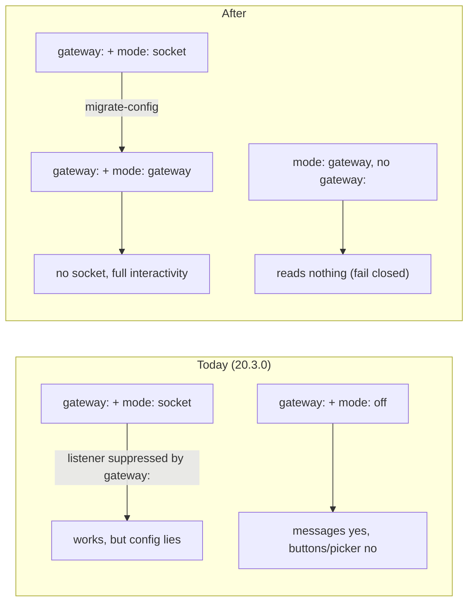

# Requirements: `read.mode: gateway` — an instance that never opens Socket Mode

## Introduction

An instance behind a gateway ([issue-496](../issue-496/requirements.md)) must set
`channels.slack.read.mode: socket` today. That is the only value that keeps the
Approve / Request changes buttons, the Execute / Start buttons and the kickoff
repository picker. It is safe only because the `gateway:` block quietly switches off the
listener that `socket` asks for. The config says "listen" and the runtime does not
listen. If someone deletes the `gateway:` block, the instance opens a second Socket Mode
connection on the gateway's app, and Slack splits every inbound envelope between the two.
The obvious alternative, `mode: off`, loses the buttons and the picker while mentions
keep arriving ([#503](https://github.com/MadaraUchiha-314/the-loop/issues/503)).

The fix is a fourth read mode, `gateway`. The ticket's owner picked this option, option 1
([comment](https://github.com/MadaraUchiha-314/the-loop/issues/503#issuecomment-6280980153)).
`read.mode` then names the transport (`poll`, `socket`, `gateway`, `off`). Whether
interactive payloads can reach the instance is derived from that transport, not from
`== "socket"`.

## Requirements

### Requirement 1 — a `gateway` read mode

**User story:** As an operator running an instance behind a gateway, I want to declare
`channels.slack.read.mode: gateway`, so that my config says what the instance does: it
takes Slack events from the gateway and never opens Socket Mode itself.

#### Acceptance criteria (EARS)

1. The system SHALL accept `gateway` as a value of `channels.slack.read.mode`, beside
   `poll`, `socket` and `off`, in the CLI config schema and in the parsed channel config.
2. WHILE `read.mode` is `gateway` the system SHALL NOT open a Socket Mode connection:
   not as a hosted ingress, not from `the-loop start`, and not from
   `the-loop channels listen`.
3. WHILE `read.mode` is `gateway` the system SHALL NOT start the poll-mode reply reader.
4. WHILE `read.mode` is `gateway` and a usable `gateway:` block is present, the system
   SHALL handle the Slack envelopes the gateway client delivers exactly as it handles
   them in `socket` mode (messages, mentions, button presses, message shortcuts, view
   submissions, slash commands).
5. WHILE `read.mode` is `gateway` the system SHALL allow the catch-up and
   reconciliation read (`the-loop channels poll`) exactly as it allows it in `socket`
   mode.

### Requirement 2 — interactivity keys on reachability, not on `socket`

**User story:** As an operator behind a gateway, I want the Approve / Request changes
buttons, the Execute / Start buttons and the kickoff picker to render, so that a gateway
consumer is not a half-working instance.

#### Acceptance criteria (EARS)

1. The system SHALL treat interactive payloads as reachable WHEN `read.mode` is `socket`,
   or WHEN `read.mode` is `gateway` and a usable `gateway:` block is present, and
   otherwise SHALL treat them as unreachable.
2. WHEN interactive payloads are reachable THEN the system SHALL render the Approve /
   Request changes buttons under the `gate.feedback` grant, the Execute / Start buttons
   under the `control.command` grant, and the kickoff repository picker under the
   `work-item.create` grant, by the same grant rules as today.
3. WHEN a kickoff picker answer is pressed THEN the system SHALL re-check the picker
   rule at press time against the same reachability rule (R2.1).
4. IF interactive payloads are unreachable THEN the system SHALL render none of those
   buttons and SHALL refuse the picker exactly as it does today in `poll` mode.

### Requirement 3 — fail closed without a gateway

**User story:** As an operator who removes the `gateway:` block, I want the instance to
stop reading Slack rather than open a socket, so that a deleted block can never put a
second Socket Mode consumer on the gateway's app.

#### Acceptance criteria (EARS)

1. IF `read.mode` is `gateway` and the config carries no usable `gateway:` block THEN the
   system SHALL read nothing from Slack, SHALL render no interactive element, SHALL open
   no Socket Mode connection, and SHALL log an error that names both keys.
2. IF `read.mode` is `gateway` and the config carries no usable `gateway:` block THEN
   `the-loop channels status` SHALL say that nothing reads Slack and why.
3. The system SHALL open a Socket Mode connection only WHEN `read.mode` is explicitly
   `socket`.

### Requirement 4 — `socket` beside a gateway is flagged, not silently honoured

**User story:** As an operator with a 20.3.0 gateway config (`gateway:` +
`mode: socket`), I want to keep working after the upgrade, and I want to be told my config
is out of date, so that nothing stops and the lie gets fixed.

#### Acceptance criteria (EARS)

1. WHILE a usable `gateway:` block is present and `read.mode` is `socket`, the system
   SHALL keep the Socket Mode listener off and keep interactivity on, as 20.3.0 does.
2. WHILE a usable `gateway:` block is present and `read.mode` is `socket`, the system
   SHALL log a warning that names `read.mode: gateway` and `the-loop migrate-config`.
   `the-loop channels status` SHALL show the same warning.
3. WHILE a usable `gateway:` block is present, `the-loop channels listen` SHALL refuse
   to open a Socket Mode connection whatever `read.mode` says, and SHALL name the gateway
   as the reason.
4. The system SHALL NOT refuse to load a config only because it carries a `gateway:`
   block with `read.mode: socket`.

### Requirement 5 — `migrate-config` rewrites the old form

**User story:** As an operator upgrading, I want `the-loop migrate-config` to rewrite
`gateway:` + `mode: socket` to `mode: gateway`, so that I do not have to edit the file by
hand.

#### Acceptance criteria (EARS)

1. WHEN `the-loop migrate-config` runs on a config with a `gateway:` block and
   `channels.slack.read.mode: socket` THEN it SHALL set `read.mode` to `gateway`, report
   the move, and leave every other key unchanged.
2. WHEN it runs on a config already migrated, or one with no `gateway:` block, THEN it
   SHALL make no change for this rule (idempotent).
3. The system SHALL report such a config as needing migration (`needs_migration`).

### Requirement 6 — the two status commands agree

**User story:** As an operator, I want `the-loop status` and `the-loop channels status`
to tell the same story about what reads Slack.

#### Acceptance criteria (EARS)

1. WHEN `read.mode` is `gateway` with a usable `gateway:` block THEN
   `the-loop channels status` SHALL print the read mode as `gateway`, say that events
   arrive through the gateway client, and report buttons, the picker, commands, mentions
   and shortcuts as available under their grants, as it does for `socket`.
2. WHEN `read.mode` is `gateway` THEN `the-loop status` SHALL report the Slack listener
   as off with a detail that names the gateway, and SHALL NOT report it as enabled but
   down.
3. WHEN `read.mode` is `gateway` without a usable `gateway:` block THEN `the-loop status`
   SHALL report the Slack listener as disabled with a detail naming the missing block.

## Non-functional requirements

- **Behaviour preserved:** a config without a `gateway:` block and with `poll`, `socket`
  or `off` behaves exactly as in 20.3.0.
- **Observability:** every new refusal or warning is a log line at `warning` or `error`
  that names the config keys involved. No secret or token value is logged.
- **Documentation:** the schema description, the shipped `cli-config.yaml` template, the
  configuration reference and the `channels` and `gateway` capability docs describe the
  new mode in the same change.

## Security considerations

- **Actors & trust:** the operator who writes the CLI config is trusted. Slack users and
  the payloads the gateway delivers are untrusted, as today. This change does not alter
  who may press a button, what a grant allows, or how a payload is authenticated.
- **Trust boundaries & data:** the boundary that matters is the Slack app's single Socket
  Mode connection. A second consumer on the same app-level token makes Slack split
  envelopes, so about half of the button presses, mentions and slash commands silently
  land on the wrong process. The new mode closes the config path that let a deleted
  `gateway:` block create that second consumer. No token, secret or personal data is
  stored or moved differently.
- **Abuse cases (EARS):**
  1. WHEN an operator removes the `gateway:` block from a `mode: gateway` config THEN the
     system SHALL open no Socket Mode connection and SHALL read nothing (R3.1).
  2. WHEN `read.mode` is a typo or an unknown value THEN the system SHALL keep resolving
     it to `off`, never to a reading mode or a socket.
  3. WHEN `the-loop channels listen` is run on an instance with a `gateway:` block THEN
     the system SHALL refuse to open a socket (R4.3).
  4. WHEN interactive payloads are unreachable THEN the system SHALL render no button,
     so an Approve that can never be received is never shown (decision-103 D5).
- **Fail closed:** `mode: gateway` with no usable `gateway:` block reads nothing and
  renders nothing interactive. An unknown mode stays `off`.

## Out of scope

- Option 2 from the ticket (a separate `read.listener` switch). The owner chose option 1.
- Any change to the gateway process itself, its Slack adapters, or how it routes
  deliveries to instances.
- Refusing `gateway:` + `mode: socket` at config load (R4.4 keeps it running).
- A config schema version bump. The migration is detected by its own predicate, so a
  config that declares `0.12.0` is not refused.

## Open questions

None. The one design choice, option 1 versus option 2, was answered on the ticket.

## Review comments
