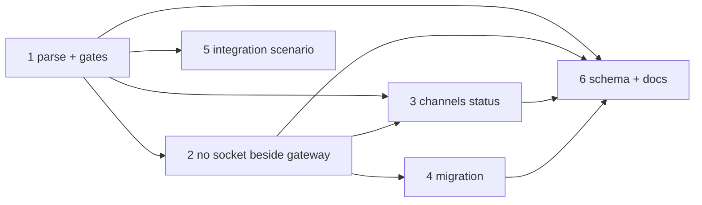

# Tasks: `read.mode: gateway`

Six tasks, all in this repository. The config parse comes first, because every other
code task reads what it produces. The docs task waits for the behaviour to settle.

## Task list

- [ ] 1. Parse `gateway`, and derive interactivity from reachability
  - `READ_MODES` gains `gateway`. `SlackChannelConfig` gains `gateway: bool`, set from
    `cli_config.gateway_block`.
  - `gateway` with no usable block resolves to `off`, with an error log that names both
    keys.
  - Add the `push_reachable` property. `interactive`, `command_buttons` and
    `kickoff_picker` use it in place of `read_mode == "socket"`.
  - Update the `poll_once` docstring. Its code is unchanged.
  - _Depends on:_ none
  - _Requirements:_ R1.1, R1.3, R1.5, R2.1–R2.4, R3.1, R3.3
  - _Test:_ T1 + T8, `tests/test_slack_gateway_read_mode.py` (parse cases, gates,
    watcher `None`, `poll_once` not skipped, press-time picker refusal, abuse AC1, AC2
    and AC4) (red→green)
- [ ] 2. Keep a socket from opening beside a gateway
  - `run_socket_listener` refuses before it reads any token, under `mode: gateway` and
    whenever a block is present.
  - Add `lifecycle.socket_beside_gateway(config)`.
  - `start` and `status` show a missing-block detail on the `disabled` listener row.
  - `_start_gateway_client` logs the migrate warning once.
  - _Depends on:_ 1
  - _Requirements:_ R1.2, R3.3, R4.1–R4.3, R6.2, R6.3
  - _Test:_ T1 + T8, `tests/test_slack_gateway_read_mode.py` (`enabled_services`,
    listener refusals AC3, status rows, the warning) (red→green)
- [ ] 3. Make `channels status` tell the truth
  - `read: gateway — …`.
  - Two `[!]` lines: no block, and socket beside a block.
  - `commands`, `mentions`, `shortcuts` and the kickoff line use `push_reachable` and
    name the transport.
  - `_button_lines` has no app-token step in `gateway` mode.
  - _Depends on:_ 1, 2
  - _Requirements:_ R3.2, R4.2, R6.1
  - _Test:_ T1, `tests/test_slack_gateway_read_mode.py` (status output cases) (red→green)
- [ ] 4. Migrate `gateway:` + `socket` to `gateway`
  - Add `_migrate_gateway_read_mode`, wired into `migrate_cli_config`.
  - `needs_migration` flags the old form.
  - `assert_current` is untouched.
  - _Depends on:_ 2 (shares `socket_beside_gateway`)
  - _Requirements:_ R4.4, R5.1–R5.3
  - _Test:_ T10, `tests/test_migrations.py -k gateway` (red→green)
- [ ] 5. Integration scenario through the gateway client's dispatch path
  - With `mode: gateway`, a `block_actions` approval press is handled, and an approval
    notification renders the Approve / Request changes pair.
  - Gherkin docstrings with `Requirement:` links.
  - _Depends on:_ 1
  - _Requirements:_ R1.4, R2.2
  - _Test:_ T2, `tests/test_slack_gateway_read_mode_integration.py`
- [ ] 6. Schema, template and docs
  - The schema enum and descriptions (`read.mode`, the `gateway` block, the grants that
    say "needs socket").
  - `templates/cli-config.yaml` and the gateway template.
  - The slack-app-manifest comment.
  - `docs/config/cli/channels-options.md` and `gateway-options.md`.
  - Capability docs `channels.md` and `gateway.md`, each with a history row.
  - `evidence/documentation.md`.
  - _Depends on:_ 1, 2, 3, 4
  - _Requirements:_ NFR documentation
  - _Test:_ T11, `uv run pre-commit run --all-files` (schema validation, markdownlint,
    the whole suite)

## Dependency graph (DAG)

## Checkpoints

- **After each task:** run that task's test file, then the neighbouring suites:
  `cd cli && uv run python -m pytest -q tests/test_channels*.py tests/test_gateway*.py
  tests/test_core_lifecycle.py tests/test_migrations.py`.
- **After task 6:** `uv run pre-commit run --all-files`. Then the verification node
  executes `testing-plan.md`.

## Review comments
