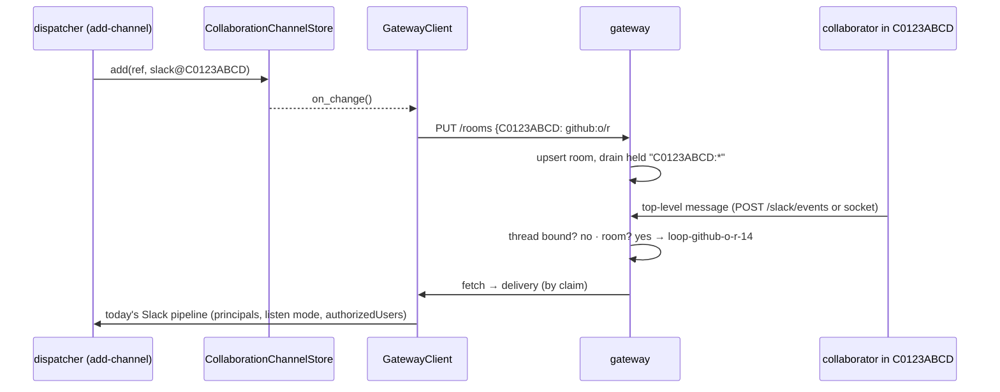
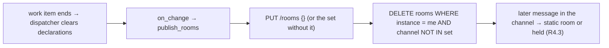

# Design: the gateway learns a work item's collaboration channel

## Overview

The instance publishes its Slack collaboration channels to the gateway as **rooms**, one
replace-set call per instance (`PUT /api/v1/gateway/rooms`). The gateway keeps them in a
new `rooms` table and resolves a Slack event in a published room to the room's work item,
after the thread lookup and before the static `slack.rooms`. Publishing a room drains the
events held under that channel's keys.



## Architecture

Two processes change and one contract grows. The instance side (`workchannels.py`, `gateway/client.py`, `api/ingress.py`) publishes; the gateway side (`gateway/store.py`, `gateway/consume.py`, `gateway/adapters/common.py`) stores, resolves and drains. `routing.py` and the instance's Slack pipeline do not change.

### Why a replace-set, not bind + delete

The ticket offers `POST /bindings` for a room plus a new `DELETE /bindings` (or a
tombstone). A replace-set per instance, shaped like `PUT /actors`, covers every case with
one call:

| Case | bind + delete | replace-set |
|---|---|---|
| declare, move | bind (and delete the old one) | publish the set |
| remove while the instance runs | delete | publish the set |
| remove while the instance is **stopped** (R4.4) | missed: nothing remembers what to delete | next registration's set omits it, the gateway drops it |
| gateway lost its store (R1.4) | re-bind every room | publish the set |
| another instance's room (R5.3) | needs an owner column anyway | the delete is scoped by instance |

Rooms go in a table of their own rather than in `bindings`, because a room has an owner
(R5) and a thread binding does not, and because a new `CREATE TABLE IF NOT EXISTS` needs
no migration of an existing store.

## Components & interfaces

### 1. `gateway/store.py` — the `rooms` table

The table is described under § Data models.

New methods, also added to the `Store` protocol:

- `publish_rooms(instance, rooms: Mapping[str, Tuple[str, str]], peer="") ->
  Union[RoomsResult, Refused]` — one transaction:
  1. `_other_peer_holds` → `Refused("duplicate-instance")`, nothing applied (R5.4).
  2. For each wanted channel held by **another** instance with a live lease: leave it,
     add `(channel, holder)` to `refused` (R5.1). An expired holder is taken over (R5.2).
  3. `DELETE FROM rooms WHERE instance = ? AND channel NOT IN (accepted)` (R4.1, R4.4).
  4. Upsert each accepted room. For each one that is new or whose ref changed, drain the
     backlog (R3.1): select `events` with `routed = 0`, `provider = 'slack'` and
     `substr(held_key, 1, len(channel) + 1) = channel || ':'`, in id order, and hand them
     to the held-event router shared with `bind` (below).
  5. Return `RoomsResult(rooms=accepted, refused=…, routed=[event ids])`.
- `resolve_room(channel) -> Optional[Tuple[str, str]]` — `(ref, slug)` or `None`.
- `rooms_of(instance) -> List[Tuple[str, str]]` — `(channel, ref)`, for the instances
  view (R7.1).

`substr` rather than `LIKE`, because a Slack id may contain `_`, which `LIKE` reads as a
wildcard.

**Shared held-event router.** The loop in `bind` that re-subjects held events and routes
them to claimants, else to the actor's instance, else leaves them held, moves into
`_route_held_rows(cur, rows, subject, ref, provider, now)`. `bind` and `publish_rooms`
both call it. A room has no subject of its own, so every drained event is re-subjected
onto the work item's subject (R3.2: with no claimant it stays held there, and the claim
routes it later through `_route_held`). Only `routed = 0` rows are selected (R3.3).

**Pruning (R4.5).** `_prune` deletes the pruned instance's `rooms` rows beside
its claims and actors, and the subject pruning's `NOT EXISTS` list gains `rooms`.

### 2. `gateway/consume.py` — `PUT /api/v1/gateway/rooms`

```python
class RoomsBody(BaseModel):
    instance: str  # 1..NAME_MAX, allow-listed like a claim
    peer: str = ""
    rooms: Dict[str, str]  # {channel id: work item ref}, at most ROOMS_MAX (256)
```

Validation, all `422` before the store is touched (abuse case 5): each key matches
`^[CGD][A-Z0-9_-]{1,20}$` (the Slack id half of `workchannels._SLACK_TARGET_RE`), each
value is at most `KEY_MAX` and parses with `slug_of`.

Handler: `_check_allowed` (R5.4) → `store.publish_rooms`. A `Refused` becomes the same
`409` `_refused` returns for a claim. Otherwise:

- `gateway.rooms` — `instance`, `rooms` (count held), `routed`, `refused` (channel ids)
  (R7.2);
- one `gateway.refused` per refused room, `reason: duplicate-room`, `holder`, `channel`
  (R5.1);
- one `subject.routed` per drained event, `by: "room"`.

Answer: `{instance, rooms: {channel: ref}, refused: [{channel, holder}], routed: n}`.

`GET /instances` gains `rooms: [{channel, workItem}]` per instance (R7.1).

### 3. `gateway/adapters/common.py` — resolution order

`_resolve_slack` becomes: thread binding → **`store.resolve_room(channel)`** → static
`slack.rooms` → hold under `<channel>:<thread>` → unbound (R2.1, R2.3, R2.4). A resolved
room returns `Resolved(subject=subject_for_slug(slug), work_item=ref)`, so
`routing.consumers_for` routes it to the subject's claimants exactly as a thread binding
does (R2.2). No change in `routing.py`.

### 4. `workchannels.py` — a change hook

```python
class CollaborationChannelStore:
    #: Called after a declaration changes in this process (issue-505). The gateway
    #: client sets it; nothing else does.
    on_change: ClassVar[Optional[Callable[[], None]]] = None
```

`add` (when it changed something), `remove` (when it removed something) and `clear`
(when it cleared something) call `_changed()` after the write. `_changed` calls the hook
inside `try/except Exception` with a warning, so a failing publish never fails a
declaration. It is a class variable for the reason `ChannelState.publisher` is one: the
dispatcher, the Slack listener and the CLI each build their own store over the same
directory.

### 5. `gateway/client.py` — publishing

- `attach(…, channel_store=None)`: when given, `self._rooms = lambda:
  channel_store.targets(SLACK)`. `targets()` already leaves contested channels out (R1.5),
  and `add` refuses a name, so every target is an id.
- `publish_rooms(*, force=False, _raise=False) -> bool`, under its own lock:
  - `desired = self._rooms()`; if not `force` and `desired == self._published_rooms`,
    return `True` with no call;
  - `PUT /rooms`; on `200` set `_published_rooms = desired`, record the time, and log a
    warning per refused room; on `409` call `_refused` (a duplicate instance stops the
    fetch loop too); any other status or a transport error logs
    `gateway: rooms not published (…)` and returns `False` (R1.6), or re-raises when
    `_raise` so `register` treats it as an outage.
- `register()`: after the claims, `publish_rooms(force=True, _raise=True)` (R1.4).
- `step()`: after a successful registration and before the fetch, call `publish_rooms()`
  when `ROOMS_RECONCILE_S = 30` seconds have passed since the last attempt (R1.3). The
  no-change short circuit keeps that to a directory scan.
- `document()`: adds `rooms: {channel: ref}` (what was last published).

### 6. `api/ingress.py` — wiring

Where `ChannelState.publisher` is set today, also pass
`channel_store=pipeline.dispatcher.channel_store` to `attach` and set
`CollaborationChannelStore.on_change = lambda: client.publish_rooms()` (R1.2).

### 7. Contract and docs

- `the-loop-gateway.v1.yaml`: the `PUT /api/v1/gateway/rooms` operation
  (`gatewayPublishRooms`) and `RoomsBody`; the description's list of registrations names
  `/rooms`.
- issue-496 `requirements.md`: R5.2's resolution sources and R5.7 name rooms, with a note
  pointing at this work item.
- `docs/capabilities/gateway.md` and `docs/capabilities/channels.md`: how a declared room
  reaches the gateway, the resolution order, and that `slack.rooms` is now only a static
  override.

## UI/UX design

N/A — no user-facing surface. The only operator-visible output is the `rooms` field in `GET /api/v1/gateway/instances` and `GET /api/v1/gateway`, and the `gateway.rooms` record.

## Data models

One new gateway table, created with `CREATE TABLE IF NOT EXISTS`, so a 20.4.0 store gains it on open:

```sql
CREATE TABLE IF NOT EXISTS rooms (
  channel TEXT PRIMARY KEY,   -- a Slack conversation id
  ref TEXT NOT NULL,          -- the work item
  slug TEXT NOT NULL,         -- its subject is loop-<slug>
  instance TEXT NOT NULL,     -- the publisher
  published_at TEXT NOT NULL
);
```

`RoomsBody` (consume API) and `RoomsResult` (store) are described in § Components. No instance-side storage changes: the declarations stay in the portable record's `collaborationChannels` section.

### Data flow: retraction



## Error handling

| Failure | Behaviour |
|---|---|
| Gateway unreachable during `publish_rooms` from the hook or reconcile | warning, `False`; the next reconcile retries, because `_published_rooms` did not change |
| Gateway unreachable during `register` | raised → `gateway.unreachable`, back-off, re-register (today's path) |
| `409 duplicate-instance` | `_refused`, as for a fetch |
| A room refused as `duplicate-room` | warning naming channel and holder; the rest applied; not retried until the set changes or the next registration |
| The portable directory cannot be read | `targets()` answers `{}`. The client would then retract every room, so `publish_rooms` skips the call when `targets()` raised (see below) |
| The hook raises | caught in `_changed`, logged; the declaration stands |

`targets()` swallows read errors and answers `{}`, which would retract every room on a
transient read failure. `publish_rooms` therefore reads through a small helper that calls
`store.store.refs()` first and skips the publish on `OSError` / `ValueError`, keeping the
gateway's previous rooms (fail closed, requirements §Security).

## Security design

| Boundary (requirements) | Enforcement |
|---|---|
| Only allow-listed instances publish rooms (abuse 1) | `_check_allowed` before anything, as for claims and bindings |
| A stale peer under a live name (R5.4) | `_other_peer_holds` inside the transaction → `409` |
| One instance cannot take a live instance's room (abuse 2) | per-room holder check with `_lease_live`; refused rooms are reported, not applied |
| One instance cannot retract another's room (abuse 3) | the `DELETE` is `WHERE instance = ?` |
| Malformed or oversized input (abuse 5) | pydantic: id regex, `KEY_MAX`, `ROOMS_MAX`, `slug_of` → `422` |
| A stranger's message routed to the instance (abuse 4, R6.1) | unchanged instance pipeline: principals, listen mode, `authorizedUsers`, roster |
| No message data in the mapping (R6.2) | the table holds channel, ref, slug, instance, time |

## Testing strategy

Unit tests on the store, the adapter resolution, the consume router, the client and the
store hook; one hosted integration scenario that replays the ticket's reproduction end to
end; the contract parity test. Detail in [`testing-plan.md`](testing-plan.md).

## Trade-offs & decisions

- **Replace-set over bind + delete** — see § Architecture.
- **A periodic reconcile (30 s) beside the in-process hook.** The hook makes the common path (a comment keyword the daemon's dispatcher handles) immediate; the reconcile catches a declaration made by the CLI in another process, at the cost of a directory scan every 30 s.
- **A refused room is not retried every reconcile.** The client remembers the set it sent, so a room held by another live instance is reported once per change or registration, not every 30 s.

### Alternatives considered

- **Bind plus delete on `/bindings`.** Rejected above: it cannot retract a room removed
  while the instance was stopped without remembering it.
- **The gateway asks the instance.** The gateway would call back into instances to ask
  who owns a channel. It inverts the pull model issue-496 chose and needs a reachable
  instance.
- **Publish from `CollaborationChannelStore.add` only.** Misses a declaration made by the
  CLI in another process, hence the periodic reconcile.

## Open questions

None.

## Review comments
