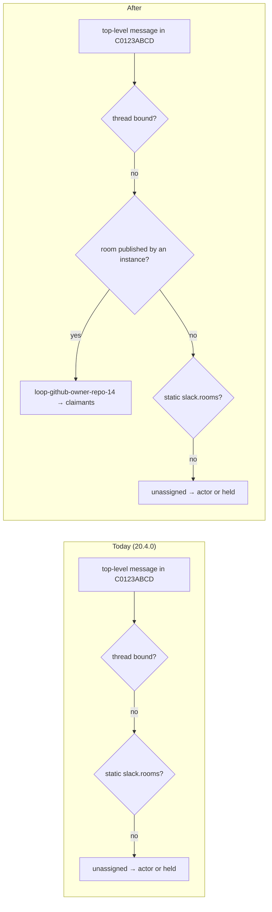

# Requirements: the gateway learns a work item's collaboration channel

## Introduction

A collaboration channel ([issue-375](../issue-375/requirements.md), `slack@C0123ABCD`)
says that every message in that Slack channel is about one work item. Behind a gateway
([issue-496](../issue-496/requirements.md)) only the instance knows the declaration. The
instance publishes thread bindings (`<channel>:<thread_ts>`) and nothing else, so the
gateway cannot tell which work item a top-level message in the room belongs to. It
resolves the message to `unassigned` and falls back to actor routing. A message from the
operator, whose Slack id is in `gateway.actors.slack`, is delivered. A message from any
other collaborator is held, and nothing in Slack says so
([#505](https://github.com/MadaraUchiha-314/the-loop/issues/505)).

The fix: the instance publishes each live declaration to the gateway as a **room**, and
the gateway resolves a message in a published room to that room's work item.

## Requirements

### Requirement 1 — the instance publishes its rooms

**User story:** As an operator running an instance behind a gateway, I want each Slack
collaboration channel I declare to be known to the gateway, so that every collaborator's
message in it reaches the work item, as it does without a gateway.

#### Acceptance criteria (EARS)

1. WHILE a gateway client is running, the system SHALL publish to the gateway every Slack
   collaboration channel that exactly one work item declares, each as a room
   `{channel id → work item ref}`.
2. WHEN a Slack collaboration channel is declared, moved to another channel or removed in
   the instance's own process THEN the system SHALL publish the change to the gateway
   without waiting for a reconnect.
3. WHEN a declaration changes in another process on the same machine (the CLI verb
   `the-loop channels add`, a graph hook) THEN the system SHALL publish the change within
   one reconcile interval, which SHALL be no longer than 60 seconds.
4. WHEN the gateway client registers, on start and after every outage, THEN it SHALL
   publish its complete set of rooms, so a gateway that restarted or lost its store gets
   them back.
5. The system SHALL NOT publish a contested channel (one that two work items declare,
   which `declared_by` already treats as declared by none) or a channel that is not a
   Slack conversation id.
6. IF publishing rooms fails (the gateway is unreachable or answers an error) THEN the
   system SHALL log a warning, keep running, and publish them again on the next
   reconcile or registration.

### Requirement 2 — the gateway resolves a message in a published room

**User story:** As a collaborator added to a work item, I want my top-level message in
its room to reach the work item, whoever I am registered with.

#### Acceptance criteria (EARS)

1. WHEN a Slack event arrives in a channel and no thread binding matches it THEN the
   gateway SHALL resolve it to the work item of the room published for that channel,
   before it looks at the static `slack.rooms` in `gateway-config.yaml`.
2. WHEN an event resolves through a published room THEN the gateway SHALL route it to the
   claimants of that work item's subject (`by: "claim"`). The author's actor
   registration SHALL play no part while the subject has claimants.
3. WHEN no room is published for the channel THEN the gateway SHALL resolve as it does
   today: static `slack.rooms`, then hold on `unassigned` under `<channel>:<ts>`.
4. A thread binding SHALL still take precedence over a room, so a thread the-loop opened
   for one work item keeps resolving to that work item.

### Requirement 3 — a late room drains the backlog

**User story:** As an operator, I want the messages that were held in a room before the
gateway learned it to be delivered once it does.

#### Acceptance criteria (EARS)

1. WHEN a room is published THEN the gateway SHALL take every Slack event still held
   under a key of that channel (`<channel>:<ts>`), move it onto the work item's subject,
   and route it to that subject's claimants, in arrival order.
2. IF the subject has no claimant yet THEN those events SHALL stay held on the work
   item's subject, and a later claim SHALL route them as any claim routes held events.
3. The gateway SHALL NOT re-route an event that was already routed.

### Requirement 4 — ending a declaration retracts the room

**User story:** As an operator, I want a room the work item no longer owns to stop
routing to it, so that a channel reused after the work item ends is not delivered to a
finished item.

#### Acceptance criteria (EARS)

1. WHEN a declaration is removed, or the work item ends and its declarations are cleared,
   THEN the system SHALL retract the room from the gateway.
2. WHEN a declaration moves to another channel THEN the system SHALL retract the old room
   and publish the new one.
3. WHEN a room is retracted THEN the gateway SHALL resolve later events in that channel
   as if no room were published (R2.3). Events already routed SHALL stay routed.
4. WHEN a declaration was removed while the instance was stopped THEN the next
   registration SHALL retract it, because the instance publishes its whole set and the
   gateway drops the instance's rooms that the set no longer names.
5. WHEN the gateway prunes an instance whose lease has lapsed THEN it SHALL drop that
   instance's rooms along with its claims and actors.

### Requirement 5 — one room, one instance

**User story:** As an operator of a gateway shared by several instances, I want one
instance's room to be safe from another instance's declaration.

#### Acceptance criteria (EARS)

1. IF an instance publishes a room that another instance holds with a live lease THEN the
   gateway SHALL keep the holder's room, SHALL refuse that one room, SHALL apply the rest
   of the publication, and SHALL record `gateway.refused` with reason
   `duplicate-room` naming the holder.
2. WHEN the holder's lease has lapsed THEN the gateway SHALL let another instance take the
   room over.
3. An instance SHALL be able to replace or retract only its own rooms.
4. The gateway SHALL check a room publisher exactly as it checks a claimant: the
   instance name on the allow-list, and a different peer under a live name refused with
   `409 duplicate-instance`.

### Requirement 6 — authorization is unchanged

**User story:** As an operator, I want the room to move messages and nothing else, so
that routing a stranger's message to my instance never lets the stranger act.

#### Acceptance criteria (EARS)

1. WHEN a delivered room event reaches the instance THEN the system SHALL apply the same
   checks it applies without a gateway: the `channels.slack` principals, the room's
   listen mode, `routing.authorizedUsers` and the collaborator roster.
2. The gateway SHALL store only the room mapping `{channel id, work item ref, instance}`,
   never a message body or a member list.

### Requirement 7 — operators can see the rooms

**User story:** As an operator debugging routing, I want to see which rooms each
instance has published.

#### Acceptance criteria (EARS)

1. The gateway's `GET /api/v1/gateway/instances` SHALL report, per instance, the rooms it
   holds (channel id and work item ref).
2. WHEN rooms are published THEN the gateway SHALL record `gateway.rooms` with the
   instance, the number of rooms held, the number routed from the backlog and any
   refused channel.

## Non-functional requirements

- **Behaviour preserved:** an instance without a gateway, and a gateway whose instances
  declare no collaboration channel, behave exactly as in 20.4.0. Static `slack.rooms`
  keep working.
- **Store compatibility:** an existing gateway store opens without a manual migration.
- **Contract first:** the new operation is in
  `docs/api-specs/openapi/the-loop-gateway.v1.yaml`, and the served surface matches it.
- **Documentation:** issue-496's R5.2 and R5.7 name rooms beside thread bindings, and the
  `gateway` and `channels` capability docs describe how a room reaches the gateway, in
  the same change.

## Security considerations

- **Actors & trust:** the operator who runs an instance and the gateway is trusted. An
  allow-listed instance is trusted to say which rooms it owns, as it is already trusted
  to publish claims and thread bindings. Slack users and the messages they post are
  untrusted. Another instance on the same gateway is trusted for its own subjects only.
- **Trust boundaries & data:** the boundary is the gateway's consumer API. A room changes
  only which instance's queue a Slack event lands on. It grants no permission: the
  instance still authorizes every delivered event (R6.1). The gateway stores a channel
  id, a work item ref and the publishing instance's name, no message text and no
  personal data beyond what the events table already holds.
- **Abuse cases (EARS):**
  1. WHEN an instance not on the gateway's allow-list publishes rooms THEN the gateway
     SHALL refuse it as it refuses such a claim (R5.4).
  2. WHEN an instance publishes a room another live instance holds THEN the gateway SHALL
     keep the holder's room (R5.1), so one instance cannot redirect another's room.
  3. WHEN an instance's publication omits a room another instance holds THEN the gateway
     SHALL leave that room alone (R5.3).
  4. WHEN a stranger posts in a published room THEN the event SHALL reach the work item's
     instance, which SHALL refuse it if the stranger is not allowed to speak (R6.1).
  5. WHEN a publication names a malformed channel id or ref, or more rooms than the
     gateway's bound, THEN the gateway SHALL refuse it with `422` before it stores
     anything.
- **Fail closed:** a room the gateway cannot resolve falls back to today's resolution
  (static rooms, then held). A publication that fails leaves the gateway's previous rooms
  in place until the next successful one, and the instance still authorizes everything
  it receives.

## Out of scope

- Jira collaboration channels (`jira@…`). The gateway routes Jira events by issue key,
  and a Jira room raises no held-message problem.
- Slash commands in a channel that has no room. The gateway drops them today and keeps
  doing so.
- Telling a held Slack author that their message is held. That is a separate gap.
- Changing who may act on a delivered event.

## Open questions

None. The ticket states the expected behaviour and its acceptance criteria; the one
design choice (one replace-set call per instance instead of a bind plus a delete) is
recorded in `design.md` with its reason.

## Review comments
