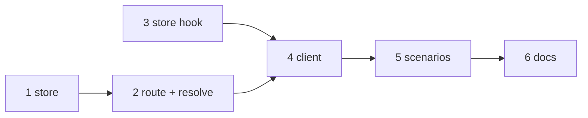

# Tasks: the gateway learns a work item's collaboration channel

Six tasks, all in this repository. The gateway side (store, then route and resolution)
comes first, because the client publishes to it. The docs task waits for the behaviour to
settle.

## Task list

- [x] 1. Store: the `rooms` table and `publish_rooms`
  - Add the table, `RoomsResult`, `publish_rooms`, `resolve_room`, `rooms_of`, and the
    `Store` protocol entries.
  - Extract `_route_held_rows` from `bind`; `bind` keeps its behaviour.
  - Pruning drops a lapsed instance's rooms; subject pruning keeps subjects a room names.
  - _Depends on:_ none
  - _Requirements:_ R3.1–R3.3, R4.1, R4.2, R4.4, R4.5, R5.1–R5.3, R6.2, NFR store
    compatibility
  - _Test:_ T1 + T8 + T10, `tests/test_gateway_rooms.py` (store cases, abuse 2 and 3,
    migration) (red→green)
- [ ] 2. Gateway: `PUT /rooms`, the instances view, and resolution order
  - `RoomsBody` with the id regex, `KEY_MAX`, `ROOMS_MAX`, `slug_of`; the handler, its
    `gateway.rooms` / `gateway.refused` / `subject.routed` records; `rooms` in
    `GET /instances`.
  - `_resolve_slack`: thread binding → published room → static room → held.
  - Add the operation and `RoomsBody` to `the-loop-gateway.v1.yaml`.
  - _Depends on:_ 1
  - _Requirements:_ R2.1–R2.4, R5.1, R5.4, R7.1, R7.2, NFR contract
  - _Test:_ T1 + T3 + T8, `tests/test_gateway_rooms.py` (resolution order, route cases,
    abuse 1 and 5), `tests/test_api_contract_parity.py` (red→green)
- [ ] 3. Instance: the store hook
  - `CollaborationChannelStore.on_change`, called after a changing `add`, `remove` and
    `clear`, guarded so a raising hook never fails a declaration.
  - _Depends on:_ none
  - _Requirements:_ R1.2
  - _Test:_ T1, `tests/test_gateway_rooms.py -k on_change` (red→green)
- [ ] 4. Instance: the client publishes rooms
  - `GatewayClient.publish_rooms`, the reconcile in `step()`, the full publish in
    `register()`, `rooms` in `document()`, `attach(channel_store=…)`, the unreadable-dir
    guard.
  - `api/ingress.py` passes the dispatcher's channel store and sets `on_change`.
  - _Depends on:_ 2, 3
  - _Requirements:_ R1.1–R1.6, R4.1, R4.2
  - _Test:_ T1 + T8, `tests/test_gateway_rooms.py` (client cases, fail-closed read)
    (red→green)
- [ ] 5. End-to-end scenarios
  - `tests/test_gateway_rooms_integration.py`: the four Gherkin scenarios of the testing
    plan, through `GatewayHarness`, the Slack HTTP ingress and a `GatewayClient`.
  - _Depends on:_ 4
  - _Requirements:_ R1.1, R1.4, R2.2, R3.1, R4.1, R4.3, R6.1, R7.2
  - _Test:_ T2 + T8, `tests/test_gateway_rooms_integration.py` (red→green on the
    branch before task 4's wiring, green after)
- [ ] 6. Docs: issue-496 amendment and capability docs
  - issue-496 `requirements.md` R5.2 and R5.7 name rooms, pointing at this work item.
  - `docs/capabilities/gateway.md` and `docs/capabilities/channels.md`: how a room
    reaches the gateway, the resolution order, `slack.rooms` as a static override.
  - _Depends on:_ 5
  - _Requirements:_ NFR documentation
  - _Test:_ T11, `uv run pre-commit run --all-files` (markdownlint)

## Dependency graph (DAG)

## Checkpoints

- After tasks 2 and 4: `cd cli && uv run python -m pytest -q tests/test_gateway_*.py
  tests/test_gateway_rooms.py tests/test_api_contract_parity.py`.
- After task 6: `uv run pre-commit run --all-files`, then the verification node runs
  `testing-plan.md`.

## Review comments
