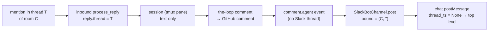

# Bugfix spec: Slack-origin replies are posted as new top-level messages instead of in the originating thread

## Summary

A person who mentions the-loop inside a thread of a work item's Slack room gets the
agent's answer somewhere else: as a new top-level message in the room, not in the thread
where they asked. In a busy room they miss it
([#507](https://github.com/MadaraUchiha-314/the-loop/issues/507), 20.5.0,
`read.mode: gateway`).

The fix: when a work item's room hears a mention inside a thread, the-loop remembers that
thread, and the agent's next comments for that work item are posted as replies in it.
The next event that starts a new conversation in the room, such as a gate prompt, a
phase change or a mention elsewhere, ends that.

## Steps to reproduce

1. Declare a room on a work item: `the-loop add-channel slack@C0123ABCD`. The
   conversation record is `{channel: C0123ABCD, thread: "", mode: "channel"}`.
2. Someone starts a thread in that room about anything.
3. An authorized collaborator replies in the thread, mentions the bot and asks it
   something.
4. Wait for the agent to answer.

## Expected vs actual

- **Expected:** the answer is a reply in the thread from step 3 (`thread_ts` = that
  thread's root).
- **Actual:** the answer is a new top-level message in the room. The event log shows
  `channel.reply_received` (`kind: work-item.reply`), then `session.reply_sent`, then
  about 20 s later `channel.posted` with `event_type: comment.agent` and a `thread` that
  is the new top-level message's own ts.

## Root cause (confirmed)

The question and the answer travel different paths, and only the question's path knows
the thread.

- `inbound.process_reply` has the thread (`reply.thread`) and puts it into the ledger
  record's detail. Nothing keeps it after the reply is delivered.
- The session answers with `the-loop comment`, which publishes `comment.agent`. That
  event carries the work item and the text, and no Slack thread.
- `SlackBotChannel.post` takes the thread from the work item's conversation binding. For
  a room (issue-378) the binding's thread is `""` by design, so every event, the answer
  included, is posted top-level.

**Open question from the ticket, answered:** no setting or verb binds or follows a
thread today. `add-channel` binds a whole room. A thread is bound only when the-loop opens
its root itself (an event, a start or a kickoff). This fix makes following the asker's
thread the default, so no new setting is needed.

## Requirements

### Requirement 1 — the answer goes to the thread that asked

**User story:** As a collaborator in a work item's Slack room, I want the agent's answer
to my mention in a thread to appear in that thread, so that I and everyone reading it
see it.

#### Acceptance criteria (EARS)

1. WHEN an authorized speaker's mention inside a thread of a Slack channel is delivered
   to a work item's session as a `work-item.reply` THEN the system SHALL remember that
   channel and thread as the work item's **reply thread**.
2. WHEN a `comment.agent` event for that work item is posted to Slack AND the channel it
   is posted to is the reply thread's channel THEN the system SHALL post it as a reply in
   the reply thread (`thread_ts` = the reply thread).
3. WHILE a reply thread is remembered, every further `comment.agent` event for that work
   item SHALL be posted into it until it is replaced or cleared (R2).
4. WHEN a reply is posted into the reply thread THEN the `channel.posted` record SHALL
   name the reply thread as its `thread`.
5. WHEN RoomPolicy drops, edits or threads an event under one of its own rules
   (issue-393) THEN that decision SHALL stand, and the reply thread SHALL change only a
   decision to post a new message.

### Requirement 2 — the reply thread ends when the conversation moves on

**User story:** As a person following a work item's room, I want gate prompts, phase
changes and the answers to other questions to appear where they always have, so that a
thread somebody once asked in does not swallow the work item's updates.

#### Acceptance criteria (EARS)

1. WHEN a later mention inside a different thread is delivered as a `work-item.reply`
   THEN the system SHALL replace the reply thread with that thread.
2. WHEN a mention at the top level of the channel (not inside a thread) is delivered as a
   `work-item.reply` THEN the system SHALL clear the reply thread, so the answer is a
   top-level message as it is today.
3. WHEN any event other than `comment.agent` or a within-phase progress event
   (`phase.progress`, `*.progress`) is posted to Slack for the work item THEN the system
   SHALL clear the reply thread before posting, and SHALL post that event exactly where
   it is posted today.
4. WHEN no reply thread is remembered THEN every event SHALL be posted exactly as it is
   today.

### Requirement 3 — never worse than today

1. IF the reply thread cannot be read, written or saved THEN the system SHALL log it at
   debug level and post the event top-level, as today; neither the reply's delivery nor
   the post SHALL fail because of it.
2. WHEN the reply thread names a channel other than the one the event is posted to (the
   work item's conversation moved, for example) THEN the system SHALL ignore it and post
   as today.
3. The fix SHALL include a regression test that fails before the fix and passes after:
   a mention in a room thread, then a `comment.agent`, posted with that thread's
   `thread_ts`.

## Non-functional requirements

- No new configuration key, grant, Slack scope, schema or event type. The reply thread
  lives in the existing per-work-item room-delivery memory in the channel state file
  (issue-393 B2), whose cap and coercion already apply.
- Socket Mode and `read.mode: gateway` behave the same: both deliver Slack events through
  `inbound.handle_socket_event` on the instance, and the post happens on the instance.

## Security considerations

- **Is the bug security-relevant?** No. It misplaces the agent's own message inside a
  channel the work item already posts to. Nothing is exposed to anyone who could not
  already read the room.
- **Actors & trust:** only an authorized speaker's mention, one that cleared every
  existing refusal (unauthorized actor, not-addressed, duplicate, standing session),
  sets the reply thread. A stranger's message never reaches that point. The
  value stored is a Slack channel id and thread ts read from Slack's own event, not
  from message text.
- **Trust boundary:** the post can only go to the channel the work item's conversation
  is already bound to (R3.2). A reply thread cannot redirect a work item's messages to
  another channel, and it cannot route anything inbound: routing still reads the
  conversation and room bindings, unchanged.
- **Abuse cases (EARS):**
  1. WHEN an unauthorized member mentions the bot in a room thread THEN the system SHALL
     refuse the message as today and SHALL NOT change the reply thread.
  2. WHEN an authorized speaker mentions the bot in a thread of a channel that is not the
     work item's bound conversation channel THEN the system SHALL NOT post the agent's
     answer there (R3.2).
- **Fail closed:** a missing, malformed or unreadable reply thread means top-level
  posting, which is today's behaviour.

## Out of scope

- Following threads for `context.added` and `decision.recorded`. Both already reply in
  the thread with their own receipt.
- Gate answers (`gate.feedback`) and control keywords typed in a thread. The gate's
  acknowledgement already threads under the gate message in an agentic room.
- A time limit on the reply thread. Requirement 2 ends it at the next event that starts
  a new conversation, which is sooner in practice.
- Answering in the thread on any channel other than Slack.

## Open questions

None. The ticket's question is answered under Root cause.

## Review comments
