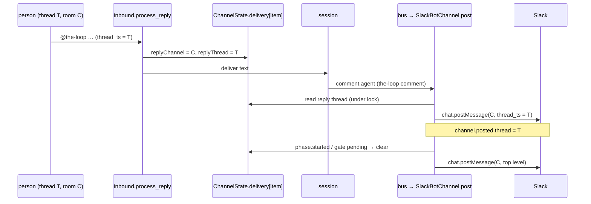
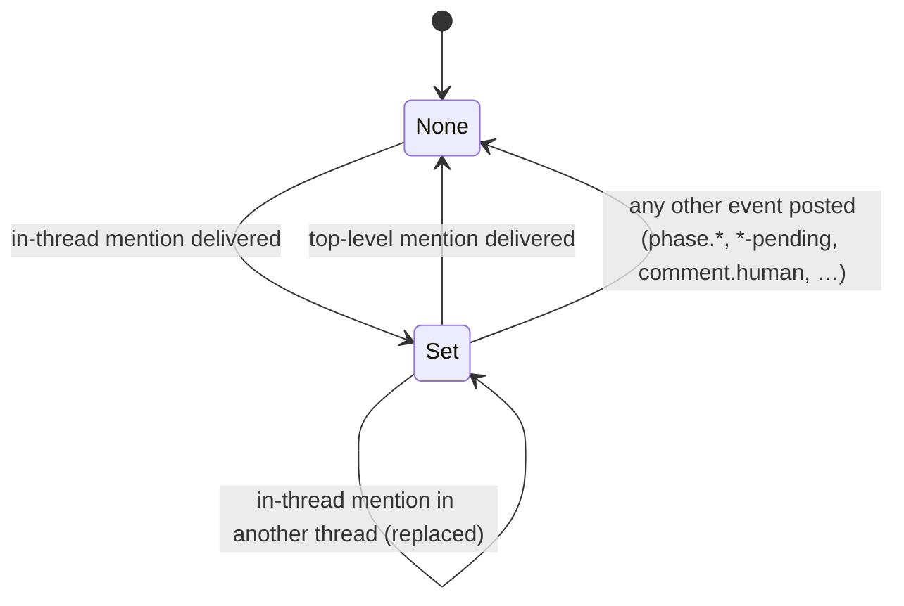

# Design: answer a Slack mention in the thread it came from

## Overview

Two small edits in `cli/the_loop/channels/`, and one new pair of fields in state the
channel already keeps. No new module, dependency, config key, event type or Slack scope.

1. **Inbound sets the reply thread.** `inbound.process_reply` already knows the thread
   of a delivered `work-item.reply`. Just before it delivers the reply to the session,
   it writes `replyChannel` and `replyThread` into the work item's room-delivery memory
   (`ChannelState.delivery`, issue-393 B2). A mention at the top level writes `""`,
   which clears it.
2. **Outbound reads it.** `SlackBotChannel.post` already resolves the work item's
   conversation under the state lock. In the same critical section it now reads the
   reply thread. A `comment.agent` posted as a new message to that channel goes into the
   thread. Any other event, progress excepted, clears it first.



## Architecture

Nothing changes in how a message is routed in or how the bus picks channels. The
change is in two places: the end of the inbound pipeline, after every refusal has
passed, and the moment `post` chooses `thread_ts`.

### Why the delivery memory, and not the event

The ticket suggests carrying `thread_ts` through `work-item.reply` to the session. That
would mean the session gets the thread, keeps it, passes it to `the-loop comment`, which
puts it on `comment.agent`, which the bus hands to Slack. That touches the session frame,
the CLI verb, the GitHub publisher and the event contract, and it still depends on the
agent remembering to pass a flag. The channel is the one party that sees both the
question and the answer, so it keeps the thread itself. The answer is posted by the same
instance that took the mention, in Socket Mode and behind a gateway alike, so the
instance-local state file is enough.

The room-delivery memory is the right existing record: it is per work item, it is
already read under the post's lock, it is capped (`DELIVERY_CAP`) and coerced on load,
and a lost record degrades to today's behaviour.

## Components & interfaces

### 1. `channels/state.py`: two fields in the delivery record

`_delivery_record` gains two string fields, coerced like the others:

| Field | Meaning |
|---|---|
| `replyChannel` | channel id of the last in-thread mention delivered for the work item, or `""` |
| `replyThread` | that mention's thread root ts, or `""` |

`remember_delivery` needs no change: scalar keys replace. A file written before this
change loads both as `""`.

### 2. `channels/inbound.py`: `_note_reply_thread(bot, reply)`

Called in `process_reply` for `event_type == "work-item.reply"` right before
`_deliver`. That point is after every refusal and after the ledger record, so only an
authorized speaker's processed reply reaches it (abuse case 1). It runs before delivery,
so the thread is recorded before the session can answer.

```python
def _note_reply_thread(bot, reply) -> None:
    in_thread = bool(reply.thread) and reply.thread != reply.ts
    try:
        with ChannelState.locked(bot.state_path, bot.stores) as state:
            state.remember_delivery(
                reply.work_item,
                replyChannel=reply.channel_id if in_thread else "",
                replyThread=reply.thread if in_thread else "",
            )
            state.save(bot.state_path)
    except Exception as exc:  # noqa: BLE001 — never fails the reply (R3.1)
        logger.debug(...)
```

A top-level mention in a room has `reply.thread == reply.ts` (issue-375 makes it its own
thread), so it clears the reply thread (R2.2). A standing session's reply (no ticket) is
skipped, since a standing session's conversation is a thread already.

### 3. `channels/slack.py`: `SlackBotChannel._reply_thread(state, event, bound)`

Called inside the existing lock in `post`, right after `_conversation`:

```python
def _reply_thread(self, state, event, bound) -> str:
    memory = state.delivery_for(event.work_item)
    thread, channel = memory["replyThread"], memory["replyChannel"]
    if not thread:
        return ""
    if event.event_type == "comment.agent":
        return thread if bound and channel == bound[0] else ""   # R1.2, R3.2
    if not room_policy.is_progress(event.event_type):           # R2.3
        state.remember_delivery(event.work_item, replyChannel="", replyThread="")
        state.save(self.state_path)
    return ""
```

`room_policy._is_progress` becomes public as `is_progress` so the progress rule has one
definition. In `post`, only the **plain post branch** changes:

```python
thread_ts=reply_to or ((bound[1] or None) if bound else None)
```

The `EDIT` and `THREAD` branches and every `DROP` keep their RoomPolicy decision (R1.5).
The returned `PostResult.thread` is `reply_to` when it was used, so `channel.posted`
names the thread (R1.4).

### 4. Docs

- `docs/capabilities/channels.md`: amend the issue-378 bullet ("every event … a top-level
  message in that room, never a reply") with the reply-thread exception, and add a
  history row.
- `docs/guide/slack.md`: one paragraph under addressing the-loop, saying where the
  answer appears.

## UI/UX design

None. The change is where an existing message lands in Slack. There is no new surface
and nothing to prototype.

## Data models

One work item's record in `delivery`, in the Slack channel state file
(`<state.root>/channels/slack.json`):

```json
"delivery": {
  "github:octo/repo#507": {
    "lastNode": "", "lastEvent": "", "progressTs": {}, "gateTs": {},
    "phaseSelectionTs": "", "sessionSpokeFor": "",
    "replyChannel": "C0123ABCD",
    "replyThread": "1760936401.000100"
  }
}
```

### Lifecycle of the reply thread



## Error handling

| Failure | Behaviour |
|---|---|
| State lock or save fails while noting the thread | debug log; the reply is still delivered; the answer posts top-level |
| State lock or save fails while clearing | debug log; the event posts where it would today. The next `comment.agent` may still thread; the next successful clear ends it |
| Reply thread's channel ≠ the conversation's channel | ignored, posted as today (R3.2) |
| Slack refuses the threaded post (thread deleted) | the existing `ChannelError("slack: post failed …")` path, as for any post |
| Malformed record on disk | `_delivery_record` coerces it to `""` → today's behaviour |

`_reply_thread` runs inside `post`'s existing `with ChannelState.locked(...)` block. A
failure there would fail the post, so the read and clear are wrapped and degrade to
`""`.

## Security design

Each trust boundary that `bugfix.md` names is enforced in code and pinned by a test:

| Boundary (from bugfix.md) | Enforced by |
|---|---|
| Only an authorized speaker's processed reply sets the thread | `_note_reply_thread` is called after the last refusal in `process_reply`, on the `work-item.reply` path only; test: an unauthorized mention leaves the memory untouched |
| A reply thread cannot move messages to another channel | `_reply_thread` returns the thread only when `replyChannel == bound[0]`, the channel `post` already posts to; test: mismatched channel posts top-level |
| Values come from Slack's event, not message text | `reply.channel_id`, `reply.thread` are taken from the event envelope fields `channel` / `thread_ts` |
| Fail closed | every read, write and save error degrades to top-level posting |

No new attack surface: no input is parsed that was not parsed before, and nothing new
leaves the machine.

## Testing strategy

Test-first. A regression test reproduces the bug red before the fix (R3.3), using the
existing `test_channels_declared_integration.py` harness: real `SlackBotChannel`, real
inbound pipeline, `FakeSlackClient`. Unit tests for `_delivery_record` coercion and
`room_policy.is_progress`. See `testing-plan.md`.

## Trade-offs & decisions

- **The channel remembers, the session does not.** Simpler and works without the agent's
  cooperation. The cost: "the answer" is inferred as "the next agent comments", not known
  causally. If the agent posts an unrelated comment before it answers, that comment also
  goes to the thread. Clearing on every conversation-starting event (R2.3) limits it to
  the window between the mention and the next phase or gate event.
- **Top-level mention → top-level answer.** Keeps today's shape for the common case and
  changes only the case the ticket reports. Threading under a top-level mention would
  also be reasonable, but it changes behaviour nobody asked about.
- **No time limit.** A remembered thread with no further events would catch a much later
  agent comment. In practice a phase or gate event clears it first. A TTL can follow if
  that turns out to be wrong.
- **Thread-shaped conversations too.** The rule is "same channel as the conversation",
  not "room only". In a central-channel thread the reply thread equals the bound thread,
  so nothing changes there. A legacy thread inside a room also answers in the asker's
  thread.

### Alternatives considered

- **Carry `thread_ts` on `comment.agent`** (the ticket's suggestion): rejected above; it
  spans the session frame, a CLI flag and the event contract.
- **Bind the asker's thread as the work item's conversation**: would move every later
  event into that thread and make the room's top level go quiet. That is the issue-312
  "one conversation" model working against the room.

## Open questions

None.

## Review comments
