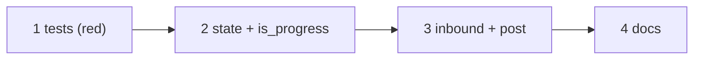

# Tasks: answer a Slack mention in the thread it came from

Four tasks, all in this repository. The regression test comes first so it is seen red;
the state fields and the two code edits then make it green; docs close it.

## Task list

- [ ] **1. Regression and integration tests (red).** Write
  `cli/tests/test_channels_reply_thread_integration.py` (T2, T3, T4) and
  `cli/tests/test_channels_reply_thread.py` (T1). Run them on the unchanged code and
  record the red result.
  - _Requirements:_ R1–R3, abuse cases 1–2
  - _Test:_ T1–T4
  - _Depends on:_ —
- [ ] **2. State fields and `is_progress`.** Add `replyChannel` / `replyThread` to
  `_delivery_record`; make `room_policy.is_progress` public (keep the private alias's
  callers working).
  - _Requirements:_ data model, R2.3, migration
  - _Test:_ T1
  - _Depends on:_ 1
- [ ] **3. Note on inbound, use on outbound.** `_note_reply_thread` in
  `inbound.process_reply`; `_reply_thread` and the `thread_ts` / `PostResult.thread`
  change in `SlackBotChannel.post`.
  - _Requirements:_ R1.1–R1.5, R2.1–R2.4, R3.1–R3.2
  - _Test:_ T2, T3, T4
  - _Depends on:_ 2
- [ ] **4. Docs.** Amend the issue-378 bullet in `docs/capabilities/channels.md` and add
  its history row; one paragraph in `docs/guide/slack.md`; `evidence/documentation.md`.
  - _Requirements:_ capability-docs gate
  - _Test:_ T5 (markdownlint)
  - _Depends on:_ 3

## Dependency graph (DAG)

## Checkpoints

- After task 1: the new tests fail for the right reason (top-level post).
- After task 3: `cd cli && uv run python -m pytest -q` is green.
- After task 4: `uv run pre-commit run --all-files` is green.

## Review comments
