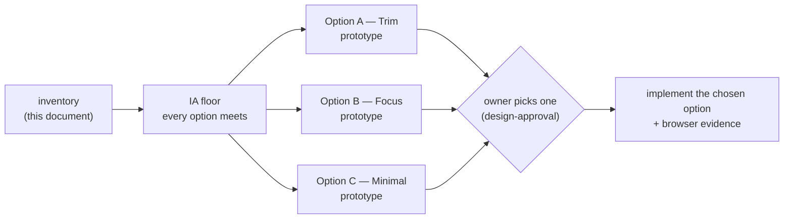

# Requirements: de-clutter the control plane UI

> Phase 1 of 3 (requirements → design → tasks). Tier 3 (`human-approves-pr`): the change
> is presentational — it removes, relocates and condenses what the dashboard shows and
> touches no route, no model join, no control verb and no setting. The owner chooses
> one of three candidate levels before anything is built.

## Introduction

[Issue #511](https://github.com/MadaraUchiha-314/the-loop/issues/511), opened by the
owner: the control plane UI at 20.5.1 is *too cluttered and has too much information for
the user to read*. Keep the design system, theme and colours; show less; improve the
information architecture; show nothing unnecessary. The sidebar carries information that
is only needed once a work item is opened, and the main column's top band carries too
much. Present **three options with increasing amounts removed**; the owner reviews them
and picks the level they want.

The UI is the issue-327 **Control Plane UI 3.0** implementation
([`../issue-327/requirements.md`](../issue-327/requirements.md)): a three-column
operations console — a 19 rem work-item sidebar, a main column, a 19 rem session panel.
Its design system (tokens, type, dots, chips, hairlines) is not in question. What is in
question is how much of what it shows earns its place.

### What the screen shows today

Read off the owner's screenshot (a work item parked at `requirements-approval`) and the
components under `ui/src/`. One fact is routinely drawn several times.

| Band | Elements drawn | Observed problems |
|---|---|---|
| Sidebar, top | brand row, surface nav (Work · Standing · Instances), search box, instance filter (fleet only) | — |
| Sidebar, rows | per item: dot, `#n`, title (two lines), instance chip; second line `repo · flag-or-node · age`; each PR nested beneath with dot, icon, label, age | the second line is detail of the item, not a reason to choose it; nested PR rows double the row count; the repository repeats on every row of a single-repository board |
| Sidebar, Standing | every standing session with dot, name, description, plus *Manage standing sessions* | a session with no work item among the work items; the Standing surface already lists them |
| Sidebar, footer | Settings icon + word, service line, health word | — |
| Header bar | title; meta: ref chip, instance chip, phase chip, repository, `updated …`; actions: copy ref, GitHub, theme, open panel | the repository is in the ref chip already; the phase chip repeats the strip's current node |
| Graph strip | `loop · 5 of 26 nodes passed · 7 skipped · blocked at design · parked — awaiting a human at requirements-approval`, *Full graph*, node row | two "where it is" statements that can disagree; the counts are bookkeeping; the parked note repeats twice more below |
| Session tabs | *Work item loop* (+ *PR #n*), `1 session · 1 work item loop` | a tab bar with one tab, and a count of it |
| Trace header | `Harness trace · claude`, *Verbose* switch | the harness name repeats the panel's |
| Gate / question banner | `Human gate — requirements-approval · waiting 5d ago`, reason, *Approve*, *Request changes* | the node and the age appear a third and fourth time |
| Composer | input, send, `delivers to tmux · loop-github-… · bracketed paste + enter · ⌘⏎ to send` | the tmux target appears for the third time, in a hint nobody acts on |
| Session panel | note banner; Harness (instance, harness, session id, status, current node, started, transcript path); tmux (target, cwd, attach command); Ticket (repo, number, GitHub); Controls | the note repeats the strip; the current node is the fifth copy; the transcript path and cwd are 150-character identifiers nobody reads on a dashboard; the ticket section repeats the header |

Counting the screenshot: the current node is written **five** times, the tmux target
**three**, the repository **four**, the age **three**. That is the clutter — not the
design system, which the owner keeps.

### The shape of this work item

**"Main bar"** in the ticket is read as the main column's top band — the header bar,
the graph strip, the session tabs and the trace header — plus the composer's hint line
at its foot. If the owner meant only the header bar, R3's ladder is still the same
ladder with fewer rungs taken.

## Requirements

### Requirement 1 — three options, strictly nested, rendered

**User story:** As the owner, I want to see three concrete versions of the de-cluttered
dashboard side by side, so that I choose a level by looking at it, not by reading a list.

#### Acceptance criteria (EARS)

1. WHEN the design phase completes THEN the system SHALL have produced three candidate
   options — **A (Trim)**, **B (Focus)**, **C (Minimal)** — each a self-contained HTML
   prototype under `docs/specs/issue-511/design/`, rendering the Work surface with a
   selected work item in **both** themes on the demo fixture's data shapes.
2. WHEN the options are compared THEN they SHALL be strictly nested: everything Option A
   removes or relocates, Option B also does; everything B does, C also does. An element
   SHALL NOT come back at a higher level.
3. WHEN an option is documented THEN `design.md` SHALL carry one **element inventory**
   per option — every element of the table above with a verdict of `keep`, `relocate`
   (naming where) or `remove`, and a one-line reason — so the three differ by a diffable
   table, not by prose.
4. WHEN the prototypes are presented THEN they SHALL be presented together, in one place
   the owner can open — the design pull request, with each prototype's screenshots
   embedded beside the current screen's — so the choice is made from the rendering.
5. WHEN the owner names an option THEN the system SHALL record the choice in `design.md`
   (the chosen option's inventory row marked selected) and in a decision record, and the
   two unchosen prototypes SHALL remain checked in as the record of what was offered.

### Requirement 2 — the information-architecture floor every option meets

**User story:** As the operator, I want each fact in one place and the sidebar to be a
list I choose from, so that I read the screen once instead of scanning it.

#### Acceptance criteria (EARS)

1. WHEN the Work surface renders a selected work item THEN each of these facts SHALL be
   drawn **once** on the screen by default: the current node, the parked or blocked
   note, the repository, the tmux target, the last-activity age. A second copy SHALL
   appear only behind a disclosure the viewer opens.
2. WHEN a sidebar row renders THEN it SHALL carry what is needed to **choose** the item —
   its identity (number and title) and its urgency (the dot, and a flag only when the
   item needs a human) — and nothing that is only needed once it is open.
3. WHEN a session's operational identifiers render — session id, transcript path,
   working directory, tmux target — THEN they SHALL be available on demand (a disclosure
   or a copy control) and SHALL NOT be drawn in full by default.
4. WHEN a count or hint is bookkeeping the viewer cannot act on — `n of m nodes passed`,
   the skipped count, `n sessions · …`, the composer's delivery hint — THEN the system
   SHALL NOT draw it; a count SHALL remain only where it changes what the viewer does
   (the *Needs you* group's count stays).
5. WHEN the graph strip states where the loop is THEN it SHALL state **one** position —
   the node the pointer is on, with the parked or blocked qualifier — never two
   statements that can disagree (`blocked at design` beside `parked at
   requirements-approval`).
6. WHEN a surface has one member THEN its chrome for choosing between members SHALL NOT
   render: a session tab bar with one session, a Standing group with no standing
   session, an instance filter on a worker.

### Requirement 3 — what each level removes

**User story:** As the owner, I want the three levels to differ in a way I can predict
before I open them, so that I know what I give up at each step.

The ladder below is the **minimum** each option removes or relocates; the design phase
may condense further within a level, never less. "Relocate" means the content stays
reachable from the same screen within one interaction.

#### Acceptance criteria (EARS)

1. **Option A — Trim.** WHEN Option A renders THEN it SHALL satisfy R2 and keep every
   column, band and section the current UI has: the duplicates and bookkeeping go, the
   structure stays.
2. **Option B — Focus.** WHEN Option B renders THEN, in addition to A, the system SHALL:
   reduce a sidebar row to one line (dot, number, title, and the urgent flag); nest PR
   rows only under the selected item; reduce the header meta to the phase chip and the
   age; reduce the session panel to its controls and the note, with Harness, tmux and
   Ticket behind disclosures closed by default; drop the trace header's harness name.
3. **Option C — Minimal.** WHEN Option C renders THEN, in addition to B, the system SHALL:
   remove the session panel as a standing column, relocating its controls to the header
   and its details to one disclosure; reduce the graph strip to one line (the position
   and a *Full graph* control that reveals the node row); render the session tab bar only
   when the item has more than one session; move the Standing group out of the sidebar
   (the Standing surface keeps it); fold search and the instance filter behind one icon;
   reduce the sidebar groups to **Needs you** and **Everything else**, the latter sorted
   by activity.
4. WHEN any option renders THEN the ticket's `#number` and title, the loop position, the
   gate banner with its *Approve* control, the agent's question with the composer, and
   the pause / resume / stop / start verbs SHALL remain reachable within one interaction
   of the Work surface — these are what the dashboard is for.

### Requirement 4 — the design system is untouched

**User story:** As the owner, I want the same look, so that de-cluttering is a removal,
not a redesign.

#### Acceptance criteria (EARS)

1. WHEN any option or the built UI renders THEN every colour, font, size, weight, radius
   and border SHALL come from the issue-327 token set in `ui/src/styles/app.css`; the
   system SHALL add no token, no font, no shadow and no gradient.
2. WHEN an element is condensed or relocated THEN it SHALL be drawn with the existing
   primitives (`StatusDot`, `PhaseChip`, `IconButton`, `Section`, `KV`, `Notice`,
   `ControlButton`, `Kicker`, `ref-chip`) or a composition of them; a new visual idiom
   SHALL NOT be introduced.
3. WHEN either theme is active THEN every option SHALL render in it, and the theme
   control, the stored choice and the pre-paint script SHALL be unchanged.

### Requirement 5 — nothing invented, nothing lost

**User story:** As the owner, I want fewer things on screen, not fewer things the
dashboard can do.

#### Acceptance criteria (EARS)

1. WHEN this work item lands THEN `ui/src/api/`, `ui/src/state/` and `ui/src/demo/`
   SHALL be unchanged except where a view's props required a signature change, and every
   `TheLoopApi` method a view calls today SHALL still be called from a user action.
2. WHEN the built UI is compared with 20.5.1 THEN every user action in issue-327's
   functionality map (`../issue-327/design.md` § Functionality map) SHALL have a home:
   select a work item or a PR session, start / pause / resume / stop a session, approve a
   parked gate, answer the agent's question, reply into a session, copy the ref and the
   attach command, open on GitHub, search, filter by instance, switch theme, collapse and
   reopen the panels, and every Standing, Settings and Instances action.
3. WHEN the built UI is compared with 20.5.1 THEN every state SHALL still render: loading,
   empty board, demo banner, connection error, missing deep link, no transcript
   (event-trail fallback), truncated tail, blocked composer with its reason, stream live /
   reconnecting / fallen back, daemon stopped, degraded fleet.
4. WHEN a hash the dashboard parses at 20.5.1 is opened THEN it SHALL land on the same
   surface; the hash SHALL remain the only record of what the main column shows.
5. WHEN the chosen option removes a chrome element THEN the system SHALL NOT add a new
   control, route, request or setting to compensate; relocation uses what exists.

### Requirement 6 — still accessible, still responsive

**User story:** As a keyboard or screen-reader user, I want the quieter screen to be at
least as operable as the current one.

#### Acceptance criteria (EARS)

1. WHEN content moves behind a disclosure THEN the disclosure SHALL be a native
   `
` or a control with `aria-expanded`, operable from the keyboard, and its
   accessible name SHALL say what it reveals.
2. WHEN a sidebar row loses its second line THEN the row's accessible name SHALL still
   carry the item's number, title and flag, and `aria-current` SHALL still mark the
   selected row, tab and node.
3. WHEN the viewport is narrower than 1280 px THEN the session panel (or, in Option C,
   its disclosure) SHALL start closed; narrower than 768 px THEN the sidebar SHALL start
   closed; both SHALL remain openable from the header.
4. WHEN the viewer prefers reduced motion THEN the active dot SHALL NOT pulse; the trace
   panel SHALL keep `role="log"`, its accessible name, keyboard focus and the
   follow-the-newest rule.

### Requirement 7 — proved in a browser

**User story:** As the owner, I want screenshot evidence of the built UI against the
option I chose, so that I approve the PR without running it.

#### Acceptance criteria (EARS)

1. WHEN the work item reaches verification THEN the system SHALL have captured headless
   Chromium screenshots of the built app on the demo fixture — Work with a selected item,
   a PR session, the full graph, the gate and question banners, each disclosure open and
   closed, Standing, Settings, panels collapsed, and a narrow viewport — in both themes,
   committed under `evidence/`.
2. WHEN the implementation PR's briefing is posted THEN it SHALL embed those screenshots
   beside the chosen prototype's, and SHALL state the count of elements drawn on the
   Work surface before and after.

### Requirement 8 — the documentation follows the change

1. WHEN this work item lands THEN `ui/README.md` § *Where the screens get their data*
   and `docs/capabilities/control-plane.md` SHALL describe the chosen layout — what each
   band shows by default and what sits behind a disclosure — and SHALL no longer describe
   the 20.5.1 layout as current.

## Non-functional requirements

- **Build and tests:** the same three CI commands (`bun run lint`, `bun run test`, `bun
  run build`) stay green; the component tests under `ui/src/` are updated to the chosen
  layout rather than deleted; no new dependency.
- **Bundle:** removing elements SHALL NOT grow the production bundle.
- **Prototypes:** each option's HTML inlines its CSS and JS and loads nothing over the
  network (`design.uiArtifacts.selfContained`), as issue-327's did.
- **Motion:** unchanged — one animation, guarded by `prefers-reduced-motion`.

## Security considerations

- **Actors & trust:** the operator's browser (trusted); the service's JSON (trusted
  transport carrying **untrusted text** — ticket titles, transcript lines, event fields,
  session paths); the three prototypes (static files, nothing executable is taken from
  them into the app).
- **Trust boundaries & data:** untrusted text crosses from JSON into the DOM in the same
  places as today, and in some new places — a one-line row's truncated title, a
  disclosure's summary, a popover's path. It must stay text. No secret is stored, moved
  or displayed; the attach command remains built from the tmux target the service
  already serves.
- **Abuse cases (EARS):**
  1. WHEN a ticket title, transcript line, path or node name contains markup or the
     trace's `**` / backtick sequences THEN the system SHALL render it as text in every
     relocated or condensed position (React escaping) and SHALL create no element from it.
  2. WHEN an element is moved behind a disclosure THEN its content SHALL be rendered only
     from the same typed record it is rendered from today, never from a string
     assembled in the DOM.
- **Fail closed — the signals that say "do not trust this screen" survive every
  level:** the demo banner, the connection banner, the health word with its degraded
  state, the stream's fallen-back state and a blocked composer's reason SHALL remain
  visible by default in Options A, B and C alike. De-cluttering never hides a warning.
- **No new attack surface**, justified: the change adds no route, no request the
  current app does not make, no HTML rendering, no `eval`, no inline event handler on
  served content and no dependency; it removes and relocates markup the app already
  renders.

## Out of scope

- Any change under `ui/src/api/`, `ui/src/demo/`, the service or the OpenAPI contract;
  a change to what the service reports (for instance reconciling the graph report's
  `blocked at` with its `parked at`) is a separate work item — this one picks which to
  show.
- A new design system, new tokens, new fonts, a new theme state.
- The Standing, Settings, Instances and instance panes' own content: they keep the same
  header bar and so inherit the header's changes, and nothing else in them is touched.
- New functionality of any kind, including controls the prototype of issue-327 showed
  and the service cannot back (**New work item**, **Checks**, **cleanup**).

## Open questions

None blocking. Two readings are recorded here rather than asked, so the owner can
overturn them at the requirements gate:

1. **"Main bar"** is read as the main column's top band plus the composer's hint line
   (see *The shape of this work item*).
2. **Option C's sidebar groups** collapse four groups into two. If the owner wants the
   four groups kept at every level, R3.3 drops that clause and nothing else changes.

## Review comments

> Appended by the-loop's `record-feedback` hook when a human gate approves with
> comments (issue-109). Append-only and attributed: an approval never silently
> discards a reviewer's suggestions, and the feedback travels with the document
> it concerns rather than living in a side-channel tracker.

### 2026-10-20 — approved

**@MadaraUchiha-314** wrote:

approved
