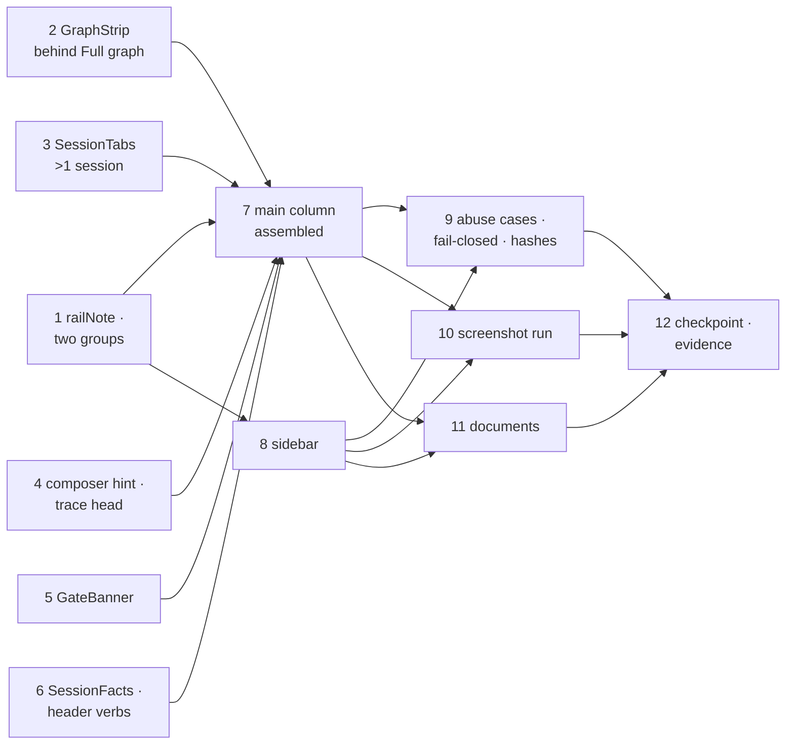

<!-- Written per the `the-loop:writing` skill. -->

# Tasks: de-cluttering the control plane UI (Option C — Minimal)

> The last spec artifact (requirements → design → testing plan → tasks). Derived
> mechanically from the **C** columns of [`design.md`](design.md)'s component table and
> element inventory, and from [`testing-plan.md`](testing-plan.md)'s matrix — both locked
> by the owner at `design-approval` on 2026-10-20 ([decision-148](../../decisions/decision-148.md)).
> No gate follows this artifact (issue-281): the graph advances on its shape.

Twelve tasks in `ui/src/`, `ui/scripts/` and two documents. Every task is a removal, a
relocation behind an existing idiom, or a condensation drawn with the existing primitives
(R4.2); none touches `ui/src/api/`, `ui/src/state/` or `ui/src/demo/` (R5.1), adds a
dependency, or adds a control, route, request or setting (R5.5). The leaf helpers come
first (1–5), the header's new home for the panel's facts and verbs next (6), the two
assemblies that change what the screen shows (7, 8), then the proof that nothing was lost
(9), the evidence tooling (10), the documents (11) and the checkpoint that runs the whole
plan (12).

## Task list

Each task is a checkbox, references the requirement(s) it satisfies, declares its
dependencies so the-loop can build the execution DAG, and names the **test(s) that will
prove it** — a row of `testing-plan.md`'s matrix, so the DAG and the plan cannot describe
different work. TDD invariant: **no production code without a failing test that
motivates it** — write/adjust the test first, watch it go red, then make it green. The
abuse cases of `design.md` § Security design are tests like any other (task 9).

- [x] 1. The pure helpers: `railNote` without the node, two sidebar groups
  - `ui/src/views/WorkItemDetail.tsx` → `railNote`: a parked item returns
    `parked — awaiting a human` (no `at <node>` suffix); otherwise the attention detail,
    as today (inventory rows 33, 34; § Where the current node is drawn).
  - `ui/src/views/grouping.ts`: add `SIDEBAR_GROUPS_MINIMAL` (`needs-you` → **Needs
    you**, `everything` → **Everything else**) and a pure mapping from `sidebarGroup`'s
    four-way answer to the two keys, with *Everything else* sorted by `lastActivity`
    descending (the views arrive sorted by it already — the mapping preserves that
    order and `needs-you` keeps the group's order). `sidebarGroup`, `itemStatus`,
    `repoOf` and `filterViews` are unchanged (design § Components, last paragraph: no
    new helper beyond this mapping — the facts render through the existing `KV`).
  - `SIDEBAR_GROUPS` stays exported until task 8 retires its last caller.
  - *Depends on:* none
  - *Requirements:* R2.1, R2.5, R3.3
  - *Test:* T1 — `ui/src/views/WorkItemDetail.test.tsx` (`railNote` of a parked view
    equals `parked — awaiting a human` and never contains the node id; the attention
    detail otherwise) and `ui/src/views/grouping.test.ts` (the two-group mapping puts
    needs-you first, everything else by `lastActivity`; `sidebarGroup` still answers
    four ways) (red→green)
- [x] 2. `GraphStrip` becomes the band behind *Full graph*
  - `ui/src/components/GraphStrip.tsx`: the component takes `expanded: boolean` from its
    parent and renders **only while expanded** — the loop name as the row's label and the
    **full** node row (every node, the current one highlighted, skipped struck through,
    `aria-current="step"`, the `<ol role="list" aria-label="loop position">` kept). The
    counts line (`n of m nodes passed`, `n skipped`), the `at <node>` statement, the
    note and the strip's own *Full graph* button leave the component (rows 30–36); the
    control and the note move to the header meta in task 7. The empty-rail sentence
    stays for an expanded strip with no nodes.
  - `compactRail`, `railLabel` and `humanize` stay exported and unchanged (`railLabel`
    still feeds the PR tab's `inner loop` fact).
  - *Depends on:* none
  - *Requirements:* R2.4, R2.5, R3.3, R6.1
  - *Test:* T2 / T9 — `ui/src/components/GraphStrip.test.tsx`: nothing renders while
    collapsed; expanded renders every node with `aria-current="step"` on the current
    one and no `of … passed` / `skipped` / `at <node>` text; `compactRail` and `railLabel`
    cases unchanged (red→green)
- [x] 3. `SessionTabs` renders only for more than one session, without the tally
  - `ui/src/components/SessionTabs.tsx`: return `null` when `view.pullRequests` is
    empty (row 37, R2.6, D4); delete the `n sessions · 1 work item loop · …` span
    (row 38). Tabs keep their links, `aria-label` = short ref, `aria-current="page"`
    and the pause glyph.
  - *Depends on:* none
  - *Requirements:* R2.4, R2.6, R3.3, R6.2
  - *Test:* T2 — `ui/src/views/WorkItemDetail.test.tsx`: `Scenario: the session tab bar
    renders only when the item has more than one session` (no `navigation` named
    *Sessions* for #205; present for #214 with #216 and loop-docs#47) and `Scenario: the
    tab bar carries no session tally` (red→green)
- [x] 4. The composer's hint and the trace head
  - `ui/src/components/Transcript.tsx` → `ChatBar`: the hint slot renders **only** the
    blocked reason (`chatBlocked`, unchanged); `delivers to tmux · <target>`,
    `bracketed paste + enter` and `⌘⏎ to send` leave (rows 47, 48); `⌘⏎` stays in the
    send button's `title`. The `tmuxTarget` prop goes with the hint if nothing else
    reads it.
  - `ui/src/views/WorkItemDetail.tsx` line ~190: the trace head reads `Harness trace`
    and the **Verbose** switch; the harness name leaves (row 40 — it lives in the
    Session details facts from task 6).
  - *Depends on:* none
  - *Requirements:* R2.1, R2.4, R3.2, R5.3
  - *Test:* T2 — `ui/src/components/Transcript.test.tsx` (`Scenario: the composer
    carries no delivery hint`; the blocked composer still shows its reason; the send
    title carries ⌘⏎) and `ui/src/views/WorkItemDetail.test.tsx` (the trace head text
    has no harness name; `role="log"`, its name and `tabindex` unchanged) (red→green)
- [x] 5. `GateBanner` says *Human gate*, never the node
  - `ui/src/views/WorkItemDetail.tsx` → `GateBanner`: heading `Human gate · waiting
    <age>` (rows 42, 43, D5); reason, **Approve — advance graph** (→ `graphComplete`,
    its disabled reason when no checkout) and *Request changes on the ticket* unchanged
    (row 44). `QuestionBanner` unchanged (row 45).
  - *Depends on:* none
  - *Requirements:* R2.1, R2.5, R3.4
  - *Test:* T2 — `ui/src/App.test.tsx`: `Scenario: the current node is written once —
    the phase chip — and the gate banner says Human gate without the node` (for #205
    the node id occurs exactly once in the main column, inside the phase chip); the
    existing gate-approval scenario still passes (red→green)
- [x] 6. `SessionFacts` and the header's verbs: the panel's content, relocated
  - `ui/src/components/SessionAside.tsx`: extract the facts into an exported
    `SessionFacts({ view, viewed })` — **Harness** (harness, status, started, session id
    **in full**, transcript path **in full**) · **tmux** (cwd **in full**, the attach
    command button — the one copy control, unchanged) · **Ticket** / **Pull request**
    (`inner loop` for a PR via `railLabel`, *Open on GitHub*). Leave out: the note
    banner, instance, current node, the tmux `target` row, repo and number (rows 50,
    51, 55, 58, 61). Render every value through the existing `KV` from the typed
    `SessionRecord` / `PullRequestView` fields (abuse case 2); add no copy control (D6,
    critic C5). Extract the verbs into an exported `SessionControls({ view, onChanged
    })`: the contextual pause / resume / stop / start `ControlButton`s calling
    `controlSession` with the **work item's** ref, busy labels and the `role="alert"`
    error line as today. `SessionAside` itself keeps composing them for the file's
    existing shape but is no longer rendered on Work (task 7).
  - `ui/src/components/HeaderBar.tsx`: render the *Open session panel* button only
    when `chrome.onOpenAside` is set (Work stops setting it in task 7; Standing and
    Settings never did); the header's root gains `flex-wrap` so the title keeps its
    width at 390 px (design § Accessibility & responsiveness).
  - `ui/src/views/WorkItemDetail.tsx` header actions: `<SessionControls>` preceded by a
    visible `work item` `Kicker` when `viewed !== view.ref` (a PR session is selected —
    row 64, D9, critic C3) · copy ref · GitHub · theme (from `HeaderBar`) · **Session
    details**: a native `
` whose `
` is the `IconButton` idiom
    (accessible name *Session details*) and whose body is `<SessionFacts>` in a popover
    anchored below the actions, `width: min(20rem, calc(100vw - 2rem))`,
    `max-height: calc(100vh - 9rem)`, `overflow-y: auto` (critic C4) — Tailwind
    utilities over the existing tokens, no new token or shadow (R4.1). Closed by default
    at every width (R6.3).
  - *Depends on:* none
  - *Requirements:* R2.3, R3.3, R3.4, R4.2, R5.2, R5.5, R6.1, R6.3
  - *Test:* T2 / T8 / T9 — new `ui/src/components/SessionFacts.test.tsx`: `Scenario:
    Session details is a closed details element whose body shows harness, status,
    started, session id, transcript path, cwd, the attach command and Open on GitHub in
    full` (the summary is named; `open` is absent by default; every value's
    `textContent` equals the record's field; no `current node`, `target`, `repo` or
    `number` row; exactly one copy button); `Scenario: pause, resume, stop and start
    render in the header and call controlSession with the work item's ref`;
    `Scenario: with a PR session selected the verbs carry a visible work item label and
    still target the work item`; abuse case 2 — a record whose `cwd`, `harnessSessionId`
    and transcript path carry `<b>x</b>` renders them as text, no `b` element
    (red→green)
- [x] 7. The main column assembled: header meta, one statement of the position, no panel
  - `ui/src/views/WorkItemDetail.tsx`: the header meta is **ref chip · `PhaseChip` ·
    the `railNote` qualifier (when non-empty) · `updated <age>` · *Full graph* /
    *Collapse graph*** (a button with `aria-expanded`, the state local to the view, off
    by default); the repository line and the instance chip leave the header (rows 24,
    26, D11 — the ref chip is the one copy of the repository). `<GraphStrip
    expanded={…}>` renders beneath the header; `<SessionTabs>` beneath it (task 3).
    The copy-ref and GitHub icon buttons stay (row 28).
  - `ui/src/views/Work.tsx`: `SessionAside` is not rendered on Work (row 65); the
    `Chrome` handed to `WorkItemDetail` carries no `asideOpen` / `onOpenAside`, so the
    header draws no open-panel button (row 29). `Panels.asideOpen` and its setter stay
    in `App`'s state untouched (`ui/src/state/` is not edited, R5.1) and are simply
    unread on Work; the `<1280 px` rule now applies to the popover, which always starts
    closed (R6.3).
  - The demo banner, connection banner and the footer's health word are not touched
    (row 66, 21; fail-closed).
  - *Depends on:* 1, 2, 3, 4, 5, 6
  - *Requirements:* R2.1, R2.5, R3.3, R3.4, R5.2, R5.3, R6.1, R6.3
  - *Test:* T2 / T9 — `ui/src/App.test.tsx` and `ui/src/views/WorkItemDetail.test.tsx`:
    `Scenario: the header meta is the ref chip, the phase chip, the note and the age —
    the repository line and the instance chip are gone`; `Scenario: Full graph in the
    header meta reveals the node row and Collapse graph hides it` (`aria-expanded`
    flips; no `[data-node]` while collapsed); the one-session scenario of task 3 on the
    assembled column; no element named *Open session panel* or *Close panel* on Work;
    `Scenario: copy ref and copy attach command write the clipboard` (re-pointed at the
    popover); the existing question + reply, gate approval and theme-toggle scenarios
    still pass (red→green)
- [x] 8. The sidebar: two groups, one-line rows, PRs under the selected item, the finder behind an icon
  - `ui/src/components/Sidebar.tsx`: groups from `SIDEBAR_GROUPS_MINIMAL` via task 1's
    mapping; the count renders on **Needs you** only (row 15). A row is one line — dot ·
    `#n` · title (`truncate`) · `InstanceChip` (fleet only) · the flag at the right only
    when `rowFlag(view).urgent` (`needs input`, `human gate`, `blocked`; rows 5–12) —
    with `aria-label` = `#n — title — flag` and `aria-current="page"` when selected
    (R6.2). PR rows nest only under the selected item (the row whose `ref` or whose
    `pullRequests` contain the active ref), without their age (rows 13, 14); the
    `Pull requests for …` list label stays. The Standing group and *Manage standing
    sessions →* leave (rows 17, 18). The search box and the fleet-only instance
    `<select>` move behind one `IconButton` in the brand row (*Search work items*,
    `aria-expanded`, closed by default; rows 3, 4; R2.6 keeps the filter off a worker);
    the empty-result sentences are unchanged. The footer (Settings, service line,
    `HealthDot`) is untouched (rows 19–21).
  - `ui/src/views/grouping.ts`: retire `SIDEBAR_GROUPS` if the sidebar was its only
    caller; keep it otherwise.
  - *Depends on:* 1
  - *Requirements:* R2.2, R2.4, R2.6, R3.3, R5.2, R6.1, R6.2
  - *Test:* T2 / T9 — `ui/src/components/Sidebar.test.tsx` and `ui/src/App.test.tsx`:
    `Scenario: a sidebar row is one line carrying the number, the title and the urgent
    flag, and its accessible name carries all three`; `Scenario: a paused, merged or
    closed item shows no flag on its row`; `Scenario: pull request rows nest only under
    the selected item`; `Scenario: only the Needs you group shows a count`; `Scenario:
    the Standing group does not render in the sidebar and the Standing surface still
    lists every standing session` (`ui/src/views/Standing.test.tsx` unchanged and
    green); `Scenario: the search box and the instance filter appear behind the search
    toggle, which carries aria-expanded`; `Scenario: an instance filter renders on a
    fleet and not on a worker` (the manager transport of `ui/src/test/manager.ts`);
    the sidebar's collapse and reopen scenario still passes (red→green)
- [x] 9. Nothing lost, nothing trusted: the abuse cases, the fail-closed signals, the hashes, the breakpoints
  - Add, in the suites of tasks 6–8, the negative tests `design.md` § Security design
    names: **abuse case 1** — a fixture-shaped view whose title is `<b>x</b>`, whose
    current node is `**n**` and whose transcript line carries backticks renders them as
    text through the one-line row, the row's `aria-label`, the header title and phase
    chip, the Session details popover and the trace (`textContent` equals the input;
    `querySelector("b")` is null; `renderInline` still yields `strong` / `code` with
    string children). **Fail-closed** — with the demo transport the demo banner renders;
    with a failing transport the connection banner (`role="alert"`) renders above the
    columns; a stopped daemon renders the `degraded` health word; #187's blocked composer
    shows its reason — all in the C layout. `Scenario: loading, empty board, missing deep
    link, no-transcript fallback, truncated tail and blocked composer render their
    sentences in the C layout`. `Scenario: every hash the 20.5.1 app parses lands on the
    same surface` (`ui/src/state/route.test.ts` unchanged and green; `App.test.tsx`
    opens `#/`, `#/item/<ref>`, `#/standing`, `#/settings`, `#/instances`, `#/events`).
    `Scenario: below 768 px the sidebar starts closed and reopens from the header`
    (the `matchMedia` stub the suite already uses). The `prefers-reduced-motion` guard
    is asserted by T9's grep, not a test.
  - *Depends on:* 7, 8
  - *Requirements:* R5.2, R5.3, R5.4, R6.3, R6.4, Security AC1, AC2, fail-closed
  - *Test:* T8 / T9 / T2 — the scenarios above in `App.test.tsx`, `Sidebar.test.tsx`,
    `SessionFacts.test.tsx`, `primitives.test.tsx`; `grep -rn
    "dangerouslySetInnerHTML\|innerHTML\|eval(" ui/src ui/index.html` empty (red→green)
- [x] 10. The screenshot run covers the C layout
  - `ui/scripts/screenshots.mjs`: re-point the selectors the change moved — the
    *Verbose* switch (the script still says *Tool calls*), `Full graph` now in the
    header, the sidebar's *Collapse sidebar*, no *Close panel* — and add the states T5
    lists: Session details open (`13-details-open`), the search toggle open
    (`14-search-open`), the sidebar collapsed (`11` becomes sidebar only), and at 390 px
    the sidebar closed and Session details open (`12c-mobile-details`); keep the PR #216
    session (the `work item` kicker), the #205 gate, the #214 question, #187's fallback,
    Standing and Settings, both themes, 1440×900 and 390×844. Names map to
    `design/screenshots/c-*.png` in `evidence/ui-visual.md`'s table (task 12).
  - No dependency is added: Playwright is installed without saving, as the header
    comment documents (NFR).
  - *Depends on:* 7, 8
  - *Requirements:* R7.1, R7.2
  - *Test:* T5 — `node ui/scripts/screenshots.mjs <out-dir> http://localhost:4173/the-loop/ui/`
    against `bun run preview --port 4173` over `dist/`; `capture.log` lists every
    state and no `pageerror` / `console.error` line (the run is the test; red = a
    selector no longer resolves)
- [ ] 11. The documents describe the C layout
  - `ui/README.md` § *Where the screens get their data*: the one-screen paragraph
    describes two columns — the sidebar (**Needs you** / **Everything else**, one-line
    rows `#n · title · flag`, PRs nested under the selected item, the finder behind the
    search icon, Settings and the health word in the footer) and the main column (title;
    meta = ref chip · phase chip · qualifier · age · *Full graph* revealing the node
    row; tabs only for more than one session; the trace with **Verbose**; the gate and
    question banners; the composer with only a blocked reason); the session facts and
    verbs in the header's **Session details** popover and action row. § *Layout*: the
    `components/` line names `SessionAside` as the facts/verbs module (`SessionFacts`,
    `SessionControls`). § *Screenshot evidence*: unchanged.
  - `docs/capabilities/control-plane.md` § *Current behaviour*: the "one screen of
    three columns" bullet becomes the C layout (two columns, the bands above, the
    `<1280 px` rule now the popover's, the sidebar's `<768 px` rule unchanged), with
    issue-511 cited; § *History* gains an issue-511 row at the top linking the spec,
    decision-148 and the issue. The design-system sentence is unchanged (R4).
  - *Depends on:* 7, 8
  - *Requirements:* R8
  - *Test:* T13 / T14 — `npx --yes markdownlint-cli2@0.18.1 "ui/README.md"
    "docs/capabilities/control-plane.md" "docs/specs/issue-511/*.md"` clean; the two
    sections read against the inventory's C column and quoted in
    `evidence/documentation.md` (task 12)
- [ ] 12. Checkpoint: the whole plan, the evidence records, the bundle
  - Run `testing-plan.md` § Verification activities end to end and tick each only when
    it has run: `cd ui && bun run lint && bun run test && bun run build`; `ls -l
    ui/dist/assets` against JS 341 685 B / CSS 24 469 B (not larger); `git diff --stat
    origin/main -- ui/src/api ui/src/state ui/src/demo` empty; the T8 and T9 greps;
    the T5 run of task 10 with the PNGs copied under `evidence/ui/`; the T13 lint over
    `**/*.md`; the T14 reading.
  - Write the records the evidence plan names: `evidence/unit.md`,
    `evidence/integration.md`, `evidence/security.md`, `evidence/lint-and-typecheck.md`,
    `evidence/build.md`, `evidence/ui-visual.md` (each still beside its
    `design/screenshots/c-*.png` counterpart, plus the before/after count of inventory
    elements drawn by default — 56 → 27 expected, recounted from the built app for
    R7.2), `evidence/documentation.md`; fill `testing-plan.md` § Verification results.
    Evidence is redacted (no local paths, no hostnames).
  - *Depends on:* 9, 10, 11
  - *Requirements:* R7, NFR (build, bundle, no dependency), R5.1
  - *Test:* T12 / T13 / T5 / T14 — the commands above; every activity ticked in
    `testing-plan.md`

## Dependency graph (DAG)

Tasks 1–6 are independent leaves and run in any order; 7 and 8 are the two assemblies;
9, 10 and 11 fan out from them; 12 closes.

## Checkpoints

Each task's commit carries its test command and the red→green transition in its message
(issue-365: no progress log). `cd ui && bun run test` runs after every task; `bun run
lint` and `bun run build` after tasks 7, 8 and 12. Task 12 is the checkpoint that executes
`testing-plan.md` in full — the **verification** node ticks each activity and records its
command, outcome and committed evidence — and only then do the review phases run the two
self-reviews, the one codex critic round and the **security review gate** (recorded in
`evidence/self-review.md`, `evidence/critic-review.md`, `evidence/security-review.md`)
before the code explainer, the reviewer briefing and the owner's approval.

The implementation crosses the phase boundary with a cleared context: it executes from
the locked `requirements.md`, `design.md` (C columns, inventory, § Security design),
`testing-plan.md` and this file on disk, with `design/option-c-minimal.html` and
`design/screenshots/c-*.png` as the visual contract.

## Review comments

> Appended by the-loop's `record-feedback` hook when a human gate approves with
> comments (issue-109). Append-only and attributed: an approval never silently
> discards a reviewer's suggestions, and the feedback travels with the document
> it concerns rather than living in a side-channel tracker.
