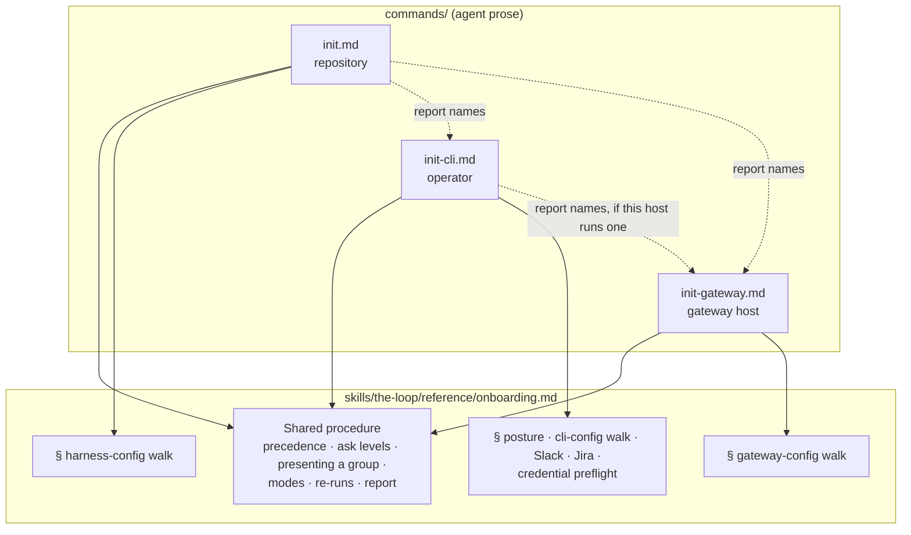

# Design: split `/the-loop:init` into `/init`, `/init-cli` and `/init-gateway`

> Phase 2 of 3 (requirements → design → tasks). Derives from the approved
> [requirements](requirements.md). `test-planning` and `tasks-breakdown` were skipped at
> phase-selection, so this document also carries the verification plan (§ Testing
> strategy) and the build order (§ Implementation order).

## Overview

`commands/init.md` is cut into three command files that share one procedure. Each of
today's eleven steps moves, whole, to exactly one command. The onboarding procedure stays
in the skill's `reference/onboarding.md`; that file is reorganised **per file** rather than
per run, so each command reads the sections for the configs it owns. No schema shape, no
template and no CLI verb changes. The only Python edit is two user-facing strings in
`migrations.py`, which name the command that now adds a Jira block.

## Architecture

### Where each of today's steps goes

The table is the no-behaviour-lost check (NFR 1). Every row of today's `commands/init.md`
has exactly one owner.

| Today's step (`commands/init.md`) | New owner | Change |
|---|---|---|
| Modes: `--dry-run`, `--defaults` | all three | Same semantics, per command (R4.1). |
| 1 Detect: instruction docs, integration-test globs, API contracts | `/init` | Unchanged. |
| 1 Detect: `owner/repo` for the CLI's `repositories` | `/init-cli` | Moves with the CLI config it feeds. |
| 1 Detect: deployment shape | `/init-cli` | Moves with the posture question. |
| 2 Harness-config walk | `/init` | Unchanged. |
| 3 Posture: deployment shape + autonomy profile | `/init-cli` | Unchanged wording. |
| 4 CLI-config location + walk, incl. the `gateway` ingress block | `/init-cli` | Unchanged. |
| 4 "Do you run the gateway on this machine?" → walk `gateway-config` | split | `/init-cli` keeps the question and **names** `/init-gateway` in its report; the walk itself moves to `/init-gateway` (R2.6, R3.2). |
| 5 Slack, then Jira | `/init-cli` | Unchanged. |
| 6 Reconcile: `.the-loop/harness-config.yaml`, `manifest.yaml`, `collaborators.yaml`, docs trees | `/init` | Unchanged. |
| 6 Reconcile: CLI config | `/init-cli` | Unchanged. |
| 6 Reconcile: `gateway-config.yaml` | `/init-gateway` | Now asks its own location (R3.3). |
| 7 `loop:<phase>` labels | `/init` | Unchanged (R1.4). |
| 7 `routing.autoExecuteLabels` labels | `/init-cli` | For each repository in `polling.sources` / `repositories` (R2.3). |
| 8 Validate harness + collaborators | `/init` | Unchanged. |
| 8 Validate CLI config | `/init-cli` | Unchanged. |
| 8 Validate gateway config | `/init-gateway` | Unchanged. |
| 8 Confirm collaborators | `/init` | Unchanged. |
| 9 Hooks & CI parity | `/init` | Unchanged. |
| 10 Credential preflight + `channels status` / `doctor` | `/init-cli`; `/init-gateway` for the gateway's own secrets | `/init` checks no credential (abuse case 2). |
| 11 Report | all three | Each names what it did not do and who does it (R1.6, R2.6). |

### Two cross-command hand-offs

- **`/init` → `/init-cli`.** `/init` never writes a CLI config. When one already exists in
  the repository it is listed under *skipped* with a pointer (R1.7). When none exists, the
  report's last block reads: *"No CLI or gateway setup was done. If this repository is
  your operator repository — the one that runs the-loop's daemon — run
  `/the-loop:init-cli`. If this machine also hosts a the-loop gateway, run
  `/the-loop:init-gateway`."*
- **`/init-cli` → `/init-gateway`.** `/init-cli` still asks the issue-496 question
  *"will this instance read its events from a gateway, or run its own receiver?"*. The
  answer fills the `gateway` ingress block, as today. If the user adds that **they run
  the gateway on this machine**, `/init-cli` does not walk the gateway schema. It names
  `/the-loop:init-gateway` under **needs-user**.

## Components & interfaces

### `commands/init.md` (rewritten, smaller)

- **Front matter:** `description` becomes *"Initialize the-loop in this repository —
  harness config, collaborators, the docs trees and the phase labels, via a guided,
  schema-driven onboarding. Sets up no daemon: that is /the-loop:init-cli."*
  `argument-hint` stays `[--dry-run] [--defaults]`.
- **Steps:** detect → harness-config walk → reconcile → phase labels → validate + confirm
  collaborators → hooks & CI parity → report. That is today's steps 1, 2, 6, 7, 8, 9 and
  11, restricted to the rows the table gives `/init`.
- **Opening paragraph:** the "two configs" promise becomes one: a config the user
  understands, the docs trees, and the labels. *"What will this do while I am not
  looking"* moves to `/init-cli`, where it is true.

### `commands/init-cli.md` (new)

- **Front matter:** `description`: *"Initialize the-loop's CLI daemon config
  (cli-config.yaml) for the operator — where it runs, how much runs unattended, ingress,
  Slack, Jira, the arming labels and the credentials they need. Run once, in the operator
  repository or for ~/.the-loop/."* `argument-hint: "[--dry-run] [--defaults]"`.
  `allowed-tools` as `/init`.
- **Steps:** detect (`owner/repo`, deployment shape) → posture → location + CLI-config
  walk (gateway ingress question included) → Slack, then Jira → reconcile the CLI config
  and `slack-app-manifest.json` → arming labels → validate → credential preflight +
  verify → report. These are today's steps 3, 4, 5, 6 (CLI rows), 7 (arming labels), 8
  (CLI row), 10 and 11, with the text carried over rather than paraphrased.
- **Independence (R2.4):** the command opens by saying it needs no
  `.the-loop/harness-config.yaml` and writes nothing outside the CLI config's directory,
  except labels on the routed repositories.

### `commands/init-gateway.md` (new)

- **Front matter:** `description`: *"Initialize a the-loop gateway's config
  (gateway-config.yaml) on the machine that runs it — the listener, the store, the GitHub,
  Jira and Slack transports, and the repositories it may start work in."*
  `argument-hint: "[--dry-run] [--defaults]"`.
- **Steps:** location question (repository `.the-loop/` or `~/.the-loop/`) → walk
  `gateway-config.schema.json` `x-onboarding.groups` → reconcile from
  `templates/gateway-config.yaml`, modeline first → validate → credential preflight for
  each `*Env` name the file declares → report.
- **Reminder in the report:** each instance that reads from this gateway needs the
  `gateway` block in its CLI config, which `/the-loop:init-cli` establishes, and
  `channels.slack.read.mode: gateway` when its Slack channel is enabled (issue-503).

### `skills/the-loop/reference/onboarding.md` (reorganised)

- **Title and intro:** *"the guided config walkthrough `/init`, `/init-cli` and
  `/init-gateway` run"*.
- **§ Two configs, one procedure** becomes **§ Three configs, three commands, one
  procedure**: the existing table gains a *Command* row and a gateway column, and the
  paragraph about the gateway file becomes that column.
- **§ The deployment shape, § The autonomy ladder, § Jira onboarding, § The credential
  preflight** each gain a first line, *"Run by `/init-cli`"* (the preflight: *"…and by
  `/init-gateway` for the gateway's own secrets"*). Their content is unchanged.
- **§ Modes, § Re-runs, § After the walkthrough** say *"each command"* where they say
  *"init"* or *"both walkthroughs"*. The `--defaults` gap list is split by the command
  that raises each gap.

### Other edits (R5)

| File | Edit |
|---|---|
| `skills/the-loop/SKILL.md` | § Commands: two new bullets; the `/init` bullet loses nothing it still does. Reference-list line for `onboarding.md`. |
| `skills/the-loop/reference/instructions.md`, `workflow.md` | `/init` mentions stay; they describe repository-side work. No edit unless a line says CLI. |
| `docs/reference/commands.md` | Superset table: rows for `/the-loop:init-cli` and `/the-loop:init-gateway`; the `/init` row says "repository only". |
| `docs/guide/onboarding.md` | Split into *What `/init` asks* and *What `/init-cli` asks*, with one paragraph on `/init-gateway`; the "two questions only you can answer" belong to `/init-cli`. |
| `docs/guide/quickstart.md`, `installation.md` | `/init` in every repository; `/init-cli` once, for the operator. |
| `docs/guide/gateway.md`, `slack.md` | "`/the-loop:init` asks…" → `/the-loop:init-cli` (and `/init-gateway` for the gateway file). |
| `docs/config/index.md`, `docs/config/cli/index.md`, `docs/config/harness-config.md` | Installed-by row: the CLI config by `/the-loop:init-cli`. |
| `docs/operating-model/index.md` | The onboarding row names the three commands. |
| `rules/the-loop.mdc` | Unchanged: it points a repository with no `.the-loop/` at `init`, which is still right. |
| `.the-loop/manifest.yaml` | The `cli-config.yaml` and `slack-app-manifest.json` comments name `/the-loop:init-cli` (R5.2). |
| `.the-loop/cli-config.schema.json` + `cli/the_loop/schemas/cli-config.schema.json` | `x-onboarding.description` string only: `/the-loop:init` → `/the-loop:init-cli`. See § Trade-offs. |
| `commands/upgrade-the-loop.md` | The `cli-config` scaffold question and the Slack manifest line point to `/the-loop:init-cli` (R5.4). |
| `commands/create-ticket.md` | Unchanged: phase labels are still `/init`'s. |
| `cli/the_loop/migrations.py` | The two Jira messages say *re-add it with /the-loop:init-cli*. |
| `docs/capabilities/distribution.md` | New SHALL lines for the three commands; history row for issue-514 (R5.3). |
| `docs/decisions/decision-149.md` + index | The split, its rationale and the four confirmed defaults. |
| `CHANGELOG.md` | Untouched: commitizen writes it at release. |

## UI/UX design

N/A. The surface is slash-command prose in a terminal, with no visual artifact.

## Data models

None change. `harness-config.schema.json`, `collaborators.schema.json`,
`cli-config.schema.json` and `gateway-config.schema.json` keep their shape and their
`x-onboarding` groups. Only the CLI schema's description string is edited.

## Error handling

- **A schema cannot be read from the plugin** (fail closed, from requirements): the
  command stops before writing that config, and its report names the missing path under
  `manifest.schemasDir`. Today's text implies this; each command now states it in its
  validate step.
- **`/init-cli` run where no `.the-loop/` exists:** this is normal. With the in-repository
  location answer it creates `.the-loop/cli-config.yaml` alone, as today.
- **`/init` run in a repository that already holds a CLI config:** the config is listed
  under *skipped*, with its path and the `/init-cli` pointer (R1.7), never edited.
- **A user who expects the old `/init`:** the final report is the signal (R1.6). No
  deprecation shim is added, because nothing is removed, only moved.

## Security design

Each boundary from the requirements' security considerations, and how it holds:

- **AuthN/AuthZ:** unchanged. The commands run as the local user, and `routing.authorizedUsers`
  is still established by name in the CLI walk, now in `/init-cli`.
- **Input validation & injection surfaces:** repository files that detection reads
  (`CONTRIBUTING.md`, test directories, API contracts) are data. Detection only proposes
  paths, and the user confirms each one, as today. No new input.
- **Secrets handling:** the credential-preflight section is the one source. `/init-cli`
  and `/init-gateway` cite it, and `/init` does not include it. Abuse case 1 (presence
  only, nothing written) is the section's existing rule. Abuse case 2 holds because
  `/init`'s step list has no preflight step and its text names no `*Env` key.
- **Least privilege:** `/init` loses label-creation rights it no longer needs on the
  arming labels. `/init-cli` creates arming labels only in repositories the config routes.
- **Fail-closed behaviour:** schema unreadable → stop before writing (§ Error handling).
  `--dry-run` writes nothing in all three.
- **Abuse-case coverage:** 1 and 3 → existing preflight and validate rules, cited by each
  command; checked in the dry-run walkthroughs below. 2 → `/init`'s text has no
  preflight. A test asserts `commands/init.md` names no `*Env` credential key.

## Testing strategy

The change is agent prose, so it is proved two ways: a few repository tests that hold the
structure, and a dry run of each command by a real harness against a scratch repository.

**Tests (pytest, `cli/tests/`):**

- `test_init_commands.py`, new:
  - `Scenario: every shipped slash command is listed in the command reference and the
    skill`. Every `commands/*.md` stem appears as `/the-loop:<stem>` in
    `docs/reference/commands.md` and in `SKILL.md` § Commands (R2.1, R3.1, R5.1). The
    guard is general, so the next command added cannot be forgotten either.
  - `Scenario: /init sets up no daemon`. `commands/init.md` mentions none of
    `cli-config.yaml`, `gateway-config.yaml`, `slack-app-manifest`, `autoExecuteLabels`
    or a `*Env` key, except in its hand-off paragraph naming `/init-cli` and
    `/init-gateway` (R1.2, R1.3, abuse case 2).
  - `Scenario: each init command offers both modes`. Each of the three files has
    `argument-hint: "[--dry-run] [--defaults]"` and a Modes section (R4.1).
- `test_migrations.py`: the two Jira assertions change from `"/the-loop:init"` to
  `"/the-loop:init-cli"`. Red first against the old strings, then green.
- The existing `test_onboarding_schema.py`, `test_manifest_schemas.py` and the
  schema-copy parity checks keep passing. They prove the description edit is the only
  schema change.

**Dry-run walkthroughs (verification evidence):** in a scratch `git init` repository with
a fake `origin`, run each command non-interactively through the plugin from this checkout:
`claude -p --plugin-dir <checkout> "/the-loop:<cmd> --dry-run"`. Check from its report
that:

1. `/init` lists only the repository files and labels and names `/init-cli` /
   `/init-gateway`.
2. `/init-cli` lists only the CLI config, the Slack manifest and the arming labels, and
   reports credentials by name only.
3. `/init-gateway` lists only `gateway-config.yaml`.
4. Nothing was written: `git status` is clean afterwards.

The reports are committed, redacted, as `evidence/dry-runs.md`.

The full suite (`make` targets / pre-commit: ruff, pyright, pytest, markdownlint, config
validation) runs before each push.

## Implementation order

1. Tests first: `test_init_commands.py` and the `test_migrations.py` assertion change
   (red).
2. `commands/init.md` rewrite; `commands/init-cli.md`, `commands/init-gateway.md` new.
3. `reference/onboarding.md` reorganisation; `SKILL.md` § Commands.
4. `migrations.py` strings; manifest comments; the two schema description strings.
5. User docs and the capability doc; decision-149.
6. Green suite, then the dry-run walkthroughs, then the review chain.

## Trade-offs & decisions

- **One shared procedure, three thin commands, not three copies.** Copying the walkthrough
  rules into each command would triple the prose that drifts. The commands own their
  *steps*; `reference/onboarding.md` keeps the *how*. This matches how `/init` already
  defers to it.
- **The schema description string is edited, though requirements put schema changes out
  of scope.** The `x-onboarding.description` of `cli-config.schema.json` says
  *"the onboarding `/the-loop:init` runs over THIS file"*, which becomes false. Editing
  that string changes no key, type, default or group, and both copies are edited
  together. **This is the one point where design reads the requirements' "no schema
  change" as "no shape change". Confirm or overrule it at the design gate.**
- **No compatibility alias.** `/init` keeps its name and its repository role, so a user
  who runs it gets a correct, smaller result and a pointer to the rest. An alias such as
  `/init --with-cli` would bring back the coupling the issue removes.
- **The gateway question stays in `/init-cli`.** An instance has to know whether it
  *reads from* a gateway to fill its own ingress block. Only *hosting* one moves out.
- **Durable decision:** recorded as `docs/decisions/decision-149.md` (the three-way split
  and the four defaults confirmed at the requirements gate).

## Open questions

None blocking. The schema-description point above is the one item for the design gate.

## Review comments

> Appended by the-loop's `record-feedback` hook when a human gate approves with
> comments (issue-109). Append-only and attributed: an approval never silently
> discards a reviewer's suggestions, and the feedback travels with the document
> it concerns rather than living in a side-channel tracker.

### 2026-10-20 — approved

**@MadaraUchiha-314** wrote:

approved
