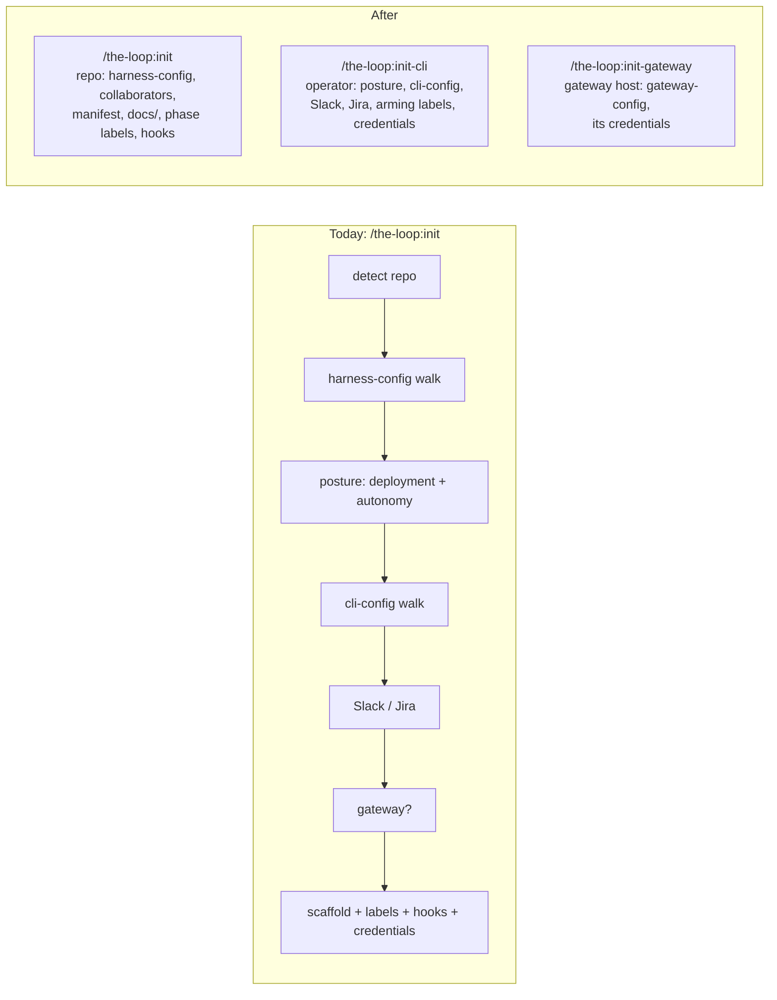

# Requirements: split `/the-loop:init` into `/init`, `/init-cli` and `/init-gateway`

> Phase 1 of 3 (requirements → design → tasks). Tier 3 (`human-approves-pr`): the
> change rewrites command prose, the onboarding reference and the user docs. It adds no
> CLI verb, changes no schema and moves no file a project already has.

## Introduction

[Issue #514](https://github.com/MadaraUchiha-314/the-loop/issues/514), from the owner:
`/the-loop:init` does too much for most of the repositories it runs in.

Today one command does three jobs. It walks the harness config (the agent's per-repo
file), then the CLI config (the operator's daemon file), then, if asked, the gateway
config. Only one repository in a deployment is the **operator** repository, the one that
holds the daemon's config. Every other repository that *uses* the-loop needs just the
plugin, `.the-loop/harness-config.yaml` and the `docs/` trees. Running `/init` there
still opens with *"where will the daemon run?"* and *"how much should it do unattended?"*.
Those questions do not apply to that repository, and a user cannot skip them without
knowing they are optional.

The ask: the plain `/init` does the repository part **only**. CLI setup moves to a
separate `/init-cli`, and gateway setup to `/init-gateway`.

Each of the three commands is idempotent, non-clobbering and supports `--dry-run` and
`--defaults`, the same contract `/init` keeps today. Each one walks its own schema's
`x-onboarding` groups with the procedure in the skill's `reference/onboarding.md`.

## Requirements

### Requirement 1 — `/the-loop:init` initializes the repository only

**User story:** As a developer adding the-loop to a repository that just *uses* it, I want
`/init` to set up only what that repository needs, so that I am not asked about a daemon,
Slack or a gateway I will never run from here.

#### Acceptance criteria (EARS)

1. WHEN `/the-loop:init` runs THEN the system SHALL scaffold, where missing,
   `.the-loop/harness-config.yaml`, `.the-loop/manifest.yaml`,
   `.the-loop/collaborators.yaml` and the docs trees (`docs/architecture/architecture.md`,
   `docs/decisions/decisions.md`, `docs/specs/`, `docs/capabilities/`,
   `docs/learnings/learnings.md`), as it does today.
2. WHEN `/the-loop:init` runs THEN the system SHALL walk the harness-config onboarding
   (`harness-config.schema.json` → `x-onboarding.groups`) and SHALL NOT ask the
   deployment-shape question, the autonomy-profile question, the CLI-config location
   question, or any CLI-config, Slack, Jira or gateway question.
3. WHEN `/the-loop:init` runs THEN the system SHALL NOT create or modify any CLI config
   (`.the-loop/cli-config.yaml` or `~/.the-loop/cli-config.yaml`),
   `slack-app-manifest.json` or `gateway-config.yaml`.
4. WHEN `/the-loop:init` runs on a GitHub-ticketed repository THEN the system SHALL create
   the missing `loop:<phase>` labels, as it does today. These labels describe the
   repository's own tickets, so they stay with `/init`.
5. WHEN `/the-loop:init` runs THEN the system SHALL keep wiring local hooks and CI parity
   only where the project has none of its own, as it does today.
6. WHEN `/the-loop:init` finishes THEN its report SHALL say that no CLI or gateway setup
   was done, and SHALL name `/the-loop:init-cli` and `/the-loop:init-gateway` as the
   commands for that, with one line on who needs each.
7. IF a CLI config already exists in the repository WHEN `/the-loop:init` runs THEN the
   system SHALL leave it untouched and SHALL mention it in the report under *skipped*,
   pointing to `/the-loop:init-cli` for any change.

### Requirement 2 — `/the-loop:init-cli` initializes the operator's CLI config

**User story:** As the operator who runs the-loop's daemon, I want a dedicated command for
the CLI config, so that the daemon's setup is a deliberate step I take once, in the
operator repository or my home directory.

#### Acceptance criteria (EARS)

1. The system SHALL ship a `/the-loop:init-cli` command (`commands/init-cli.md`) for every
   harness that ships `commands/`.
2. WHEN `/the-loop:init-cli` runs THEN the system SHALL carry out what today's `/init`
   steps 3, 4 (minus the gateway-config part), 5 and 10 do for the CLI config: the
   deployment shape and autonomy profile, the location question (repository or
   `~/.the-loop/`), the `cli-config.schema.json` walk (including the `gateway` ingress
   block for an instance that *reads from* a gateway), Slack, Jira, and the credential
   preflight for the variables the CLI config names.
3. WHEN `/the-loop:init-cli` runs THEN the system SHALL create the
   `routing.autoExecuteLabels` entries in the repositories the config routes, where
   routing was enabled and the labels are missing.
4. WHEN `/the-loop:init-cli` runs THEN the system SHALL NOT require `.the-loop/harness-config.yaml`
   to exist and SHALL NOT create or modify it, the docs trees or the phase labels.
5. WHEN `/the-loop:init-cli` writes a CLI config THEN the system SHALL validate it against
   the plugin's `cli-config.schema.json`, read from `manifest.schemasDir` on disk.
6. WHEN `/the-loop:init-cli` finishes THEN its report SHALL name the autonomy profile
   applied (or say plainly that no automation is enabled), list every credential still
   missing by variable **name**, and name `/the-loop:init-gateway` when the user said this
   machine runs the gateway.

### Requirement 3 — `/the-loop:init-gateway` initializes a gateway host

**User story:** As the person who runs a the-loop gateway for several instances, I want its
config set up by its own command, so that gateway setup is neither buried inside CLI
onboarding nor offered to people who will never run one.

#### Acceptance criteria (EARS)

1. The system SHALL ship a `/the-loop:init-gateway` command (`commands/init-gateway.md`).
2. WHEN `/the-loop:init-gateway` runs THEN the system SHALL establish `gateway-config.yaml`
   by walking `gateway-config.schema.json` → `x-onboarding.groups`, scaffolded from
   `templates/gateway-config.yaml` with the modeline kept as the first line.
3. WHEN `/the-loop:init-gateway` runs THEN the system SHALL ask where the file lives
   (beside a CLI config in this repository, or `~/.the-loop/`) and SHALL NOT assume either.
4. WHEN `/the-loop:init-gateway` writes the file THEN the system SHALL validate it against
   the plugin's `gateway-config.schema.json` and SHALL run the credential preflight
   (presence only) for every secret variable the file names.
5. WHEN `/the-loop:init-gateway` runs THEN the system SHALL NOT create or modify the harness
   config, the CLI config, the docs trees or any label.

### Requirement 4 — the three commands share one contract

**User story:** As a user of any of the three commands, I want them to behave the same
way, so that learning one teaches me the others.

#### Acceptance criteria (EARS)

1. Each of `/init`, `/init-cli` and `/init-gateway` SHALL accept `--dry-run` (print the
   report, write nothing, ask nothing) and `--defaults` (ask nothing, default everything,
   list gaps under **needs-user**).
2. Each SHALL be idempotent and non-clobbering per `.the-loop/manifest.yaml`: it creates
   only what is missing and never overwrites a user-owned file.
3. On a re-run, each SHALL raise only gaps (empty required keys, `# TODO: verify` lines,
   keys added by an upgrade) and SHALL NOT re-ask what is already established.
4. Each SHALL end with the **created / skipped / drifted / needs-user** report and the next
   action.

### Requirement 5 — docs and references move with the split

**User story:** As a reader of the-loop's docs, I want every page that describes `/init`
to describe the new split, so that no page tells me `/init` will ask about the daemon.

#### Acceptance criteria (EARS)

1. WHEN this work item merges THEN the skill (`SKILL.md` § Commands,
   `reference/onboarding.md`), `docs/reference/commands.md`, `docs/guide/onboarding.md`,
   `docs/guide/quickstart.md`, `docs/guide/installation.md`, `docs/guide/gateway.md`,
   and `docs/guide/slack.md` SHALL describe the three commands wherever they
   now describe CLI or gateway setup as part of `/init`.
2. WHEN this work item merges THEN `.the-loop/manifest.yaml`'s optional `cli-config.yaml`
   and `slack-app-manifest.json` entries SHALL name `/the-loop:init-cli` as the command
   that scaffolds them.
3. WHEN this work item merges THEN the affected capability docs (`distribution.md` at
   least) SHALL state the new behaviour with a history row for issue-514.
4. WHEN this work item merges THEN `/the-loop:upgrade-the-loop` SHALL point to the command
   that owns a missing file (`/init-cli` for a CLI config, `/init-gateway` for a gateway
   config) wherever it now says `/init`.

## Non-functional requirements

- **No behaviour lost.** Every step of today's `/init` lands in exactly one of the three
  commands. Design records that mapping step by step.
- **No new code path in the CLI.** The commands are agent prose. The onboarding schemas and
  their `x-onboarding` groups stay as they are; the schema-consistency tests
  (`test_onboarding_schema.py`, `test_manifest_schemas.py`) keep passing unchanged.
- **Discoverability.** A user who runs only `/init` is told the other two exist, and what
  each is for, in the final report (R1.6).

## Security considerations

No new attack surface. The change splits existing agent instructions across three
commands. It adds no network call, no CLI verb, no token handling and no new input.

- **Actors & trust:** the user running the command (trusted, local); the repository's
  existing files (read, never trusted as instructions); the shipped schemas and templates
  (the plugin's, read from disk).
- **Trust boundaries & data:** credentials are handled exactly as today. They are
  referenced by environment-variable **name** in the configs, and their presence is
  reported only by `/init-cli` and `/init-gateway`. The split narrows exposure: `/init` no
  longer touches anything credential-bearing.
- **Abuse cases (EARS):**
  1. WHEN any of the three commands runs the credential preflight THEN the system SHALL
     report presence only, never a value, prefix, length or hash, and SHALL NOT write a
     credential into any file.
  2. WHEN `/the-loop:init` runs THEN the system SHALL NOT read, print or check any
     credential variable.
  3. WHEN a command validates a config THEN the system SHALL read the schema from the
     plugin on disk and SHALL NOT fetch one over the network.
- **Fail closed:** IF the schema a command needs cannot be read from the plugin THEN that
  command SHALL stop before writing its config and report the missing schema, rather
  than write an unvalidated file.

## Out of scope

- Changing any config schema, template or `x-onboarding` group.
- A CLI verb (`the-loop init …`). These remain slash commands.
- Splitting `/the-loop:upgrade-the-loop`. It keeps reconciling every manifest entry, and
  only its pointers change (R5.4).
- A Codex slash-command surface. Codex ships `skills/` only today, and this item does not
  change that.

## Open questions

Assumed defaults, open to change at the requirements gate:

1. **`collaborators.yaml` stays with `/init`.** The issue names only the harness config,
   but the skill reads `collaborators.yaml` for people and approver roles in every
   repository. It is a per-repository file, not an operator one.
2. **`loop:<phase>` labels stay with `/init`**, and the `routing.autoExecuteLabels`
   arming labels move to `/init-cli`. Phase labels describe a repository's tickets, while
   arming labels exist only because a daemon routes that repository.
3. **No `--only-harness` flag.** The issue's first bullet asks for "an option" and its
   later bullets make that the default of `/init`. Making it the default needs no flag.
4. **`/init-cli` does not run `/init` first.** The CLI config is independent of any
   repository (decision-032), so the operator repository runs both commands, and no
   other repository runs `/init-cli`.

## Review comments

> Appended by the-loop's `record-feedback` hook when a human gate approves with
> comments (issue-109). Append-only and attributed: an approval never silently
> discards a reviewer's suggestions, and the feedback travels with the document
> it concerns rather than living in a side-channel tracker.
