# Design: hand a conversation to the-loop from any surface, at any stage

> Phase 2 of 3 (requirements → design → tasks). `requirements-approval` was declared
> skipped at phase selection, so `requirements.md` is reviewed and locked with this
> design and the testing plan at `design-approval`.

## Overview

**A handoff is a pre-filled phase selection.** The handoff skill files the issue and
posts a signed, hashed **handoff record**. When the poller arms the item, it reads that
record into `work-item-state.json`. The phase-selection checklist then renders the
phases before the starting step **unticked**. The developer's ordinary
`the-loop execute` reply turns those unticked rows into declared skips. A new first
node, `import-handoff`, materializes and checks the carried files. If a file fails its
check, the node un-skips the phase that produces it. From there the walk is the
existing graph.

This reuses three mechanisms that already exist:

- **Declared skips** (`Runtime._route_skips`, `declared_skips`) move the pointer.
- **The phase-selection gate** stays the only act that authorizes a walk, as
  decision-068 requires. A handoff never moves a pointer by itself.
- **The approval gates** lock artifacts exactly as they do today (R8).

What is new: the skill, the record format and its parser, a `handoff` block in state,
the checklist's per-item default, the `import-handoff` node and its hook, a spec-branch
checkout, two Jira fields, and a recorded spec-chain artifact URL.

## Architecture

```mermaid
sequenceDiagram
  autonumber
  actor Dev as Developer
  participant Skill as handoff skill
  participant GH as GitHub issue
  participant Jira as Jira copy
  participant Poller as CLI poller / dispatcher
  participant RT as graph runtime
  participant S as loop session

  Dev->>Skill: "hand this to the-loop"
  Skill->>Skill: draft artifacts + interview (preselected)
  Dev->>Skill: confirm summary
  Skill->>GH: create issue (loop:<phase>) or attach
  opt Jira selected
    Skill->>Jira: create (type, parent epic, the-loop-mirror label)
  end
  opt repo checked out
    Skill->>GH: push spec branch, draft PR (the-loop pr create)
  end
  Skill->>GH: post handoff record (+ parts)
  opt run now / queue
    Skill->>GH: auto-execute labels (+ "the-loop start")
  end
  Poller->>GH: list comments, find_record()
  Poller->>Poller: prepare workspace (spec branch if named)
  Poller->>RT: start(handoff=record)
  RT->>GH: phase-selection checklist, earlier phases unticked
  Dev->>GH: the-loop execute
  RT->>S: spawn at import-handoff
  S->>S: materialize files, commit, adopt artifact
  S->>RT: graph complete → import-handoff hook
  RT->>RT: shape + hash check; un-skip on failure
  RT->>GH: first approval gate asks (e.g. requirements-approval)
```

The pointer walks the shipped graph with one node added:

```mermaid
flowchart LR
  ps[phase-selection] -->|selected| ih[import-handoff]
  ih -->|pass / skipped| bs[brainstorming]
  bs -.skipped.-> ba[brainstorm-approval]
  ba -.skipped.-> rd[requirements-definition]
  rd -.skipped.-> ra[requirements-approval]
  ra --> d[design] --> tp[test-planning] --> da[design-approval]
```



For *requirements settled*, the dashed edges are declared skips, and the walk lands on
`requirements-approval`. With no handoff, `import-handoff` is itself skipped and the
walk is the same as today.

## Components & interfaces

| # | Component | Where | Requirements |
|---|---|---|---|
| C1 | Handoff skill | `skills/handoff/SKILL.md` + `commands/handoff.md` | R1, R2, R4, R5.1–5.3 |
| C2 | Handoff record format and parser | `cli/the_loop/core/handoff.py` | R5, security |
| C3 | `the-loop handoff` CLI verb | `cli/the_loop/commands/handoff_cmd.py` | R1.4, R5.2, R5.4, R7.2 |
| C4 | Ticket creation additions | `core/tickets.py`, `jiraapi.py`, `commands/github_cmd.py`, API/MCP routes | R3 |
| C5 | Poller pick-up | `webhook/dispatcher.py`, `graphlink.py` | R6.1, R6.2 |
| C6 | Runtime + state | `graph/runtime.py`, `graph/state.py` | R6.1, R6.3, R7.3 |
| C7 | Checklist default | `graph/hooks/selection.py` | R6.4, R6.5 |
| C8 | `import-handoff` node + hook | `graph/pdlc-work-item-loop.yaml`, `graph/hooks/handoff.py` | R7 |
| C9 | `$graph_context` line | `graphlink.render_graph_context` | R6.1, R7.4 |

### C1 — Handoff skill

The skill ships as a plain skill folder, so the same file loads in Claude Code (as
`/the-loop:handoff`) and in the Claude chat and desktop apps as an uploaded skill
(owner decision 2). The skill:

1. **Drafts** from the conversation, plus `docs/specs/draft-*/` when a checkout exists,
   using the bundled templates. A chat that never ran `/brainstorm` becomes a
   `brainstorm.md` whose *Options considered* section keeps the rejected options.
2. **Picks a transport** in the R1.4 order. It uses the-loop CLI when `the-loop --version`
   runs, otherwise a GitHub/Atlassian connector, otherwise `gh`. Every later step goes
   through the chosen transport, and the confirmation summary names it.
3. **Interviews** with `AskUserQuestion` (or the surface's question tool). It asks four
   questions of at most four options each, preselected (R2). Free-text fields are
   checked as entered: `OWNER/REPO` against `^[\w.-]+/[\w.-]+$`, and the Jira project
   against `integrations.jira.projects`. With the CLI, that check is a new read-only
   `the-loop ticket projects` subcommand (C4). Without it, there is no config to read, so the Jira option
   is offered only when a CLI is present. The summary says so.
4. **Refuses in `work-item` mode** (R2.10). A daemon-spawned session is launched without
   `AskUserQuestion` (issue-426), so the skill stops and says a handoff needs the
   developer present.
5. **Posts after confirmation only** (R1.5), in this order: issue → Jira copy → spec branch
   and draft PR → spec-chain artifact → handoff record → arming. A record posted last
   cannot point at something that failed to exist.

"Run now" adds every auto-execute label and posts `the-loop start` as the developer
(owner decision 3). "Queue it" adds the labels only. "Continue in this session"
registers the session and runs `/the-loop:work-on <id>` in place. "Just file it" posts
the issue and the record only.

### C2 — Handoff record (`core/handoff.py`)

```python
@dataclass(frozen=True)
class HandoffArtifact:
    name: str            # one of CHAIN = brainstorm.md, requirements.md|bugfix.md,
                         # design.md, testing-plan.md
    sha256: str          # of the file's exact bytes (LF line endings)

@dataclass(frozen=True)
class HandoffRecord:
    version: int                     # 1
    stage: str                       # exploring | brainstorm-settled |
                                     # requirements-settled | design-settled
    enter: str                       # node id; must equal STAGE_ENTRY[stage](artifacts)
    artifacts: Tuple[HandoffArtifact, ...]
    carried_by: str                  # branch | ticket | artifact
    branch: str = ""                 # carried_by == branch
    pull_request: int = 0
    spec_artifact: str = ""          # claude.ai artifact URL
    source: str = ""                 # "from": surface · date
    approved_in_chat: Tuple[str, ...] = ()
    mirror: str = ""                 # jira:<site>/<KEY>
    confirmation: str = ""           # the developer's quoted confirmation
    parts: Tuple[str, ...] = ()      # continuation comment ids
    author: str = ""                 # filled by the reader, never by the text
    comment_url: str = ""

def parse(body: str) -> Optional[HandoffRecord]: ...
def render(record: HandoffRecord) -> List[str]: ...   # record + parts, each ≤ 65,536
def find_record(comments, is_authorized, is_self) -> Tuple[Optional[HandoffRecord], str]:
    """Newest well-formed v1 record whose author is authorized or the-loop itself;
    the second value names why each rejected one was rejected (for the event log)."""
```

`STAGE_ENTRY` is the table under R6, written as a function of the stage and of whether
`testing-plan.md` is in the artifacts. The parser refuses a record whose `enter` differs
from `STAGE_ENTRY`, or that names a node outside `{brainstorming, brainstorm-approval,
requirements-approval, test-planning, design-approval}`. That rejection is abuse case 2.

The wire format is the one in the issue, opening with `<!-- the-loop:handoff v1 -->`.
`artifacts:` lists `name sha256:<hex>` per file. With `carried-by: ticket`, each file
follows in a `<details><summary>name</summary>` block with a fenced body. Files that
overflow go into part comments opening with
`<!-- the-loop:handoff-part v1 <n>/<N> -->`. A part counts only when the record's author
wrote it.

### C3 — `the-loop handoff` verb

- `the-loop handoff post --work-item <ref> --record <file.json> [--files <dir>]` renders
  the record and its parts, then posts them. Through the CLI the record is self-marked,
  so it is trusted as the-loop's own identity.
- `the-loop handoff show <id>` prints the record frozen in state (read-only).
- `the-loop handoff import <id> [--from-dir <dir>]` materializes the carried files into
  `docs/specs/<id>/`. It reads them from the checked-out branch, the ticket comments, or
  `--from-dir`, where the session has extracted the spec-chain artifact's files. It
  verifies every hash and refuses a mismatched file. It writes nothing it cannot verify.
- `the-loop handoff note <id>` edits the record to point at the committed files and the
  PR (R5.4). If the record isn't the-loop's own comment and can't be edited, it posts one
  follow-up comment that supersedes the record's `carried-by`.

### C4 — Ticket creation

- `the-loop ticket create` already takes a free-text body (R3.1 is met). The handoff
  calls it directly and leaves `/the-loop:create-ticket` unchanged.
- `--issue-type <name>` and `--parent <KEY>`, Jira only, pass through
  `create_ticket` → `JiraTickets.create(…, issue_type=None, parent="")` →
  `JiraClient.create_issue(…, issue_type, parent_key)`. That sets
  `fields["parent"] = {"key": parent_key}`, which is how Jira Cloud and DC 9+ link an
  epic. `--parent` is validated with the same `_PROJECT_KEY_RE` family as issue keys.
  The same two optional fields go into the `POST /work-items/tickets` body, the facade
  and the MCP tool.
- `the-loop ticket projects` (new, read-only) prints the keys under
  `integrations.jira.projects`, so the skill can check a project before creating.
- A Jira copy is created with the label **`the-loop-mirror`** and a description that
  opens with the GitHub issue URL. The GitHub issue body names the Jira key (R3.5).

### C5 — Poller pick-up

On the arming path, before `_prepare_workspace`, and only when the item has no state
yet, `Dispatcher` calls `poller.list_comments(item)` once and runs
`handoff.find_record` with `gate_authorized` and `is_self_authored`.

- With a record that names `branch`, `_prepare_workspace(…, branch=record.branch)`
  checks the spec branch out (R6.2).
- `graphlink.on_arm(…, handoff=record)` passes the record to `Runtime.start`.
- Every outcome emits `handoff.honoured` or `handoff.ignored` with the reason
  (NFR observability).

A Jira item labelled `the-loop-mirror` is refused at arming, with the event
`arm.refused reason=mirror` (abuse case 7).

### C6 — Runtime and state

- `Runtime.start(…, handoff=None)` writes `state.handoff = record.as_dict()` before the
  first save. This happens only inside the existing `if state.current_node: return None`
  guard, so a record posted or edited after the walk started never reaches state (abuse
  cases 3 and 6).
- New state fields:
  - `handoff`: the record, plus `author`, `commentUrl` and `recordedAt`.
  - `handoffDemoted`: a list of `{node, artifact, reason}`.
  - `claudeArtifactUrl`: a string (R7.4).
- `declared_skips` gains one rule, next to the opt-in rule: a node marked
  `requiresHandoff: true` is skipped with `{"via": "no-handoff"}` when `state.handoff`
  is empty. That keeps `import-handoff` out of every other item's walk (R7.1), with no
  edge special-casing.
- `the-loop check` renders a skip whose declaration carries `handoff: <commentUrl>` as
  *skipped by handoff (declared by @x)* (R6.3).

### C7 — Checklist default

`_checklist_body` today unticks `UNTICKED_BY_DEFAULT`. With `state.handoff` set, it also
unticks every skippable node before `handoff.enter`, and adds one line above the rows:
"Handed off by @dev at *requirements settled* ([record](…)) — earlier phases are unticked."
It pre-ticks the spec-chain artifact row when the record names one.

`classify_phase_selection` stamps each resulting skip that falls before `enter` with
`handoff: <commentUrl>`. The signer is still the replier. The person who said
`the-loop execute` owns the walk, which preserves decision-068 (R6.4).

### C8 — `import-handoff` node and hook

```yaml
  - id: import-handoff
    actor: agent
    skippable: true
    requiresHandoff: true      # skipped with via: no-handoff for every other item
    command: work-on
    entry: [deliver-assignment]
    exit: [import-handoff]     # hook: graph/hooks/handoff.py
# edges
  - {from: phase-selection, to: import-handoff, on: selected}   # replaces → brainstorming
  - {from: import-handoff, to: brainstorming, on: pass}
  - {from: import-handoff, to: brainstorming, on: skipped}
```

The session's assignment is:

1. Run `the-loop handoff import <id>`, after extracting the artifact's files first when
   the files ride only in the spec-chain artifact.
2. Commit the files.
3. Link the PR with `the-loop pr create --work-item` if none exists.
4. Set `claudeArtifactUrl` and republish to that URL (R7.4).
5. Run `the-loop handoff note`.
6. Run `the-loop graph complete`.

The **`import-handoff` hook** is deterministic. For each artifact the record names, in
chain order, it checks three things:

- the file exists,
- its committed bytes hash to the record's `sha256`,
- it passes the `validate-artifacts` section check of the node that produces it.

On the **first failure** it removes from `state.skips` that producing node and every
skipped node after it up to `enter`. It appends a `handoffDemoted` entry and returns
`pass`. The walk then routes into the producing node, which is earlier and never later
(R7.3). When no file can be verified at all, it un-skips `brainstorming` (R7.5).

Un-skipping only ever adds work, so an agent may trigger it. It never adds a skip.
Artifacts named in `approved-in-chat` get `status: approved` and
`approvedBy: [<record author>]` plus `approvedVia: handoff <commentUrl>` written by the
hook, not the session (R6.5). The furthest artifact is never in that list (R8.3); the
parser enforces this.

### C9 — `$graph_context`

When `state.handoff` is set, the block gains this line:

```text
handed off: stage <stage>, enter <enter>, carried by <carried_by>; record <commentUrl>
```

When `claudeArtifactUrl` is set, the existing artifact line names that URL as the one to
republish to.

## UI/UX design

N/A. The handoff interview runs in the harness's own question tool, and its only new
rendered surface is one line on the existing checklist comment (C7).

## Data models

`work-item-state.json` additions, all optional and absent on every existing item:

```json
{
  "handoff": {
    "version": 1, "stage": "requirements-settled", "enter": "requirements-approval",
    "artifacts": [{"name": "brainstorm.md", "sha256": "…"}, {"name": "requirements.md", "sha256": "…"}],
    "carriedBy": "branch", "branch": "the-loop/issue-42-x", "pullRequest": 43,
    "specArtifact": "https://claude.ai/artifact/…", "source": "Claude chat · 2026-10-21",
    "approvedInChat": ["brainstorm.md"], "mirror": "jira:acme/PROJ-123",
    "confirmation": "> yes, file it", "author": "dev", "commentUrl": "…", "recordedAt": "…"
  },
  "handoffDemoted": [{"node": "requirements-definition", "artifact": "requirements.md", "reason": "missing section Security considerations"}],
  "claudeArtifactUrl": "https://claude.ai/artifact/…"
}
```

The state schema (`docs/cli/state.md`) and `archive.py` pick up the three keys. The
graph schema adds `requiresHandoff` (boolean) to a node.

The spec-chain artifact embeds its files as
`<script type="application/json" id="the-loop-spec-files">[{"name","md"}]</script>`,
so a session can extract exactly the bytes the record hashed.

## Error handling

| Failure | Response |
|---|---|
| No record, or none valid | Item starts as today. `handoff.ignored` names each rejected record and why. |
| Comment listing fails at arming | Arming proceeds without a handoff. A warning event is emitted. Fails closed to "no handoff", never to a guessed stage. |
| Spec branch missing on the remote | The existing `WorkspaceError` path: the spawn fails and redelivery retries. |
| Artifact unreachable, or a hash mismatch | `the-loop handoff import` refuses that file. The hook demotes (C8). |
| Shape check fails | Demote to the producing node. Recorded in `handoffDemoted` and in `the-loop check`. |
| Record edit not permitted | `handoff note` posts a superseding comment instead. |
| Jira create fails after the GitHub issue exists | The skill reports it, posts the record without `mirror`, and continues. GitHub is the tracker. |

## Security design

- **AuthN/AuthZ:** `find_record` admits a record only when its author passes
  `is_authorized` against `routing.authorizedUsers` (the same `gate_authorized` set the
  phase-selection gate uses), or when it carries the self-marker and was posted by
  the-loop's identity (`is_self_authored`). The author comes from the API's comment
  metadata, never from the record text. Parts must share the record's author.
- **Input validation & injection surfaces:**
  - The record is parsed as a strict key–value block. Unknown keys and unknown versions
    reject the record (R5.5).
  - `enter` must equal `STAGE_ENTRY(stage, artifacts)` and lie inside the five allowed
    nodes, so no record reaches implementation (abuse case 2).
  - Artifact names are a closed set. No path ever comes from the record, which closes
    path traversal.
  - Branch names are checked with `git check-ref-format` and the `the-loop/` prefix
    before checkout.
  - Artifact bodies enter the session only as files under `docs/specs/<id>/` and through
    the assignment's standing rule that ticket text is data (abuse case 5). Nothing in a
    body is executed or templated.
- **Secrets handling:** no new secret. Jira and GitHub credentials stay variable names
  in `cli-config.yaml`. Connectors on chat surfaces use their own OAuth.
- **Least privilege:** the skill needs issue create/comment and, in a checkout, push to
  a `the-loop/` branch. The poller needs the comment listing it already has.
- **Fail-closed behaviour:** every unverifiable condition resolves to "no handoff", or
  to an earlier node, never a later one. Abuse cases 3 and 6 are closed by reading the
  record only when `state.current_node` is empty. The phase-selection reply stays the
  single authorizing act.
- **Abuse-case coverage:**

  | Abuse case | Mechanism | Negative test |
  |---|---|---|
  | 1 unauthorized record | `find_record` author check | record by a non-authorized login → `handoff.ignored`, default checklist |
  | 2 start past design-approval | `STAGE_ENTRY` + allowed set | `enter: implementation` → rejected |
  | 3 new record on a started item | `Runtime.start` guard | second record after start → state unchanged |
  | 4 artifact hash mismatch | `handoff import` + hook | tampered file → refused, demoted |
  | 5 instructions in a body | files-only ingress | body with an "ignore your rules" line → written verbatim, no behaviour change (prompt test) |
  | 6 record edited after start | same guard as 3 | edited comment → state unchanged |
  | 7 arming the Jira copy | `the-loop-mirror` refusal | label + arming comment on the mirror → `arm.refused` |

## Testing strategy

Unit tests cover `core/handoff.py`: parse/render round trips, every rejection reason,
`STAGE_ENTRY` per row of the R6 table, and part splitting at 65,536 characters. They
also cover the hook's demotion order. Runtime tests drive a fake work item through
`start(handoff=…)` → checklist render → `classify_phase_selection` → `import-handoff`
for each of the five table rows, plus a no-handoff item that must walk byte-for-byte as
today. Dispatcher tests use the existing GitHub and Jira fakes (`tests/jirafakes.py`)
for the arming path, branch checkout and the mirror refusal. The skill is proved by a
prompt-level scenario run in a scratch repository and by a dry run on a chat surface.
`testing-plan.md` carries the executable detail.

## Trade-offs & decisions

- **Keep phase selection instead of bypassing it.** The issue's "one command, one
  confirmation" would be literally true only if the chat confirmation authorized the
  walk. Decision-068 makes `phase-selection` the walk's one structural invariant, and
  bypassing it would give a comment's author power to declare skips without an
  authorized `the-loop execute`. The cost is one reply on the ticket. Pre-unticking makes
  that reply a single keyword. This is a candidate for a decision record at
  implementation.
- **Reuse declared skips rather than a "start node" override.** A per-item start node
  would be a second way to move a pointer, which `check`, `--recompute` and
  `skipped_artifacts` would each have to learn. Skips already carry provenance.
- **Per-file hashes instead of one artifact hash.** One hash over the artifact page
  would break on any republish. Per-file hashes cover every carrier: branch, ticket and
  artifact.
- **Jira mirror by label.** A Jira editor could remove the label. Doing so and then
  arming takes an authorized user acting on purpose, which the arming gate already
  attributes.

## Open questions

None open. The assumptions this design rests on are listed on PR #518 for the
`design-approval` review.

## Review comments

> Appended by the-loop's `record-feedback` hook when a human gate approves with
> comments (issue-109). Append-only and attributed.
