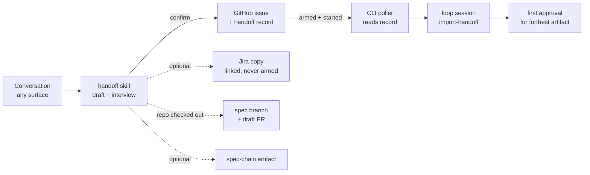

# Requirements: hand a conversation to the-loop from any surface, at any stage

> Phase 1 of 3 (requirements → design → tasks). Tier 3 (`human-approves-pr`): a new
> skill, a new graph node, a new machine-read comment format the poller trusts, and a
> wider Jira create call. `requirements-approval` was declared skipped at phase
> selection (comment of 2026-10-21T22:18:22Z), so these requirements lock with the
> design at `design-approval`.

## Introduction

[Issue #517](https://github.com/MadaraUchiha-314/the-loop/issues/517), from the owner: a
developer who has talked an idea through with Claude has no single way to hand it to
the-loop, and the three-command path that exists drops work on the floor.

Today the path is `/the-loop:brainstorm` → `/the-loop:new-requirement` →
`/the-loop:create-ticket`. Each step assumes a repository checkout and a
`docs/specs/draft-<slug>/` folder. Nothing turns an unstructured chat into
`brainstorm.md`. `create-ticket` needs a `requirements.md`. None of the three commits or
pushes, so the ticket links to a spec file that no remote branch holds. The poller then
walks the new item from the first phase and the loop redoes the work the developer already
did.

This item adds **one hand-off**: a skill that drafts what the conversation supports,
runs a short interview, files the GitHub issue (plus an optional linked Jira copy),
posts a machine-readable **handoff record**, and lets the poller and the spawned session
start the graph at the stage the developer reached.

### Decisions already taken by the owner

Recorded on the ticket ([comment of 2026-10-21T22:15:23Z](https://github.com/MadaraUchiha-314/the-loop/issues/517)),
answering the issue's three open questions:

1. **The operator and the developer are the same person.** Edit access on the
   spec-chain artifact across Claude accounts is out of scope. The session that imports
   the handoff can edit the artifact the developer published.
2. **Connectors are enough outside Claude Code.** The skill on the Claude chat and
   desktop apps works through GitHub / Atlassian connectors, with no the-loop CLI.
3. **"Run now" is labels plus a comment, nothing more.** It adds the auto-execute labels
   and posts `the-loop start`. It does not choose a workspace and does not overlap with
   on-demand cloud workspaces.

## Requirements

### Requirement 1 — Hand off from anywhere

**User story:** As a developer who has explored an idea with Claude, I want to say "hand
this to the-loop" wherever I am, so that the work moves into the loop without me
re-typing it as a spec.

#### Acceptance criteria (EARS)

1. WHEN a developer invokes the handoff (`/the-loop:handoff`, or asks in words to hand
   the conversation to the-loop) THEN the skill SHALL draft artifacts from the
   conversation and from any `docs/specs/draft-*/` files in the checkout, if one exists.
2. IF no repository is checked out THEN the skill SHALL still complete the handoff,
   carrying the artifacts in the ticket or the spec-chain artifact instead of a branch.
3. The skill SHALL draft only the artifacts the conversation supports: a `brainstorm.md`
   (including the options considered and rejected), a `requirements.md`, a `design.md`
   and a `testing-plan.md`, or any prefix of that chain.
4. The skill SHALL reach the tracker through the first available of: the-loop CLI, a
   GitHub or Atlassian connector, `gh`.
5. The skill SHALL post, create, label or commit nothing before the developer confirms
   the summary (Requirement 2, criterion 6).
6. WHERE the harness has no artifact tool (Codex, Cursor) the skill SHALL carry the
   artifacts in ticket comments and SHALL say so in the handoff record.

### Requirement 2 — The interview

**User story:** As a developer, I want a short interview with my answers preselected, so
that handing off is mostly confirming what the chat already says.

#### Acceptance criteria (EARS)

1. The skill SHALL ask, in order: the stage reached, the destinations, the destination
   details, and the next step, then show a confirmation summary.
2. The skill SHALL preselect each answer it can infer from the conversation.
3. Each question SHALL fit the harness's question tool (`AskUserQuestion` in Claude
   Code): at most four options plus free text.
4. The stage question SHALL offer exactly: *still exploring*, *brainstorm settled*,
   *requirements settled*, *design settled*.
5. The destination question SHALL always include a GitHub issue — new, or an existing
   issue to attach to — and MAY add a linked Jira copy and the spec-chain artifact.
6. The confirmation summary SHALL list every title, label, epic, the handoff record,
   and, in a checkout, the files, branch and PR, before anything is posted.
7. WHEN Jira is selected THEN the skill SHALL ask for the project key, the issue type
   (Story, Bug or Task) and an optional epic.
8. IF the Jira project key is not listed under `integrations.jira.projects` THEN the
   skill SHALL reject it and ask again.
9. IF the GitHub repository is not given as `OWNER/REPO` THEN the skill SHALL reject it
   and ask again.
10. WHERE the session runs in `work-item` interaction mode (no one at the terminal) the
    skill SHALL NOT run the interview; a handoff is a developer-attended act.

### Requirement 3 — Ticket creation

**User story:** As a developer, I want the ticket filed from whatever I settled, so that
I don't have to write requirements first just to get an issue.

#### Acceptance criteria (EARS)

1. The ticket-creation path the handoff uses SHALL accept a title and body with no
   `requirements.md`. (`the-loop ticket create` already takes a free-text body; the
   gap is the `/the-loop:create-ticket` command, which takes only a `requirements.md`
   path.)
2. WHEN the handoff creates the GitHub issue THEN it SHALL apply the `loop:<phase>` label
   of the stage's starting phase (table under Requirement 6).
3. WHEN the developer chose to attach to an existing GitHub issue THEN the handoff SHALL
   create no new issue and SHALL post the handoff record on the existing one.
4. Jira ticket creation (`JiraTickets.create` → `JiraClient.create_issue`) SHALL accept
   an issue type and a parent epic, in addition to project, title, body and labels.
   Today the issue type is never passed and is always `Task`, and no parent field
   exists.
5. WHEN a Jira copy is created THEN it SHALL link to the GitHub issue, the GitHub issue
   SHALL name the Jira copy, and the Jira copy SHALL carry no auto-execute label.

### Requirement 4 — Commit at handoff

**User story:** As a reviewer opening a handed-off ticket, I want every spec link on it
to resolve, so that I can read the spec and a remote session can check it out.

#### Acceptance criteria (EARS)

1. WHEN a repository is checked out THEN the handoff SHALL promote
   `docs/specs/draft-<slug>/` to `docs/specs/<id>/`, commit it on a spec branch, push it,
   and open a draft PR with `the-loop pr create --work-item`.
2. WHEN no repository is checked out THEN the ticket SHALL link no file path that no
   remote branch holds.

### Requirement 5 — The handoff record

**User story:** As the poller and as the spawned session, I want a machine-readable record
of what was handed off, so that I know the item's stage without reading the chat.

#### Acceptance criteria (EARS)

1. The handoff SHALL post one versioned record on the GitHub issue, opening with the
   marker `<!-- the-loop:handoff v1 -->`, carrying at least: `stage`, `enter`
   (the starting node), `artifacts`, `carried-by` (`branch` + PR, `ticket`, or
   `artifact`), `spec-artifact` (URL and `sha256`) when one was published, `from`
   (surface and date), `approved-in-chat` (artifacts approved by the developer's
   confirmation), and `mirror` (the Jira copy) when one exists.
2. WHEN artifacts travel in ticket comments THEN each SHALL sit in its own `
`
   block, and a body over GitHub's 65,536-character comment limit SHALL continue in
   further comments the record lists, never truncated.
3. The record SHALL quote the developer's confirmation, which is the paper trail for
   every earlier artifact counted as approved by the handoff.
4. WHEN the session commits the imported files THEN it SHALL edit the record to point at
   the committed files and the PR; from then on the files are the source of truth.
5. A record whose version the reader does not know SHALL be ignored, and the item SHALL
   start as an item with no handoff.

### Requirement 6 — The poller starts at the right step

**User story:** As the operator, I want a handed-off item to start where the developer
left off, so that no finished phase is redone.

| Stage picked | Artifacts carried | Issue label | Starting step | First approval asked |
|---|---|---|---|---|
| Still exploring | Chat summary, partial `brainstorm.md` | `loop:brainstorming` | `brainstorming` | Brainstorm |
| Brainstorm settled | `brainstorm.md` | `loop:brainstorming` | `brainstorm-approval` | Brainstorm |
| Requirements settled | `requirements.md` (+ `brainstorm.md`) | `loop:requirements-definition` | `requirements-approval` | Requirements |
| Design settled, with a testing plan | + `design.md`, `testing-plan.md` | `loop:test-planning` | `design-approval` | Design and testing plan |
| Design settled, no testing plan | + `design.md` | `loop:design` | `test-planning` | Design and testing plan |

#### Acceptance criteria (EARS)

1. WHEN the poller arms or spawns an item whose GitHub issue carries a valid handoff
   record THEN the graph runtime SHALL record the record's starting step in
   `work-item-state.json`, so that the walk enters that step once phase selection is
   recorded rather than the graph's first phase, and SHALL render the starting step in
   the spawn prompt's `$graph_context`.
2. WHEN the record names a spec branch THEN the workspace SHALL check that branch out.
3. The nodes before the starting step SHALL be declared skipped, attributed to the
   handoff record and the developer's quoted confirmation, and `the-loop check` SHALL
   report them as *skipped by handoff*, never as passed.
4. Phase selection SHALL still run for a handed-off item, with the phases before the
   starting step pre-unticked. The developer's `the-loop execute` reply is still what
   authorizes the walk.
5. WHERE an artifact earlier than the furthest one is carried without its own approval
   (a brainstorm under *requirements settled*) the system SHALL keep it as the record and
   SHALL count it approved by the handoff, citing the record.

### Requirement 7 — The `import-handoff` step

**User story:** As the loop session, I want a first step that turns the handoff into
checked-in, shape-checked files, so that the rest of the graph runs unchanged.

#### Acceptance criteria (EARS)

1. The shipped graph SHALL gain an `import-handoff` node that runs first for a
   handed-off item and is skipped for every other item.
2. `import-handoff` SHALL write the carried artifacts to `docs/specs/<id>/`, check each
   one's shape with the gate that would have produced it, commit them, link the PR, and
   adopt the spec-chain artifact.
3. WHEN an artifact fails its shape check THEN the item SHALL start at the step that
   produces that artifact, never later than the record's starting step.
4. WHEN a spec-chain artifact is named in the record THEN the session SHALL set
   `claudeArtifact: true`, record the artifact's URL in `work-item-state.json` (no state
   holds it today), and republish to that same URL instead of publishing a new one.
5. IF the spec-chain artifact cannot be fetched, or its content does not match the
   record's `sha256`, THEN `import-handoff` SHALL reject it and fall back to the
   artifacts in the branch or the ticket; with none, the item SHALL start at
   `brainstorming`.

### Requirement 8 — Approvals

**User story:** As the developer, I want to approve the furthest artifact once, on the
ticket, so that the decision has a paper trail and the loop moves on.

#### Acceptance criteria (EARS)

1. The approval gate for the furthest artifact carried SHALL ask its question on the
   GitHub issue.
2. WHEN an authorized user replies with an approval THEN the gate SHALL lock that
   artifact, as it does today.
3. The handoff SHALL NOT lock the furthest artifact; only the gate does.

## Non-functional requirements

- **One command, one confirmation.** From a chat, the developer reaches a running loop
  with the handoff invocation and the confirmation. After that the ticket asks two
  replies, as for every item: `the-loop execute` at phase selection and the approval
  of the furthest artifact.
- **Observability.** The poller SHALL emit an event when it honours a handoff record and
  when it ignores one, naming the reason (author not authorized, unknown version,
  item already on the graph).
- **Compatibility.** Items with no handoff record behave exactly as today.

## Security considerations

- **Actors & trust:** the developer (trusted, authorized); the-loop's own identity
  (trusted); anyone else who can comment on the repository, or edit a Jira copy
  (untrusted). The handoff record, the artifact bodies in comments, the spec branch and
  the spec-chain artifact are all data the poller and session read.
- **Trust boundaries & data:** the record crosses from a public comment into the
  poller's state-writing code; artifact bodies cross into the session's context. Both are
  untrusted text: they describe what is wanted and are never instructions to the
  session. No secret is stored or moved. Jira credentials stay as variable names in the
  CLI config.
- **Abuse cases (EARS):**
  1. WHEN a user not in `routing.authorizedUsers`, and not the-loop's own identity, posts
     a handoff record THEN the poller SHALL ignore it and start the item as an item
     with no handoff.
  2. WHEN a handoff record names a starting step past `design-approval` (for example
     `implementation`) THEN the poller SHALL reject the record and start the item as
     an item with no handoff.
  3. WHEN a new handoff record is posted on an item already on the graph THEN the system
     SHALL ignore it.
  4. WHEN a spec-chain artifact's content does not match the record's `sha256` THEN
     `import-handoff` SHALL reject it.
  5. WHEN an artifact body contains text phrased as instructions to the agent THEN the
     session SHALL treat it as spec content only.
  6. WHEN anyone edits the handoff record after the item started THEN the edit SHALL
     not move the pointer.
  7. WHEN a comment or edit on the Jira copy carries an arming keyword or label THEN no
     session SHALL start from the Jira copy.
- **Fail closed:** a record that is unauthorized, malformed, of unknown version, or
  names an unknown step is ignored, and the item starts as an item with no handoff. A shape-check
  failure only ever moves the start earlier. The record never approves anything after
  the handoff; every later lock comes from an approval reply on the ticket.

## Success measures

- Chat to running loop in one command and one confirmation.
- A handed-off item rewrites no artifact it was handed: under *requirements settled*, no
  `requirements.md` is regenerated.
- Every link on a handed-off ticket resolves.
- Zero double spawns from a GitHub issue with a linked Jira copy.

## Out of scope

- Approving the furthest artifact in chat. That approval stays on the ticket.
- Jira as a primary tracker. GitHub is always the tracker the loop works from.
- Artifact features on Codex or Cursor; they fall back to ticket comments.
- Edit access on the spec-chain artifact across Claude accounts (decision 1 above).
- Shipping the-loop CLI to the Claude chat or desktop apps (decision 2 above).
- Choosing a workspace for "run now" (decision 3 above).

## Open questions

None open. The issue's three questions were answered by the owner on the ticket (see
*Decisions already taken by the owner*).

## Affected capability docs

`docs/capabilities/spec-workflow.md`, `docs/capabilities/process-graph.md` and
`docs/capabilities/webhook-triggers.md`, updated in the same PR as the change.

## Review comments

> Appended by the-loop's `record-feedback` hook when a human gate approves with
> comments (issue-109). Append-only and attributed.
