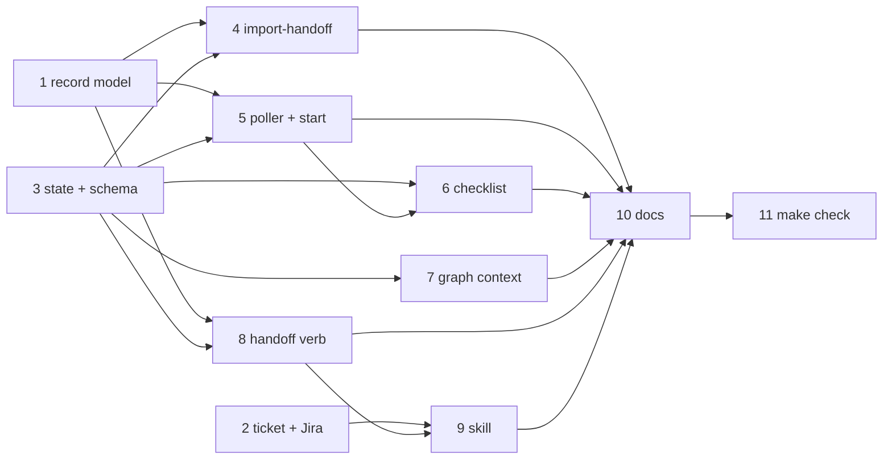

# Tasks: hand a conversation to the-loop from any surface, at any stage

> Derived from the approved [`design.md`](design.md) (components C1–C9) and
> [`testing-plan.md`](testing-plan.md). Each `_Test:_` names a matrix row. TDD
> throughout: each task's tests are written first and seen red. All work lands in this
> repository on PR #518.

## Task list

- [x] 1. Handoff record model (C2)
  - New `cli/the_loop/core/handoff.py`:
    - `HandoffArtifact` and `HandoffRecord`;
    - `parse` and `render`, with part splitting at 65,536 characters;
    - `STAGE_ENTRY`, the allowed-node set and the closed artifact-name set;
    - `find_record`, which returns the record plus the reasons for each rejection.
  - Fixtures under `cli/tests/fixtures/handoff/`: one record per carrier, plus malformed
    and oversized bodies.
  - _Depends on:_ none
  - _Requirements:_ R5.1, R5.2, R5.5, R6 table; security (abuse 1, 2; names, branch)
  - _Test:_ T1, T6, T8. Run `make test` on the new `cli/tests/test_handoff_record.py`:
    round trips, every rejection reason, the `STAGE_ENTRY` rows, parts rejoined
    byte-equal, record snapshots, an unauthorized author, `enter: implementation`, a part
    by another author, a bad branch, and a bad artifact name. Red → green.
- [x] 2. Ticket creation additions (C4)
  - `JiraClient.create_issue(…, issue_type, parent_key)` sets `fields["parent"]`.
  - `JiraTickets.create` and `create_ticket` pass `issue_type` and `parent` through.
  - `the-loop ticket create --issue-type --parent`, both Jira only.
  - New read-only `the-loop ticket projects`.
  - `POST /work-items/tickets`, the facade and the MCP tool accept `issueType` and
    `parent`.
  - _Depends on:_ none
  - _Requirements:_ R3.1, R3.4, R2.8
  - _Test:_ T1, T2, T3. Extend `test_jira_api.py` for the sent fields, add the
    `Scenario: a Jira copy is created with issue type, parent and the mirror label` via
    `jirafakes`, and add route and MCP contract cases. The existing contract tests stay
    green.
- [x] 3. State and graph schema (C6, data models)
  - `WorkItemState` gains `handoff`, `handoffDemoted` and `claudeArtifactUrl`, loaded,
    saved and archived (`archive.py`).
  - The graph node schema gains `requiresHandoff`.
  - `declared_skips` skips a `requiresHandoff` node with `via: no-handoff` when there is
    no handoff.
  - _Depends on:_ none
  - _Requirements:_ R6.1, R7.1, R7.4; compatibility NFR
  - _Test:_ T1, T10. Unit tests cover the `declared_skips` rule; a legacy state fixture
    loads, walks and archives unchanged.
- [x] 4. `import-handoff` node and hook (C8)
  - Node and edges in `graph/pdlc-work-item-loop.yaml` (phase-selection →
    import-handoff → brainstorming).
  - New `graph/hooks/handoff.py`:
    - exists, hash and section checks in chain order;
    - demotion that un-skips the producing node through `enter`;
    - writing the `approved-in-chat` locks with `approvedVia`.
  - _Depends on:_ 1, 3
  - _Requirements:_ R6.5, R7.1–R7.3, R7.5, R8.3
  - _Test:_ T1, T2, T8, T10.
    - Demotion order (unit).
    - `Scenario: a requirements.md missing Security considerations demotes to requirements-definition`.
    - `Scenario: a brainstorm carried under requirements-settled is locked as approved by the handoff`.
    - `Scenario: a carried file whose hash does not match is refused`.
    - Instructions in a body change no state.
    - The graph compiles, and `make validate` passes.
- [x] 5. Poller pick-up and runtime start (C5, C6)
  - In `Dispatcher`, on the arming path for an item with no state:
    - list comments once and run `find_record`;
    - pass `branch` to `_prepare_workspace`;
    - emit `handoff.honoured` / `handoff.ignored` and `arm.refused reason=mirror`.
  - `graphlink.on_arm` passes `handoff` to `Runtime.start`, which freezes it before the
    first save, inside the existing guard.
  - _Depends on:_ 1, 3
  - _Requirements:_ R6.1, R6.2, R3.5; abuse 1, 3, 6, 7; observability NFR
  - _Test:_ T2, T8.
    - `Scenario: arming a handed-off item checks out its spec branch`.
    - `Scenario: a handoff record from an unauthorized user is ignored`.
    - `Scenario: a record posted or edited after the walk started changes nothing`.
    - `Scenario: arming a Jira mirror is refused`.
- [x] 6. Checklist default and skip provenance (C7)
  - `_checklist_body` unticks the nodes before `enter`, adds the handoff line and
    pre-ticks the artifact row.
  - `classify_phase_selection` stamps `handoff: <commentUrl>` on those skips.
  - `the-loop check` renders _skipped by handoff_.
  - _Depends on:_ 3, 5
  - _Requirements:_ R6.3, R6.4
  - _Test:_ T2, T6.
    - A checklist snapshot.
    - The five R6-table walk scenarios, from `Scenario: an exploring handoff walks to brainstorming` to `Scenario: a design-settled handoff without a testing plan walks to test-planning`.
    - `Scenario: an item with no handoff walks exactly as before`.
- [x] 7. `$graph_context` and the artifact URL (C9)
  - `render_graph_context` adds the handoff line, and the artifact line names
    `claudeArtifactUrl`.
  - _Depends on:_ 3
  - _Requirements:_ R6.1, R7.4
  - _Test:_ T2. `Scenario: an imported spec-chain artifact URL is recorded and rendered in graph context`.
- [x] 8. `the-loop handoff` verb (C3)
  - `post`, `show`, `import [--from-dir]` and `note` in
    `cli/the_loop/commands/handoff_cmd.py`, registered in the CLI.
  - `import` refuses an unverifiable file. `note` falls back to a superseding comment.
  - _Depends on:_ 1, 3
  - _Requirements:_ R5.2, R5.4, R7.2, R7.5
  - _Test:_ T2, T8. `Scenario: handoff note points the record at the committed files and PR`,
    plus `import` with a tampered file, a missing part, and `--from-dir`.
- [x] 9. Handoff skill and command (C1)
  - New `skills/handoff/SKILL.md`, covering:
    - drafting, the transport order, the interview, the confirmation and posting order;
    - the four next-step choices, and the refusal in `work-item` mode;
    - the artifact's embedded `the-loop-spec-files` JSON.
  - New `commands/handoff.md` (thin wrapper). The plugin manifest lists the skill.
  - _Depends on:_ 2, 8
  - _Requirements:_ R1, R2, R3.2, R3.3, R4, R5.1, R5.3
  - _Test:_ T11 (manual procedure); T12 markdownlint. The existing command-listing tests
    gain the new command.
- [x] 10. Docs, capability docs, decision
  - Capability docs: `docs/capabilities/spec-workflow.md`, `process-graph.md` and
    `webhook-triggers.md`, each with an issue-517 history row.
  - CLI and state docs: `docs/cli/state.md` and the CLI command reference
    (`handoff`, `ticket create`, `ticket projects`).
  - Skill docs: `skills/the-loop/SKILL.md` § Commands and `reference/workflow.md`.
  - `docs/decisions/decision-<next>.md`: a handoff pre-fills phase selection rather than
    bypassing it. Add its index row.
  - _Depends on:_ 4, 5, 6, 7, 8, 9
  - _Requirements:_ affected capability docs
  - _Test:_ T12 (`make check`, markdownlint).
- [x] 11. Checkpoint: full checks
  - _Depends on:_ 1–10
  - _Test:_ T12 — `make check` green; then the `verification` node runs the testing plan.

## Dependency graph (DAG)

Tasks 1, 2 and 3 start in parallel.

## Checkpoints

- After each task: its named tests red → green, recorded in the commit that carries it.
- After 4 and 6: `make validate` (the graph compiles with the new node).
- After 11: `make check`; then `verification` executes `testing-plan.md`, and the review
  chain and the security review follow.

## Review comments

> Appended by the-loop's `record-feedback` hook when a human gate approves with
> comments (issue-109). Append-only and attributed.
