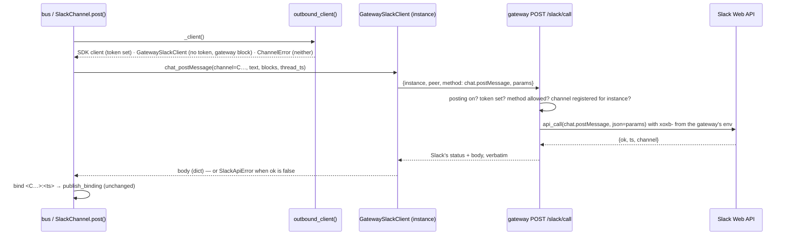
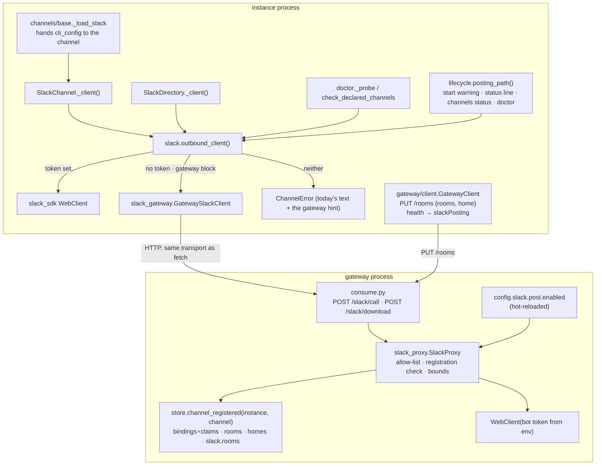
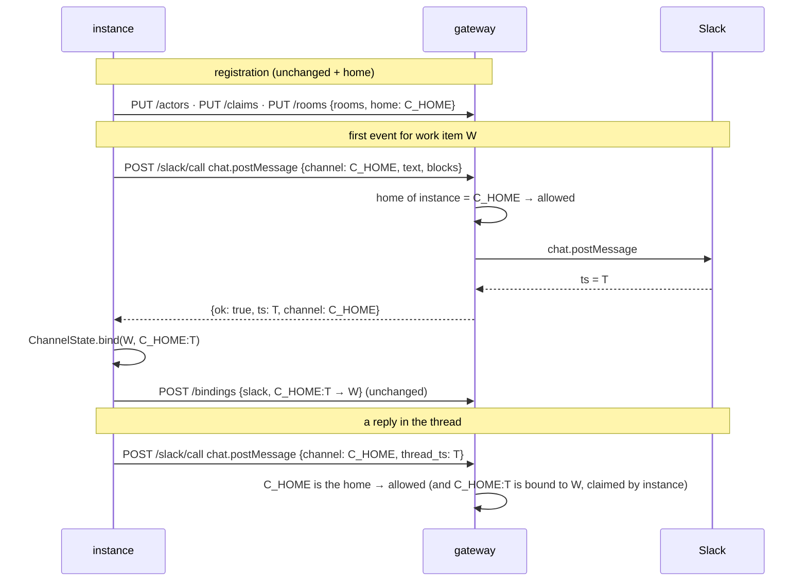

<!-- Written per the `the-loop:writing` skill. -->

# Design: outbound Slack through the gateway, and a loud failure when it cannot

## Overview

The instance keeps every Slack call site it has and changes one thing: **where its Slack
client comes from.** A new resolver, `outbound_client()`, returns the SDK client when the
local bot token is set, a `GatewaySlackClient` when it is not and a `gateway` block is
present, and raises today's `ChannelError` otherwise. `GatewaySlackClient` has the same
eleven method names as the SDK client and forwards each as one `POST
/api/v1/gateway/slack/call` to the gateway, which checks the method against an allow-list
and the channel against what the instance registered, then makes the call with the bot
token it already holds for Socket Mode. File downloads take a sibling route. The same
resolver tells `start`, `status`, `channels status` and `doctor slack` which posting path
is in use, so an instance with neither path says so in one sentence instead of filling
the outbox.



## Architecture

Two processes change, one contract grows, no new dependency. On the **gateway**:
`gateway/config.py` (the `slack.post` block), `gateway/store.py` (a `homes` table and a
registration query), `gateway/slack_proxy.py` (new: the allow-list, the checks, the SDK
call), `gateway/consume.py` (two routes, `home` on `PUT /rooms`, `posting` in health). On
the **instance**: `channels/slack_gateway.py` (new: the proxy client), `channels/slack.py`
(`outbound_client`, `posting_path`, `_client()` and `fetch_attachments` use them),
`channels/directory.py`, `channels/doctor.py`, `channels/attachments.py` (a `fetch`
override counts as a credential), `channels/base.py` (the loader hands the channel its
CLI config), `gateway/client.py` (publishes the home, reads `posting` from health),
`core/lifecycle.py` and the three commands (`status`, `channels status`, `doctor slack`).



### Why the instance swaps a client and not a channel

`SlackChannel` has one factory, `_client()`, and every outbound path goes through it;
the directory, the doctor and the attachment fetcher each build their own client from
the same variable. Replacing the client keeps the forty call sites, the room policy, the
thread binding, the outbox and the reaction logic untouched: they already handle an SDK
response (`response.get("ts")`) and an SDK exception. The proxy returns a plain dict and
raises `slack_sdk.errors.SlackApiError` for `ok: false`, so `_edit_or_post`'s
stale-`ts` fallback and the best-effort reactions behave exactly as with a local token
(R2.4, R4.2). A typed post route (D2's alternative) would have meant a second rendering
path on the instance and a route per call site on the gateway.

### Why an allow-list of Slack methods and not a pass-through

`api_call(method, …)` would proxy anything, including `admin.*` and
`conversations.invite`. The proxy accepts exactly the eleven methods the instance uses
(R2.2), each with its parameter encoding and the name of the parameter that carries the
channel, so the registration check is data-driven and a new call site on the instance is
a one-row change here, reviewed as such.

## Components & interfaces

### 1. `gateway/config.py`, the schema and the template — `slack.post`

```yaml
slack:
  post:
    enabled: true   # the gateway makes Slack Web API calls for its instances (issue-519)
```

- `SlackPost(enabled: bool = True)` on `SlackIngress`; parsed by `_slack()`, validated by
  `gateway-config.schema.json` (`additionalProperties: false`, one boolean, default
  `true`); the template carries the key with its comment (R6.1).
- Hot-reloaded for free: the route reads `state.config.slack.post.enabled` at call time and
  the reloader already replaces `state.config` on a successful reload (R6.3).
  `restart_required()` is unchanged: `post.enabled` is not a start-time key.
- `secret_names()` is unchanged: the bot token is already declared by `slack.socket`.
- `/the-loop:init-gateway` asks the question from the schema's description, in the Slack
  block's walk, default pre-selected (R6.4). The `botTokenEnv` description changes from
  "for the heartbeat split check" to "for the heartbeat split check and for posting on
  the instances' behalf".

### 2. `gateway/store.py` — `homes` and the registration query

```sql
CREATE TABLE IF NOT EXISTS homes (
  instance TEXT PRIMARY KEY,
  channel TEXT NOT NULL,
  published_at TEXT NOT NULL
);
```

- `publish_rooms(instance, rooms, peer="", home="")` upserts the home in the same
  transaction, or deletes the instance's row when `home` is empty (an instance that
  stopped declaring a central channel). Several instances may share one home: the key is
  the instance, not the channel, so a fleet's one `#the-loop` is every instance's home.
  `homes` is pruned with the instance by `_prune`.
- `home_of(instance) -> str`; `instances()` rows carry `home`.
- `channel_registered(instance, channel) -> Optional[str]` returns the source that
  allows the channel, or `None`:

  | Source | Query |
  |---|---|
  | `binding` | a `bindings` row with `provider = 'slack'` and `substr(key, 1, n) = '<channel>:'` whose `'loop-' \|\| slug` has a `claims` row for `instance` |
  | `room` | a `rooms` row for `channel` with `instance = ?` |
  | `home` | the `homes` row for `instance` names `channel` |

  Bindings carry no instance (the table is `(provider, key)` keyed), so a thread is
  "the instance's" when the instance **claims the work item it is bound to**, which is
  the same fact routing uses to deliver that thread's replies to it. The static
  `slack.rooms` of the config is checked by the proxy, not the store.

### 3. `gateway/slack_proxy.py` — the allow-list and the call

```python
#: method → (encoding, channel parameter or None)
SLACK_METHODS = {
    "chat.postMessage":    ("json",   "channel"),
    "chat.update":         ("json",   "channel"),
    "chat.postEphemeral":  ("json",   "channel"),
    "chat.delete":         ("json",   "channel"),
    "reactions.add":       ("json",   "channel"),
    "views.open":          ("json",   None),      # a trigger_id, no channel
    "conversations.info":  ("params", "channel"),
    "conversations.list":  ("params", None),
    "conversations.replies": ("params", "channel"),
    "conversations.history": ("params", "channel"),
    "users.list":          ("params", None),
    "files.info":          ("params", None),      # Slack's file ACL applies (R5.2)
    "auth.test":           ("params", None),
}
```

- `SlackProxy(state, *, web_client_factory=build_client)`.
- `available() -> Tuple[bool, str]`: `(False, "disabled")` when `slack.post.enabled` is
  false, `(False, "socket-unconfigured")` without a `slack` block, `(False, "no-token")`
  when `os.environ[slack.socket.botTokenEnv]` is empty; else `(True, "")`. Read at call
  time, so a token that appears or a flag that flips needs no restart.
- `call(instance, peer, method, params) -> ProxyResult(status, body, headers)`:
  1. `available()` or `503 posting-unavailable` with the reason;
  2. `method in SLACK_METHODS` or `422 method-not-allowed`;
  3. when the method has a channel parameter: `params[channel]` matches
     `SLACK_CHANNEL_RE`, and `store.channel_registered(instance, channel)` or the channel
     is in `config.slack.rooms`, else `403 channel-not-registered`;
  4. `WebClient.api_call(method, json=params)` or `api_call(method, params=params)` by
     encoding; the SDK's `SlackResponse.status_code`, `.data` and `Retry-After` header
     (a 429) come back as they are. The SDK raises `SlackApiError` on `ok: false`; the
     proxy catches it and returns its `response.status_code` and `response.data`, so the
     instance sees exactly what a local client would (R2.4). A transport failure
     (`SlackClientError`, `OSError`) is `502 slack-unreachable` with the exception class
     as detail.
  5. `eventlog.emit("gateway.slack_call", instance, method, channel, status, ok)` —
     never `text`, `blocks` or the token (R2.6).
- `download(instance, peer, url) -> ProxyResult`: `available()` as above; then
  `channels.attachments.fetch_url(url, credential=token, allowed_hosts=SLACK_HOSTS,
  max_bytes=MAX_BYTES)` — the instance's own fetcher, with its host check on every
  redirect hop and its 25 MiB cap — returning the bytes with the content type; a
  `FetchError` is `422` (`off-host`) or `413` (`over-cap`) or `502` (`transfer-failed`)
  with the reason (R3.1, R3.2). The route reads the file into memory once; 25 MiB is the
  existing bound on the instance side and stays the bound here.
- The web client is built per call from the token in the environment: cheap (no
  connection pool to keep), and it means a rotated token is picked up on the next call.

### 4. `gateway/consume.py` — two routes, `home`, `posting`

```python
class SlackCallBody(BaseModel):
    instance: str   # min 1, max NAME_MAX — allow-listed like a claim
    peer: str       # max NAME_MAX
    method: str     # max 64
    params: Dict[str, Any]   # at most SLACK_PARAMS_MAX = 256 KiB when serialised

class SlackDownloadBody(BaseModel):
    instance: str
    peer: str
    url: str        # max 2048, https only
```

| Route | Does | Answers |
|---|---|---|
| `POST /api/v1/gateway/slack/call` | `_check_allowed`, `store.peer_conflict`, then `SlackProxy.call` | Slack's status and body verbatim; `422 method-not-allowed`; `403 channel-not-registered`; `409 unknown-instance` / `duplicate-instance` (the existing `_refused` shape); `503 posting-unavailable {reason}`; `502 slack-unreachable {detail}` |
| `POST /api/v1/gateway/slack/download` | the same two guards, then `SlackProxy.download` | `200` bytes with `Content-Type`; `422 off-host`; `413 over-cap`; `502 transfer-failed`; `503` as above |

- `RoomsBody` gains `home: str = ""` validated by `SLACK_CHANNEL_RE`; the route passes it
  to `publish_rooms`; `GET /instances` lists `home` beside `rooms` (R5.1, R6.2).
- `GatewayState.health()` gains `"slack": {"socket": …, "posting": "on" | "off" | "no-token" | "socket-unconfigured"}` from `SlackProxy.available()` (R4.6).
- The 256 KiB cap on `params`: Slack refuses a message over 40 000 characters and 50
  blocks, so the bound is above anything the instance renders and far below the 25 MiB
  body limit the server already applies. A `422` at the door writes nothing.
- Both routes are recorded in `docs/api-specs/openapi/the-loop-gateway.v1.yaml` with their
  operation ids (`gatewaySlackCall`, `gatewaySlackDownload`); the parity test's gateway
  half compares paths, methods and operation ids (R2.5).

### 5. `channels/slack_gateway.py` — the instance's proxy client (new)

```python
class GatewaySlackClient:
    """The eleven SDK method names, each one POST /api/v1/gateway/slack/call."""
    def __init__(self, url, instance, peer, *, transport=None): ...
    @classmethod
    def from_cli_config(cls, cli_config) -> "GatewaySlackClient": ...
    def chat_postMessage(self, **params): return self._call("chat.postMessage", params)
    # chat_update, chat_postEphemeral, chat_delete, reactions_add, views_open,
    # conversations_info, conversations_list, conversations_replies,
    # conversations_history, users_list, files_info, auth_test — the same shape
    def fetch(self, url, *, credential="", allowed_hosts=(), max_bytes=MAX_BYTES, timeout=...): ...
```

- `from_cli_config` reads `gateway_block(cli_config).url`, `instance_name(cli_config)`
  and the peer id from `<local_dir>/<PEER_FILE>` the hosted client persists — the same
  id, so the gateway's lease check sees one peer whether the call comes from the daemon
  or from `the-loop doctor slack` in another process. No file yet (the daemon never
  ran) sends an empty peer, which the gateway accepts while no live holder exists.
- `_call` uses `gateway.client.urllib_transport(url)` (the existing stdlib transport,
  a 10 s timeout per call) and maps the answer:

  | Gateway answer | The caller sees |
  |---|---|
  | `200`, `ok: true` | the body as a `dict` — `response.get("ts")` works as before |
  | Slack's `ok: false` (any status) | `slack_sdk.errors.SlackApiError(error, response)` — what the SDK raises, so every existing `except` path holds |
  | `403`, `409`, `422`, `502`, `503` | `GatewayPostingError(ChannelError)` naming the gateway's `error` and `detail` (R4.4, R4.5) |
  | unreachable, timeout, non-JSON | `GatewayPostingError("gateway unreachable: …")` — never a local-token fallback (R4.4) |

- `fetch()` has `attachments.fetch_url`'s signature so `slack_attachments(…, fetch=…)`
  takes it unchanged; it ignores `credential` (the gateway holds it) and raises
  `attachments.FetchError(reason)` from the gateway's `error` field, so the attachment
  renders with the same reason words as today (R3.3).
- A `files_info` on this client is what `fetch_attachments` passes as the transcript
  re-reader, exactly as it does with the SDK client.

### 6. `channels/slack.py` — the resolver and the posting path

```python
@dataclass(frozen=True)
class PostingPath:
    kind: str      # local | gateway | none
    detail: str    # "THE_LOOP_SLACK_BOT_TOKEN" · the gateway url · the reason

def posting_path(config, cli_config, *, gateway_posting: Optional[str] = None) -> PostingPath
def outbound_client(config, cli_config, client_factory=None) -> Any
```

- `posting_path`: `local` when `os.environ[config.bot_token_env]` is set; else `gateway`
  when `gateway_block(cli_config)` exists and `gateway_posting` is `"on"` or unknown
  (`None` — the caller could not ask); else `none` with the reason: `"<var> is unset and
  no gateway block is configured"`, or `"<var> is unset and the gateway reports posting
  <off|no-token|socket-unconfigured>"`.
- `outbound_client`: `local` → `(client_factory or build_client)(token)`; `gateway` →
  `GatewaySlackClient.from_cli_config(cli_config)` (a `client_factory` from a test is
  honoured first, so every existing fake keeps working); `none` → `ChannelError` with
  today's sentence plus `", or point this instance at a gateway with slack.post.enabled"`
  (R4.3).
- `SlackChannel.__init__` gains `cli_config: Optional[Mapping] = None`, stored in the
  existing `_cli_config`; `_load_slack` passes the config it already has. `_client()`
  becomes `outbound_client(self.config, self._cli_config, self._client_factory)`.
- `fetch_attachments`: `client = outbound_client(...)` inside the existing `try`; when it
  is a `GatewaySlackClient`, `slack_attachments(files, token="", dest_dir=…,
  files_info=…, fetch=client.fetch)`; otherwise unchanged (R3.3, R4.2).
- `SlackDirectory._client()` and `doctor._probe` / `check_declared_channels` call
  `outbound_client` in place of their own `os.environ` read; the doctor's
  `_unverifiable` reason becomes `posting_path(...).detail` (R1.3, R4.2). Under a
  gateway the doctor's heartbeat is posted through the proxy and heard by the gateway's
  connection, which is what `doctor slack` already treats as the app's one listener.
- `central_channel()` is unchanged; under a gateway its name→id lookup runs
  `conversations.list` through the proxy, a channel-less method (R5.2).

### 7. `channels/attachments.py` — a custom `fetch` is a credential

`slack_attachments` keeps its signature. The guard `if not token:` becomes `if not token
and fetch is None:` (evaluated before `fetch = fetch or fetch_url`), so a caller that
supplies its own credentialed fetcher is not told `no-token`. Nothing else changes.

### 8. `gateway/client.py` — the home and `slackPosting`

- `attach(...)` gains a `home` provider: `lambda: SlackChannel.central_channel()` of the
  loaded Slack channel, or `""` when Slack is disabled. `publish_rooms` sends `"home":
  home()` with the set, on the same cadence (registration, change hook, every 30 s).
- `document()` gains `"slackPosting": (last_health.get("slack") or {}).get("posting") or
  "unknown"`; `last_health` is refreshed by the fetch loop's health probe as today
  (R4.6).

### 9. `core/lifecycle.py` and the commands — say it

| Surface | Change | Requirement |
|---|---|---|
| `start_all` | after the rows, `path = posting_path(slack, config, gateway_posting=None)`; `none` → `logger.warning("slack: outbound posts cannot be delivered — %s", path.detail)` and `eventlog.emit("channel.posting_unavailable", level="warning", reason=…)`; the start still succeeds | R1.1, R1.6 |
| `gateway_line(doc)` | `connected · long-poll <url>` gains the suffix `posting through the gateway` when `slackPosting == "on"` and no local token, or the suffix `outbound Slack needs <var> on this instance` when the path is `none` | R1.2, R1.4 |
| `channels status` | a `posting:` line: `local token (<var>)` · `through the gateway (<url>)` · `[!] unavailable — <reason>` | R1.2, R1.4 |
| `doctor slack` | `_gateway_lines` adds `[ok] the gateway posts for this instance` / `[!] the gateway reports posting <reason>`; `_probe`'s `unverifiable` reason is the posting path's | R1.3 |
| `GET /api/v1/gateway` and the Gateway card | `slackPosting` rendered as one more state word (`posting via gateway`) | R4.6 |

`channels.slack.enabled: false` short-circuits every row above (R1.5).

### 10. Contract and documents

- `the-loop-gateway.v1.yaml`: the two routes, their bodies and every error body; the
  description's "no authentication" sentence adds "post as the bot into channels an
  instance registered" to what an exposed gateway permits (abuse case 6).
- `docs/capabilities/gateway.md` (behaviour + history row), `docs/capabilities/channels.md`
  (the outbound path, the doctor), `docs/guide/gateway.md` (step 1's "holds no posting
  token" becomes what is true), `docs/config/cli/gateway-options.md`,
  `docs/config/cli/channels-options.md` (`botTokenEnv` is optional behind a posting
  gateway), `docs/cli/commands/gateway.md` (`status` output), `commands/init-cli.md`
  and `commands/init-gateway.md` (the question), the skill's `reference/onboarding.md`.
- **decision-151** (new): the gateway posts with the token it already held; decision-146's
  "any posting token" line is amended to "any GitHub or Jira posting token", and the
  boundary statement gains posting. Status proposed; the owner decides at the PR.

## UI/UX design

N/A — the dashboard's Gateway card gains one word of state (`slackPosting`), rendered
with the existing state-word component; no new screen, no prototype.

## Data models

```mermaid
erDiagram
  instances ||--o| homes : "declares one"
  instances ||--o{ rooms : "publishes"
  instances ||--o{ claims : "claims"
  claims }o--|| subjects : "on"
  bindings }o--|| subjects : "loop-<slug>"
  homes { text instance PK; text channel; text published_at }
  rooms { text channel PK; text ref; text slug; text instance; text published_at }
  bindings { text provider PK; text key PK; text ref; text slug; text published_at }
  claims { text subject PK; text instance PK; text role PK; text since }
```

`channel_registered(instance, C)` is true when `C` is `homes[instance]`, or a `rooms` row
with `instance`, or the prefix of a `bindings` key whose subject `instance` claims; the
proxy adds the config's static `slack.rooms`. Everything else stored is unchanged: no
message text, no token, no file bytes at rest (a download streams through).

### Data flow: an instance with no token opens a work item's thread



## Error handling

| Failure | Where | What happens | Visible as |
|---|---|---|---|
| no local token, no gateway block | `outbound_client` | `ChannelError`, the event goes to the outbox | `channel.post_failed`; `status`'s undelivered line; start warning |
| no local token, gateway posting off / no token on the gateway | proxy call | `503 posting-unavailable` → `GatewayPostingError` → outbox | `channel.post_failed` naming the gateway's reason; `status`: `outbound Slack needs <var>`; start warning |
| gateway unreachable | proxy call | `GatewayPostingError`, no local fallback | `channel.post_failed`; `gateway.unreachable` already logged by the fetch loop |
| channel not registered | gateway | `403` → `GatewayPostingError`; the post counts as failed | `gateway.refused` on the gateway; `warning` with channel and work item on the instance (R4.5) |
| Slack `ok: false` (bad `ts`, `not_in_channel`, rate limit) | proxy call | `SlackApiError` exactly as the SDK raises | today's handling: `_edit_or_post` posts fresh; a reaction is skipped with a warning; a post goes to the outbox |
| method not allowed | gateway | `422`, nothing sent | `gateway.refused` with `method` |
| download off-host / over cap | gateway | `422` / `413` → `FetchError(reason)` | the attachment line carries `off-host` / `over-cap` as today |
| body over bounds | gateway | `422` at the door | the request is never logged beyond its size |
| stale peer under a live name | gateway | `409 duplicate-instance` | `gateway.refused` with the holder's fingerprint, as for a claim |

Observability is identical at dev time and runtime: `gateway.slack_call` on the gateway's
JSONL log (method, channel, status, ok, instance; never text), the existing
`channel.post_failed` / `channel.undelivered` on the instance with the gateway's reason in
the text, and a new `channel.posting_unavailable` at start.

## Security design

- **AuthN/AuthZ.** Unchanged by decision: the gateway's consumer API authenticates nobody
  (decision-146). The two routes sit behind exactly the guards every consumer route has
  — the `instances` allow-list (`409 unknown-instance`) and the peer lease (`409
  duplicate-instance`) — plus one of their own: a channel-bearing call is allowed only
  for a channel the calling instance has registered (home, room, bound thread it claims,
  or a static room). This is a misconfiguration guard, stated as such in the OpenAPI
  description and the capability page, not authentication.
- **Input validation & injection surfaces.** Every body field is bounded at the door by
  pydantic (`NAME_MAX`, `KEY_MAX`, `method ≤ 64`, `params ≤ 256 KiB`, `url ≤ 2048`);
  `method` must be a key of `SLACK_METHODS` (no string reaches the SDK unchecked);
  `channel` must match `SLACK_CHANNEL_RE`; `url` must be `https` and its host, and every
  redirect's host, in `SLACK_HOSTS` before any request is made (`fetch_url`'s existing
  check). `params` is passed to the SDK as data, never interpolated into a string. The
  store queries are parameterised SQL; the prefix match uses `substr`, not `LIKE`, as
  the rooms query already does.
- **Secrets handling.** The bot token is read from the gateway's environment at call
  time and never leaves the process: not in a route body, not in a log line
  (`gateway.slack_call` logs method, channel, status), not in `health`. The instance's
  proxy carries no credential; `fetch()` drops the `credential` argument on the floor.
  The event log's redaction list already holds every declared secret name.
- **Least privilege.** The gateway uses the scopes the Slack app already grants the bot;
  no new scope. An instance behind a posting gateway needs no Slack secret at all. The
  allow-list is the minimum set of methods the instance calls today.
- **Fail-closed behaviour.** Posting disabled, no token or no `slack` block → `503`,
  never a fallback to any other token. An unknown method → `422`. A channel the
  registration query cannot attribute → `403`. A body the model rejects → `422` before
  any read. On the instance, `none` raises and queues; the proxy never falls back to a
  local token on a gateway failure.
- **Abuse-case coverage** (requirements § Security considerations):

  | Abuse case | Mechanism | Negative test |
  |---|---|---|
  | 1 — a method outside the allow-list | `SLACK_METHODS` lookup → `422`, nothing sent | `test_slack_call_refuses_a_method_outside_the_allow_list` (unit; a fake web client asserts no call) |
  | 2 — a channel the instance did not register | `channel_registered` + static rooms → `403` | `test_slack_call_refuses_an_unregistered_channel` (unit) |
  | 3 — a home or room another live instance holds | rooms: existing holder rule; home: per-instance key, so a second instance's home is its own and grants only that instance | `test_home_is_per_instance_and_grants_only_that_instance` (unit) |
  | 4 — a non-Slack URL or an over-cap file | `fetch_url`'s host check per hop, `max_bytes` → `422` / `413` | `test_download_refuses_off_host_and_over_cap` (unit, fake opener) |
  | 5 — posting disabled | `available()` → `503`; the socket adapter alone uses the token | `test_posting_disabled_is_503_and_sends_nothing` (unit) |
  | 6 — exposed without `listen.exposed` | unchanged refusal at start; the contract and the page name posting | `test_gateway_config_refuses_non_loopback_without_exposed` (existing) + a doc assertion in the capability page review |

## Testing strategy

Unit tests cover the gateway side with the `GatewayHarness` and a fake web client
(`SlackProxy.call` and `download`, the allow-list, the registration query over bindings,
rooms and homes, the `503`/`403`/`422`/`409` answers, `health.slack.posting`, hot reload
of `slack.post.enabled`) and the instance side with a fake transport
(`GatewaySlackClient` mapping of answers to `dict` / `SlackApiError` /
`GatewayPostingError`, `outbound_client` and `posting_path` across the three paths,
`fetch_attachments` through `fetch`, `start_all`'s warning, `gateway_line`, `channels
status` and `doctor slack` wording). Integration tests under
`cli/tests/test_*_integration.py` carry Gherkin docstrings linking back to R1–R7 and run
the instance pipeline against a real `SqliteStore` gateway app: *Scenario: an instance
with no bot token opens a work item's thread through the gateway and binds it*
(R2, R4, R5), *Scenario: a reply in a thread opened through the gateway reaches the work
item* (R4.7), *Scenario: a voice note's transcript reaches the session through the
gateway's download route* (R3), *Scenario: an instance with a local token never calls
the gateway* (R4.1), *Scenario: an instance with neither path warns at start and keeps
the event in the outbox* (R1). The contract test `test_api_contract_parity.py` (gateway
half) proves the served schema matches `the-loop-gateway.v1.yaml` (R2.5). The live proof
is the reporter's scenario on `the-loop-testing`: one gateway, one instance with no bot
token, a work item started by comment, its Slack thread appearing. Which types apply, the
environment and the evidence belong to `testing-plan.md`.

## Trade-offs & decisions

- **A client swap, not a channel swap** — § Architecture. Costs one `cli_config` argument
  on the channel; saves every call site.
- **An allow-list of Slack methods** — § Architecture. Costs one row per new call site;
  buys a bounded surface a reviewer can read in one table.
- **Posting on by default** (requirements D3). The knob exists for an operator who wants
  the gateway read-only on Slack; the default matches what the reporter expected from
  gateway mode. The security review will see the default stated with its reasoning.
- **Homes are a field on `PUT /rooms`, not a new route.** The rooms publication already
  runs at every registration and every 30 s, and a home has the same lifecycle; one more
  field keeps the client's cadence and the gateway's lease check in one place. Against:
  "rooms" now carries something that is not a room; the body's description says so.
- **The bound-thread rule goes through claims.** Bindings carry no instance, and adding a
  column would make every existing binding unattributable. Routing already defines "the
  instance's thread" as "a thread bound to a work item it claims"; the posting rule
  reuses that definition rather than inventing a second one.
- **A web client per call on the gateway.** Simpler than a cached client that must be
  invalidated on a token change; the SDK client is cheap to build and the call volume is
  a few per minute.
- **No new dependency.** `slack_sdk` (already required), `fastapi`/pydantic (already the
  gateway's), the stdlib transport already used by the gateway client.

### Alternatives considered

- **A typed `POST /post` carrying event type, blocks and thread** (reporter's sketch;
  requirements D2). Rejected: a second render path and a route per call site.
- **The gateway records the thread binding when it posts the opener** (reporter's note).
  Deferred: the instance's `publish_binding` already follows every opener within the
  same call path, so the round-trip it would save is one request; folding it into the
  proxy would make `chat.postMessage` sometimes bind and sometimes not, depending on
  whether the instance meant it as an opener, which the gateway cannot know.
- **Fall back to the gateway when the local token exists but Slack refuses it.** Rejected:
  two credentials in play makes a failure ambiguous; D4 keeps one path per instance.
- **A `homes` entry per channel, shared like rooms.** Rejected: a fleet shares one central
  channel, and a shared row would let the first instance's lease block every other's
  openers.

## Open questions

None open here. The design takes the five decisions the requirements tabled and the
approver signed; the posting default (D3) is restated above for the security review.

## Review comments

> Appended by the-loop's `record-feedback` hook when a human gate approves with
> comments (issue-109). Append-only and attributed.
