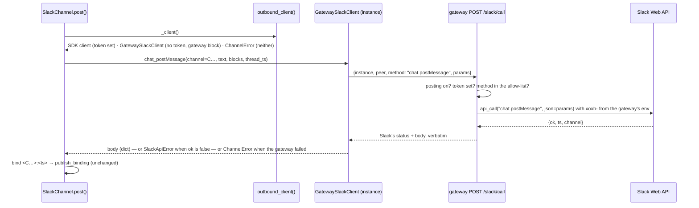
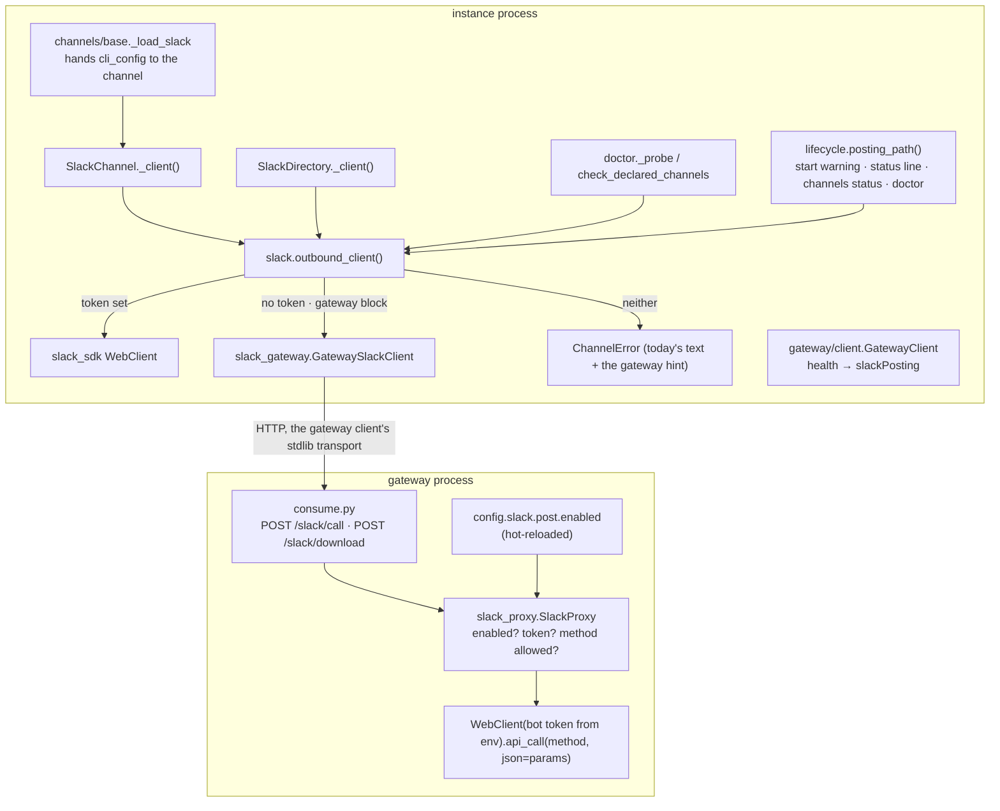
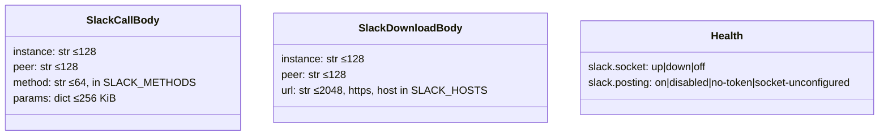
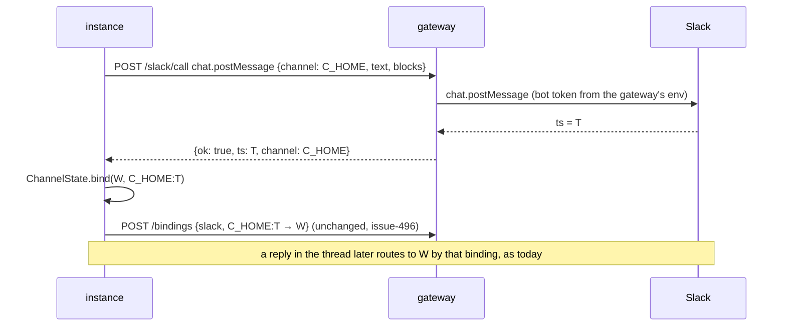

<!-- Written per the `the-loop:writing` skill. -->

# Design: outbound Slack through the gateway, and a loud failure when it cannot

## Overview

A **pass-through.** The instance keeps every Slack call site it has and changes one
thing: where its Slack client comes from. A resolver, `outbound_client()`, returns the
SDK client when the local bot token is set, a `GatewaySlackClient` when it is not and a
`gateway` block is present, and raises today's `ChannelError` otherwise.
`GatewaySlackClient` has the same method names as the SDK client and forwards each as
one `POST /api/v1/gateway/slack/call {method, params}`; the gateway calls Slack with the
bot token it already holds for Socket Mode and returns Slack's answer verbatim. File
downloads take a sibling route. The gateway **keeps no state** for this: no table, no
queue, no retry. If the gateway is unreachable or refuses, the post fails, as one
`ChannelError`, like any failed Slack call. The same resolver tells `start`, `status`,
`channels status` and `doctor slack` which posting path is in use, so an instance with
neither path says so in one sentence.



Revised after the owner's design review
([PR #522](https://github.com/MadaraUchiha-314/the-loop/pull/522#pullrequestreview-5623247964)):
the first draft registered each instance's channels on the gateway and checked every
post against them. That state and that check are gone; what remains is the proxy.

## Architecture

Two processes change, one contract grows, no new dependency, **no new persistent
state.** On the **gateway**: `gateway/config.py` (the `slack.post` block),
`gateway/slack_proxy.py` (new: the allow-list and the SDK call), `gateway/consume.py` (two
routes, `posting` in health). On the **instance**: `channels/slack_gateway.py` (new: the
proxy client), `channels/slack.py` (`outbound_client`, `posting_path`; `_client()` and
`fetch_attachments` use them), `channels/directory.py`, `channels/doctor.py`,
`channels/attachments.py` (a `fetch` override counts as a credential), `channels/base.py`
(the loader hands the channel its CLI config), `gateway/client.py` (reads `posting` from
health), `core/lifecycle.py` and the three commands (`status`, `channels status`,
`doctor slack`).



### Why the instance swaps a client and not a channel

`SlackChannel` has one factory, `_client()`, and every outbound path goes through it;
the directory, the doctor and the attachment fetcher each build their own client from
the same variable. Replacing the client keeps the forty call sites, the room policy, the
thread binding, the outbox and the reaction logic untouched: they already handle an SDK
response (`response.get("ts")`) and an SDK exception. The proxy returns a plain dict and
raises `slack_sdk.errors.SlackApiError` for `ok: false`, so `_edit_or_post`'s
stale-`ts` fallback and the best-effort reactions behave exactly as with a local token
(R2.4, R4.2).

### Why a flat allow-list and nothing else

The gateway checks three things before it calls Slack: posting is on, it has the token,
and the method is one the instance calls. The third is a `frozenset` of thirteen
strings. It is not channel logic and it stores nothing; it only keeps the gateway from
being a generic bot-token oracle for `admin.*` or `conversations.invite`. The owner may
strike it; the design loses one line.

## Components & interfaces

### 1. `gateway/config.py`, the schema and the template — `slack.post`

```yaml
slack:
  post:
    enabled: true   # the gateway makes Slack Web API calls for its instances (issue-519)
```

- `SlackPost(enabled: bool = True)` on `SlackIngress`; parsed by `_slack()`, validated by
  `gateway-config.schema.json` (`additionalProperties: false`, one boolean, default
  `true`); the template carries the key with its comment (R6.1).
- Hot-reloaded for free: the route reads `state.config.slack.post.enabled` at call time and
  the reloader already replaces `state.config` on a successful reload (R6.3).
  `restart_required()` and `secret_names()` are unchanged.
- `/the-loop:init-gateway` asks the question from the schema's description, in the Slack
  block's walk, default pre-selected (R6.4). The `botTokenEnv` description becomes "for
  the heartbeat split check and for posting on the instances' behalf".

### 2. `gateway/slack_proxy.py` — the allow-list and the call

```python
SLACK_METHODS = frozenset({
    "chat.postMessage", "chat.update", "chat.postEphemeral", "chat.delete",
    "reactions.add", "views.open",
    "conversations.info", "conversations.list", "conversations.replies",
    "conversations.history", "users.list", "files.info", "auth.test",
})
```

- `SlackProxy(state, *, web_client_factory=build_client)`.
- `available() -> Tuple[bool, str]`: `(False, "disabled")` when `slack.post.enabled` is
  false, `(False, "socket-unconfigured")` without a `slack` block, `(False, "no-token")`
  when `os.environ[slack.socket.botTokenEnv]` is empty; else `(True, "")`. Read at call
  time, so a token that appears or a flag that flips needs no restart.
- `call(method, params) -> ProxyResult(status, body, headers)`:
  1. `available()` or `503 posting-unavailable` with the reason;
  2. `method in SLACK_METHODS` or `422 method-not-allowed`;
  3. `WebClient.api_call(method, json=params)` — every method in the set accepts a JSON
     body. The SDK's `SlackResponse.status_code`, `.data` and a `Retry-After` header
     come back as they are. The SDK raises `SlackApiError` on `ok: false`; the proxy
     catches it and returns its `response.status_code` and `response.data`, so the
     instance sees exactly what a local client would (R2.4). A transport failure
     (`SlackClientError`, `OSError`) is `502 slack-unreachable` with the exception class
     as detail.
  4. `eventlog.emit("gateway.slack_call", instance, method, channel, status, ok)` —
     never `text`, `blocks` or the token (R2.6). `channel` is read from `params` for the
     record only.
- `download(url) -> ProxyResult`: `available()` as above; then
  `channels.attachments.fetch_url(url, credential=token, allowed_hosts=SLACK_HOSTS,
  max_bytes=MAX_BYTES)` — the instance's own fetcher, with its host check on every
  redirect hop and its 25 MiB cap — returning the bytes with the content type; a
  `FetchError` is `422` (`off-host`), `413` (`over-cap`) or `502` (`transfer-failed`)
  with the reason (R3.1, R3.2). The bytes are returned, not kept.
- The web client is built per call from the token in the environment: nothing to cache
  or invalidate, and a rotated token is picked up on the next call.

### 3. `gateway/consume.py` — two routes, `posting`

```python
class SlackCallBody(BaseModel):
    instance: str   # min 1, max NAME_MAX — allow-listed like a claim
    peer: str       # max NAME_MAX
    method: str     # max 64
    params: Dict[str, Any]   # at most SLACK_PARAMS_MAX = 256 KiB when serialised

class SlackDownloadBody(BaseModel):
    instance: str
    peer: str
    url: str        # max 2048, https only
```

| Route | Does | Answers |
|---|---|---|
| `POST /api/v1/gateway/slack/call` | `_check_allowed`, `store.peer_conflict`, then `SlackProxy.call` | Slack's status and body verbatim; `422 method-not-allowed`; `409 unknown-instance` / `duplicate-instance` (the existing `_refused` shape); `503 posting-unavailable {reason}`; `502 slack-unreachable {detail}` |
| `POST /api/v1/gateway/slack/download` | the same two guards, then `SlackProxy.download` | `200` bytes with `Content-Type`; `422 off-host`; `413 over-cap`; `502 transfer-failed`; `503` as above |

- The two guards are the ones every consumer route already has (the `instances`
  allow-list and the peer lease); nothing is added to them.
- `GatewayState.health()` gains `"slack": {"socket": …, "posting": "on" | "disabled" |
  "no-token" | "socket-unconfigured"}` from `SlackProxy.available()` (R4.6).
- The 256 KiB cap on `params`: Slack refuses a message over 40 000 characters and 50
  blocks, so the bound is above anything the instance renders and far below the 25 MiB
  body limit the server already applies. A `422` at the door writes nothing.
- Both routes are recorded in `docs/api-specs/openapi/the-loop-gateway.v1.yaml` with their
  operation ids (`gatewaySlackCall`, `gatewaySlackDownload`); the parity test's gateway
  half compares paths, methods and operation ids (R2.5).

### 4. `channels/slack_gateway.py` — the instance's proxy client (new)

```python
class GatewaySlackClient:
    """The SDK method names the instance uses, each one POST /api/v1/gateway/slack/call."""
    def __init__(self, url, instance, peer, *, transport=None): ...
    @classmethod
    def from_cli_config(cls, cli_config) -> "GatewaySlackClient": ...
    def chat_postMessage(self, **params): return self._call("chat.postMessage", params)
    # chat_update, chat_postEphemeral, chat_delete, reactions_add, views_open,
    # conversations_info, conversations_list, conversations_replies,
    # conversations_history, users_list, files_info, auth_test — the same shape
    def fetch(self, url, *, credential="", allowed_hosts=(), max_bytes=MAX_BYTES, timeout=...): ...
```

- `from_cli_config` reads `gateway_block(cli_config).url`, `instance_name(cli_config)`
  and the peer id from `<local_dir>/<PEER_FILE>` the hosted client persists — the same
  id, so the gateway's lease check sees one peer whether the call comes from the daemon
  or from `the-loop doctor slack` in another process. No file yet sends an empty peer.
- `_call` uses `gateway.client.urllib_transport(url)` (the existing stdlib transport,
  a 10 s timeout per call) and maps the answer:

  | Gateway answer | The caller sees |
  |---|---|
  | `200`, `ok: true` | the body as a `dict` — `response.get("ts")` works as before |
  | Slack's `ok: false` (any status) | `slack_sdk.errors.SlackApiError(error, response)` — what the SDK raises, so every existing `except` path holds |
  | `409`, `422`, `502`, `503` | `GatewayPostingError(ChannelError)` naming the gateway's `error` and `detail` (R4.4) |
  | unreachable, timeout, non-JSON | `GatewayPostingError("gateway unreachable: …")` — the post fails; never a local-token fallback (R4.4) |

- `fetch()` has `attachments.fetch_url`'s signature so `slack_attachments(…, fetch=…)`
  takes it unchanged; it ignores `credential` (the gateway holds it) and raises
  `attachments.FetchError(reason)` from the gateway's `error` field, so the attachment
  renders with the same reason words as today (R3.3).

### 5. `channels/slack.py` — the resolver and the posting path

```python
@dataclass(frozen=True)
class PostingPath:
    kind: str      # local | gateway | none
    detail: str    # "THE_LOOP_SLACK_BOT_TOKEN" · the gateway url · the reason

def posting_path(config, cli_config, *, gateway_posting: Optional[str] = None) -> PostingPath
def outbound_client(config, cli_config, client_factory=None) -> Any
```

- `posting_path`: `local` when `os.environ[config.bot_token_env]` is set; else `gateway`
  when `gateway_block(cli_config)` exists and `gateway_posting` is `"on"` or unknown
  (`None` — the caller could not ask); else `none` with the reason: `"<var> is unset and
  no gateway block is configured"`, or `"<var> is unset and the gateway reports posting
  <disabled|no-token|socket-unconfigured>"`.
- `outbound_client`: `local` → `(client_factory or build_client)(token)`; `gateway` →
  `GatewaySlackClient.from_cli_config(cli_config)` (a `client_factory` from a test is
  honoured first, so every existing fake keeps working); `none` → `ChannelError` with
  today's sentence plus `", or point this instance at a gateway with slack.post.enabled"`
  (R4.3).
- `SlackChannel.__init__` gains `cli_config: Optional[Mapping] = None`, stored in the
  existing `_cli_config`; `_load_slack` passes the config it already has. `_client()`
  becomes `outbound_client(self.config, self._cli_config, self._client_factory)`.
- `fetch_attachments`: `client = outbound_client(...)` inside the existing `try`; when it
  is a `GatewaySlackClient`, `slack_attachments(files, token="", dest_dir=…,
  files_info=…, fetch=client.fetch)`; otherwise unchanged (R3.3, R4.2).
- `SlackDirectory._client()` and `doctor._probe` / `check_declared_channels` call
  `outbound_client` in place of their own `os.environ` read; the doctor's
  `_unverifiable` reason becomes `posting_path(...).detail` (R1.3, R4.2). Under a
  gateway the doctor's heartbeat is posted through the proxy and heard by the gateway's
  connection, which `doctor slack` already treats as the app's one listener.

### 6. `channels/attachments.py` — a custom `fetch` is a credential

`slack_attachments` keeps its signature. The guard `if not token:` becomes `if not token
and fetch is None:` (evaluated before `fetch = fetch or fetch_url`), so a caller that
supplies its own credentialed fetcher is not told `no-token`. Nothing else changes.

### 7. `gateway/client.py` — `slackPosting`

`document()` gains `"slackPosting": (last_health.get("slack") or {}).get("posting") or
"unknown"`; `last_health` is refreshed by the fetch loop's health probe as today (R4.6).
Nothing else on the client changes: no new registration, `PUT /rooms` is as issue-505
left it.

### 8. `core/lifecycle.py` and the commands — say it

| Surface | Change | Requirement |
|---|---|---|
| `start_all` | after the rows, `path = posting_path(slack, config, gateway_posting=None)`; `none` → `logger.warning("slack: outbound posts cannot be delivered — %s", path.detail)` and `eventlog.emit("channel.posting_unavailable", level="warning", reason=…)`; the start still succeeds | R1.1, R1.6 |
| `gateway_line(doc)` | `connected · long-poll <url>` gains the suffix `posting through the gateway` when `slackPosting == "on"` and no local token, or the suffix `outbound Slack needs <var> on this instance` when the path is `none` | R1.2, R1.4 |
| `channels status` | a `posting:` line: `local token (<var>)` · `through the gateway (<url>)` · `[!] unavailable — <reason>` | R1.2, R1.4 |
| `doctor slack` | `_gateway_lines` adds `[ok] the gateway posts for this instance` / `[!] the gateway reports posting <reason>`; `_probe`'s `unverifiable` reason is the posting path's | R1.3 |
| `GET /api/v1/gateway` and the Gateway card | `slackPosting` rendered as one more state word (`posting via gateway`) | R4.6 |

`channels.slack.enabled: false` short-circuits every row above (R1.5).

### 9. Contract and documents

- `the-loop-gateway.v1.yaml`: the two routes, their bodies and every error body; the
  description's "no authentication" sentence adds "post as the bot" to what an exposed
  gateway permits (abuse case 6).
- `docs/capabilities/gateway.md` (behaviour + history row), `docs/capabilities/channels.md`
  (the outbound path, the doctor), `docs/guide/gateway.md` (step 1's "holds no posting
  token" becomes what is true), `docs/config/cli/gateway-options.md`,
  `docs/config/cli/channels-options.md` (`botTokenEnv` is optional behind a posting
  gateway), `docs/cli/commands/gateway.md` (`status` output), `commands/init-cli.md`
  and `commands/init-gateway.md` (the question), the skill's `reference/onboarding.md`.
- **decision-151** (new): the gateway posts with the token it already held, as a
  pass-through; decision-146's "any posting token" line is amended to "any GitHub or
  Jira posting token", and the boundary statement gains posting. Status proposed; the
  owner decides at the PR.

## UI/UX design

N/A — the dashboard's Gateway card gains one word of state (`slackPosting`), rendered
with the existing state-word component; no new screen, no prototype.

## Data models

**No new persistent state.** The gateway's store is untouched: no table, no column, no
migration. Two request bodies and one health field are the whole of the data model:



### Data flow: an instance with no token opens a work item's thread



## Error handling

| Failure | Where | What happens | Visible as |
|---|---|---|---|
| no local token, no gateway block | `outbound_client` | `ChannelError`; the post fails | `channel.post_failed`; the existing outbox keeps the event as for any failed Slack call; `status`'s undelivered line; start warning |
| no local token, gateway posting disabled / no token on the gateway | proxy call | `503 posting-unavailable` → `GatewayPostingError`; the post fails | `channel.post_failed` naming the gateway's reason; `status`: `outbound Slack needs <var>`; start warning |
| gateway unreachable | proxy call | `GatewayPostingError`; the post fails; no local fallback | `channel.post_failed`; `gateway.unreachable` already logged by the fetch loop |
| Slack `ok: false` (bad `ts`, `not_in_channel`, rate limit) | proxy call | `SlackApiError` exactly as the SDK raises | today's handling: `_edit_or_post` posts fresh; a reaction is skipped with a warning; a post fails |
| method not allowed | gateway | `422`, nothing sent | `gateway.refused` with `method` |
| download off-host / over cap | gateway | `422` / `413` → `FetchError(reason)` | the attachment line carries `off-host` / `over-cap` as today |
| body over bounds | gateway | `422` at the door | nothing logged beyond the refusal |
| stale peer under a live name | gateway | `409 duplicate-instance` | `gateway.refused` with the holder's fingerprint, as for a claim |

Nothing in this change retries or queues: a failed call is one exception to the caller.
Observability is identical at dev time and runtime: `gateway.slack_call` on the gateway's
JSONL log (method, channel, status, ok, instance; never text), the existing
`channel.post_failed` / `channel.undelivered` on the instance with the gateway's reason in
the text, and a new `channel.posting_unavailable` at start.

## Security design

- **AuthN/AuthZ.** Unchanged by decision: the gateway's consumer API authenticates nobody
  (decision-146). The two routes sit behind exactly the guards every consumer route has
  — the `instances` allow-list (`409 unknown-instance`) and the peer lease (`409
  duplicate-instance`) — and nothing more. **Any instance the gateway accepts may post
  as the bot into any channel the bot can see**; the owner chose this at the design
  review over a per-instance channel registration, and the OpenAPI description and the
  capability page say so in those words.
- **Input validation & injection surfaces.** Every body field is bounded at the door by
  pydantic (`NAME_MAX`, `method ≤ 64`, `params ≤ 256 KiB`, `url ≤ 2048`); `method` must
  be in `SLACK_METHODS` (no string reaches the SDK unchecked); `url` must be `https` and
  its host, and every redirect's host, in `SLACK_HOSTS` before any request is made
  (`fetch_url`'s existing check). `params` is passed to the SDK as data, never
  interpolated into a string. No SQL is added.
- **Secrets handling.** The bot token is read from the gateway's environment at call
  time and never leaves the process: not in a route body, not in a log line
  (`gateway.slack_call` logs method, channel, status), not in `health`. The instance's
  proxy carries no credential; `fetch()` drops the `credential` argument on the floor.
  The event log's redaction list already holds every declared secret name.
- **Least privilege.** The gateway uses the scopes the Slack app already grants the bot;
  no new scope. An instance behind a posting gateway needs no Slack secret at all. The
  allow-list is the set of methods the instance calls today and nothing else.
- **Fail-closed behaviour.** Posting disabled, no token or no `slack` block → `503`,
  never a fallback to any other token. An unknown method → `422`. A body the model
  rejects → `422` before any read. On the instance, `none` raises; the proxy never
  falls back to a local token on a gateway failure.
- **Abuse-case coverage** (requirements § Security considerations, as amended):

  | Abuse case | Mechanism | Negative test |
  |---|---|---|
  | 1 — a method outside the allow-list | `SLACK_METHODS` lookup → `422`, nothing sent | `test_slack_call_refuses_a_method_outside_the_allow_list` (unit; a fake web client asserts no call) |
  | 2, 3 — withdrawn by the owner at the design review | no channel registration exists; the posture is stated in the contract and the capability page | a doc assertion in the capability page review |
  | 4 — a non-Slack URL or an over-cap file | `fetch_url`'s host check per hop, `max_bytes` → `422` / `413` | `test_download_refuses_off_host_and_over_cap` (unit, fake opener) |
  | 5 — posting disabled | `available()` → `503`; the socket adapter alone uses the token | `test_posting_disabled_is_503_and_sends_nothing` (unit) |
  | 6 — exposed without `listen.exposed` | unchanged refusal at start; the contract and the page name posting | `test_gateway_config_refuses_non_loopback_without_exposed` (existing) |

## Testing strategy

Unit tests cover the gateway side with the `GatewayHarness` and a fake web client
(`SlackProxy.call` and `download`, the allow-list, the `503`/`422`/`409` answers,
`health.slack.posting`, hot reload of `slack.post.enabled`) and the instance side with a
fake transport (`GatewaySlackClient` mapping of answers to `dict` / `SlackApiError` /
`GatewayPostingError`, `outbound_client` and `posting_path` across the three paths,
`fetch_attachments` through `fetch`, `start_all`'s warning, `gateway_line`, `channels
status` and `doctor slack` wording). Integration tests under
`cli/tests/test_*_integration.py` carry Gherkin docstrings linking back to R1–R7 and run
the instance pipeline against a real gateway app: *Scenario: an instance with no bot
token opens a work item's thread through the gateway and binds it* (R2, R4), *Scenario:
a reply in a thread opened through the gateway reaches the work item* (R4.7),
*Scenario: a voice note's transcript reaches the session through the gateway's download
route* (R3), *Scenario: an instance with a local token never calls the gateway* (R4.1),
*Scenario: an instance with neither path warns at start and the post fails* (R1),
*Scenario: a gateway that stops posting fails the post and never falls back to a local
token* (R4.4). The contract test proves the served schema matches
`the-loop-gateway.v1.yaml` (R2.5). Which types apply, the environment and the evidence
belong to `testing-plan.md`.

## Trade-offs & decisions

- **A pass-through, no gateway state** (the owner's call at the design review). Costs:
  any accepted instance may post anywhere the bot can; stated, not mitigated. Buys: no
  table, no registration, no migration, and a route a reviewer reads in one screen.
- **A client swap, not a channel swap** — § Architecture. Costs one `cli_config` argument
  on the channel; saves every call site.
- **A flat allow-list of Slack methods** — § Architecture. One `frozenset`; strikeable.
- **Posting on by default** (requirements D3). The knob exists for an operator who wants
  the gateway read-only on Slack; the default matches what the reporter expected.
- **A web client per call on the gateway.** Simpler than a cached client that must be
  invalidated on a token change; the SDK client is cheap to build.
- **No new dependency.** `slack_sdk` (already required), `fastapi`/pydantic (already the
  gateway's), the stdlib transport already used by the gateway client.

### Alternatives considered

- **Per-instance channel registration on the gateway** (this document's first draft:
  a `homes` table, a `home` field on `PUT /rooms`, a `channel_registered` check, `403
  channel-not-registered`). Rejected by the owner as too complicated: state in the
  gateway for a guard that is not authentication anyway.
- **A typed `POST /post` carrying event type, blocks and thread** (reporter's sketch;
  requirements D2). Rejected: a second render path and a route per call site.
- **The gateway records the thread binding when it posts the opener** (reporter's note).
  Not taken: the instance's `publish_binding` already follows every opener, and the
  gateway cannot tell an opener from a reply.
- **Fall back to the gateway when the local token exists but Slack refuses it.** Rejected:
  two credentials in play makes a failure ambiguous; D4 keeps one path per instance.

## Open questions

None open here. The owner's design review is folded in above; the one thing left to
them is whether the thirteen-name allow-list stays (§ Architecture).

## Review comments

> Appended by the-loop's `record-feedback` hook when a human gate approves with
> comments (issue-109). Append-only and attributed.

### 2026-10-22 — approved

**@MadaraUchiha-314** wrote:

approved
