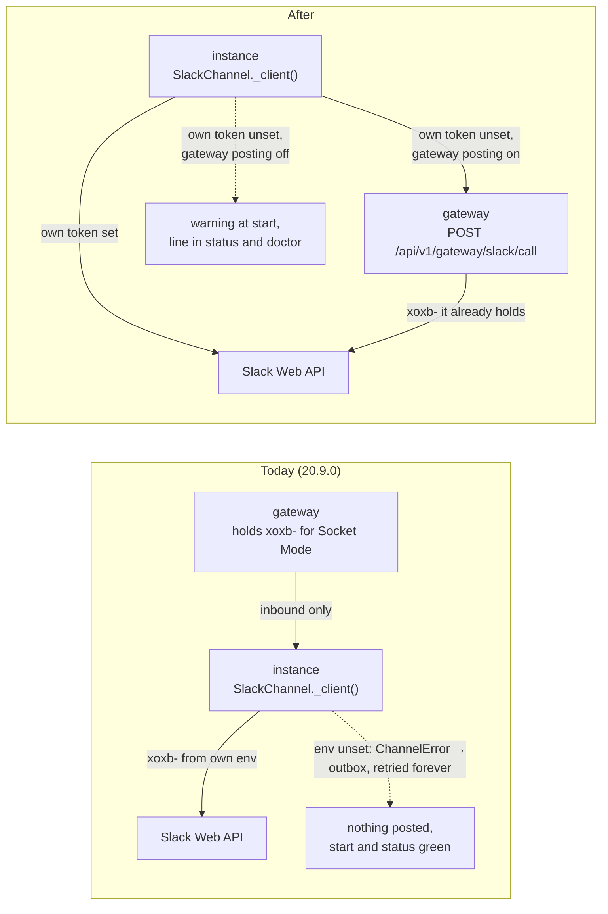

<!-- Written per the `the-loop:writing` skill. -->

# Requirements: outbound Slack through the gateway, and a loud failure when it cannot

## Introduction

An instance behind a gateway ([issue-496](../issue-496/requirements.md)) reads Slack
through the gateway and still needs the Slack app's bot token in its own environment to
write anything back. Nothing says so. `the-loop start` succeeds, `the-loop status` shows
the gateway client `connected`, the work item runs on GitHub, and every Slack-bound
event fails with `slack: no bot token` and sits in the undelivered outbox, retried every
60 s for as long as the daemon lives
([#519](https://github.com/MadaraUchiha-314/the-loop/issues/519)).

The reporter's reading of the code is confirmed. Every outbound call the instance makes
goes through one factory, `SlackChannel._client()`, which builds the Slack client from
`os.environ[channels.slack.botTokenEnv]` and nothing else; the doctor, the name→id
directory, attachment downloads and the `record-context` thread snapshot read the same
variable. The gateway's consumer API has no outbound route at all. Meanwhile the gateway
**already holds the bot token**: its Socket Mode adapter requires `slack.socket.botTokenEnv`
beside the app token. So today the xoxb- token is on the gateway *and* on every instance,
while the guide says the gateway "holds no posting token". The secret is spread further
than either document admits, and the failure is silent exactly where the operator looks.

**What we do about it.** Two things, in the reporter's order of preference and both in
scope. First, the gateway **posts for its instances**: the instance's Slack client sends
each Web API call it would have made to a new consumer route, and the gateway makes the
call with the bot token it already holds. The instance's own token stays the first
choice when it is set, so an existing deployment changes nothing. Second, the instance
**fails loudly** whenever outbound Slack cannot work: at start, in `the-loop status`, in
`channels status` and in `doctor slack`, one sentence that names the missing token and
the gateway knob that would make it unnecessary.

**What it costs.** One more thing an unauthenticated peer can do to an exposed gateway
([decision-146](../../decisions/decision-146.md)): post as the bot into the channels the
gateway knows. The route is bounded to the channels an instance has registered, and an
operator can turn it off, but neither is authentication; the network stays the boundary,
as the decision says. Two schema changes (gateway and CLI config) and a widening of the
OpenAPI contract. Risk tier 4, so the security review waits for a named human.

**What to check.** The abuse cases under *Security considerations* and the decisions listed
below. *Requirement 5* carries the one amendment made after approval: the owner withdrew
the per-instance channel registration at the design review, so a post may land wherever
the bot can.

### Decisions this document takes, for the approver

Each is a judgement call made so the item keeps moving. Objecting to one at the gate
returns the document to `requirements-definition`; approving takes them all.

| # | Decision | Alternative not taken |
|---|----------|-----------------------|
| D1 | Both halves ship: the gateway route **and** the loud failure. The failure stays useful after the route exists, for an operator whose gateway has posting off. | The loud failure alone (reporter's option 2). Cheaper, but leaves the bot token on every instance, which the reporter names as the point of gateway mode. |
| D2 | The gateway proxies a short **allow-list of Slack Web API methods**, not a bespoke "post / edit / react" vocabulary. The instance's client keeps its method names and swaps only its transport. | A typed `POST /post` with event type, blocks and thread. Smaller surface, but every new call site on the instance would need a new gateway route; the first landing already needs eleven methods (R2). |
| D3 | Gateway posting is **on by default** when the Socket Mode ingress is configured, with a `slack.post.enabled: false` kill switch. The gateway holds the token already, binds loopback by default, and an operator who exposed it accepted that peers can claim and commit. | Off by default. Fails closed, but an operator who set up a gateway for Slack still ends up at the loud failure of R1 and has to find the knob. |
| D4 | The instance uses its **own token first** and the gateway only when the variable is empty. | Gateway first whenever a block is present. Would change behaviour for every existing gateway deployment on upgrade. |
| D5 | File downloads (attachments, voice-note transcripts) go through the gateway too, under the same caps. | Documenting attachments as "not available via gateway". Silently degrades another feature, which is the class of bug this ticket is. |

## Requirements

### Requirement 1 — the instance fails loudly when outbound Slack cannot work

**User story:** As an operator who configured a gateway consumer, I want the instance to
tell me at start and in status that it cannot post to Slack, so that I learn it before
a work item runs for nine hours without a thread.

A posting path is **available** when `channels.slack.botTokenEnv` is set in the daemon's
environment, or when a usable `gateway` block is present and the gateway reports
posting enabled (R4.6). It is **unavailable** otherwise.

#### Acceptance criteria (EARS)

1. WHEN `the-loop start` runs with `channels.slack.enabled: true` and no posting path is
   available THEN the system SHALL log one `warning` line that names the unset variable
   and, when a gateway block is present, says that the gateway reports posting off or
   could not be asked, and SHALL still start.
2. WHILE no posting path is available `the-loop status` SHALL print, beside the
   `gateway-client` row, the words `outbound Slack needs <var> on this instance` with
   the variable's name, and `channels status` SHALL print the same finding under
   `slack:`.
3. WHILE no posting path is available `the-loop doctor slack` SHALL report outbound
   Slack as `unverifiable` with that same reason, in place of the bare
   `no bot token — <var> is unset` it prints today.
4. WHEN a posting path is available through the gateway alone THEN `the-loop status`
   and `channels status` SHALL say `posting through the gateway`, so an operator can
   see which path is in use.
5. IF `channels.slack.enabled` is false THEN the system SHALL print and log none of the
   above.
6. The system SHALL NOT refuse to start on an unavailable posting path; the daemon's
   GitHub ledger and its other channels are unaffected and the outbox keeps retrying.
   (A fatal flag was offered by the reporter and is not built: the outbox already keeps
   the events, and a refused start loses the GitHub work too.)

### Requirement 2 — the gateway makes Slack Web API calls for its instances

**User story:** As an operator running a fleet behind one gateway, I want the gateway
to post to Slack on each instance's behalf, so that the Slack app's bot token lives in
one place.

#### Acceptance criteria (EARS)

1. The gateway SHALL expose one consumer route, `POST /api/v1/gateway/slack/call`, that
   takes the calling `instance` name, a Slack Web API `method` and that method's
   `params`, calls the method with the bot token the gateway's Socket Mode ingress
   holds, and returns the Slack response body and status verbatim.
2. The route SHALL accept exactly the methods the instance calls today and refuse any
   other with `422 method-not-allowed`, nothing sent to Slack:

   | Method | Used by |
   |--------|---------|
   | `chat.postMessage` | thread openers, replies, kickoff answers, the doctor's heartbeat |
   | `chat.update` | phase progress edits in place, button-press reports |
   | `chat.postEphemeral` | `help` answers and refusal reasons |
   | `chat.delete` | the doctor's and the split check's heartbeat cleanup |
   | `reactions.add` | received / completed / error acknowledgements |
   | `views.open` | the kickoff repository picker |
   | `conversations.info`, `conversations.list`, `users.list` | the name→id directory and `channels status --probe` |
   | `conversations.replies`, `conversations.history` | `record-context` snapshots and the doctor's read-back |
   | `files.info`, `auth.test` | attachment transcripts; the bot's own identity and granted scopes |

3. WHEN the gateway's Socket Mode ingress is not configured, or its bot token variable
   is unset, THEN the route SHALL answer `503 posting-unavailable` and send nothing.
4. WHEN Slack answers an error (`ok: false`, a rate limit, a transport failure) THEN the
   gateway SHALL return it to the instance unchanged, so the instance's existing
   handling (the outbox, the stale-`ts` fallback in `_edit_or_post`, the best-effort
   reaction) behaves exactly as it does with a local token.
5. The route SHALL be recorded in `the-loop-gateway.v1.yaml` and
   `cli/tests/test_api_contract_parity.py` SHALL hold.
6. The gateway SHALL log each call as `gateway.slack_call` with the instance, the method,
   the channel and the outcome, and never the message text or the token.

### Requirement 3 — the gateway downloads a message's files for its instances

**User story:** As a collaborator who sends a voice note to a work item behind a gateway,
I want its transcript to reach the session as it does without a gateway.

#### Acceptance criteria (EARS)

1. The gateway SHALL expose `POST /api/v1/gateway/slack/download` taking the calling
   `instance` and a Slack `url`, fetch it with the bot token under the rules of
   `channels/attachments.py` (Slack's hosts only, redirects re-checked, 25 MiB cap),
   and stream the bytes back with the content type.
2. WHEN the URL's host is not one of Slack's, or the declared or streamed size exceeds
   the cap, THEN the gateway SHALL refuse with `422` or `413` and fetch nothing further.
3. WHEN the instance has no local token and a posting path through the gateway THEN
   `SlackChannel.fetch_attachments` SHALL download through this route, and the
   rendered result on the ticket and in the pane SHALL be the same as with a local
   token. A gateway that answers `503` yields today's `no-token` entry per file.

### Requirement 4 — the instance posts through the gateway when it has no token

**User story:** As an operator, I want an instance with a `gateway` block and no bot
token to post through the gateway without any new setting on the instance.

#### Acceptance criteria (EARS)

1. WHEN `channels.slack.botTokenEnv` is set in the instance's environment THEN every
   outbound call SHALL use it directly, as today, whether or not a gateway is configured.
2. WHEN that variable is unset and a usable `gateway` block is present THEN
   `SlackChannel._client()` SHALL return a client whose methods (R2.2) send the call to
   `POST /api/v1/gateway/slack/call` with this instance's name and peer, and the
   `SlackDirectory`, the doctor and `fetch_attachments` SHALL obtain their client the
   same way.
3. WHEN that variable is unset and no gateway block is present THEN the behaviour SHALL
   be today's: a `ChannelError` naming the variable, and the event goes to the outbox.
4. WHEN the gateway is unreachable, or answers `503 posting-unavailable` or `409`, THEN
   the call SHALL raise a `ChannelError` that names the gateway's answer, so the outbox
   keeps the event and retries on its schedule; the client SHALL NOT fall back to a
   token of its own.
5. ~~WHEN the gateway refuses a call with `403 channel-not-registered` (R5) THEN the
   instance SHALL log it at `warning` with the channel and the work item and treat it as
   a failed post.~~ *Withdrawn with R5.1 at the design review: no such refusal exists.*
6. The gateway client's document (`GET /api/v1/gateway` on the instance, the dashboard's
   Gateway card) SHALL carry `slackPosting: on | off | unknown`, read from the gateway's
   health answer, which SHALL gain that field.
7. A thread the instance opens through the gateway SHALL be bound for inbound routing
   exactly as a thread opened with a local token is: the instance publishes the
   `<channel>:<thread_ts>` binding as today, in the same act. (The reporter's idea of the
   gateway binding the opener itself is left to design; the requirement is that a reply
   in that thread reaches the work item.)

### Requirement 5 — the existing consumer guards apply to the new routes

> **Amended 2026-10-23 at the design review by @MadaraUchiha-314**
> ([review](https://github.com/MadaraUchiha-314/the-loop/pull/522#pullrequestreview-5623247964)):
> "Why can't we just do a passthrough? Doesn't make any sense to store these messages
> in the gateway." Criteria 5.1 and 5.2 — a per-instance channel registration on the
> gateway and the `403 channel-not-registered` refusal — are **withdrawn**. The gateway
> keeps no state for posting; any instance it accepts may post wherever the bot can.
> Criteria 5.3 and 5.4 stand.

~~1. The gateway SHALL allow a call whose `channel` is one the calling instance registered
(a bound thread, a published room, its home channel, a static room) and refuse every
other with `403 channel-not-registered`.~~ *Withdrawn.*

~~2. Methods that name no channel SHALL be allowed without the check.~~ *Withdrawn with 5.1.*

#### Acceptance criteria (EARS)

- **5.3** The gateway SHALL apply the `instances` allow-list to this route as it does to a
  claim: an unknown name is `409 unknown-instance`, a stale peer under a live name
  `409 duplicate-instance`.
- **5.4** The gateway SHALL apply the body limits every consumer route has (each field
  length-bounded, `params` capped in size) and answer `422` at the door.

### Requirement 6 — the operator can see and switch it

#### Acceptance criteria (EARS)

1. `gateway-config.yaml` SHALL gain `slack.post.enabled` (default `true`), validated by
   the gateway schema; `false` makes the route answer `503 posting-unavailable`.
2. `the-loop gateway status` SHALL print whether posting is on, and `--format json`
   SHALL carry it beside `secretsSet`.
3. The setting SHALL be hot-reloaded on the five-second cadence like the enabled set
   of ingresses.
4. `/the-loop:init-gateway` SHALL ask the question once, in the Slack group, with the
   default pre-selected.

### Requirement 7 — the documents say what is true

#### Acceptance criteria (EARS)

1. `docs/guide/gateway.md` (the gateway file's own documentation), `docs/capabilities/gateway.md`,
   `docs/capabilities/channels.md`, `docs/config/cli/gateway-options.md` and
   `docs/config/cli/channels-options.md` (`botTokenEnv`) SHALL state that the gateway
   holds the bot token and posts for its instances, that an instance's own token takes
   precedence, and what an instance without either sees (R1).
2. [decision-146](../../decisions/decision-146.md)'s "any posting token" line SHALL be
   amended by a new decision record that says what the gateway now does with the token
   it already held, and why the boundary is unchanged.
3. `/the-loop:init-cli` SHALL, in the gateway question for an instance, say that the
   bot token is optional on the instance when the gateway posts.

## Non-functional requirements

- **Latency.** A post through the gateway adds one loopback or LAN round trip. No
  queueing: the route is synchronous, so the instance's `PostResult` carries Slack's
  real `ts` as it does today.
- **Observability.** `gateway.slack_call` on the gateway's JSONL log; the instance's
  existing `channel.post_failed` / `channel.undelivered` keep their shape, with the
  reason text naming the gateway when it was the gateway that refused.
- **Compatibility.** No change for an instance without a gateway block, and none for an
  instance with a block and a local token (D4). The CLI config schema changes only in
  description text; the gateway schema gains one optional boolean.
- **Risk tier 4.** The change touches two schemas, a secret's handling and the gateway's
  network surface. The security review waits for a named human sign-off.

## Security considerations

- **Actors & trust.** The operator who runs the gateway and its instances is trusted.
  An instance is trusted to post into the channels it registered, as it is already
  trusted to claim subjects and publish bindings. Any peer that can reach an exposed
  gateway's socket is **untrusted** and, under decision-146, indistinguishable from an
  instance. Slack users and the files they send are untrusted.
- **Trust boundaries & data.** The boundary is the gateway's consumer API, unchanged.
  What crosses it anew: outbound message text and blocks (the-loop's own rendering of
  events, plus quoted ticket text) and file bytes coming back. The bot token never
  crosses it in either direction; the gateway reads it from its environment and the
  instance never sees it. The gateway logs method, channel and outcome, never text.
- **Abuse cases (EARS).**
  1. WHEN a peer calls the route with a method outside the allow-list (`chat.delete` on
     another instance's message is in the list and is bounded by R5; `admin.*`,
     `users.profile.set`, `conversations.invite` are not) THEN the gateway SHALL refuse
     with `422` and send nothing.
  2. ~~WHEN a peer posts into a channel no registration of its own names THEN the gateway
     SHALL refuse with `403 channel-not-registered`.~~ *Withdrawn with R5.1 by the owner
     at the design review: an accepted instance may post wherever the bot can, and the
     contract and the capability page say so.*
  3. ~~WHEN a peer registers a home another live instance holds THEN the holder's
     stays.~~ *Withdrawn with R5.1: there is no home registration.*
  4. WHEN a peer asks the download route for a non-Slack URL, or a file over the cap,
     THEN the gateway SHALL refuse before fetching and never follow the redirect (R3.2).
  5. WHEN `slack.post.enabled` is false THEN every call SHALL be `503` and the token
     SHALL be used for nothing but the Socket Mode connection, as today.
  6. WHEN the route is exposed on a non-loopback host without `listen.exposed: true`
     THEN the gateway SHALL refuse to start, as today; the capability page and the
     OpenAPI description SHALL add "post as the bot into registered channels" to what an
     exposed gateway permits.
- **Fail closed.** A missing bot token on the gateway is `503`, never a fallback to an
  instance's token. A missing or malformed `instance`, `method` or `channel` is `422`.
  An instance with no token and no posting gateway raises and queues, never drops.
  A registration the gateway cannot verify (a peer under a live name) is refused as a
  claim would be.
- **What this does not do.** It is not authentication. A peer that can reach an exposed
  gateway can register a home channel and post into it as the bot. That is the same
  posture decision-146 accepted for claims and commits, now stated for posting too; the
  bearer-token attachment point named there covers this route as well.

## Out of scope

- Authentication between instance and gateway (decision-146's follow-up). This item
  adds a route under the existing posture and names it on the capability page.
- Moving the GitHub or Jira posting token to the gateway. Only Slack is asked for, and
  only Slack has the one-connection constraint that put the token on the gateway.
- A Slack listener on the instance that falls back when the gateway is down. Decision
  of issue-496: an instance never falls back to its own ingress.
- Proxying inbound reads beyond the two snapshot methods (R2.2). The gateway is the
  reader; the instance reads a thread only for `record-context` and the doctor.
- A fatal start on a missing token (reporter's option 2, "a config flag could make it
  fatal"); see R1.6.

## Open questions

None left open here. The five judgement calls are the *Decisions* table above, put to
the approver at the `requirements-approval` gate, where the one reply either takes
them or returns the document.

## Review comments

> Appended by the-loop's `record-feedback` hook when a human gate approves with
> comments (issue-109). Append-only and attributed.

### 2026-10-22 — approved

**@MadaraUchiha-314** wrote:

approved

### 2026-10-23 — amended after approval, at the design review

**@MadaraUchiha-314** wrote on [PR #522](https://github.com/MadaraUchiha-314/the-loop/pull/522#pullrequestreview-5623247964):

> This design is too complicated. Why can't we just do a passthrough? Doesn't make any
> sense to store these messages in the gateway etc. If gateway is unavailable, then
> message sending fails, that's it.

Folded in as the amendment to Requirement 5 (5.1 and 5.2 withdrawn) and to abuse cases
2–3 above; recorded by the-loop, decided by the owner.
