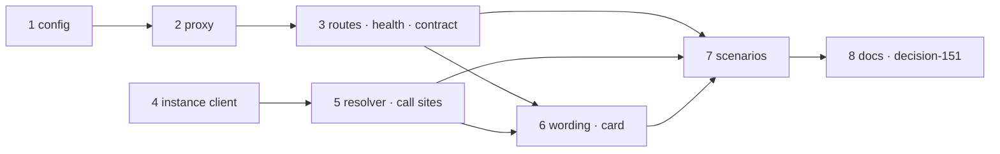

<!-- Written per the `the-loop:writing` skill. -->

# Tasks: outbound Slack through the gateway, and a loud failure when it cannot

Eight tasks, all in this repository. The gateway side comes first (config, then the proxy,
then the routes), because the instance's client is tested against it. The instance side
runs in parallel until the wording task, which needs both. The scenarios and the docs come
last. Every task is red → green: the test is written first and the commit message records
the transition. No task touches the gateway's store.

## Task list

- [x] 1. Gateway config: the `slack.post` block
  - `SlackPost(enabled: bool = True)` on `SlackIngress`; `_slack()` parses `post.enabled`;
    `gateway-config.schema.json` gains `slack.post` (`additionalProperties: false`, one
    boolean, default `true`, a description the onboarding walk asks from); the template
    carries the key with its comment; the `botTokenEnv` description says "and for posting
    on the instances' behalf". `restart_required()` and `secret_names()` unchanged.
  - _Depends on:_ none
  - _Requirements:_ R6.1, R6.3, R6.4, NFR compatibility
  - _Test:_ T1 + T10 — `tests/test_gateway_slack_proxy.py -k config` (a file without
    `slack.post` reads `enabled: true`; `false` parses; the schema validates both; the
    description is present) (red→green)
- [x] 2. Gateway proxy: `gateway/slack_proxy.py`
  - `SLACK_METHODS` (the fourteen names), `ProxyResult`, `SlackProxy(state,
    web_client_factory=build_client)`: `available()` → `(ok, reason)` read at call time;
    `call(method, params)` → `503 posting-unavailable` / `422 method-not-allowed` /
    `api_call(method, json=params)` with the status, body and `Retry-After` returned as
    they are, a `SlackApiError` returned as Slack's status and body, a transport error as
    `502 slack-unreachable`; `download(url)` through `attachments.fetch_url` with
    `SLACK_HOSTS` and `MAX_BYTES`, `FetchError` → `422` / `413` / `502`.
  - `gateway.slack_call` record: instance, method, channel, status, ok — never `text`,
    `blocks` or the token.
  - _Depends on:_ 1
  - _Requirements:_ R2.1–R2.4, R2.6, R3.1, R3.2, R6.1
  - _Test:_ T1 + T8 — `tests/test_gateway_slack_proxy.py -k "proxy or abuse"` (every
    allowed method forwarded with a JSON body; an unknown method refused with no call on
    the fake web client, abuse 1; disabled / no token / no block → `503`, abuse 5; a
    fake `SlackApiError` returned verbatim; off-host and over-cap downloads refused before
    any fetch, abuse 4; the log record carries no message text) (red→green)
- [x] 3. Gateway routes, health, contract and `gateway status`
  - `SlackCallBody` / `SlackDownloadBody` with the bounds (`NAME_MAX`, `method ≤ 64`,
    `params ≤ 256 KiB` serialised, `url ≤ 2048` https); `POST /api/v1/gateway/slack/call`
    and `/slack/download` behind `_check_allowed` and `store.peer_conflict`, then the
    proxy; `GatewayState.health()["slack"]["posting"]`; `gateway status` prints posting
    in text and carries it in `--format json`.
  - `the-loop-gateway.v1.yaml`: both operations (`gatewaySlackCall`,
    `gatewaySlackDownload`), their bodies, every error body; the description names
    "post as the bot" among what an exposed gateway permits.
  - _Depends on:_ 2
  - _Requirements:_ R2.1, R2.5, R4.6, R5.3, R5.4, R6.2, abuse 6 (doc)
  - _Test:_ T1 + T3 + T8 — `tests/test_gateway_slack_proxy.py -k "route or abuse"`
    (unknown instance and stale peer → `409`; oversized `params`, `method`, `url` →
    `422` at the door; health carries `posting`; `gateway status` JSON carries it) and
    `tests/test_api_contract_parity.py` (red→green)
- [x] 4. Instance proxy client: `channels/slack_gateway.py`
  - `GatewaySlackClient(url, instance, peer, transport=None)` with the fourteen SDK
    method names, `from_cli_config()` (gateway block url, instance name, the peer id from
    `<local_dir>/<PEER_FILE>` or `""`), `_call` over `gateway.client.urllib_transport`;
    `200 ok` → `dict`; Slack `ok: false` → `slack_sdk.errors.SlackApiError`; `409` /
    `422` / `502` / `503` / unreachable → `GatewayPostingError(ChannelError)`; `fetch()`
    with `fetch_url`'s signature, ignoring `credential`, raising `FetchError(reason)`.
  - _Depends on:_ none (tested against a fake transport; task 3 is its live counterpart)
  - _Requirements:_ R4.2, R4.4, R3.3
  - _Test:_ T1 — `tests/test_slack_gateway_client.py` (each mapping row; the peer file
    read; no local token read on any failure) (red→green)
- [x] 5. Instance resolver: `posting_path`, `outbound_client`, and the call sites
  - `PostingPath`, `posting_path(config, cli_config, gateway_posting=None)`,
    `outbound_client(config, cli_config, client_factory=None)` in `channels/slack.py`;
    `SlackChannel.__init__(…, cli_config=None)` and `_load_slack` passes the config;
    `_client()` → the resolver; `fetch_attachments` passes `fetch=client.fetch` for a
    `GatewaySlackClient`; `slack_attachments`' guard becomes `not token and fetch is
    None`; `SlackDirectory._client()`, `doctor._probe` and `check_declared_channels` use
    the resolver, the doctor's `unverifiable` reason is the posting path's.
  - _Depends on:_ 4
  - _Requirements:_ R1.3, R3.3, R4.1–R4.4
  - _Test:_ T1 — `tests/test_slack_posting_path.py` (the three paths; a `client_factory`
    wins; today's error text plus the gateway hint; directory, doctor and attachments
    through the resolver; a `GatewaySlackClient` never reads the token variable) (red→green)
- [x] 6. Saying it: start, status, `channels status`, `doctor slack`, the card
  - `core/lifecycle.py`: `start_all` logs the warning and emits
    `channel.posting_unavailable` for path `none` with Slack enabled, nothing otherwise;
    `gateway_line(doc)` suffixes from `slackPosting` and the local token;
    `GatewayClient.document()["slackPosting"]` from `last_health`.
  - `channels_cmd.py`: the `posting:` line; `diagnose_cmd.py`: the gateway posting line
    in `_gateway_lines`; `ui/src/api/types.ts` + `ui/src/views/InstanceDetail.tsx`: the
    `slackPosting` state word on the Gateway card.
  - _Depends on:_ 3, 5
  - _Requirements:_ R1.1, R1.2, R1.4, R1.5, R1.6, R4.6
  - _Test:_ T1 — `tests/test_slack_posting_path.py -k "start or status or doctor"` and
    `cd ui && bun run test -- InstanceDetail` (the card renders the word) (red→green)
- [x] 7. Integration scenarios
  - `tests/test_gateway_slack_proxy_integration.py`: the six Gherkin scenarios of the
    testing plan through `GatewayHarness`, a real `SlackBotChannel` on the bus and a
    fake Slack web client on the gateway; each docstring carries `Requirement:` links.
    Run also with `--dispatch-lag=0.5`.
  - _Depends on:_ 3, 5, 6
  - _Requirements:_ R1, R2, R3, R4.1, R4.2, R4.4, R4.7
  - _Test:_ T2 + T8 — `tests/test_gateway_slack_proxy_integration.py` (red on the branch
    before tasks 3–6, green after) (red→green)
- [x] 8. Docs, decision and the documentation record
  - `docs/capabilities/gateway.md` (behaviour, "what it does not do", history row),
    `docs/capabilities/channels.md` (the outbound path, the doctor line),
    `docs/guide/gateway.md` (step 1), `docs/config/cli/gateway-options.md`,
    `docs/config/cli/channels-options.md` (`botTokenEnv` optional behind a posting
    gateway), `docs/cli/commands/gateway.md` (`status` output), `commands/init-cli.md`,
    `commands/init-gateway.md`, `skills/the-loop/reference/onboarding.md`.
  - `docs/decisions/decision-151.md` (the gateway posts with the token it already held;
    amends decision-146's "any posting token" line) and its row in `decisions.md`.
  - `evidence/documentation.md` with `## Capability docs` and `## Documentation`.
  - _Depends on:_ 7
  - _Requirements:_ R7.1–R7.3
  - _Test:_ T12 — `uv run pre-commit run --all-files` (markdownlint over every touched
    page; the config validation hook over the template and schema)

## Dependency graph (DAG)

Two chains run independently until task 6: `1 → 2 → 3` on the gateway and `4 → 5` on the
instance. Task 6 joins them, task 7 proves the whole, task 8 writes it down.

## Checkpoints

- After tasks 3 and 5: `cd cli && uv run python -m pytest -q tests/test_gateway_slack_proxy.py tests/test_slack_gateway_client.py tests/test_slack_posting_path.py tests/test_api_contract_parity.py`.
- After task 7: the T2 command at lag 0 and at `--dispatch-lag=0.5`.
- After task 8: `uv run pre-commit run --all-files`, then the `verification` node runs
  `testing-plan.md` (T1–T3, T8, T10, T11 on real processes with no token anywhere, T12)
  and records each activity; only then do the self, critic and security reviews run.

Each task's commit records its test command and the red→green transition in its message;
no progress log is written (issue-365).

## Review comments

> Appended by the-loop's `record-feedback` hook when a human gate approves with
> comments (issue-109). Append-only and attributed.
