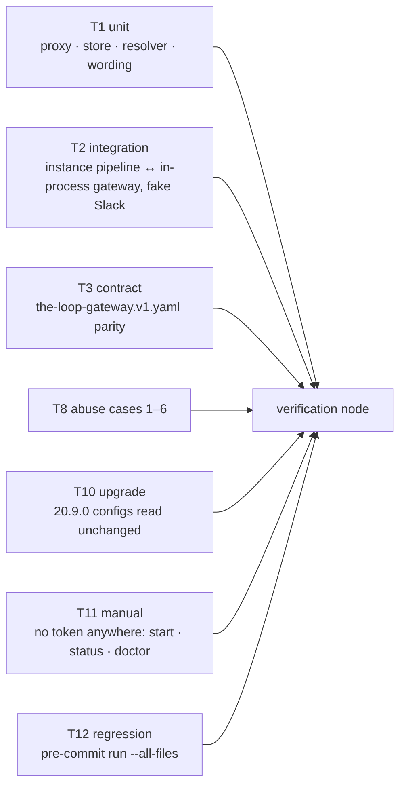

<!-- Written per the `the-loop:writing` skill. -->

# Testing plan: outbound Slack through the gateway, and a loud failure when it cannot

Everything but one row is proved in this repository with no credential: the gateway runs
in-process (`GatewayHarness`), Slack is a fake web client, and the instance's proxy talks
to it over FastAPI's test transport. The one thing automation cannot reach, a real Slack
workspace, is **not** in this plan (T4, `n/a` with its reason): the reporter's live
scenario is offered to the author as a post-merge check on `the-loop-testing`, exactly as
issue-505 handled it. What this plan does reach live, with no credential at all, is the
loud-failure half (T11): a gateway and an instance started on this machine with no Slack
token anywhere, and the start warning, the status line and the doctor line read off the
real commands.

## Test matrix

| # | Type | Applies? | Scope / what it proves | Where it runs |
|---|------|----------|------------------------|---------------|
| T1 | Unit | yes | gateway: `SlackProxy.available / call / download` (allow-list, one JSON encoding, `503`/`422`/`502`, the `gateway.slack_call` record without text), `health.slack.posting`, hot reload of `slack.post.enabled`, `gateway status --format json`; instance: `GatewaySlackClient` (answer → `dict` / `SlackApiError` / `GatewayPostingError`, `fetch` → `FetchError`, peer file read), `posting_path` and `outbound_client` across the three paths, `_client()` / `SlackDirectory` / doctor through the resolver, `slack_attachments` with a custom `fetch`, `document().slackPosting`, `start_all`'s warning and event, `gateway_line`, `channels status` and `doctor slack` wording | `cd cli && uv run python -m pytest -q tests/test_gateway_slack_proxy.py tests/test_slack_gateway_client.py tests/test_slack_posting_path.py` |
| T2 | Integration (scenario) | yes | the instance's Slack pipeline (`SlackBotChannel` through the bus, `ChannelState.bind`, `publish_binding`, `fetch_attachments`) against a real gateway app with a fake Slack web client: the thread opens through the gateway and is bound; a reply routes back; a transcript downloads; a local token bypasses the gateway; neither path warns and the post fails; a gateway that stops posting fails the post with no fallback. Gherkin-documented with `Requirement:` links | `cd cli && uv run python -m pytest -q tests/test_gateway_slack_proxy_integration.py`, then the same with `--dispatch-lag=0.5` (issue-251) |
| T3 | Contract (OpenAPI) | yes | `POST /api/v1/gateway/slack/call` and `/slack/download` are in `the-loop-gateway.v1.yaml` with `gatewaySlackCall` / `gatewaySlackDownload`, and the served surface matches | `cd cli && uv run python -m pytest -q tests/test_api_contract_parity.py` |
| T4 | End-to-end | n/a — needs a real Slack app and workspace; T2 drives the same routes, the same `SlackChannel` code and the same binding publication with a fake web client, and T11 drives the real processes for the no-token path. The reporter's live scenario (one gateway with the app's tokens, one instance with none, a work item started by comment, its thread appearing) is the author's optional post-merge check on `the-loop-testing`, as for issue-505 | | |
| T5 | UI / visual | n/a — no new screen; the Gateway card gains one state word, asserted in T1 on the document the card renders | | |
| T6 | Snapshot | n/a — JSON answers are asserted field by field | | |
| T7 | Performance / load | n/a — one extra loopback round trip per Slack call, a few calls a minute; the gateway builds a web client per call, which the SDK makes cheap, and no new table is read on the hot inbound path | | |
| T8 | Security / abuse case | yes | the abuse cases of `requirements.md` § Security considerations that remain after the owner withdrew 2–3 at the design review, each the negative test `design.md` § Security design names: method outside the allow-list → `422`, nothing sent; off-host URL and over-cap file refused before fetch; posting disabled → `503` and the socket adapter alone holds the token; non-loopback bind without `exposed` refused at start. Plus the fail-closed set: no token on the gateway → `503`; the proxy never falls back to a local token; a stale peer → `409`; a body over bounds → `422` at the door; the `gateway.slack_call` record carries no `text`, `blocks` or token | `cd cli && uv run python -m pytest -q tests/test_gateway_slack_proxy.py tests/test_gateway_slack_proxy_integration.py -k abuse` |
| T9 | Accessibility | n/a — no UI | | |
| T10 | Migration / upgrade | yes | no store change, so no schema migration; a `gateway-config.yaml` without `slack.post` validates and reads `enabled: true`; an instance config unchanged from 20.9.0 behaves as before (local token first, no gateway call) | `cd cli && uv run python -m pytest -q tests/test_gateway_slack_proxy.py -k migration` |
| T11 | Manual exploratory | yes | the loud failure on real processes with **no credential anywhere**: a gateway started from a config whose Slack token variables are unset, and an instance pointed at it with `channels.slack.enabled: true` and no bot token; `the-loop start` prints the warning, `the-loop status` prints `outbound Slack needs THE_LOOP_SLACK_BOT_TOKEN on this instance` beside the gateway-client row, `channels status` prints the `posting:` line, `doctor slack` reports `unverifiable` with the posting reason, `gateway status` reports posting `no-token`; then `slack.post.enabled: false` is written and `gateway status` follows within the reload cadence | procedure in § Verification environment, evidenced under `evidence/manual.md` |
| T12 | Regression (whole suite) | yes | behaviour preserved for an instance with a local token and for one without a gateway block; the full suite, lint, format, types, markdown and the config validation | `uv run pre-commit run --all-files` |

## Scenarios & requirement trace

| Row | Requirement(s) | Scenario / case |
|-----|----------------|-----------------|
| T1 | R1.1, R1.6 | `start_all` with Slack enabled and no posting path logs one warning naming the variable and the gateway's reason, emits `channel.posting_unavailable`, and `ok` is unchanged; with Slack disabled, nothing |
| T1 | R1.2, R1.4 | `gateway_line` suffixes: `outbound Slack needs <var> on this instance`; `posting through the gateway`; `channels status` prints `posting: local token (<var>)` / `through the gateway (<url>)` / `[!] unavailable — <reason>` |
| T1 | R1.3 | `doctor._probe` with no token and a gateway reporting `off` is `unverifiable` with the posting reason; `_gateway_lines` prints the posting line |
| T1 | R1.5 | `channels.slack.enabled: false` prints and logs none of the above |
| T1 | R2.1, R2.2 | every method in `SLACK_METHODS` is forwarded as `api_call(method, json=params)` and the response status and body come back verbatim; an unknown method is `422 method-not-allowed` and the fake web client saw no call |
| T1 | R2.3 | no `slack` block, or the token variable unset → `503 posting-unavailable` with `socket-unconfigured` / `no-token`; `health.slack.posting` says the same |
| T1 | R2.4 | `ok: false` from Slack (a `SlackApiError` from the fake) returns Slack's status and body; a `SlackClientError` is `502 slack-unreachable` |
| T1 | R2.6 | `gateway.slack_call` carries instance, method, channel, status, ok — and no `text`, `blocks` or token value |
| T1 | R3.1, R3.2 | `download` fetches through `fetch_url` with `SLACK_HOSTS` and `MAX_BYTES`; an off-host URL is `422`, an over-cap body `413`, a transfer error `502`; the content type is returned |
| T1 | R3.3 | `fetch_attachments` on a `GatewaySlackClient` calls `slack_attachments(…, token="", fetch=client.fetch)`; the attachment renders with the same fields; a `503` yields `no-token` per file |
| T1 | R4.1 | with the variable set, `outbound_client` returns the factory's client and the gateway transport is never called |
| T1 | R4.2 | with the variable unset and a block, `_client()`, `SlackDirectory._client()`, `_probe` and `check_declared_channels` all get a `GatewaySlackClient` |
| T1 | R4.3 | with neither, `ChannelError` with today's sentence plus the gateway hint |
| T1 | R4.4 | unreachable / `503` / `409` → `GatewayPostingError` (a `ChannelError`); the post fails; no local token is read |
| T1 | R4.6 | `document().slackPosting` from `last_health`; `health()` carries `slack.posting` |
| T1 | R5.3, R5.4 (R5.1–R5.2 withdrawn by the owner) | unknown instance → `409`; stale peer → `409`; oversized `params`, `method` or `url` → `422` |
| T1 | R6.1–R6.3 | `slack.post.enabled` parses, validates, defaults `true`; `false` → `503`; a reload flips it without restart; `gateway status` text and JSON carry it |
| T1 | R6.4 | the gateway schema's `slack.post.enabled` carries a description the onboarding walk asks from (asserted on the schema file) |
| T2 | R2, R4.2, R4.7 | `Scenario: an instance with no bot token opens a work item's thread through the gateway and binds it` |
| T2 | R4.7 | `Scenario: a reply in a thread opened through the gateway reaches the work item` |
| T2 | R3 | `Scenario: a voice note's transcript reaches the session through the gateway's download route` |
| T2 | R4.1 | `Scenario: an instance with a local token never calls the gateway` |
| T2 | R1, R4.3, R4.4 | `Scenario: an instance with neither path warns at start and the post fails` |
| T2 | R4.4 | `Scenario: a gateway that stops posting fails the post and never falls back to a local token` |
| T3 | R2.5 | parity of path, method and operationId for the two routes |
| T8 | abuse 1, 4, 5, 6, fail closed | the cases listed in the matrix row, run under `-k abuse` |
| T10 | NFR compatibility | a config without `slack.post` reads `true`; an instance config from 20.9.0 posts with its local token as before and never calls the gateway |
| T11 | R1.1–R1.4, R6.2, R6.3 | the manual procedure below, each command's output captured |
| T12 | NFR compatibility | the whole suite and every hook pass |

## Verification environment

- **Repositories:** this repository only.
- **Services / containers:** none for T1–T3, T8, T10, T12: the gateway runs in-process
  through FastAPI's `TestClient` (`GatewayHarness`), Slack is `FakeSlackClient` /
  a fake web client factory handed to `GatewayState`, and the instance's proxy uses an
  in-process transport. For T11 two real processes on this machine, loopback only.
- **Fixtures & data:** `tmp_path` stores and portable directories; Slack payloads built
  in the test.
- **Credentials:** **none.** T11 is designed to run with every Slack variable unset:
  `THE_LOOP_SLACK_APP_TOKEN` and `THE_LOOP_SLACK_BOT_TOKEN` are named in the configs and
  deliberately absent from the environment. No value is written anywhere.
- **Bring-up:** `uv sync --locked` · **Tear-down:** none for the suites; T11 ends with
  `the-loop stop --config <tmp>/cli-config.yaml` and `the-loop gateway stop --config
  <tmp>/gateway-config.yaml`.
- **T11 procedure** (every path under a temporary directory, every token variable unset):
  1. Write `<tmp>/gateway-config.yaml` from the template: `state.root: <tmp>/gw`,
     `listen: 127.0.0.1:8799`, `repositories: [MadaraUchiha-314/the-loop-testing]`,
     Slack socket enabled with the default variable names. `the-loop gateway start
     --config <tmp>/gateway-config.yaml`; `the-loop gateway status --config … --format
     json` → `slackSocket: off`, `secretsSet` all false, posting `no-token`.
  2. Write `<tmp>/cli-config.yaml`: `state.root: <tmp>/inst`, `service.port` free,
     `channels.slack.enabled: true`, `channel: C0000000000`, `read.mode: gateway`,
     `gateway.url: http://127.0.0.1:8799`, `instance.name: t11`, every ingress disabled.
     `the-loop start --config <tmp>/cli-config.yaml` → the warning line; `the-loop
     status --config …` → the `gateway-client` row with the suffix; `the-loop channels
     status --config …` → the `posting:` line; `the-loop doctor slack --config …` →
     `unverifiable` with the posting reason and the gateway posting line.
  3. Edit the gateway file to `slack.post.enabled: false`; within 10 s `gateway status`
     reports posting `disabled` with no restart required; the instance's `status` suffix
     is unchanged in meaning (the reason text names `disabled`).
  4. Stop both. Capture every command and its output, redacting the temporary paths.
- **If bring-up fails:** record it under Verification results, leave the dependent
  activities unticked, and escalate — do not pass the gate on an environment that never
  came up.

## Evidence plan

| Row | Evidence | Path under `evidence/` |
|-----|----------|------------------------|
| T1, T8, T10 | pytest summary, red → green note per task | `unit.md` |
| T2 | `the-loop scenarios --glob 'cli/tests/test_*_integration.py' --format markdown` filtered to this item, plus the run output at lag 0 and 0.5 | `integration.md` |
| T3 | parity test output and the two operation ids | `contract.md` |
| T11 | each command and its output, paths redacted | `manual.md` |
| T12 | pre-commit summary | `lint-and-typecheck.md` |

## Verification activities

- [ ] T1 — `cd cli && uv run python -m pytest -q tests/test_gateway_slack_proxy.py tests/test_slack_gateway_client.py tests/test_slack_posting_path.py`
- [ ] T2 — `cd cli && uv run python -m pytest -q tests/test_gateway_slack_proxy_integration.py` and `… --dispatch-lag=0.5`
- [ ] T3 — `cd cli && uv run python -m pytest -q tests/test_api_contract_parity.py`
- [ ] T8 — `cd cli && uv run python -m pytest -q tests/test_gateway_slack_proxy.py tests/test_gateway_slack_proxy_integration.py -k abuse`
- [ ] T10 — `cd cli && uv run python -m pytest -q tests/test_gateway_slack_proxy.py -k migration`
- [ ] T11 — the manual procedure in § Verification environment
- [ ] T12 — `uv run pre-commit run --all-files`

## Verification results

_Not yet executed._

| Activity | Command / procedure | Outcome | Evidence |
|----------|--------------------|---------|----------|
| | | | |

## Review comments

> Appended by the-loop's `record-feedback` hook when a human gate approves with
> comments (issue-109). Append-only and attributed.

### 2026-10-22 — approved

**@MadaraUchiha-314** wrote:

approved
